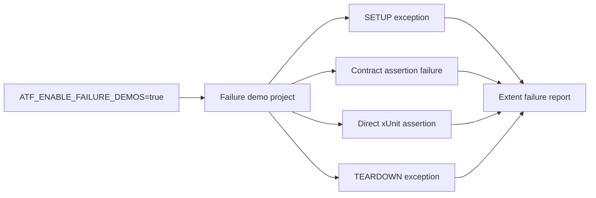

# Atf.Api.FailureDemos

This is the deliberate red-team suite for the reporting contract. It is isolated
from `Atf.Api` so a normal API run cannot become red because of an intentional
failure demonstration.



The project is expected to finish with four failed tests. That non-zero exit code
is intentional and proves that setup, contract, body and teardown failures remain
visible in both xUnit and Extent.

```powershell
$env:ATF_ENABLE_FAILURE_DEMOS = "true"
dotnet test .\Atf.Api.FailureDemos\Atf.Api.FailureDemos.csproj --no-restore
$env:ATF_ENABLE_FAILURE_DEMOS = $null
```

The normal quality gate is `Atf.Api`; it does not reference this project as a test
fixture and therefore remains green when the diagnostic suite is not requested.
