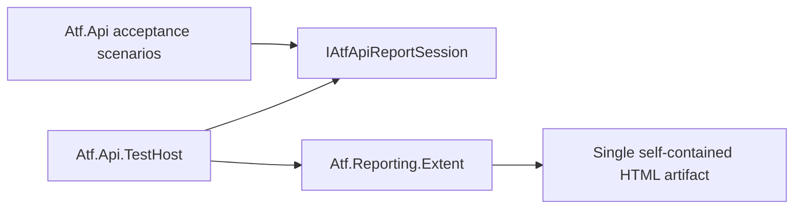

# Atf.Api.TestHost

`Atf.Api.TestHost` este adaptorul de compoziție pentru acceptanța live. Deține
boundary-ul fixture-ului xUnit și implementarea Extent curentă, în timp ce
`Atf.Api` consumă doar `IAtfApiReportSession` și `IAtfScenarioScope`.

Rămâne un proiect separat în arhitectura țintă simplificată. Eliminarea lui ar
obliga `Atf.Api` să construiască sau să refere direct renderer-ul Extent concret
și ar distruge boundary-ul de compoziție. Proiectul poate fi redenumit ulterior
în `Atf.TestHost`, dar aceasta este doar o schimbare de nume și nu trebuie
combinată cu modificări de lifecycle sau raportare.

Prin urmare, acesta este unul dintre cele cinci directoare arhitecturale de cod
păstrate la rădăcina repository-ului: `Atf.Core`, `Atf.Api`, `Atf.Api.TestHost`,
`Atf.Reporting.Extent` și `Atf.Tests`. `docs` și `artifacts` sunt directoare de
suport; codul modulelor și toate proiectele de test ATF sunt grupate acum în
`Atf.Api/Module` și `Atf.Tests`, respectiv.

Direcția dependențelor este intenționată:

Acest proiect este singurul layer de compoziție al host-ului live care selectează
Extent. Un renderer viitor poate înlocui `ApiTestFixture` fără să schimbe
scenariile API, pașii, transportul sau validarea contractelor.

## Boundary-ul de compoziție — 2026-10-13

Host-ul este bine poziționat, dar trebuie să rămână strict un composition root:

- creează snapshot-ul de configurație și sesiunea de raportare;
- selectează adaptorul Extent;
- furnizează scope-ul de scenariu către `Atf.Api`;
- finalizează raportul o singură dată și publică artefactul;
- nu decide validitatea business și nu implementează reguli HTTP.

Failure-ul unei operații de reporting este diagnostic secundar. Host-ul nu are voie
să înlocuiască rezultatul funcțional al scenariului și nu trebuie să împiedice
cleanup-ul. Orice schimbare aici trebuie verificată atât cu un fake renderer, cât
și cu un artifact real.

### Teste de boundary necesare

| Test | Criteriu |
|---|---|
| `HostDoesNotLeakExtentIntoApiScenario` | scenariul depinde numai de porturi Core |
| `FinalizationIsIdempotent` | flush/finalize repetat produce un singur artifact valid |
| `RendererFailureDoesNotReplaceScenarioOutcome` | cauza funcțională rămâne autoritară |
| `ParallelFixturesUseIndependentSessions` | două rulări nu amestecă testele sau fișierele |
| `FailureDemoIsOptIn` | suite-ul normal nu primește exit code intenționat de failure |
