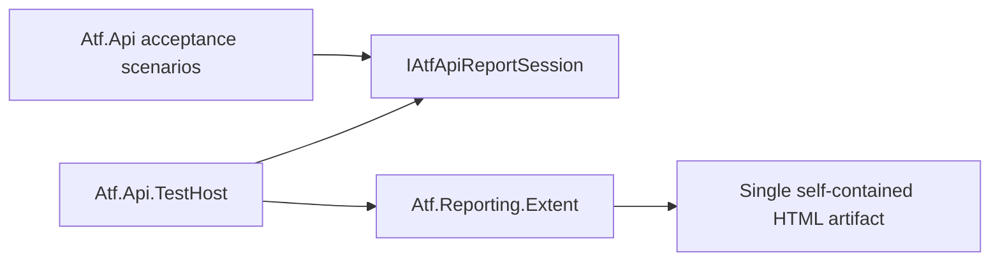

# Atf.Api.TestHost

`Atf.Api.TestHost` is the live acceptance composition adapter. It owns the
xUnit fixture boundary and the current Extent implementation, while
`Atf.Api` consumes only `IAtfApiReportSession` and `IAtfScenarioScope`.

It remains a separate project in the simplified target. Removing it would make
`Atf.Api` construct or reference the concrete Extent renderer directly and
would destroy the composition boundary. The project may later be renamed to
`Atf.TestHost`, but that is naming-only and must not be mixed with lifecycle or
reporting changes.

This is therefore one of the five architectural code directories retained at
repository root: `Atf.Core`, `Atf.Api`, `Atf.Api.TestHost`,
`Atf.Reporting.Extent` and `Atf.Tests`. `docs` and `artifacts` are support
directories; module code and all ATF test projects are now grouped under
`Atf.Api/Module` and `Atf.Tests` respectively.

The dependency direction is intentional:

This project is the only live-host composition layer that selects Extent. A
future renderer can replace `ApiTestFixture` without changing API scenarios,
steps, transport, or contract validation.

## Audit boundary — 2026-10-13

Host-ul este bine poziționat, dar trebuie să rămână strict un composition root:

- creează snapshot-ul de configurație și sesiunea de raportare;
- selectează adaptorul Extent;
- furnizează scope-ul de scenariu către `Atf.Api`;
- finalizează raportul o singură dată și publică artefactul;
- nu decide validitatea business și nu implementează reguli HTTP.

Failure-ul unei operații de reporting este diagnostic secundar. Host-ul nu are voie
să înlocuiască rezultatul funcțional al scenariului și nu trebuie să împiedice
cleanup-ul. Orice schimbare aici trebuie verificată atât cu un fake renderer, cât
și cu un artifact real.

### Teste de boundary necesare

| Test | Criteriu |
|---|---|
| `HostDoesNotLeakExtentIntoApiScenario` | scenariul depinde numai de porturi Core |
| `FinalizationIsIdempotent` | flush/finalize repetat produce un singur artifact valid |
| `RendererFailureDoesNotReplaceScenarioOutcome` | cauza funcțională rămâne autoritară |
| `ParallelFixturesUseIndependentSessions` | două rulări nu amestecă testele sau fișierele |
| `FailureDemoIsOptIn` | suite-ul normal nu primește exit code intenționat de failure |
