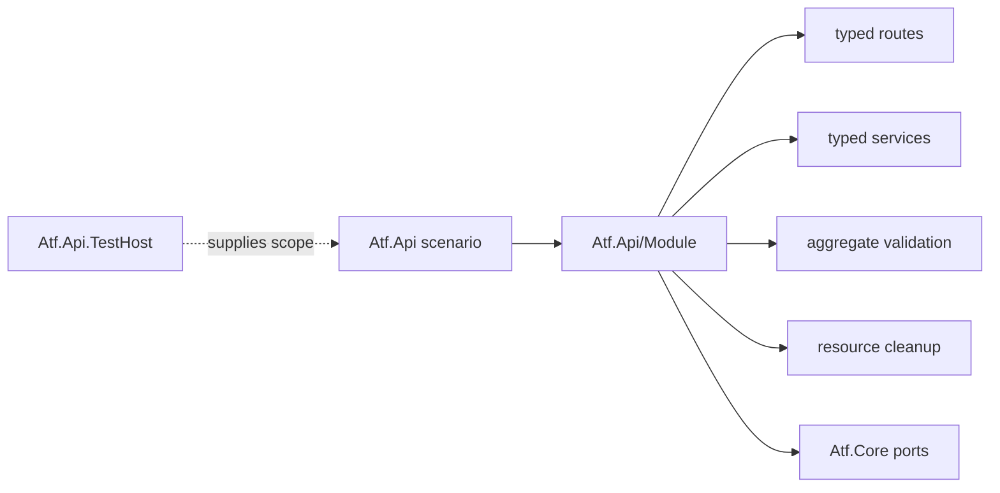

# Atf.Api/Module — vocabularul modulului API

Acest director este fostul `Atf.Common`, absorbit în modulul API pentru a
elimina un proiect cu un singur consumator. Nu este un „Common” generic și nu
conține Extent, xUnit lifecycle sau logică de produs.

## Ownership



| Zonă | Responsabilitate | Nu face |
|---|---|---|
| `Data` | fixtures și serializare deterministică | nu ascunde request-uri |
| `Models` | payload-uri typed | nu citește environment |
| `Routing` | method/path/auth/resource metadata | nu execută HTTP |
| `Services` | request serialization și operații API typed | nu produce markup |
| `Validation` | contract fluent, evaluare și tabel agregat | nu decide CSS/HTML |
| `Lifecycle` | ownership și cleanup reverse-order | nu înlocuiește failure-ul primar |
| `Modules` | composition root local pentru rute/services/executor | nu este scenariu |

## Contractul de validation

```text
ApiResponse
  -> ResponseContract
  -> ValidationEvaluator
  -> one ValidationTable
  -> ValidationReportPublisher
```

`ResponseContract` este singura suprafață fluentă publică. Verificările pentru
un response se agregă într-un singur tabel și într-o singură validare de raport.
Publisher-ul este best-effort; o problemă de diagnostic nu schimbă verdictul
funcțional.

Pentru observații non-blocking se folosește `SoftContract`. Rândul eșuat rămâne
vizibil, validarea devine `Warning`, iar cleanup-ul și teardown-ul continuă.

## Reguli OOP

- o clasă are un motiv dominant de schimbare;
- `ApiModule` construiește graful, nu execută scenarii;
- serviciile cunosc route metadata și payload-ul, nu Extent;
- validarea nu primește o fațadă de reporter mai largă decât are nevoie;
- nu se introduc `Shared`, `Utils`, `Steps` forwarding-only sau un al doilea DSL;
- orice clasă nouă are test de contract propriu;
- namespace-urile `Atf.Common.*` rămân compatibile în această migrare; redenumirea
  namespace-urilor este o schimbare separată și nu se combină cu mutarea fizică.

## Testare

Testele modulelor sunt în `Atf.Tests/Atf.Common.Tests`. Ele protejează acest
director prin component tests fără endpoint extern. `Atf.Tests/Atf.Api.Tests`
protejează boundary-ul dintre scenariu, module și reporting.

```powershell
dotnet test .\Atf.Tests\Atf.Common.Tests\Atf.Common.Tests.csproj --no-restore
dotnet test .\Atf.Tests\Atf.Api.Tests\Atf.Api.Tests.csproj --no-restore
```

Un test live din `Atf.Api` este justificat numai când adaugă business coverage;
nu este înlocuit cu test pentru framework.
