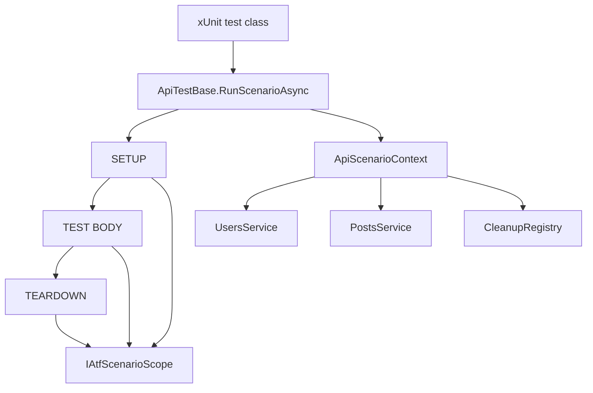
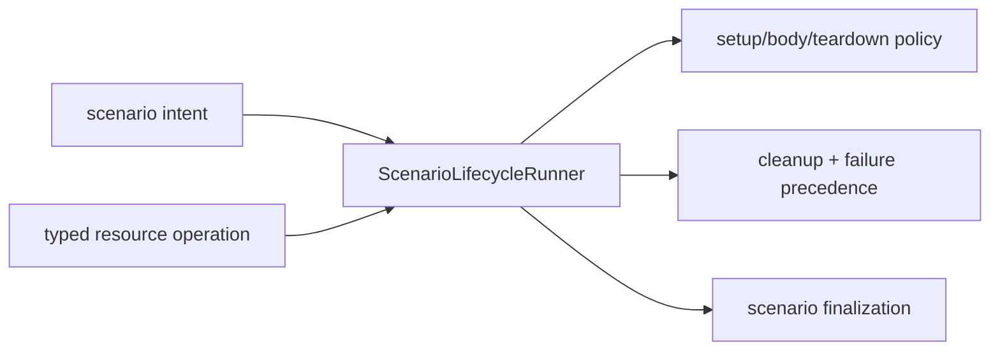
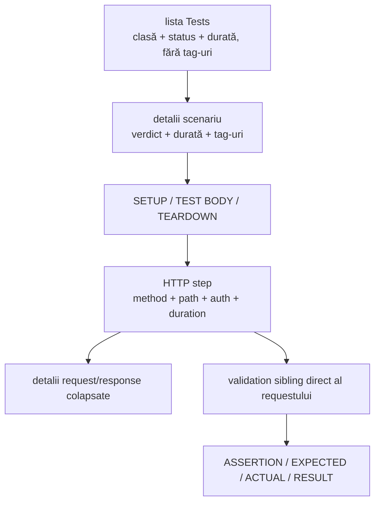
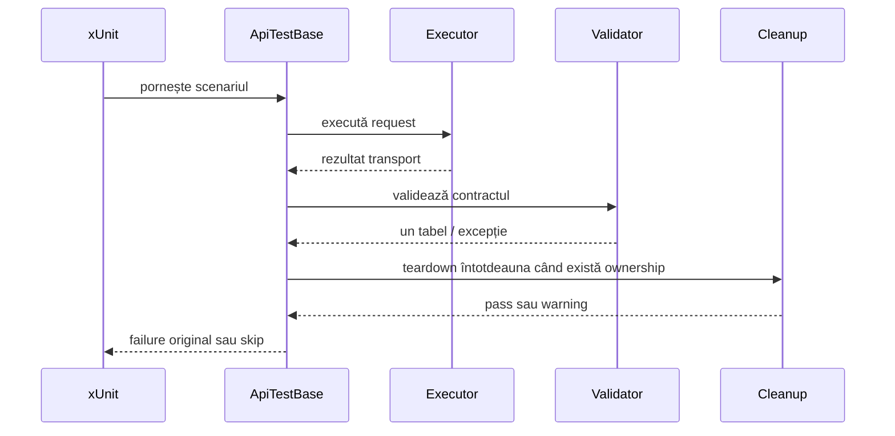

# Atf.Api — boundary-ul scenariilor live

Pentru traseul complet de adăugare a unei operații și verificare a raportului,
urmează [ghidul specializat pentru adăugarea unui test API](../docs/ATF_API_TEST_GUIDE.md).

`Atf.Api` este boundary-ul de acceptanță live, nu kernelul reutilizabil al
framework-ului. Este singurul proiect care trebuie să apeleze serviciul extern
configurat. Deține integrarea xUnit, intenția scenariilor, acoperirea business și modulul API din
`Atf.Api/Module`. Fostul proiect `Atf.Common` nu mai există ca boundary separat
la rădăcină.

Numele este păstrat intenționat pentru compatibilitate cu path-urile curente din
rapoarte și teste. Conceptual, conține atât modulul API, cât și scenariile sale
de acceptanță. O redenumire sau un merge de namespace trebuie tratate ca migrare
mecanică, nu combinate cu un refactor de comportament.

## Ownership și țintă

```text
STRUCTURA                       ȚINTĂ
Atf.Api/Module/Routing          Atf.Api/Module/Routing
Atf.Api/Module/Services         Atf.Api/Module/Services
Atf.Api/Module/Validation       Atf.Api/Module/Validation
Atf.Api/Tests                   Atf.Api/Tests
Atf.Tests/Atf.Api.Tests         Atf.Tests/Atf.Api.Tests
```

`Atf.Core` nu este absorbit niciodată în `Atf.Api`. Kernelul rămâne neutru față
de produs; numai vocabularul modulului API se poate apropia de scenarii.

## Boundary-uri de infrastructură

`Atf.Api.Infrastructure` păstrează doar contextul scenariului, adaptorul xUnit
și collection wiring-ul. Responsabilitățile care au reguli proprii sunt
namespace-uri explicite:

```text
Atf.Api.Infrastructure
├── ApiScenarioContext / ApiTestBase / ApiReportTestGroup
├── Lifecycle
│   ├── ApiScenarioLifecycleRunner
│   ├── ApiScenarioPhaseRunner
│   └── ApiScenarioTeardownRunner
└── Outcome
    ├── ApiScenarioOutcome
    ├── ApiScenarioExecutionResult
    ├── ApiScenarioOutcomeResolver
    └── ApiScenarioSkipException
```

Acest split este un boundary de ownership, nu o mutare cosmetică: runner-ele
cunosc doar compoziția fazelor, outcome-ul este modelul semantic
`Passed | Warning | Failed | Skipped`, iar `ApiTestBase` este singurul adaptor care traduce
rezultatul în xUnit și Extent. `InfrastructurePackageBoundaryTests` protejează
limita de maximum opt tipuri top-level directe per namespace.

## Lifecycle-ul scenariului



`ApiTestBase` pornește un scenariu sub clasa xUnit reală, creează un singur
modul/context, execută fazele opționale, rulează cleanup-ul, păstrează failure-ul
primar și îl aruncă din nou astfel încât xUnit să rămână autoritar.

Boundary de responsabilitate:

```text
Atf.Api.TestHost       fixture xUnit + bridge curent de compoziție Extent
Atf.Api                xUnit + intenția scenariului live + modul API
Atf.Core               porturi de execuție și raportare
Atf.Reporting.Extent   adaptor HTML concret
Atf.Tests              teste offline de contract pentru API, Core, modul și raportare
```

**Boundary-ul efectiv al soluției:** `Atf.Api` are în prezent o referință de
proiect către `Atf.Api.TestHost` pentru fixture-ul xUnit și collection wiring.
Scenariile consumă contractul `IAtfApiReportSession`, dar assembly boundary-ul nu
este încă complet renderer-neutral. Aceasta este o datorie de compoziție
documentată, nu trebuie ascunsă prin formularea „Atf.Api nu depinde de host”.
Orice separare viitoare trebuie să mute fixture wiring-ul într-un acceptance
host fără să mute intenția scenariilor, serviciile sau validarea.

## Responsabilități — boundary live

`Atf.Api` este intenționat subțire, dar `ApiTestBase` rămâne boundary-ul cu cel
mai mare risc din host. Traduce dependențele xUnit, consumă
`IAtfApiReportSession`, creează `ApiScenarioContext`, invocă politica de lifecycle,
mapează rezultatul în scope-ul neutru al scenariului și retrimite excepția
autoritară. Extent este selectat numai de `Atf.Api.TestHost`.

| Responsabilitate | Owner | Owner țintă |
|---|---|---|
| traducerea constructorului/output/skip xUnit | `ApiTestBase` | rămâne aici; acesta este adaptorul host-ului |
| creare modul/context | `ApiModuleFactory.FromSettings` | factory explicit pentru setări/porturi |
| precedența setup/body/teardown | `ApiScenarioLifecycleRunner` | runner injectabil cu model explicit de outcome |
| finalizarea Extent și maparea statusului | `ApiTestBase` | port de finalizare a scenariului furnizat de fixture |
| intenția de business | clasele concrete de scenariu | rămâne în `Atf.Api`; nu o muta în runner |

Regula chirurgicală este: nu muta decizii business în infrastructură și nu lăsa
excepțiile xUnit să definească modelul reutilizabil de lifecycle. Rezultatul
explicit `Passed | Warning | Failed | Skipped` este deja modelat în `Outcome`, iar
`ApiTestBase` rămâne singurul loc care îl traduce în comportament xUnit.

## Separarea responsabilităților

`Atf.Api` trebuie să rămână subțire în raport cu framework-ul: exprimă intenția
scenariului și business coverage, nu implementează transport, Extent sau politica
generică de validare. Orice abatere trebuie formulată ca responsabilitate, test
și criteriu de acceptare; README-ul nu păstrează rezultate intermediare.

### Harta responsabilităților

```text
ApiTestBase
  -> adaptor xUnit + traducerea rezultatului final
ApiScenarioLifecycleRunner
  -> orchestrarea setup/body/teardown
ApiModule
  -> routes/services/semantic operations
Atf.Core
  -> transport/auth/retry/configuration
Atf.Reporting.Extent
  -> arbore concret și publicare HTML
```

`ApiScenarioLifecycleRunner` are deja separate `ApiScenarioPhaseRunner`,
`ApiScenarioTeardownRunner` și `ApiScenarioOutcomeResolver`. Nu se mai
extrage un alt coordinator doar pentru a obține clase mai mici. Presiunea
rămasă în `ApiTestBase` este responsabilitatea corectă a adapterului xUnit:
compoziția contextului, traducerea outcome-ului neutru și finalizarea scope-ului.
Teardown-ul folosește un rezultat discriminat `ApiScenarioTeardownOutcome`
(`Passed`, `Skipped`, `Failed`), nu o pereche de excepții nullable interpretată
de caller; acest boundary păstrează precedence-ul și cleanup-ul testabile fără
a expune coordinatorul intern. Rezultatul public al lifecycle-ului adaugă
`ApiScenarioOutcome.Warning`: warning-ul este semantic explicit, dar nu devine
failure xUnit. Resolver-ul păstrează ordinea `Fail > Skip > Warning > Pass`, iar
`IAtfScenarioScope.HasWarnings` este singurul semnal neutru folosit pentru
alinierea dintre orchestrator și renderer.

### Reguli pentru scenarii

- `ApiLifecycleAndCombinationsTests` poate păstra combinațiile de setup/body/
  teardown, dar nu trebuie să reimplementeze lifecycle-ul;
- testele de tip `test only` trebuie să afișeze numai `TEST BODY`, fără setup sau
  teardown sintetic;
- setup, body și teardown sunt faze surori sub același scenario;
- un request și validarea lui sunt frați direcți sub aceeași fază;
- failure-ul primar rămâne autoritar chiar când cleanup-ul sau reporterul eșuează;
- contractele reutilizabile trebuie testate offline, iar `Atf.Api` trebuie să
  conțină numai dovadă live de business.

`ApiScenarioLifecycleRunner` este un coordinator intenționat subțire.
Execuția fazelor, siguranța teardown-ului și rezolvarea rezultatului sunt seam-uri
interne separate; coordinatorul le compune și păstrează contractul de precedență:

```text
ApiScenarioLifecycleRunner
    -> ScenarioPhaseExecutor
    -> TeardownCoordinator
    -> ApiScenarioOutcomeResolver
```

Fiecare seam are acoperire de contract pentru precedența failure-urilor și
garanțiile de cleanup. Nu reintroduce politica în coordinator doar pentru a
reduce zgomotul la call-site. Un finalizer nou de scenariu este justificat doar
de un al doilea host sau de o regulă distinctă și testată; altfel este doar
indirecție fără câștig de ownership.

Contractul lifecycle-ului este protejat prin `finally` interior: teardown-ul
custom și cleanup-ul păstrează failure-ul primar din body/setup, iar un failure
al reporterului nu poate preveni acțiunea pe resource, următorul cleanup item sau
deschiderea TEARDOWN. Testele acestui contract aparțin proiectelor de testare,
nu scenariilor live.

### Separarea OOP: `ApiTestBase` și scenariile de combinații

`ApiTestBase` este acum un adapter xUnit subțire: construiește contextul și
delegă phase runner, skip parity, cleanup, exception precedence și finalizarea
Extent către `ApiScenarioLifecycleRunner`. Runnerul este testabil separat și
păstrează aceeași regulă de ownership pentru SETUP / TEST BODY / TEARDOWN.

`ApiLifecycleAndCombinationsTests` este util ca test de contract, dar ramifică
în interior după `resource` și construiește contracte diferite în aceeași
metodă. Asta face raportul dinamic, însă nu îl face ușor de citit. La o
extensie viitoare, extrageți o politică tipizată de
resursă sau separați scenariile users/posts; nu copiați ramificațiile în încă
un test. Regula de siguranță este:



Ramificațiile de resource rămân intenționat în scenarii pentru a demonstra
comportamentul observabil, dar lifecycle-ul propriu-zis nu mai este duplicat în
clasa de bază. Orice ramificație nouă trebuie să rămână la nivel de intenție de
scenariu, nu să reimplementeze cleanup sau politica de failure.

Ierarhia raportului este:

```text
TestCase
├── SETUP
│   └── Request(s)
├── TEST BODY
│   ├── Request
│   │   ├── Technical trace
│   │   ├── Response details
│   │   └── Response JSON
│   └── Validation(s) — direct sibling of its owning request
│       └── aggregate assertion table
└── TEARDOWN
    └── Request(s)
```

Fazele sunt frați direcți sub scenariu. Fazele goale nu sunt fabricate.
Verdictul scenariului este vizibil în header-ul scenariului. Pentru scenariile
cu lifecycle compozit, tabelul generic `Scenario passed` este eliminat deoarece
duplică verdictul. Deschiderea unui scenariu afișează shell-uri compacte pentru
faze; fiecare fază și pașii copil rămân colapsați până la deschidere. Executorul
ține nodul HTTP deschis cât timp publică evidence-ul response-ului; validatorul
agregat este randat apoi ca următorul sibling direct al request-ului, sub aceeași
fază. Technical trace, response details și response JSON rămân sub request;
validarea nu este copilul request-ului. Assertions multiple rămân astfel rânduri într-un singur tabel, iar un
response HTTP ulterior primește propria pereche request/validation sibling.

### Contractul pentru assertion soft

`ApiAssertions.SoftContract` este intenționat explicit și trebuie să fie rar.
Se folosește pentru o observație cunoscută, neblocantă, al cărei failure trebuie
să rămână vizibil fără să eșueze xUnit:

    ApiAssertions.SoftContract(
        context.Reporter,
        response,
        "Validate: compatibility warning",
        contract => contract.Status(HttpStatusCode.Created));

Raportul conține în continuare rândul eșuat în tabelul agregat de assertions.
Nodul de validare și scenariul primesc Warning; Overview mapează scenariul în
Others, iar tag-ul afectat incrementează OTHERS. Acest comportament este diferit
intenționat de `ApiAssertions.Contract`, unde un rând eșuat este autoritar și
aruncă `ApiValidationException`. Excepțiile de configurație/evaluator nu sunt
niciodată transformate în soft failure.

Contractul Overview este intenționat multi-suprafață: cardul direct al
scenariului, contoarele/graficul nativ `Tests`, coloana OTHERS din `Tags` și
metadata secundară de execuție trebuie să derive aceeași populație `Warning`.
Un assertion soft nu trebuie să incrementeze niciodată `Tests Failed`, iar o
excepție de reporter nu trebuie să-l transforme într-un failure xUnit. Testele de componentă protejează propagarea mixtă
pass/warning/fail/skip; contractul DOM pentru
reconcilierea computed styles și interacțiunea reală în DOM, prin tab-ul MCP.

## Reguli pentru scenarii

Un scenariu trebuie să exprime intenția:

```csharp
await RunScenarioAsync(
    "GET users — collection contract",
    ["api", "users", "smoke", "contract"],
    async context =>
    {
        var response = await context.Users.ListAsync();
        ApiAssertions.Contract(context.Reporter, response, "Validate: user collection contract", contract => contract
            .Status(HttpStatusCode.OK)
            .ContentTypeContains("application/json")
            .JsonSchema(schemaPath));
    });
```

El nu trebuie să construiască request-ul, să formeze URL-ul, să adauge header-ul
Authorization sau să creeze un nod de raport.

Testele de lifecycle folosesc:

```text
setup    -> creează precondiția și înregistrează ownership-ul
test     -> execută comportamentul testat
teardown -> verificare explicită + CleanupRegistry.RunAsync
```

Suita de combinații lifecycle păstrează explicită matricea observabilă. Ea
acoperă toate formele legale de faze și cazurile de precedență ușor de regresat
în raport:

| Caz | Verdict așteptat al scenariului | Evidence așteptat pe fază |
|---|---|---|
| doar test | Pass | numai `TEST BODY`; fără setup/teardown sintetic |
| setup → test | Pass | setup și body sunt frați |
| test → teardown | Pass | body și teardown sunt frați |
| setup → test → teardown | Pass | toate cele trei faze sunt frați |
| warning → pass | Warning | warning-ul rămâne vizibil; fără contor de teste eșuate |
| pass → warning | Warning | warning-ul ulterior promovează scenariul |
| warning → fail → pass | Fail | failure-ul este autoritar; teardown rămâne Pass |
| setup skip → teardown pass | Skip | setup este Skip; teardown este Pass |
| body skip → teardown pass | Skip | body este Skip; teardown este Pass |
| body pass → teardown warning | Warning | body este Pass; teardown este Warning |
| body pass → teardown skip | Skip | body este Pass; teardown este Skip |

Matricea este exprimată intenționat prin schimburi API reale pentru ramurile de
reușită și teardown. Ramurile skip/failure folosesc semnale deterministe de
lifecycle, astfel încât contractul raportului să poată fi testat fără să depindă
de un secret lipsă sau de o eroare remote. Fiecare schimb HTTP reușit se încheie
în continuare cu un singur nod de validare agregat deținut de request.

## Autentificare și mediu

Rutele read-only pot folosi profilul anonim. Rutele de scriere necesită profilul
bearer configurat:

```powershell
$env:ATF_API_TOKEN = '<secret supplied separately>'
dotnet test .\Atf.Api\Atf.Api.csproj --no-restore
```

Scenariile de scriere sunt omise când scrierile sunt dezactivate sau variabila
de token configurată lipsește. Raportul afișează motivul; skip nu este pass.

Autentificarea rutei este declarată central de `ApiRoutes` prin
`ApiRouteAuthentication`, nu este dedusă din verbul HTTP sau numele profilului:

```text
ApiRoutes.UserCreate
  method       = POST
  path         = /public/v2/users
  auth.type    = Bearer
  auth.access  = Required
  auth.profile = default
```

Enum-urile descriu intenția rutei (`ApiAuthType` și `ApiAuthRequirement`), iar
profilul rămâne o cheie de configurare a modulului. Extent randează separat
contractul rutei (`route.auth.*`) față de profilul runtime efectiv
(`auth.profile`, `auth.mode`, `auth.token.state`), fără să randeze secrete.

**Paritatea verdictului este impusă:** proiectul de teste API folosește contractul
implicit xUnit v3 pentru skip dinamic (`SkipException.ForSkip`) după marcarea
scenariului Extent ca `Skip`. Un token de scriere lipsă este astfel `Skipped` în
runner, în rădăcina clasei și în nodul scenariului; nu este convertit niciodată
în return/Pass normal. Aceasta este o regulă de contract a testului, nu o
conveniență de raportare.

## Inventarul testelor

- `UsersApiTests`: contracte pentru colecție/item user și autentificare negativă.
- `PostsApiTests`: contracte pentru colecție/item post, relație și not-found.
- `ApiLifecycleAndCombinationsTests`: compoziția setup/body/teardown, ownership cleanup și combinații de faze.
- `ApiExecutorReportingTests`: închiderea request-step-ului și contractul de diagnostic.
- `ApiRoutesTests`: contractul catalogului de rute.
- `ApiScenarioPhaseLayoutTests`: ierarhia fazelor, ordinea request/validation sibling și contractul tabelului agregat.
- `AssertionEvidenceFormatterTests`: contractul HTML pentru assertion/evidence.

Lifecycle-ul reutilizabil al validator-step-ului este testat în
`Atf.Tests/Atf.Common.Tests/ValidationAndLifecycleTests`; `Atf.Api` verifică doar
arborele orientat spre API și boundary-ul executorului. Astfel politica de raportare
rămâne testată offline, iar scenariile live duplicate nu devin teste de framework.

## Categorii

```powershell
dotnet test .\Atf.Api\Atf.Api.csproj --filter "Category=smoke"
dotnet test .\Atf.Api\Atf.Api.csproj --filter "Category=lifecycle"
dotnet test .\Atf.Api\Atf.Api.csproj --filter "Category=combination"
```

Fiecare scenariu live nou trebuie să aibă un nume semantic stabil, categorii
concentrate, o rută read-only când este posibil, ownership explicit pentru
cleanup și cel puțin un test de componentă determinist.

Nu adăuga tag-ul sau adnotarea generică `framework`. Proiectul și namespace-ul
identifică deja aceste scenarii ATF; un tag este permis numai dacă schimbă
filtrarea, politica de execuție sau navigarea raportului și are un test observabil.

## Fixture pentru randarea failure-urilor

`FailApiTests` este un fixture opt-in care eșuează intenționat pentru validarea
contractului de raportare. Acoperă patru owner-i diferiți ai failure-ului:

- setup exception;
- failure de assertion de contract (schimbul HTTP este prezent, iar tabelul de
  assertions conține un rând eșuat);
- failure direct de assertion xUnit în test body;
- excepție de teardown după finalizarea body-ului.

Fixture-ul este omis implicit și, prin urmare, nu poate înroși o rulare API
normală. Rulează-l deliberat când verifici prezentarea failure-urilor:

```powershell
$env:ATF_ENABLE_FAILURE_DEMOS = "true"
dotnet test .\Atf.Api\Atf.Api.csproj --filter "FullyQualifiedName~FailApiTests"
Remove-Item Env:ATF_ENABLE_FAILURE_DEMOS
```

Raportul așteptat conține patru scenarii eșuate, status `Fail` în Overview,
badge-uri roșii pentru failure și un rezultat `❌` în tabelul de assertions.
Cele patru cazuri dovedesc și că SETUP, TEST BODY și TEARDOWN rămân vizibile
individual și colapsate implicit. Păstrează acest fixture în afara quality
gate-ului local obișnuit.

## Acceptanța raportării

Înainte de acceptarea unei schimbări de raportare:

1. rulează `Atf.Core.Tests`;
2. rulează `Atf.Tests/Atf.Common.Tests`;
3. rulează `Atf.Tests/Atf.Api.Tests` și `Atf.Tests/Atf.Reporting.Extent.Tests`;
4. rulează un scenariu live reprezentativ;
5. inspectează HTML-ul generat în tab-ul MCP.

Raportul trebuie să afișeze clasa xUnit în navigarea din stânga, scenariul sub ea,
fără tag-uri în item-ul clasei, iar tag-urile doar în detaliile scenariului;
verdictul scenariului în header, fazele lifecycle ca siblings, shell-uri compacte
și colapsate pentru faze, validarea sibling directă a requestului și fără
rânduri `Execution summary` pe containerele lifecycle sau pe ultimul request,
un singur technical trace pe schimb, JSON dark împachetat și scrollabil, un singur
tabel de assertions, fără folder Extent extern și fără valoarea tokenului.

## Cum se citește un test API în raport



Interpretarea trebuie făcută în această ordine: întâi verdictul testului, apoi
operația HTTP, apoi trace-ul tehnic, apoi body-urile JSON, iar la final tabelul de
assertions. `Info` înseamnă evidence; `Pass`/`Fail` din tabelul agregat este verdict
funcțional. Nodurile sunt colapsate implicit pentru ca raportul să rămână scanabil.

## Matricea de acoperire live

| Familie | Acoperire existentă | Extensie recomandată |
|---|---|---|
| users | item, collection, auth lipsă, lifecycle | persistența câmpului replace/patch, schema pentru eroare de input invalid |
| posts | item, collection, item necunoscut, relație user | create/delete nested, colecție goală, parent-not-found |
| lifecycle | setup/body/teardown și combinații | cleanup la cancellation/timeout și failure primar versus teardown |
| reziliență | teste offline ale politicii retry | simulare sigură de `429` printr-un profil de transport fake |
| raport | contract HTML Extent autonom | assertions automate DOM pentru Overview/overflow |

Overview-ul trebuie calculat din cardurile directe ale scenariilor, fără a copia
totaluri în README și fără a număra containerele-rădă ale claselor. Testele
offline de contract nu sunt scenarii API suplimentare în arborele de navigare.

## Matrice de extindere live

Rândurile de mai jos sunt familii de scenarii recomandate când produsul cere
acoperire nouă; nu reprezintă un status sau un raport istoric. TODO-urile active
se păstrează exclusiv în `docs/feedback/`.

Rândurile `P0`/`P1`/`P2` sunt acoperirea business și resilience care merită
adăugată în scenariile reale. Protecția internă a framework-ului rămâne în
proiectele de testare offline.

| Prioritate | Scenariu | Motiv |
|---|---|---|
| P0 | invalid JSON / invalid error envelope | verifică dacă diagnosticul rămâne într-un tabel, fără excepții obscure |
| P0 | timeout și cancellation cu cleanup | confirmă că resursele nu rămân după întrerupere |
| P1 | post create/update/delete cu auth validă | completează lifecycle-ul real pentru al doilea resource |
| P1 | empty collection, pagination, filter și sort | protejează contractele de colecție, nu doar statusul `200` |
| P1 | correlation id și rate-limit headers | face triage-ul operațional reproductibil |
| P2 | profile matrix pe environment | verifică aceeași suită cu base URL/auth diferite, fără modificarea codului |
| P2 | failure demo separat de quality gate | exit code-ul intenționat nu trebuie confundat cu sănătatea suitei normale |

Fiecare scenariu nou trebuie să aibă întâi test component offline pentru request,
route și validator, apoi un singur test live reprezentativ. Nu se duplică testele
de framework în `Atf.Api`.

Layer-ul live este intenționat subțire. Un scenariu nou trebuie introdus numai
când adaugă acoperire business; un defect de kernel sau modul aparține în
`Atf.Tests`, astfel încât să poată rula fără serviciu.

## Ownership-ul failure-ului



Cauza originală a failure-ului de scenariu/contract rămâne autoritară. Un warning
de cleanup trebuie să fie vizibil în Extent, dar nu trebuie să șteargă rădăcina
problemei.


