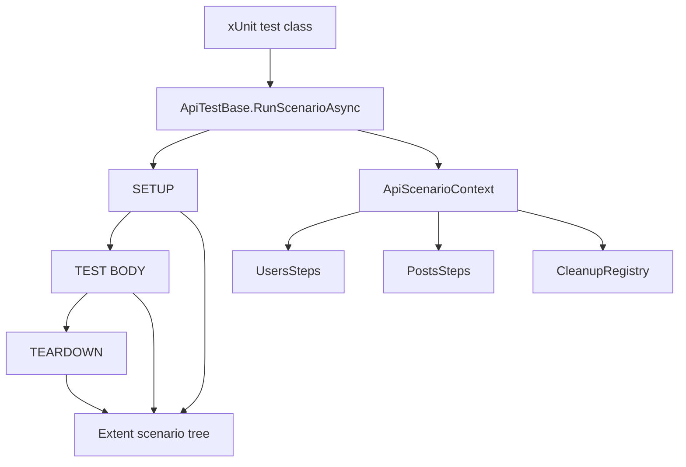
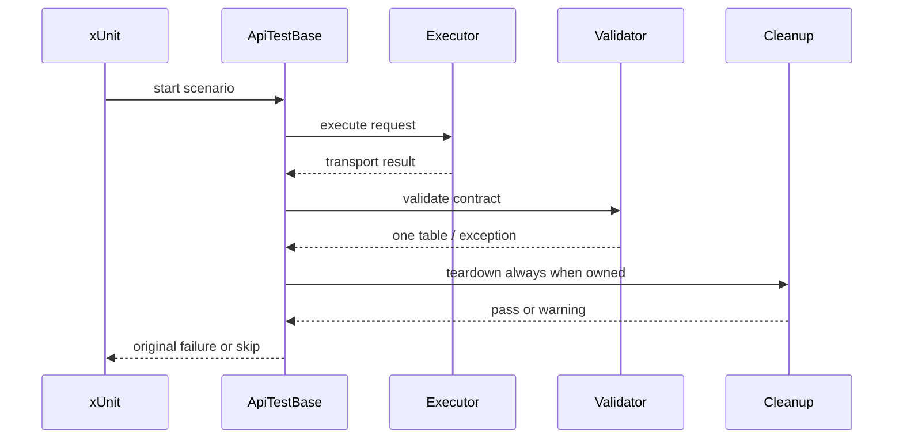

# Atf.Api — live scenario boundary

`Atf.Api` is the only project expected to call the configured external service. It owns xUnit integration, scenario intent and business coverage. It consumes Core and Common; it does not reimplement them.

## Scenario lifecycle



`ApiTestBase` starts one scenario under the actual xUnit class, creates one module/context, executes optional phases, runs cleanup, preserves the primary failure and rethrows it so xUnit remains authoritative.

The report hierarchy is:

```text
UsersApiTests
  scenario
    SETUP
      API request
        technical trace + JSON evidence
        contract validation
    TEST BODY
      API request
        technical trace + JSON evidence
        contract validation
    TEARDOWN
      cleanup / verification
```

Phases are direct siblings below the scenario. Empty phases are not manufactured.
The scenario verdict is visible in the scenario header. For composite lifecycle
scenarios the generic parent `Scenario passed` event table is removed because it
duplicates that verdict. Opening a scenario exposes compact phase shells; each
phase and its child steps remain collapsed until opened. The executor keeps the
HTTP node open after response evidence is published; the aggregate validator is
then opened as a child of that request. Multiple assertions therefore remain rows
inside one table, while a later HTTP response receives its own request-owned
validation node.

## Scenario rules

A scenario should state intent:

```csharp
await RunScenarioAsync(
    "GET users — collection contract",
    ["api", "users", "smoke", "contract"],
    async context =>
    {
        var response = await context.Users.ListAsync();
        ApiAssertions.Status(context.Reporter, response, HttpStatusCode.OK);
        JsonSchemaAssertions.Matches(context.Reporter, response, schemaPath);
    });
```

It should not construct a request, build a URL, add an Authorization header or create a report node.

Lifecycle tests use:

```text
setup    -> create prerequisite and register ownership
test     -> exercise behavior under test
teardown -> explicit verification + CleanupRegistry.RunAsync
```

## Authentication and environment

Read-only routes may use the anonymous profile. Write routes require the configured bearer profile:

```powershell
$env:ATF_API_TOKEN = '<secret supplied separately>'
dotnet test .\Atf.Api\Atf.Api.csproj --no-restore
```

Write scenarios are skipped when writes are disabled or the configured token variable is absent. The report shows the reason; skip is not pass.

Route authentication is declared centrally by `ApiRoutes` through
`ApiRouteAuthentication`, not inferred from the HTTP verb or the profile name:

```text
ApiRoutes.UserCreate
  method       = POST
  path         = /public/v2/users
  auth.type    = Bearer
  auth.access  = Required
  auth.profile = default
```

The enums describe route intent (`ApiAuthType` and `ApiAuthRequirement`), while
the profile remains a module configuration key. Extent renders the route
contract (`route.auth.*`) separately from the effective runtime profile
(`auth.profile`, `auth.mode`, `auth.token.state`), without rendering secrets.

**Verdict parity is now enforced:** the API test project uses xUnit v3's native
dynamic-skip contract (`SkipException.ForSkip`) after marking the Extent scenario
as `Skip`. A missing write token is therefore `Skipped` in the runner, class root
and scenario node; it is never converted into a normal return/Pass. This is a
contract test concern, not a reporting convenience.

## Test inventory

- `UsersApiTests`: user collection/item contracts and negative authentication.
- `PostsApiTests`: post collection/item, relationship and not-found contracts.
- `ApiLifecycleAndCombinationsTests`: setup/body/teardown composition, cleanup ownership and phase combinations.
- `ApiExecutorReportingTests`: request-step completion and diagnostic contract.
- `ApiRoutesTests`: route catalog contract.
- `ApiScenarioPhaseLayoutTests`: Extent hierarchy plus request-owned aggregate validation contract.
- `AssertionEvidenceFormatterTests`: assertion/evidence HTML contract.

The reusable validator-step lifecycle is tested in
`Atf.Tests/Atf.Common.Tests/ValidationAndLifecycleTests`; `Atf.Api` tests only
verify the API-facing tree and executor boundary. This keeps reporting policy
tests offline and prevents duplicate live scenarios from becoming framework tests.

## Categories

```powershell
dotnet test .\Atf.Api\Atf.Api.csproj --filter "Category=smoke"
dotnet test .\Atf.Api\Atf.Api.csproj --filter "Category=lifecycle"
dotnet test .\Atf.Api\Atf.Api.csproj --filter "Category=combination"
```

Every new live scenario should have a stable semantic name, focused categories, a read-only path where possible, explicit cleanup ownership and at least one deterministic component test.

## Failure rendering fixture

`FailApiTests` is an intentionally failing, opt-in fixture for validating the
reporting contract. It covers four different failure owners:

- setup exception;
- contract assertion failure (the HTTP exchange is present and the assertion
  table contains a failed row);
- direct xUnit assertion failure in the test body;
- teardown exception after the body has completed.

The fixture is skipped by default and therefore cannot make a normal API run
red. Run it deliberately when reviewing the failure presentation:

```powershell
$env:ATF_ENABLE_FAILURE_DEMOS = "true"
dotnet test .\Atf.Api\Atf.Api.csproj --filter "FullyQualifiedName~FailApiTests"
Remove-Item Env:ATF_ENABLE_FAILURE_DEMOS
```

The expected report contains four failed scenarios, a failed Overview status,
red failure badges, and a `❌` result in the assertion table. The four cases
also prove that SETUP, TEST BODY, and TEARDOWN remain individually visible and
collapsed by default. Never enable this fixture in a regular CI quality gate.

## Reporting acceptance

Before accepting a reporting change:

1. run `Atf.Core.Tests`;
2. run `Atf.Common.Tests`;
3. run one representative live scenario;
4. inspect the generated HTML.

The report must show the xUnit class in the left navigation, the scenario below it,
the scenario verdict in the header, lifecycle phases as siblings, compact collapsed
phase shells, request-owned validation, no generic
`Execution summary` rows on lifecycle containers or on the last request, one technical trace per exchange, dark wrapped
scrollable JSON, one assertion table, no external Extent folder and no token value.

## Cum se citește un test API în raport

```mermaid
flowchart TD
    Test[scenario header\nverdict + duration + tags]
    Test --> Phase[SETUP / TEST BODY / TEARDOWN]
    Phase --> Exchange[HTTP step\nmethod + path + auth + duration]
    Exchange --> Details[collapsed request/response details]
    Exchange --> Validation[validation step]
    Validation --> Table[ASSERTION | EXPECTED | ACTUAL | ✅/❌]
```

Interpretarea trebuie făcută în această ordine: întâi verdictul testului, apoi
operația HTTP, apoi trace-ul tehnic, apoi body-urile JSON, iar la final tabelul de
assertions. `Info` înseamnă evidence; `Pass`/`Fail` din tabelul agregat este verdict
funcțional. Nodurile sunt collapsed by default pentru ca raportul să rămână scanabil.

## Live coverage matrix

| Family | Current proof | Next proof to add |
|---|---|---|
| users | item, collection, missing auth, lifecycle | replace/patch field persistence, invalid input error schema |
| posts | item, collection, unknown item, user relationship | nested create/delete, empty collection, parent-not-found |
| lifecycle | setup/body/teardown and combinations | cancellation/timeout cleanup and primary-vs-teardown failure |
| resilience | offline retry policy tests | live-safe 429 simulation through a fake transport profile |
| report | real Extent HTML generated after live run | automated DOM-level overview/overflow assertions |

The current Extent baseline should therefore be read from the direct scenario
cards in the report: `13 API scenarios`, with `12 passed + 1 skipped` in the
latest run. The xUnit assembly also contains offline API contract tests, so its
runner total is larger; those unit cases are not additional API scenarios in the
Extent navigation tree. The native overview is reconciled from these same direct
scenario cards instead of counting the three class-root containers.

## Teste live care lipsesc

| Prioritate | Scenariu | Motiv |
|---|---|---|
| P0 | invalid JSON / invalid error envelope | verifică dacă diagnosticul rămâne într-un tabel, fără excepții obscure |
| P0 | timeout și cancellation cu cleanup | confirmă că resursele nu rămân după întrerupere |
| P1 | post create/update/delete cu auth validă | completează lifecycle-ul real pentru al doilea resource |
| P1 | empty collection, pagination, filter și sort | protejează contractele de colecție, nu doar statusul `200` |
| P1 | correlation id și rate-limit headers | face triage-ul operațional reproductibil |
| P2 | profile matrix pe environment | verifică aceeași suită cu base URL/auth diferite, fără modificarea codului |

Fiecare scenariu nou trebuie să aibă întâi test component offline pentru request,
route și validator, apoi un singur test live reprezentativ. Nu se duplică testele
de framework în `Atf.Api`.

The live layer is intentionally thin. A new scenario must be introduced only when it adds business coverage; a kernel or module defect belongs in `Atf.Tests` so it can run without a service.

## Failure ownership



The original scenario/contract failure remains authoritative. A cleanup warning must be visible in Extent but must not erase the root cause.

