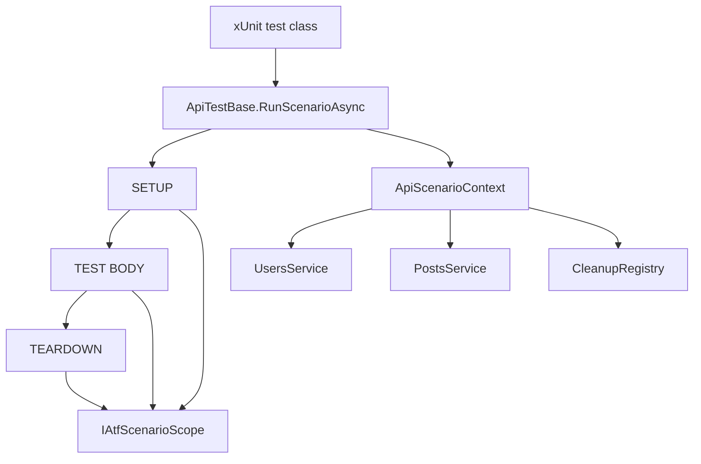
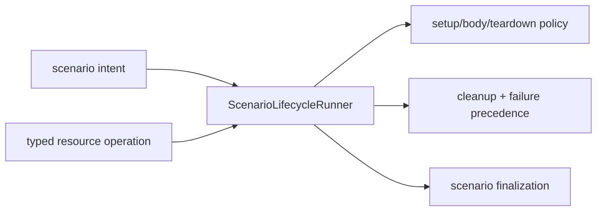
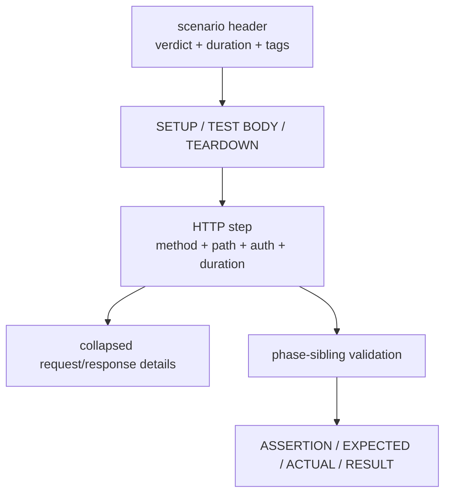
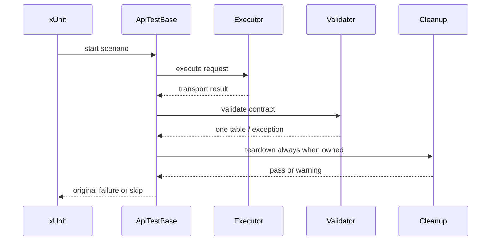

# Atf.Api — live scenario boundary

`Atf.Api` is the live acceptance boundary (not the reusable framework kernel).
It is the only project expected to call the configured external service. It owns
xUnit integration, scenario intent, business coverage and the API module under
`Atf.Api/Module`. The former `Atf.Common` project no longer exists as a
separate root boundary.

The name is intentionally kept for compatibility with current report/test
paths. Conceptually it contains both the API module and its acceptance scenarios.
A future rename or namespace merge must be handled as a mechanical migration,
not mixed into a behavior refactor.

## Current versus target ownership

```text
CURRENT                         TARGET
Atf.Api/Module/Routing          Atf.Api/Module/Routing
Atf.Api/Module/Services         Atf.Api/Module/Services
Atf.Api/Module/Validation       Atf.Api/Module/Validation
Atf.Api/Tests                   Atf.Api/Tests
Atf.Tests/Atf.Api.Tests         Atf.Tests/Atf.Api.Tests
```

`Atf.Core` is never absorbed into `Atf.Api`. The kernel remains product-neutral;
only the API-module vocabulary may move closer to the scenarios.

## Scenario lifecycle



`ApiTestBase` starts one scenario under the actual xUnit class, creates one module/context, executes optional phases, runs cleanup, preserves the primary failure and rethrows it so xUnit remains authoritative.

Responsibility boundary:

```text
Atf.Api.TestHost       xUnit fixture + current Extent composition bridge
Atf.Api                xUnit + live scenario intent + API module
Atf.Core               execution and reporting ports
Atf.Reporting.Extent   concrete HTML adapter
Atf.Tests              offline API, Core, module and reporting contract tests
```

## Responsibility audit — live boundary

`Atf.Api` is intentionally thin, but `ApiTestBase` remains the highest-risk
boundary in the host. It translates xUnit dependencies, consumes
`IAtfApiReportSession`, creates `ApiScenarioContext`, invokes lifecycle policy,
maps the result to the neutral scenario scope and rethrows the authoritative
exception. Extent is selected only by `Atf.Api.TestHost`.

| Responsibility | Current owner | Target owner |
|---|---|---|
| xUnit constructor/output/skip translation | `ApiTestBase` | remains here; this is the host adapter |
| module/context creation | `ApiModuleFactory.FromSettings` | explicit settings/ports factory |
| setup/body/teardown precedence | `ApiScenarioLifecycleRunner` | injectable runner with explicit outcome model |
| Extent finalization and status mapping | `ApiTestBase` | scenario finalizer port supplied by the fixture |
| business intent | concrete scenario classes | remains in `Atf.Api`; never move it into the runner |

The surgical rule is: do not move business decisions into infrastructure, and
do not let xUnit exceptions define the reusable lifecycle model. The next
refactor should introduce an explicit `Passed | Failed | Skipped` outcome and
keep `ApiTestBase` as the only place that converts that outcome to xUnit
behavior.

## Audit update — 2026-10-13

`Atf.Api` trebuie să rămână subțire în raport cu framework-ul: exprimă intenția
scenariului și business coverage, nu implementează transport, Extent sau politica
generică de validare. Abaterile sunt findings live cu test și criteriu de
acceptare, nu note permanente în documentație.

### Separarea responsabilităților

```text
ApiTestBase
  -> xUnit adapter + translation of final outcome
ApiScenarioLifecycleRunner
  -> orchestration of setup/body/teardown
ApiModule
  -> routes/services/semantic operations
Atf.Core
  -> transport/auth/retry/configuration
Atf.Reporting.Extent
  -> concrete tree and HTML publication
```

`ApiScenarioLifecycleRunner` are deja separate `ApiScenarioPhaseRunner`,
`ApiScenarioTeardownRunner` și `ApiScenarioOutcomeResolver`. Nu se mai
extrage un alt coordinator doar pentru a obține clase mai mici. Presiunea
rămasă în `ApiTestBase` este responsabilitatea corectă a adapterului xUnit:
compoziția contextului, traducerea outcome-ului neutru și finalizarea scope-ului.

### Reguli pentru scenarii

- `ApiLifecycleAndCombinationsTests` poate păstra combinațiile de setup/body/
  teardown, dar nu trebuie să reimplementeze lifecycle-ul;
- testele de tip `test only` trebuie să afișeze numai `TEST BODY`, fără setup sau
  teardown sintetic;
- setup, body și teardown sunt faze surori sub același scenario;
- un request și validarea lui sunt frați direcți sub aceeași fază;
- failure-ul primar rămâne autoritar chiar când cleanup-ul sau reporterul eșuează;
- contractele reutilizabile trebuie testate offline, iar `Atf.Api` trebuie să
  conțină numai dovadă live de business.

`ApiScenarioLifecycleRunner` is now a deliberately thin coordinator. Phase
execution, teardown safety and outcome resolution are separate internal seams;
the coordinator composes them and preserves the precedence contract:

```text
ApiScenarioLifecycleRunner
    -> ScenarioPhaseExecutor
    -> TeardownCoordinator
    -> ApiScenarioOutcomeResolver
```

Each seam has contract coverage for failure precedence and cleanup guarantees.
Do not reintroduce policy into the coordinator merely to reduce call-site
noise. A new scenario finalizer is justified only by a second host or by a
distinct tested rule; otherwise it is indirection without ownership gain.

**P0 lifecycle closed for custom teardown:** the runner now calls custom teardown
and cleanup through an inner `finally`, preserving the primary body/setup
failure. `ApiScenarioLifecycleRunnerTests` contains the regression case for
`teardown fails + cleanup still executes`.

**P1 lifecycle semantic contract is protected:** `CleanupRegistry` reports
best-effort before executing a resource action, iar un reporter failure nu mai
poate preveni acțiunea, următorul cleanup item sau deschiderea TEARDOWN.
Rămân deschise doar hardening-ul concurenței și dovada DOM.

**Test-boundary resolved:** `ApiScenarioLifecycleRunnerTests` now lives in
`Atf.Tests/Atf.Api.Tests`, while `Atf.Api` contains only live acceptance scenarios and
the opt-in failure fixture. Framework lifecycle tests therefore run offline and
do not add synthetic scenario cards to the live Extent artifact.

### Audit OOP: `ApiTestBase` și scenariile de combinații

`ApiTestBase` este acum un adapter xUnit subțire: construiește contextul și
delegă phase runner, skip parity, cleanup, exception precedence și finalizarea
Extent către `ApiScenarioLifecycleRunner`. Runnerul este testabil separat și
păstrează aceeași regulă de ownership pentru SETUP / TEST BODY / TEARDOWN.

`ApiLifecycleAndCombinationsTests` este util ca test de contract, dar ramifică
în interior după `resource` și construiește contracte diferite în aceeași
metodă. Asta face raportul dinamic, însă nu îl face ușor de citit. La o rundă
ulterioară, după înghețarea testelor actuale, extrageți o politică tipizată de
resursă sau separați scenariile users/posts; nu copiați ramificațiile în încă
un test. Regula de siguranță este:



Ramificațiile de resource rămân intenționat în scenarii pentru a demonstra
comportamentul observabil, dar lifecycle-ul propriu-zis nu mai este duplicat în
clasa de bază. Orice ramificație nouă trebuie să rămână la nivel de intenție de
scenariu, nu să reimplementeze cleanup sau politica de failure.

The report hierarchy is:

```text
UsersApiTests
  scenario
    SETUP
      API request
        technical trace + JSON evidence
        Validate: contract
    TEST BODY
      API request
        technical trace + JSON evidence
        Validate: contract
    TEARDOWN
      cleanup / verification
```

Phases are direct siblings below the scenario. Empty phases are not manufactured.
The scenario verdict is visible in the scenario header. For composite lifecycle
scenarios the generic parent `Scenario passed` event table is removed because it
duplicates that verdict. Opening a scenario exposes compact phase shells; each
phase and its child steps remain collapsed until opened. The executor keeps the
HTTP node open while response evidence is published; the aggregate validator is
then rendered as the next direct sibling of that request under the same phase.
Multiple assertions therefore remain rows inside one table, while a later HTTP
response receives its own request/validation sibling pair.

### Soft assertion contract

ApiAssertions.SoftContract is intentionally explicit and should be rare. It is
for a known, non-blocking observation where the failed assertion must remain
visible without making xUnit fail:

    ApiAssertions.SoftContract(
        context.Reporter,
        response,
        "Validate: compatibility warning",
        contract => contract.Status(HttpStatusCode.Created));

The report still contains the failed row in the aggregate assertion table. The
validation node and scenario receive Warning; the Overview maps that scenario
to Others, and the affected tag increments OTHERS. This is deliberately
different from ApiAssertions.Contract, where a failed row is authoritative and
throws ApiValidationException. Configuration/evaluator exceptions are never
softened.

The Overview contract is intentionally multi-surface: the direct scenario card,
the native `Tests` counters/chart, the `Tags` OTHERS column and the secondary
execution metadata must all derive the same `Warning` population. A soft
assertion must never increment `Tests Failed`, and a reporter exception must not
turn it into an xUnit failure. Component tests now protect mixed
pass/warning/fail/skip propagation; rămâne deschis doar contractul DOM pentru
reconcilierea computed styles și interacțiunea reală din browser.

## Scenario rules

A scenario should state intent:

```csharp
await RunScenarioAsync(
    "GET users — collection contract",
    ["api", "users", "smoke", "contract"],
    async context =>
    {
        var response = await context.Users.ListAsync();
        ApiAssertions.Contract(context.Reporter, response, "Validate: user collection contract", contract => contract
            .Status(HttpStatusCode.OK)
            .ContentTypeContains("application/json")
            .JsonSchema(schemaPath));
    });
```

It should not construct a request, build a URL, add an Authorization header or create a report node.

Lifecycle tests use:

```text
setup    -> create prerequisite and register ownership
test     -> exercise behavior under test
teardown -> explicit verification + CleanupRegistry.RunAsync
```

The lifecycle-combination suite keeps the observable matrix explicit. It covers
all phase shapes that are legal for a scenario and the precedence edges that
are easy to regress in the report:

| Case | Expected scenario verdict | Expected phase evidence |
|---|---|---|
| test only | Pass | `TEST BODY` only; no synthetic setup/teardown |
| setup → test | Pass | setup and body are siblings |
| test → teardown | Pass | body and teardown are siblings |
| setup → test → teardown | Pass | all three phases are siblings |
| warning → pass | Warning | warning remains visible; no failed test counter |
| pass → warning | Warning | a later warning promotes the scenario |
| warning → fail → pass | Fail | failure is authoritative; teardown still passes |
| setup skip → teardown pass | Skip | setup is Skip; teardown is Pass |
| body skip → teardown pass | Skip | body is Skip; teardown is Pass |
| body pass → teardown warning | Warning | body is Pass; teardown is Warning |
| body pass → teardown skip | Skip | body is Pass; teardown is Skip |

The matrix is intentionally expressed with real API exchanges for the passing
and teardown branches. The skip/failure branches use deterministic lifecycle
signals, so the report contract can be tested without depending on a missing
secret or a remote error. Every successful HTTP exchange still ends with one
aggregate validation node owned by that request.

## Authentication and environment

Read-only routes may use the anonymous profile. Write routes require the configured bearer profile:

```powershell
$env:ATF_API_TOKEN = '<secret supplied separately>'
dotnet test .\Atf.Api\Atf.Api.csproj --no-restore
```

Write scenarios are skipped when writes are disabled or the configured token variable is absent. The report shows the reason; skip is not pass.

Route authentication is declared centrally by `ApiRoutes` through
`ApiRouteAuthentication`, not inferred from the HTTP verb or the profile name:

```text
ApiRoutes.UserCreate
  method       = POST
  path         = /public/v2/users
  auth.type    = Bearer
  auth.access  = Required
  auth.profile = default
```

The enums describe route intent (`ApiAuthType` and `ApiAuthRequirement`), while
the profile remains a module configuration key. Extent renders the route
contract (`route.auth.*`) separately from the effective runtime profile
(`auth.profile`, `auth.mode`, `auth.token.state`), without rendering secrets.

**Verdict parity is now enforced:** the API test project uses xUnit v3's native
dynamic-skip contract (`SkipException.ForSkip`) after marking the Extent scenario
as `Skip`. A missing write token is therefore `Skipped` in the runner, class root
and scenario node; it is never converted into a normal return/Pass. This is a
contract test concern, not a reporting convenience.

## Test inventory

- `UsersApiTests`: user collection/item contracts and negative authentication.
- `PostsApiTests`: post collection/item, relationship and not-found contracts.
- `ApiLifecycleAndCombinationsTests`: setup/body/teardown composition, cleanup ownership and phase combinations.
- `ApiExecutorReportingTests`: request-step completion and diagnostic contract.
- `ApiRoutesTests`: route catalog contract.
- `ApiScenarioPhaseLayoutTests`: phase hierarchy plus request/validation sibling order and aggregate-table contract.
- `AssertionEvidenceFormatterTests`: assertion/evidence HTML contract.

The reusable validator-step lifecycle is tested in
`Atf.Tests/Atf.Common.Tests/ValidationAndLifecycleTests`; `Atf.Api` tests only
verify the API-facing tree and executor boundary. This keeps reporting policy
tests offline and prevents duplicate live scenarios from becoming framework tests.

## Categories

```powershell
dotnet test .\Atf.Api\Atf.Api.csproj --filter "Category=smoke"
dotnet test .\Atf.Api\Atf.Api.csproj --filter "Category=lifecycle"
dotnet test .\Atf.Api\Atf.Api.csproj --filter "Category=combination"
```

Every new live scenario should have a stable semantic name, focused categories, a read-only path where possible, explicit cleanup ownership and at least one deterministic component test.

Do not add a generic `framework` tag or annotation. The project and namespace
already identify these as ATF scenarios; a tag is allowed only when it changes
filtering, execution policy or report navigation and has an observable test.

## Failure rendering fixture

`FailApiTests` is an intentionally failing, opt-in fixture for validating the
reporting contract. It covers four different failure owners:

- setup exception;
- contract assertion failure (the HTTP exchange is present and the assertion
  table contains a failed row);
- direct xUnit assertion failure in the test body;
- teardown exception after the body has completed.

The fixture is skipped by default and therefore cannot make a normal API run
red. Run it deliberately when reviewing the failure presentation:

```powershell
$env:ATF_ENABLE_FAILURE_DEMOS = "true"
dotnet test .\Atf.Api\Atf.Api.csproj --filter "FullyQualifiedName~FailApiTests"
Remove-Item Env:ATF_ENABLE_FAILURE_DEMOS
```

The expected report contains four failed scenarios, a failed Overview status,
red failure badges, and a `❌` result in the assertion table. The four cases
also prove that SETUP, TEST BODY, and TEARDOWN remain individually visible and
collapsed by default. Keep this fixture out of the regular local quality gate.

## Reporting acceptance

Before accepting a reporting change:

1. run `Atf.Core.Tests`;
2. run `Atf.Tests/Atf.Common.Tests`;
3. run one representative live scenario;
4. inspect the generated HTML.

The report must show the xUnit class in the left navigation, the scenario below it,
the scenario verdict in the header, lifecycle phases as siblings, compact collapsed
phase shells, phase-sibling validation, no generic
`Execution summary` rows on lifecycle containers or on the last request, one technical trace per exchange, dark wrapped
scrollable JSON, one assertion table, no external Extent folder and no token value.

## Cum se citește un test API în raport



Interpretarea trebuie făcută în această ordine: întâi verdictul testului, apoi
operația HTTP, apoi trace-ul tehnic, apoi body-urile JSON, iar la final tabelul de
assertions. `Info` înseamnă evidence; `Pass`/`Fail` din tabelul agregat este verdict
funcțional. Nodurile sunt collapsed by default pentru ca raportul să rămână scanabil.

## Live coverage matrix

| Family | Current proof | Next proof to add |
|---|---|---|
| users | item, collection, missing auth, lifecycle | replace/patch field persistence, invalid input error schema |
| posts | item, collection, unknown item, user relationship | nested create/delete, empty collection, parent-not-found |
| lifecycle | setup/body/teardown and combinations | cancellation/timeout cleanup and primary-vs-teardown failure |
| resilience | offline retry policy tests | live-safe 429 simulation through a fake transport profile |
| report | real Extent HTML generated after live run | automated DOM-level overview/overflow assertions |

The current Extent baseline must be read from the direct scenario cards in the
generated report, not copied into this README. The xUnit assembly also contains
offline API contract tests, so its runner total is intentionally larger; those
unit cases are not additional API scenarios in the Extent navigation tree. The
native overview is reconciled from the same direct scenario cards instead of
counting class-root containers.

## Backlog live după audit

Primul rând este păstrat ca dovadă de închidere a regresiei de reporter; nu mai
este un test live lipsă. Rândurile `P0`/`P1`/`P2` sunt acoperirea business și
resilience care încă merită adăugată în scenariile reale.

| Prioritate | Scenariu | Motiv |
|---|---|---|
| closed | reporter failure în `StartStep`, tabel, verdict și `CompleteStep` | protejat offline prin `ValidationReportPublisher` și `CleanupRegistry`; păstrează regresia component |
| P0 | invalid JSON / invalid error envelope | verifică dacă diagnosticul rămâne într-un tabel, fără excepții obscure |
| P0 | timeout și cancellation cu cleanup | confirmă că resursele nu rămân după întrerupere |
| P1 | post create/update/delete cu auth validă | completează lifecycle-ul real pentru al doilea resource |
| P1 | empty collection, pagination, filter și sort | protejează contractele de colecție, nu doar statusul `200` |
| P1 | correlation id și rate-limit headers | face triage-ul operațional reproductibil |
| P2 | profile matrix pe environment | verifică aceeași suită cu base URL/auth diferite, fără modificarea codului |
| P2 | failure demo separat de quality gate | exit code-ul intenționat nu trebuie confundat cu sănătatea suitei normale |

Fiecare scenariu nou trebuie să aibă întâi test component offline pentru request,
route și validator, apoi un singur test live reprezentativ. Nu se duplică testele
de framework în `Atf.Api`.

The live layer is intentionally thin. A new scenario must be introduced only when it adds business coverage; a kernel or module defect belongs in `Atf.Tests` so it can run without a service.

## Failure ownership



The original scenario/contract failure remains authoritative. A cleanup warning must be visible in Extent but must not erase the root cause.


