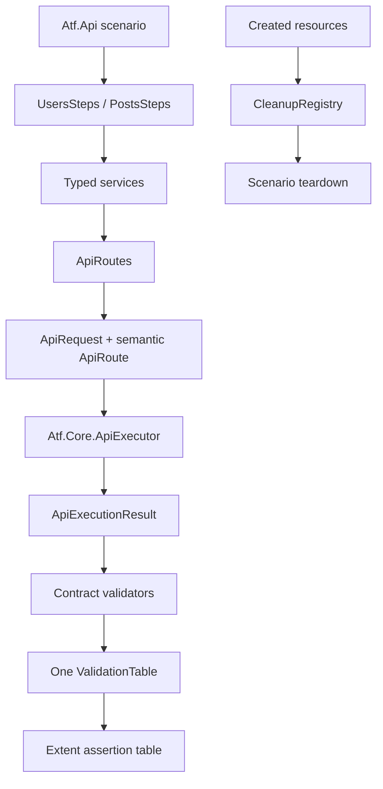
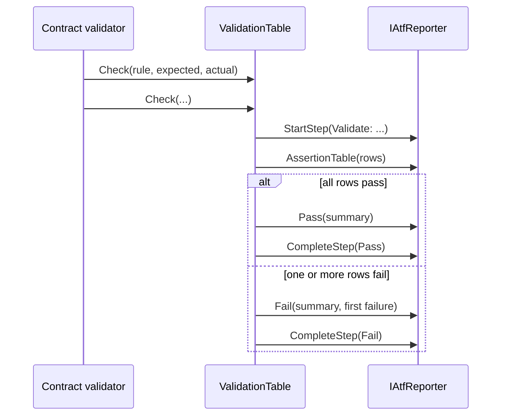
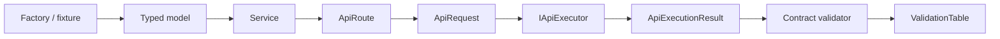
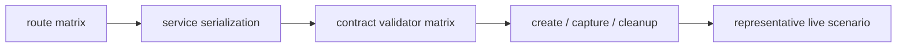

# Atf.Common — reusable API module layer

The cross-layer design and report tree are described in the
[architecture and reporting guide](../docs/ATF_Architecture.md).

`Atf.Common` translates a configured endpoint catalog into a readable API language for scenarios. It is the bridge between the product-neutral execution kernel and a concrete API module.

## Boundary



The intended call flow is `scenario → step → service → route → executor`, then `response → validator → ValidationTable → reporter`. A resource follows `resource → CleanupRegistry → reverse-order teardown`.

## Responsibilities by component

| Component | Responsibility | Does not do |
|---|---|---|
| `ApiModule` | Composition root for routes, executor, services and steps | Decide scenario outcomes |
| `ApiRoutes` | Route metadata: method, path, auth, resource and operation | Send requests |
| Services | Serialize typed requests and select route contracts | Render Extent markup |
| Steps | Expose scenario-friendly domain actions | Duplicate transport policy |
| Models | Define request/response shapes | Read environment variables |
| Data/factories | Create deterministic, unique test data | Hide API calls |
| Validators | Evaluate response contracts and aggregate rows | Build routes |
| `CleanupRegistry` | Own resources and run reverse cleanup | Replace primary failures |

## Composition root

`ApiModule` is the only object-graph composition root:

```text
ApiSettings + IAtfReporter
          |
          v
       ApiModule
      /         \
 ApiRoutes     ApiExecutor
   |              |
 Services       Core ports
   |              |
  Steps       HTTP + Extent
```

The constructor accepting `IApiExecutor` and `ApiRoutes` is fake-friendly. Component tests verify request construction without a socket, secret or report file.

A scenario should never instantiate `HttpClient`, concatenate a URL, serialize a body manually when a service exists, call Extent directly or hide cleanup order.

## Route catalog

A route is executable metadata, not just a path string:

```text
ApiRoute
  Name
  HttpMethod
  PathTemplate
  Resource
  Operation
  Authentication
    Type          (None / Bearer / ApiKey / Basic / Custom)
    Requirement   (Optional / Required)
    Profile       (configuration key, e.g. anonymous/default)
    Policy        (derived display text, not a free-form source of truth)
```

Example:

```text
users.posts.collection
  GET /public/v2/users/{userId}/posts
  resource = posts
  operation = list by user
  authentication.type = None
  authentication.requirement = Optional
  authentication.profile = anonymous
  authentication.policy = anonymous allowed
```

`ApiRoute.ResolvePath` encodes path tokens. `CreateRequest` preserves route metadata on the request so the executor can explain the operation in the report.

`ApiRouteAuthentication` is deliberately typed. The catalog declares the
contract (`Bearer + Required` for write routes, `None + Optional` for public
reads), while the profile name remains configurable. The report shows both
sides: `route.auth.*` describes what the route declares, and `auth.*` describes
the effective configured profile used by the exchange.

The catalog keeps its vocabulary in one place:

| Constant group | Owns |
|---|---|
| ApiRouteNames | Stable route identifiers used in evidence and diagnostics |
| ApiRequestMethods | The supported HTTP method instances |
| ApiRouteActions | Semantic operations such as list, create and list by user |
| ApiRouteResources | Report/grouping resources such as users and posts |
| ApiRouteTokens | Template tokens such as id and userId |
| ApiRouteAuthProfiles | Configuration profile keys such as anonymous and default |
| ApiRoutePathTemplates | Safe construction of item paths from configurable collection roots |

ApiRoutes.All is the deterministic route inventory. A new module route should
be added to the constants, catalog and inventory contract together; services
then consume the typed route instead of repeating method, path, operation or
token strings.

## Services, steps and validation

Services translate typed data into requests:

```text
UsersSteps.Create
  -> UsersService.Create
  -> ApiRoutes.UserCreate
  -> ApiRoute.CreateRequest(body, auth)
  -> IApiExecutor.ExecuteAsync
```

Steps are a facade for scenarios. Services own serialization and route selection. Add a step only when it improves intent.

One contract creates one `ValidationTable`:

```text
Check(name, expected, actual, predicate)
Check(...)
Check(...)
       |
       v
ASSERTION | EXPECTED | ACTUAL | RESULT
       |
       +--> all rows emitted once
       +--> ApiValidationException if any row failed
```

Supported validation families include status, allowed statuses, headers, content, JSONPath, array relationships and JSON Schema.

### Validation step lifecycle



`ValidationTable.Run` closes its own reporter step in a `finally` boundary. That
contract is required even when a test has several validations after one response:
`GET` remains open, while `Validate: status`, `Validate: JSONPath` and
`Validate: schema` become children of that request. Prefer one
`ContractValidators.*` method when the checks describe one response contract;
the method emits one validation node and one aggregated table. Use separate
validation methods only when the report needs a genuinely distinct contract
boundary. The table aggregates assertions; it does not create one Extent node
per assertion.

Validation contract details:

| Validator family | Input | Evidence | Important edge case |
|---|---|---|---|
| status / status-one-of | HTTP response | expected status vs actual status | negative test passes only when the expected error is received |
| header / content | response headers/body | safe header/body preview | header lookup must be case-insensitive |
| JSONPath | parsed JSON + path | expected token/value vs actual | invalid JSON is a contract failure, not an unhandled parser leak |
| relationship | collection + property | expected relationship vs compact collection preview | empty collections need an explicit policy; `All(...)` alone is vacuously true |
| schema | response + schema path | matched or diagnostic schema messages | missing/invalid schema is visible in the same assertion table |

The `ACTUAL` preview limit comes from `IAtfReporter.AssertionMaxDisplayCharacters`
and defaults to `240`. This is a presentation limit only: the validator evaluates the
complete raw response, while the report receives a bounded diagnostic string.

### Aggregate validations by response

`ApiAssertions.Contract` is the preferred public entry point when one HTTP
response needs more than one check. It exposes a small fluent
`ResponseValidationGroup`; every method appends a row to the same
`ValidationTable`, and the table is published once. This keeps the report
compact without hiding any assertion:

```csharp
ApiAssertions.Contract(reporter, response, "Validate: post item contract", contract => contract
    .Status(HttpStatusCode.OK)
    .ContentTypeContains("application/json")
    .JsonPathExists("$.id")
    .JsonPathExists("$.user_id"));
```

Do not aggregate assertions from different HTTP responses. They remain separate
request-owned validation nodes so the report still answers exactly which exchange was
validated. The legacy single-check helpers remain available and delegate to the
same grouping primitive for compatibility.

## Lifecycle and cleanup

`CleanupRegistry` is an ownership boundary. Register a cleanup action when ownership is acquired.

```mermaid
sequenceDiagram
    participant S as Scenario
    participant C as CleanupRegistry
    participant API as API service

    S->>API: create resource
    API-->>S: resource id
    S->>C: Own(resource, id, delete action)
    S->>API: test behavior
    S->>C: RunAsync()
    loop reverse registration order
        C->>API: cleanup action
        API-->>C: success or failure
    end
    C-->>S: cleanup complete; warnings preserved
```

Cleanup is reverse-order and best-effort: one failed action does not prevent others; failures become warnings; the registry is empty after a run; a primary scenario failure remains primary.

## Test map

```text
RoutingServicesAndDataTests  route encoding, metadata, serialization,
                             module composition, data and fixture errors
ValidationComponentTests     status/header/body/JSONPath/schema/relationship
ValidationAndLifecycleTests  one-table aggregation, validator-step closure and cleanup
```

Run:

```powershell
dotnet test .\Atf.Tests\Atf.Common.Tests\Atf.Common.Tests.csproj --no-restore --logger "console;verbosity=normal"
```

## Module contract checklist



| Rule | Required behavior | Typical failure |
|---|---|---|
| route | every token is resolved and encoded before transport | unresolved `{id}` is rejected early |
| service | typed input becomes the configured JSON body | wrong field/casing/auth profile |
| step | scenario vocabulary remains semantic | endpoint strings leak into tests |
| validator | one contract emits one aggregated table | one assertion becomes many noisy child steps |
| cleanup | ownership is registered immediately after create | resource remains after failure/skip |

The route-token guard is deliberate: a malformed route is a module defect and must not become a misleading network failure. `Atf.Common.Tests` protects this contract directly.

## Additional module tests to add



Recommended component tests, in order:

1. `EmptyCollectionPolicyIsExplicit` — verifies whether an empty collection is
   accepted, rejected or treated as a separate expected outcome.
2. `ErrorEnvelopeIsValidatedBySchema` — proves the common error shape, code,
   message and correlation id are reported together.
3. `PatchAndDeletePreserveRouteAndAuthMetadata` — protects write operations before
   a real token is used.
4. `CapturedIdsAreScenarioScoped` — proves values captured from one scenario never
   leak into another parallel scenario.
5. `CleanupRegistrationIsImmediateAfterCreate` — protects the failure window between
   a successful create and the next test step.
6. `ServiceNeverWritesExtentDirectly` — architectural contract test that keeps
   reporting behind `IAtfReporter`.

## Module gaps to close

- add declarative operation metadata beside `ApiRoutes` so a new module can be configured rather than recompiled for every endpoint;
- add shared error, pagination and collection validators;
- add explicit non-empty/empty collection semantics instead of relying on vacuous `All(...)` behavior;
- add capture/variable scope for values such as created ids, with cleanup values isolated per scenario;
- add contract tests for `PUT`, `PATCH`, `DELETE` and nested create flows, not only request construction.

