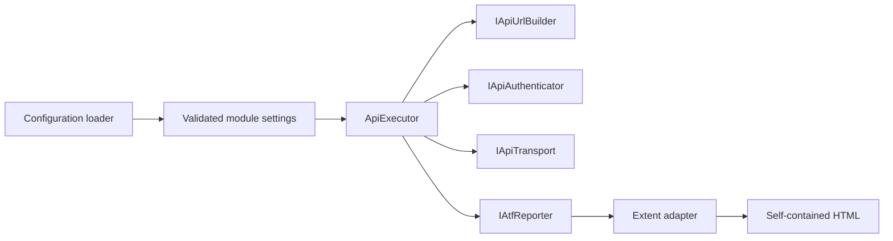
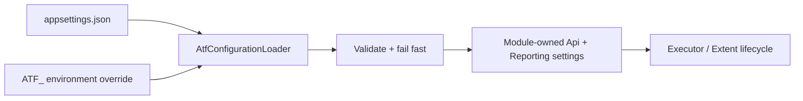
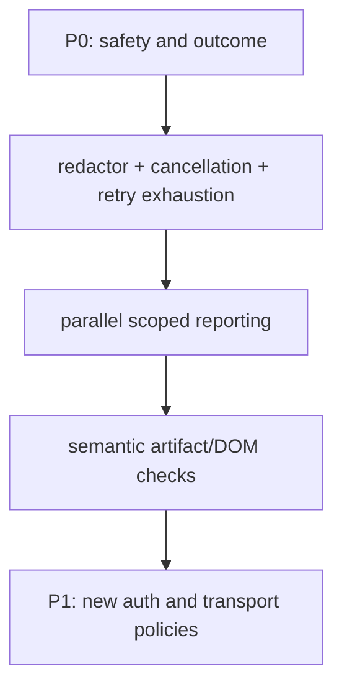

# Atf.Core — execution kernel

For the complete dependency, lifecycle and Extent artifact model, see the
[architecture and reporting guide](../docs/ATF_Architecture.md).

`Atf.Core` is the product-neutral kernel. It owns policies that should behave identically for every API module and remain testable without a live service.

## Responsibility boundary



Core does not know product route names, domain models, business schemas or scenario decisions. It does know how a configured request is represented, how URLs and auth are applied safely, how one exchange is retried and measured, and how evidence is delivered to the reporting port.

## Public contracts and patterns

| Contract / component | Pattern | Responsibility |
|---|---|---|
| `AtfConfigurationLoader` | configuration provider | Loads JSON, environment overlays and module settings |
| `ApiRequest`, `ApiRoute`, `ApiRouteAuthentication`, `ApiResponse` | value objects | Carry semantic HTTP data without Extent dependencies; route auth uses typed metadata |
| `IApiUrlBuilder` | port | Builds absolute URLs and encodes path/query values |
| `IApiAuthenticator` | port + strategy | Applies a named auth profile and exposes non-secret state |
| `IApiTransport` | port | Isolates network I/O from orchestration |
| `ApiExecutor` | pipeline/orchestrator | Executes one exchange and emits evidence in stable order |
| `RateLimitRetryPolicy` | strategy | Decides bounded retry behavior for configured statuses |
| `Polling` | deadline policy | Polls until satisfied or until the deadline |
| `IAtfReporter` | reporting port | Receives evidence without exposing Extent to domain code |
| `SensitiveDataRedactor` | boundary policy | Sanitizes structured and free-form evidence before it reaches a reporter |
| `ReportArtifactInspector` | executable specification | Verifies the HTML users actually open |

## Exchange sequence


`HTTP exchange completed` does not imply `functional contract passed`. The executor
publishes transport evidence with an informational status; `Atf.Common` then opens
exactly one aggregate contract validation as the next sibling of that request under the same
phase and decides whether that response satisfies the requested contract.
The validation closes immediately after its table is published. The rendered
hierarchy is `phase → request + contract validation sibling → one table`.

`ApiExecutionReporter` is the execution-side adapter. It maps request/response
facts to stable report properties, request JSON, response JSON and retry
diagnostics. Its best-effort policy is intentional: a broken renderer cannot
turn a successful HTTP response into a failed test or replace the original
transport exception. This keeps the executor cohesive and leaves Extent markup
inside the reporting boundary.

The result is intentionally split into transport facts and functional verdict:

| State/fact | Owner | Meaning |
|---|---|---|
| `ApiResponse` | transport | status, headers, raw body, URL and duration observed |
| `Attempts` / `RetryEvents` | executor + retry policy | how the exchange reached its final response |
| `ValidationTable` | Common validators | all expected-vs-actual contract checks |
| Extent `Info` | reporter | technical evidence only; never a business pass |
| Extent `Pass`/`Fail` | validation/scenario lifecycle | functional contract and scenario outcome |

## Configuration

Settings are read from `Modules:Api:Config`:

```text
Modules:Api:Config:Api
  BaseUrl, TimeoutSeconds, WriteTestsEnabled
  TokenEnvironmentVariable, DefaultAuthProfile
  RateLimit, Polling, AuthProfiles, Routes

Modules:Api:Config:Reporting
  Engine = extent, ReportPath, TimestampEnabled
  TimestampFormat, DocumentTitle, ReportName
  AssertionMaxDisplayCharacters

Modules:Api:Config:Api:Redaction
  Enabled, Replacement
  RedactLocalPaths, LocalPathReplacement
  SensitiveKeys, PiiEnabled, PiiKeys
```

The loader validates the absolute base URL, positive timeout/polling/rate-limit values,
the positive assertion display limit and the Extent-only reporting policy before the
fixture can start. `AssertionMaxDisplayCharacters` changes only the rendered `ACTUAL`
preview; it never changes the response used by a validator.

Redaction is applied only to the copy sent to reporting. Secret keys and transport
credentials are masked by default; PII masking is explicit through `PiiEnabled` so
teams can choose whether business identifiers remain available for diagnostics.
Local Windows paths in exception evidence are masked by default as
`[LOCAL_PATH]` while preserving the source line suffix. Set
`RedactLocalPaths=false` only for a deliberately local diagnostic run.

Configuration contract:



## Authentication and resilience

`ConfiguredApiAuthenticator` supports configured `none` and `bearer` profiles. It separately applies a header, describes the mode and describes only token availability. `ApiRouteAuthentication` adds a typed route declaration (`ApiAuthType` + `ApiAuthRequirement` + configurable profile) so the report can distinguish route intent from the effective runtime profile. The report never contains the token.

`RateLimitRetryPolicy` retries only configured statuses, reads delay headers in order, rejects unusable delays, falls back, caps the delay and stops at the retry budget. `Polling.UntilAsync` is deadline-based and returns the last value, attempt count, elapsed duration and a satisfaction flag.

## Reporting contract

```text
IAtfReporter                 framework-neutral evidence API
IAtfScenarioScope            scenario lifecycle port
       |
Atf.Reporting.Extent         concrete Extent adapter assembly
       |
ExtentSparkReporter          HTML generation
       |
ApplyCustomTheme + inline    final HTML normalization
       |
ReportAssetCleaner            remove sibling extent asset folder
       |
ReportArtifactInspector       verify consumer-facing contract
```

The final report must be one timestamped, self-contained HTML file; Extent assets are embedded; no `extent` folder is delivered; all surfaces share `--atf-dark`; class → scenario → phase → API step is preserved; request/response/JSON/assertion evidence is collapsed by default; JSON is wrapped and vertically scrollable; technical trace and assertions are compact tables.

The reporter renders evidence. It must not decide business validity. Validators own the assertion result. Lifecycle phases are structural containers: they do not render a generic `Execution summary · N fields` row. Context-only fields (fixture ids, combination shape and similar runner metadata) are suppressed even when they arrive while the last HTTP node is still active; technical evidence belongs to the HTTP request, while its contract validation is the next phase sibling that owns the aggregate assertion table.

The embedded client script also has one canonical `directScenarioCards(item)` selector. Overview totals and the secondary tag audit must count the same direct scenario nodes; they must never infer totals from class containers or accidentally call an undefined selector.

Evidence ownership is also a security boundary: the current implementation reports
token availability rather than token content and applies one redaction pipeline before
`Detail`, `Json`, assertion values, retry diagnostics and exception text. Structured
JSON is traversed recursively; free-form text also masks authorization headers, API
keys, cookies, query-string secrets and email addresses. The original request and
exception remain untouched for execution semantics, while only the reporter copy is
sanitized.

Retry history is emitted as explicit informational evidence (`Attempt N → HTTP status
→ retry in delay`) so the final response and the path taken to reach it are both
visible without turning transport diagnostics into a functional pass.

## Test map

```text
ConfigurationAndResilienceTests  loader, validation, retry, polling, JSON
CoreArchitectureTests          URL/auth/transport/path/asset policies
HttpExecutorComponentTests     retry result, route metadata and evidence
ApiExecutorCompositionTests    injected ports and exception preservation
ReportingComponentTests         status aggregation and evidence classification
ReportingStructureTests         phase/request + validation ownership and active-step evidence
ReportArtifactInspectorTests    final HTML contract
ReportingLifecycleComponentTests fixture composition and finalization
```

Run:

```powershell
dotnet test .\Atf.Tests\Atf.Core.Tests\Atf.Core.Tests.csproj --no-restore --logger "console;verbosity=normal"
```

A new Core policy is acceptable only when it is product-neutral, exposed through a replaceable boundary where appropriate and covered by a deterministic test.

## Core contract checklist

| Area | Required invariant | Current guard |
|---|---|---|
| configuration | invalid base URL/timing/report engine fails before runtime | `ConfigurationAndResilienceTests` |
| URL/auth | path and query are encoded; secrets are described only by state | `CoreArchitectureTests`, `HttpExecutorComponentTests` |
| execution | transport is replaceable; retry result is explicit; reporter cannot replace the original exception | `ApiExecutorCompositionTests`, `HttpExecutorComponentTests` |
| resilience | retry status, delay source, cap and budget are deterministic | `ConfigurationAndResilienceTests`, `CoreArchitectureTests` |
| reporting | status aggregation is failure-first; one response produces one aggregate validation table on the next sibling under the same phase | `ReportingComponentTests`, `ReportingStructureTests`, `ApiExecutorReportingTests` |
| artifact | final HTML is self-contained and follows the visual/report contract | `ReportArtifactInspectorTests` |

## Test additions recommended for Core



The highest-value additions are deterministic and do not require a live endpoint:

| Proposed test | Component seam | Why it matters |
|---|---|---|
| `SecretsAreRedactedBeforeEvidence` | `IAtfReporter` recording fake | prevents credentials leaking through headers, JSON or exceptions |
| `CancellationPreservesOriginalException` | `IApiTransport` fake | distinguishes cancellation from ordinary HTTP failure |
| `RetryExhaustionReturnsDiagnosticNotPass` | scripted transport + reporter | protects against false green after final `429` |
| `ParallelRunsKeepIndependentScopes` | two async scopes | protects `AsyncLocal` and report hierarchy isolation |
| `ReportArtifactHasNoHorizontalOverflow` | generated HTML + DOM engine | protects the user-facing report rather than only CSS source |
| `ConfigurationRejectsUnknownOrConflictingKeys` | loader/schema provider | makes declarative configuration safe to evolve |

### Remaining safe increments

The current kernel intentionally supports `none` and `bearer` authentication,
JSON configuration and renderer-neutral reporting ports. The Extent lifecycle,
presentation and asset inlining are implemented by `Atf.Reporting.Extent`; no
static Extent manager owns test state. Future renderers must depend on the same
Core contracts and deterministic artifact tests.


