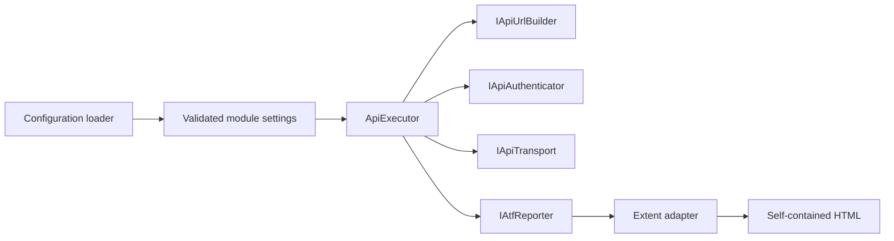
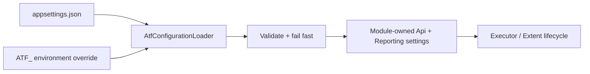
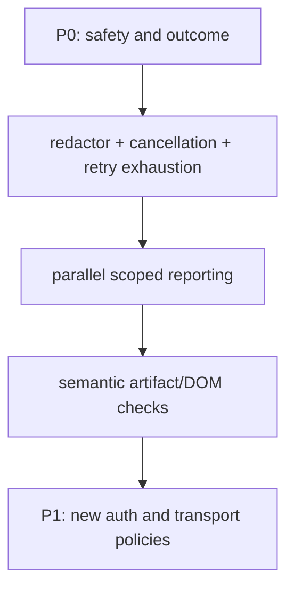

# Atf.Core — execution kernel

`Atf.Core` is the product-neutral kernel. It owns policies that should behave identically for every API module and remain testable without a live service.

## Responsibility boundary



Core does not know product route names, domain models, business schemas or scenario decisions. It does know how a configured request is represented, how URLs and auth are applied safely, how one exchange is retried and measured, and how evidence is delivered to the reporting port.

## Public contracts and patterns

| Contract / component | Pattern | Responsibility |
|---|---|---|
| `AtfConfigurationLoader` | configuration provider | Loads JSON, environment overlays and module settings |
| `ApiRequest`, `ApiRoute`, `ApiRouteAuthentication`, `ApiResponse` | value objects | Carry semantic HTTP data without Extent dependencies; route auth uses typed metadata |
| `IApiUrlBuilder` | port | Builds absolute URLs and encodes path/query values |
| `IApiAuthenticator` | port + strategy | Applies a named auth profile and exposes non-secret state |
| `IApiTransport` | port | Isolates network I/O from orchestration |
| `ApiExecutor` | pipeline/orchestrator | Executes one exchange and emits evidence in stable order |
| `RateLimitRetryPolicy` | strategy | Decides bounded retry behavior for configured statuses |
| `Polling` | deadline policy | Polls until satisfied or until the deadline |
| `IAtfReporter` | reporting port | Receives evidence without exposing Extent to domain code |
| `ExtentReportLifecycle` | adapter | Maps the lifecycle port to Extent |
| `ExtentTestScope` | scoped adapter | Maps steps, JSON, tables and status to one scenario node |
| `ExtentEvidenceRenderer` | presentation component | Owns the safe, collapsed HTML envelope for evidence |
| `AtfReportColors` | palette constants | Single source of truth for report colors and alpha surfaces |
| `AtfReportTheme` | theme provider | Expands the palette into the stylesheet |
| `ExtentAssetInliner` | artifact adapter | Embeds Extent CSS, JavaScript, fonts and logo |
| `ReportArtifactInspector` | executable specification | Verifies the HTML users actually open |

## Exchange sequence


`HTTP exchange completed` does not imply `functional contract passed`. The executor returns an `ApiExecutionResult`; `Atf.Common` validators decide whether it satisfies the requested contract.

The result is intentionally split into transport facts and functional verdict:

| State/fact | Owner | Meaning |
|---|---|---|
| `ApiResponse` | transport | status, headers, raw body, URL and duration observed |
| `Attempts` / `RetryEvents` | executor + retry policy | how the exchange reached its final response |
| `ValidationTable` | Common validators | all expected-vs-actual contract checks |
| Extent `Info` | reporter | technical evidence only; never a business pass |
| Extent `Pass`/`Fail` | validation/scenario lifecycle | functional contract and scenario outcome |

## Configuration

Settings are read from `Modules:Api:Config`:

```text
Modules:Api:Config:Api
  BaseUrl, TimeoutSeconds, WriteTestsEnabled
  TokenEnvironmentVariable, DefaultAuthProfile
  RateLimit, Polling, AuthProfiles, Routes

Modules:Api:Config:Reporting
  Engine = extent, ReportPath, TimestampEnabled
  TimestampFormat, DocumentTitle, ReportName
  AssertionMaxDisplayCharacters
```

The loader validates the absolute base URL, positive timeout/polling/rate-limit values,
the positive assertion display limit and the Extent-only reporting policy before the
fixture can start. `AssertionMaxDisplayCharacters` changes only the rendered `ACTUAL`
preview; it never changes the response used by a validator.

Configuration contract:



## Authentication and resilience

`ConfiguredApiAuthenticator` supports configured `none` and `bearer` profiles. It separately applies a header, describes the mode and describes only token availability. `ApiRouteAuthentication` adds a typed route declaration (`ApiAuthType` + `ApiAuthRequirement` + configurable profile) so the report can distinguish route intent from the effective runtime profile. The report never contains the token.

`RateLimitRetryPolicy` retries only configured statuses, reads delay headers in order, rejects unusable delays, falls back, caps the delay and stops at the retry budget. `Polling.UntilAsync` is deadline-based and returns the last value, attempt count, elapsed duration and a satisfaction flag.

## Reporting contract

```text
IAtfReporter                 framework-neutral evidence API
       |
ExtentTestScope              scenario-scoped adapter
       |
ExtentManager                process/report lifecycle facade
AtfReportTheme               centralized palette + CSS provider
ExtentEvidenceRenderer       evidence HTML presentation component
ExtentAssetInliner           offline asset embedding component
       |
ExtentSparkReporter         HTML generation
       |
ApplyCustomTheme + inline    final HTML normalization
       |
ReportAssetCleaner           remove sibling extent asset folder
       |
ReportArtifactInspector      verify consumer-facing contract
```

The final report must be one timestamped, self-contained HTML file; Extent assets are embedded; no `extent` folder is delivered; all surfaces share `--atf-dark`; class → scenario → phase → API step is preserved; request/response/JSON/assertion evidence is collapsed by default; JSON is wrapped and vertically scrollable; technical trace and assertions are compact tables.

The reporter renders evidence. It must not decide business validity. Validators own the assertion result.

Evidence ownership is also a security boundary: the current implementation reports
token availability rather than token content. The next hardening step is one redaction
pipeline applied before `Detail`, `Json`, exception text and configuration snapshots.

## Test map

```text
ConfigurationAndResilienceTests  loader, validation, retry, polling, JSON
CoreArchitectureTests          URL/auth/transport/path/asset policies
HttpExecutorComponentTests     retry result, route metadata and evidence
ApiExecutorCompositionTests    injected ports and exception preservation
ReportingComponentTests         status aggregation and evidence classification
ReportingStructureTests         phase siblings and active-step evidence
ReportArtifactInspectorTests    final HTML contract
ReportingLifecycleComponentTests fixture composition and finalization
```

Run:

```powershell
dotnet test .\Atf.Tests\Atf.Core.Tests\Atf.Core.Tests.csproj --no-restore --logger "console;verbosity=normal"
```

A new Core policy is acceptable only when it is product-neutral, exposed through a replaceable boundary where appropriate and covered by a deterministic test.

## Core contract checklist

| Area | Required invariant | Current guard |
|---|---|---|
| configuration | invalid base URL/timing/report engine fails before runtime | `ConfigurationAndResilienceTests` |
| URL/auth | path and query are encoded; secrets are described only by state | `CoreArchitectureTests`, `HttpExecutorComponentTests` |
| execution | transport is replaceable; retry result is explicit; reporter cannot replace the original exception | `ApiExecutorCompositionTests`, `HttpExecutorComponentTests` |
| resilience | retry status, delay source, cap and budget are deterministic | `ConfigurationAndResilienceTests`, `CoreArchitectureTests` |
| reporting | status aggregation is failure-first and evidence is attached to the active step | `ReportingComponentTests`, `ReportingStructureTests` |
| artifact | final HTML is self-contained and follows the visual/report contract | `ReportArtifactInspectorTests` |

## Test additions recommended for Core



The highest-value additions are deterministic and do not require a live endpoint:

| Proposed test | Component seam | Why it matters |
|---|---|---|
| `SecretsAreRedactedBeforeEvidence` | `IAtfReporter` recording fake | prevents credentials leaking through headers, JSON or exceptions |
| `CancellationPreservesOriginalException` | `IApiTransport` fake | distinguishes cancellation from ordinary HTTP failure |
| `RetryExhaustionReturnsDiagnosticNotPass` | scripted transport + reporter | protects against false green after final `429` |
| `ParallelRunsKeepIndependentScopes` | two async scopes | protects `AsyncLocal` and report hierarchy isolation |
| `ReportArtifactHasNoHorizontalOverflow` | generated HTML + DOM engine | protects the user-facing report rather than only CSS source |
| `ConfigurationRejectsUnknownOrConflictingKeys` | loader/schema provider | makes declarative configuration safe to evolve |

### Remaining safe increments

The current kernel intentionally supports `none` and `bearer` authentication, JSON configuration and an Extent-backed lifecycle facade. Reporting presentation is now split into `AtfReportTheme`, `ExtentEvidenceRenderer` and `ExtentAssetInliner`; the static `ExtentManager` remains only the process-scoped compatibility boundary required by the Extent integration. Future increments should add a central secret redactor, explicit transport correlation state, a runner-neutral report scope and a schema-backed configuration provider behind contracts and deterministic tests.

