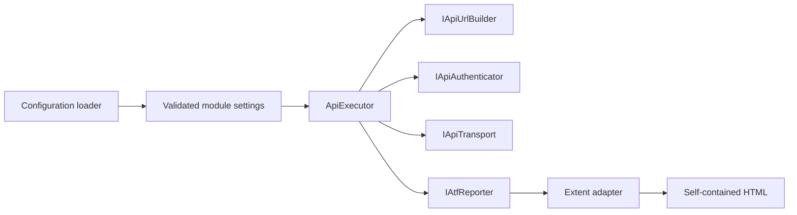
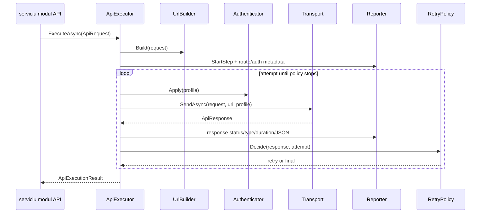
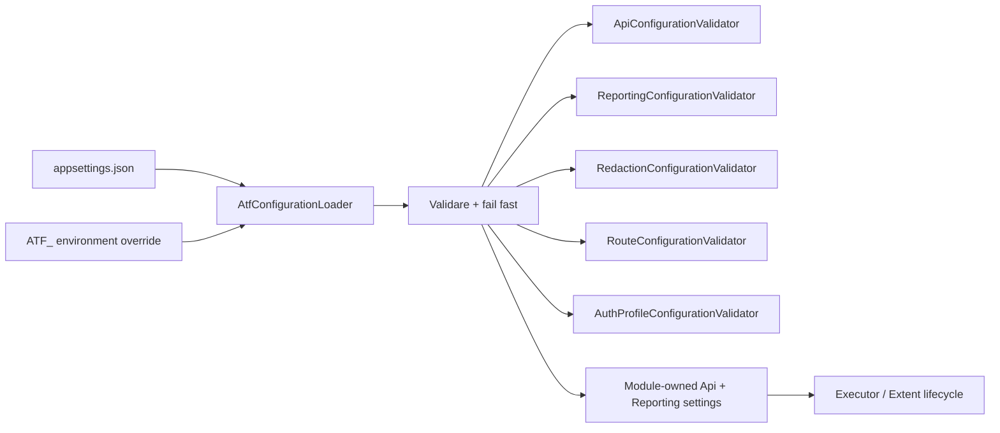
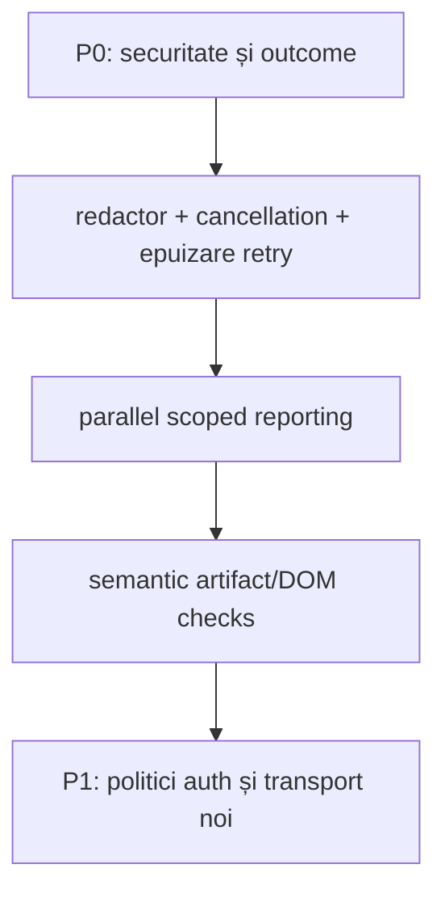

# Atf.Core — kernelul de execuție

Pentru modelul complet de dependențe, lifecycle și artifact Extent, consultă
[ghidul de arhitectură și raportare](../docs/ATF_Architecture.md).

`Atf.Core` este kernelul neutru față de produs. Deține politici care trebuie să
se comporte identic pentru fiecare modul API și să rămână testabile fără serviciu
live.

Rămâne un proiect separat în arhitectura simplificată. Implementarea fostului
`Atf.Common` se află acum în `Atf.Api/Module`; rutele de produs, modelele API și
intenția scenariilor nu trebuie să ajungă niciodată în Core. Core descrie
semantica execuției și evidence-ului, iar adaptorul Extent deține prezentarea lor
HTML.

## Boundary-ul responsabilității



Core nu cunoaște nume de rute ale produsului, modele de domeniu, scheme business
sau decizii de scenariu. Cunoaște însă reprezentarea unui request configurat,
aplicarea sigură a URL-urilor și autentificării, retry-ul și măsurarea unui schimb
și livrarea evidence-ului către portul de raportare.

**Starea boundary-ului:** separarea renderer-ului este implementată. `AtfAssertion`
și porturile de raportare rămân în Core ca și contracte neutre față de renderer;
formatatoarele HTML Extent și `ReportArtifactInspector` se află în
`Atf.Reporting.Extent`. Core nu trebuie să reintroducă `helm-*`, tag-uri HTML,
token-uri de temă sau selectori de browser.

## Auditul responsabilităților — perspectivă OOP strictă

`Atf.Core` este cel mai puternic boundary din soluție, dar nu este încă o
colecție de clase perfect coezive. Punctele de presiune sunt elemente intenționate
de backlog, nu motive pentru a sparge proiectul în mai multe pachete:

| Tip/zonă | Responsabilitate curentă | Țintă de refactorizare |
|---|---|---|
| `ApiExecutor` | buget timeout, selecție URL/auth, buclă retry, creare rezultat și orchestrarea evidence-ului | păstrează-l coordinator; extrage bugetul de execuție și runner-ul unui attempt numai când testele expun o politică distinctă |
| `Http/Transport/IApiTransport.cs` | port de transport | izolează I/O de rețea de orchestrare |
| `Http/Transport/HttpClientTransport.cs` | transport HTTP de producție | deține conversia request/response, nu politica de retry |
| `Http/Transport/IApiAuthenticator.cs` + `ConfiguredApiAuthenticator.cs` | port de autentificare și adaptor configurat | deleagă strategiile auth tipizate și redactează diagnosticul |
| `Http/Routing/ApiUrlBuilder.cs` | port/implementare pentru construcția URL-ului | deține doar URL-ul de bază și codificarea query-ului |
| `Configuration/ApiSettings.cs` și fișierele de setări surori | modele de binding JSON și copiere snapshot | păstrează modelele de binding la marginea configurației și valorile runtime immutable |
| `SensitiveDataRedactor` | JSON structurat, text liber, headere, query/path și mascarea PII | compune politici mici de redaction în spatele unei fațade; compilează pattern-urile o singură dată |
| `AtfAssertion` | model neutru față de renderer pentru rândul assertion | păstrează datele verdictului independente de HTML și Extent |

Regula Core este simplă: o politică nouă trebuie să fie neutră față de produs,
injectabilă atunci când face I/O sau lucrează cu timpul și acoperită de un test
determinist. Nu muta reguli de prezentare în Core doar pentru că HTML-ul final
este cel mai ușor loc în care pot fi observate.

## Contracte publice și tipare

| Contract / componentă | Tipar | Responsabilitate |
|---|---|---|
| `AtfConfigurationLoader` | provider de configurare | Încarcă JSON, suprapuneri de mediu și setări de modul |
| `ApiRequest`, `ApiRoute`, `ApiRouteAuthentication`, `ApiResponse` | obiecte valoare | Transportă date HTTP semantice fără dependențe Extent; auth-ul rutei folosește metadata tipizată |
| `IApiUrlBuilder` | port | Construiește URL-uri absolute și codifică valorile path/query |
| `IApiAuthenticator` | port + strategie | Aplică un profil auth numit și expune starea fără secrete |
| `IApiTransport` | port | Izolează I/O de rețea de orchestrare |
| `ApiExecutor` | pipeline/orchestrator | Execută un schimb și emite evidence în ordine stabilă |
| `RateLimitRetryPolicy` | strategie | decide comportamentul retry limitat pentru statusurile configurate |
| `Polling` | politică de deadline | Interoghează până la satisfacere sau până la deadline |
| `IAtfValidationReporter` | port îngust de validare | lifecycle + evidence/status pentru assertions, fără închiderea scenariului |
| `IAtfCleanupReporter` | port îngust pentru cleanup | doar lifecycle + pass/warning |
| `IAtfScenarioCompletionReporter` | port de închidere a scenariului | pass/fail/skip la boundary-ul scenariului |
| `IAtfReporter` | agregat de compatibilitate | păstrat pentru fake-urile/adaptoarele existente; consumatorii noi folosesc porturi înguste |
| `SensitiveDataRedactor` | politică de boundary | Igienizează evidence structurat și liber înainte de a ajunge la reporter |
| `AtfAssertion` | model de evidence | Transportă numele assertion-ului, expected, actual și verdictul fără prezentare |

## Exchange sequence



`HTTP exchange completed` nu implică `functional contract passed`. Executorul
publică evidence de transport cu status informativ; `Atf.Api/Module` deschide apoi
exact o validare agregată de contract, ca următor sibling al request-ului sub aceeași
fazele și decide dacă response-ul respectă contractul cerut. Validarea se închide
imediat după publicarea tabelului. Ierarhia randată
ierarhia este `phase → request + contract validation sibling → one table`.

`ApiExecutionReporter` este adaptorul de pe partea de execuție. Mapează faptele
request/response în proprietăți stabile ale raportului, JSON request, JSON
response și diagnostice retry. Politica best-effort este intenționată: un renderer
defect nu poate transforma un response HTTP reușit într-un test eșuat și nu poate
înlocui excepția originală de transport. Executorul rămâne astfel coerent, iar
markup-ul Extent rămâne în boundary-ul de raportare.

Rezultatul este împărțit intenționat în fapte de transport și verdict funcțional:

| State/fact | Owner | Meaning |
|---|---|---|
| `ApiResponse` | transport | status, headere, body brut, URL și durata observată |
| `Attempts` / `RetryEvents` | executor + politica de retry | cum a ajuns schimbul la response-ul final |
| `ValidationTable` | API module validators | all expected-vs-actual contract checks |
| Extent `Info` | reporter | doar evidence tehnic; niciodată Pass de business |
| Extent `Pass`/`Fail` | lifecycle validation/scenariu | contract funcțional și rezultat al scenariului |

## Configurare

Setările sunt citite din `Modules:Api:Config`:

```text
Modules:Api:Config:Api
  BaseUrl, TimeoutSeconds, WriteTestsEnabled
  TokenEnvironmentVariable, DefaultAuthProfile
  RateLimit, Polling, AuthProfiles, Routes

Modules:Api:Config:Reporting
  Engine = extent, ReportPath, TimestampEnabled
  TimestampFormat, DocumentTitle, ReportName
  AssertionMaxDisplayCharacters

Modules:Api:Config:Api:Redaction
  Enabled, Replacement
  RedactLocalPaths, LocalPathReplacement
  SensitiveKeys, PiiEnabled, PiiKeys
```

Loader-ul validează URL-ul absolut de bază, valorile pozitive pentru timeout,
polling și rate-limit, limita pozitivă de afișare a assertion-ului și politica de
raportare exclusiv Extent înainte de pornirea fixture-ului.
`AssertionMaxDisplayCharacters` schimbă doar previzualizarea `ACTUAL` randată;
nu modifică response-ul folosit de validator.

Redaction-ul se aplică doar copiei trimise la raportare. Cheile secrete și
credențialele de transport sunt mascate implicit; mascarea PII este explicită prin
`PiiEnabled`, astfel încât echipele să poată decide dacă identificatorii business
rămân disponibili pentru diagnostic.
 Căile locale Windows din evidence-ul excepției sunt mascate implicit ca
`[LOCAL_PATH]`, păstrând sufixul liniei sursă. `RedactLocalPaths=false` se
folosește numai într-o rulare locală de diagnostic, asumată explicit.
`Redaction.Enabled=false` nu este ocolire pentru secrete: authorization, token,
cookie, API-key și câmpurile sensibile configurate rămân mascate. Flag-ul oprește
doar transformările opționale de path/PII într-o rulare locală explicită.

Compoziția runtime folosește `ApiSettingsSnapshot`: executorul copiază profund
`RateLimit`, `Polling`, `AuthProfiles`, `Redaction` and `Routes` at
construction time. Mutating an array, header dictionary or profile in the
configurația host-ului după începerea execuției nu poate schimba un request activ;
regula este protejată de `ApiSettingsSnapshotTests`.

Configuration contract:



`AtfConfigurationValidator` este doar coordonatorul boundary-ului. Fiecare
validator intern de mai sus deține un singur set de reguli și păstrează mesajele
de compatibilitate ale contractului public `AtfConfiguration.Validate()`. Acest
split permite teste unitare directe pe API, reporting, redaction, routes și auth
fără să transforme configurația într-o clasă monolitică. Nu se introduc încă
diagnostice noi sau o schimbare de ordine: refactorul este intenționat
comportamental neutru.

## Autentificare și reziliență

`ConfiguredApiAuthenticator` transformă boundary-ul de configurare bazat pe
string-uri în strategii tipizate pentru headerele `none`, `bearer`, `api-key`,
`basic` și `custom`. Slăbiciunea de design rămasă este la boundary:
`AuthProfileSettings.Type` și placeholder-ele de header sunt încă string-uri
libere, astfel încât validarea și rezolvarea runtime dublează vocabularul modurilor
suportate. `ApiRouteAuthentication` adaugă o declarație tipizată a rutei
(`ApiAuthType` + `ApiAuthRequirement` + profil configurabil), astfel încât raportul
să distingă intenția rutei de profilul runtime efectiv. Raportul nu conține
niciodată token-ul.

## Findings curente de refactorizare (2026-10-13)

Core este într-o poziție bună, dar findings-urile active nu înseamnă că toate
politicile sunt complet închise. Kernelul trebuie să rămână renderer-neutral și
determinist; orice logică Extent, HTML, CSS, JavaScript sau xUnit aparține
adaptorului ori host-ului.

Punctele care cer refactorizare, nu funcționalitate nouă, sunt:

- `ApiExecutor` rămâne coordonator; `ApiAttemptRunner` se extrage numai dacă
  retry history, timeout-ul și cancellation au un contract separat și teste proprii;
- `ApiExecutionResult` trebuie să păstreze explicit response-ul final, cauza de
  transport, cancellation, duration, correlation id și fiecare attempt;
- `IAtfReporter` este un port necesar, dar publicarea evidence nu trebuie să
  poată înlocui excepția funcțională;
- redaction-ul trebuie verificat printr-o matrice pentru header, query, path,
  request body, response body și exception text;
- snapshot-ul de configurație trebuie să rămână immutable după validarea de startup;
- testele xUnit nu sunt responsabilitatea Core și nu trebuie importate doar pentru
  a verifica politici de execuție.

### Contract de autoritate

```text
transport fact -> ApiExecutionResult -> validation outcome -> scenario verdict
                         \-> evidence publication (best effort)
```

Un failure al reporterului poate reduce diagnosticul, dar nu poate transforma un
failure funcțional în Pass și nu poate înlocui cauza originală. Acesta este
contractul pe care trebuie să-l protejeze testele Core.

Acest kernel nu este locul pentru o rescriere largă. `ApiExecutor` este deja un
orchestrator mic, cu seam-uri separate pentru URL, auth, transport și evidence.
Îmbunătățirile cu valoare mare sunt mai înguste:

1. înlocuiește setările mutabile și dicționarele copiate cu un snapshot runtime
   immutable și validat;
2. transformă vocabularul modurilor de auth într-un registru tipizat la încărcarea configurației;
3. introdu un rezultat explicit pentru eroare de transport, cancellation,
   response final și retry history, fără ca apelanții să deducă starea;
4. păstrează `SensitiveDataRedactor` obligatoriu pentru output-ul raportului chiar
   și când o rulare locală cere mai puțină mascarea; dezactivarea securității
   trebuie să fie o politică explicită și protejată.

Separarea redaction-ului este implementată: `SensitiveDataRedactor` compune
`StructuredJsonRedactor`, `SecretPatternRedactor`, `QueryStringRedactor`,
`LocalPathRedactor` și `PiiRedactor`. Fațada publică deține doar ordinea și
contractul boundary-ului de raportare; fiecare strategie deține o singură
transformare. `ApiScenarioOutcome` este implementat și în host-ul API ca rezultat
explicit și închis de lifecycle. Ținta rămasă este configurația runtime immutable
și vocabularul auth tipizat, nu un al doilea model nullable de rezultat.
Vezi [evaluarea de refactorizare](../docs/ATF_Refactoring_Assessment.md) pentru
rațiunea extragerilor și seam-urile deschise.

Ordinea redaction-ului este deterministă:

```text
field -> sensitive-field replacement
      -> query-string masking
      -> secret-pattern masking
      -> optional local-path masking
      -> optional PII masking
JSON  -> recursive field-aware traversal -> same text pipeline for strings
```

Setarea `Enabled` nu dezactivează mascarea secretelor. Controlează doar
transformările opționale pentru path/PII, astfel încât o configurație de
diagnostic să nu poată publica accidental credențiale.

`RateLimitRetryPolicy` face retry numai pentru statusuri configurate, citește
headerele de delay în ordine, respinge delay-urile inutilizabile, folosește
fallback, limitează delay-ul și se oprește la bugetul de retry.
`Polling.UntilAsync` folosește un deadline și returnează ultima valoare, numărul
de attempt-uri, durata scursă și un flag de satisfacere.

## Contractul de raportare

```text
IAtfReporter                 API evidence neutră față de framework
IAtfScenarioScope            port pentru lifecycle-ul scenariului
       |
Atf.Reporting.Extent         concrete Extent adapter assembly
       |
ExtentSparkReporter          HTML generation
       |
ApplyCustomTheme + inline    final HTML normalization
       |
ReportAssetCleaner            remove sibling extent asset folder
       |
Atf.Reporting.Extent           randează și inspectează contractul HTML vizibil utilizatorului
```

Raportul final trebuie să fie un singur fișier HTML autonom, cu timestamp;
asset-urile Extent sunt inline, folderul `extent` nu este livrat, toate suprafețele
folosesc `--atf-dark`, iar ierarhia clasă → scenariu → fază → pas API este
păstrată. Evidence-ul request/response/JSON/assertion este colapsat implicit,
JSON-ul este împachetat și scrollabil vertical, iar technical trace și assertions
sunt tabele compacte.

Reporterul randează evidence și nu decide validitatea business. Validatorii dețin
rezultatul assertion-ului. Fazele lifecycle sunt containere structurale și nu
randează un rând generic `Execution summary · N fields`. Câmpurile exclusiv de
context sunt suprimate chiar dacă sosesc când ultimul nod HTTP este activ;
evidence-ul tehnic aparține request-ului HTTP, iar validarea contractului este
următorul sibling al fazei și deține tabelul agregat.

Scriptul client embedded are un singur selector canonic
`directScenarioCards(item)`. Totalurile Overview și auditul secundar al tag-urilor
trebuie să numere aceleași noduri directe ale scenariilor; nu trebuie să deducă
totaluri din containerele claselor sau să apeleze un selector nedefinit.

Ownership-ul evidence-ului este și boundary de securitate: implementarea curentă
raportează disponibilitatea tokenului, nu conținutul lui, și aplică o singură
pipeline de redaction înainte de `Detail`, `Json`, valorile assertion-urilor,
diagnosticele retry și textul excepției. JSON-ul structurat este parcurs recursiv;
textul liber maschează de asemenea headerele de authorization, cheile API,
cookie-urile, secretele din query-string și adresele de email. Request-ul și
excepția originale rămân neschimbate pentru semantica execuției; numai copia
trimisă reporterului este igienizată.

Istoricul retry este emis ca evidence informativ explicit (`Attempt N → HTTP status
→ retry in delay`), astfel încât response-ul final și traseul care a dus la el să
fie vizibile fără ca diagnosticul transportului să devină Pass funcțional.

## Harta testelor

```text
ConfigurationAndResilienceTests  loader, validare, retry, polling, JSON
CoreArchitectureTests          politici URL/auth/transport/path/asset
HttpExecutorComponentTests     rezultat retry, metadata rută și evidence
ApiExecutorCompositionTests    porturi injectate și păstrarea excepțiilor
ReportingComponentTests         agregarea statusului și clasificarea evidence-ului
ReportingStructureTests         ownership phase/request + validation și evidence al step-ului activ
ReportingLifecycleComponentTests compoziția fixture-ului și finalizarea
```

Rulare:

```powershell
dotnet test .\Atf.Tests\Atf.Core.Tests\Atf.Core.Tests.csproj --no-restore --logger "console;verbosity=normal"
```

O politică nouă în Core este acceptabilă numai dacă este neutră față de produs,
expusă printr-un boundary înlocuibil când este cazul și acoperită de un test
determinist.

## Core contract checklist

| Zonă | Invariantă obligatorie | Protecție curentă |
|---|---|---|
| configurație | URL-ul de bază, timing-ul sau engine-ul invalid eșuează înainte de runtime; fiecare regulă de boundary este izolată | `ConfigurationAndResilienceTests`, `ConfigurationRuleTests` |
| URL/auth | path-ul și query-ul sunt codificate; secretele sunt descrise doar prin stare | `CoreArchitectureTests`, `HttpExecutorComponentTests` |
| execuție | transportul este înlocuibil; rezultatul retry este explicit; reporterul nu poate înlocui excepția originală | `ApiExecutorCompositionTests`, `HttpExecutorComponentTests` |
| reziliență | statusul retry, sursa delay-ului, plafonul și bugetul sunt deterministe | `ConfigurationAndResilienceTests`, `CoreArchitectureTests` |
| raportare | agregarea statusului respectă failure-first; un response produce un singur tabel agregat pe sibling-ul următor, sub aceeași fază | `ReportingComponentTests`, `ReportingStructureTests`, `ApiExecutorReportingTests` |
| model evidence | rândurile assertion rămân neutre față de renderer și păstrează valorile actuale | `ReportingComponentTests`, `ApiExecutorReportingTests` |

## Teste recomandate suplimentar pentru Core



Adăugirile cu cea mai mare valoare sunt deterministe și nu necesită endpoint live:

| Test propus | Seam componentă | De ce contează |
|---|---|---|
| `SecretsAreRedactedBeforeEvidence` | fake recorder pentru `IAtfReporter` | împiedică scurgerea credențialelor prin headere, JSON sau excepții |
| `CancellationPreservesOriginalException` | fake pentru `IApiTransport` | diferențiază cancellation de un failure HTTP obișnuit |
| `RetryExhaustionReturnsDiagnosticNotPass` | transport scriptat + reporter | protejează împotriva unui rezultat fals verde după ultimul `429` |
| `ParallelRunsKeepIndependentScopes` | două scope-uri async | protejează izolarea `AsyncLocal` și a ierarhiei raportului |
| `ReportArtifactHasNoHorizontalOverflow` | HTML generat + motor DOM | protejează raportul vizibil utilizatorului, nu doar sursa CSS |
| `ConfigurationRejectsUnknownOrConflictingKeys` | loader/provider de schemă | face configurația declarativă sigură la evoluție |

### Remaining safe increments

Înaintea oricărei extinderi de API, adăugați teste pentru:

| Seam | Test obligatoriu | Criteriu |
|---|---|---|
| transport | timeout și cancellation | cauza originală și starea anulării rămân distincte |
| retry | exhaustion și `Retry-After` | nu se emite verdict funcțional Pass dintr-un exchange nereușit |
| concurrency | două execuții paralele | evidence și scope-urile nu se amestecă |
| redaction | matrice de secrete | niciun secret nu ajunge în reporter, exception sau snapshot |
| configuration | chei necunoscute/conflictuale | fail fast cu path complet și mesaj determinist |
| reporting port | reporter care aruncă | rezultatul funcțional rămâne autoritar |

Acestea sunt teste de contract; nu introduceți un nou strat `Shared` sau
`Utils` pentru a le găzdui.

Kernelul curent suportă intenționat strategiile de autentificare `none`, `bearer`,
`apikey`, `basic` și `custom` în spatele unui boundary JSON bazat pe string-uri,
plus porturi de raportare neutre față de renderer. Lifecycle-ul Extent,
prezentarea și inline-ul asset-urilor sunt implementate de
`Atf.Reporting.Extent`; niciun manager static Extent nu deține starea testelor.
Renderer-ele viitoare trebuie să depindă de aceleași contracte Core și de aceleași
teste deterministe ale artifactului.


