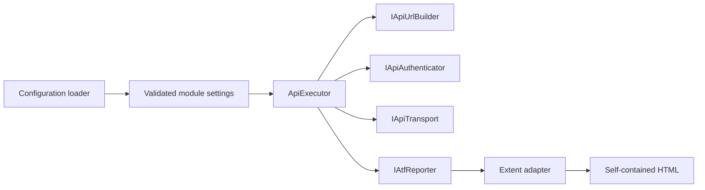
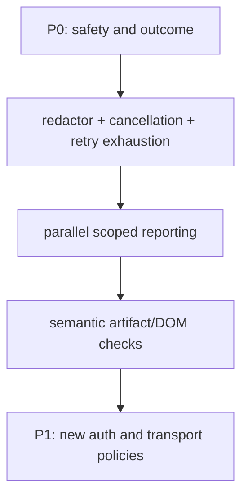

# Atf.Core — execution kernel

For the complete dependency, lifecycle and Extent artifact model, see the
[architecture and reporting guide](../docs/ATF_Architecture.md).

`Atf.Core` is the product-neutral kernel. It owns policies that should behave identically for every API module and remain testable without a live service.

It remains a separate project in the simplified architecture. The former
`Atf.Common` implementation now lives in `Atf.Api/Module`; product routes, API models and scenario intent
must never move into Core. Core describes execution and evidence semantics; the
Extent adapter owns their HTML presentation.

## Responsibility boundary



Core does not know product route names, domain models, business schemas or scenario decisions. It does know how a configured request is represented, how URLs and auth are applied safely, how one exchange is retried and measured, and how evidence is delivered to the reporting port.

**Boundary status:** the renderer split is now implemented. `AtfAssertion` and
the reporting ports remain in Core as renderer-neutral contracts; Extent HTML
formatters and `ReportArtifactInspector` live in `Atf.Reporting.Extent`. Core
must not reintroduce `helm-*`, HTML tags, theme tokens or browser selectors.

## Responsibility audit — strict OOP view

`Atf.Core` is the strongest boundary in the solution, but it is not yet a
collection of perfectly cohesive classes. The pressure points are intentional
backlog items, not reasons to break the project into more packages:

| Type/area | Current responsibility | Refactoring target |
|---|---|---|
| `ApiExecutor` | timeout budget, URL/auth selection, retry loop, result creation and evidence orchestration | keep it as coordinator; extract an execution budget and an attempt runner only when tests expose a distinct policy |
| `Http/Transport/IApiTransport.cs` | transport port | isolates network I/O from orchestration |
| `Http/Transport/HttpClientTransport.cs` | production HTTP transport | owns request/response conversion, not retry policy |
| `Http/Transport/IApiAuthenticator.cs` + `ConfiguredApiAuthenticator.cs` | authentication port and configured adapter | delegates typed auth strategies and redacts diagnostics |
| `Http/Routing/ApiUrlBuilder.cs` | URL construction port/implementation | owns only base URL and query encoding |
| `Configuration/ApiSettings.cs` and sibling settings files | JSON binding models and snapshot copying | keep binding models at the configuration edge and keep runtime values immutable |
| `SensitiveDataRedactor` | structured JSON, free text, headers, query/path and PII masking | compose small redaction policies behind one facade; compile patterns once |
| `AtfAssertion` | renderer-neutral assertion row model | keep verdict data independent from HTML and Extent |

The Core rule is simple: a new policy must be product-neutral, injectable when
it performs I/O or time-based work, and covered by a deterministic test. Do not
move presentation rules into Core just because the final HTML is the easiest
place to observe them.

## Public contracts and patterns

| Contract / component | Pattern | Responsibility |
|---|---|---|
| `AtfConfigurationLoader` | configuration provider | Loads JSON, environment overlays and module settings |
| `ApiRequest`, `ApiRoute`, `ApiRouteAuthentication`, `ApiResponse` | value objects | Carry semantic HTTP data without Extent dependencies; route auth uses typed metadata |
| `IApiUrlBuilder` | port | Builds absolute URLs and encodes path/query values |
| `IApiAuthenticator` | port + strategy | Applies a named auth profile and exposes non-secret state |
| `IApiTransport` | port | Isolates network I/O from orchestration |
| `ApiExecutor` | pipeline/orchestrator | Executes one exchange and emits evidence in stable order |
| `RateLimitRetryPolicy` | strategy | Decides bounded retry behavior for configured statuses |
| `Polling` | deadline policy | Polls until satisfied or until the deadline |
| `IAtfValidationReporter` | narrow validation port | lifecycle + assertion evidence/status without scenario completion |
| `IAtfCleanupReporter` | narrow cleanup port | lifecycle + pass/warning only |
| `IAtfScenarioCompletionReporter` | scenario completion port | pass/fail/skip at scenario boundary |
| `IAtfReporter` | compatibility aggregate | retained for existing fakes/adapters; new consumers use narrow ports |
| `SensitiveDataRedactor` | boundary policy | Sanitizes structured and free-form evidence before it reaches a reporter |
| `AtfAssertion` | evidence model | Carries assertion name, expected, actual and verdict without presentation |

## Exchange sequence


`HTTP exchange completed` does not imply `functional contract passed`. The executor
publishes transport evidence with an informational status; `Atf.Api/Module` then opens
exactly one aggregate contract validation as the next sibling of that request under the same
phase and decides whether that response satisfies the requested contract.
The validation closes immediately after its table is published. The rendered
hierarchy is `phase → request + contract validation sibling → one table`.

`ApiExecutionReporter` is the execution-side adapter. It maps request/response
facts to stable report properties, request JSON, response JSON and retry
diagnostics. Its best-effort policy is intentional: a broken renderer cannot
turn a successful HTTP response into a failed test or replace the original
transport exception. This keeps the executor cohesive and leaves Extent markup
inside the reporting boundary.

The result is intentionally split into transport facts and functional verdict:

| State/fact | Owner | Meaning |
|---|---|---|
| `ApiResponse` | transport | status, headers, raw body, URL and duration observed |
| `Attempts` / `RetryEvents` | executor + retry policy | how the exchange reached its final response |
| `ValidationTable` | API module validators | all expected-vs-actual contract checks |
| Extent `Info` | reporter | technical evidence only; never a business pass |
| Extent `Pass`/`Fail` | validation/scenario lifecycle | functional contract and scenario outcome |

## Configuration

Settings are read from `Modules:Api:Config`:

```text
Modules:Api:Config:Api
  BaseUrl, TimeoutSeconds, WriteTestsEnabled
  TokenEnvironmentVariable, DefaultAuthProfile
  RateLimit, Polling, AuthProfiles, Routes

Modules:Api:Config:Reporting
  Engine = extent, ReportPath, TimestampEnabled
  TimestampFormat, DocumentTitle, ReportName
  AssertionMaxDisplayCharacters

Modules:Api:Config:Api:Redaction
  Enabled, Replacement
  RedactLocalPaths, LocalPathReplacement
  SensitiveKeys, PiiEnabled, PiiKeys
```

The loader validates the absolute base URL, positive timeout/polling/rate-limit values,
the positive assertion display limit and the Extent-only reporting policy before the
fixture can start. `AssertionMaxDisplayCharacters` changes only the rendered `ACTUAL`
preview; it never changes the response used by a validator.

Redaction is applied only to the copy sent to reporting. Secret keys and transport
credentials are masked by default; PII masking is explicit through `PiiEnabled` so
teams can choose whether business identifiers remain available for diagnostics.
Local Windows paths in exception evidence are masked by default as
`[LOCAL_PATH]` while preserving the source line suffix. Set
`RedactLocalPaths=false` only for a deliberately local diagnostic run.
`Redaction.Enabled=false` is not a secret bypass: authorization, token,
cookie, API-key and configured sensitive fields remain masked. The flag only
turns off optional path/PII transformations for an explicitly local run.

Runtime composition uses `ApiSettingsSnapshot`: the executor deep-copies
`RateLimit`, `Polling`, `AuthProfiles`, `Redaction` and `Routes` at
construction time. Mutating an array, header dictionary or profile in the
host configuration after execution starts cannot change an active request;
this is protected by `ApiSettingsSnapshotTests`.

Configuration contract:


`AtfConfigurationValidator` este doar coordonatorul boundary-ului. Fiecare
validator intern de mai sus deține un singur set de reguli și păstrează mesajele
de compatibilitate ale contractului public `AtfConfiguration.Validate()`. Acest
split permite teste unitare directe pe API, reporting, redaction, routes și auth
fără să transforme configurația într-o clasă monolitică. Nu se introduc încă
diagnostice noi sau o schimbare de ordine: refactorul este intenționat
comportamental neutru.

## Authentication and resilience

`ConfiguredApiAuthenticator` resolves the string-based configuration boundary to
typed strategies for `none`, `bearer`, `api-key`, `basic` and `custom` headers.
The remaining design weakness is at the boundary: `AuthProfileSettings.Type`
and header placeholders are still free-form strings, so validation and runtime
resolution duplicate the supported-mode vocabulary. `ApiRouteAuthentication`
adds a typed route declaration (`ApiAuthType` + `ApiAuthRequirement` +
configurable profile) so the report can distinguish route intent from the
effective runtime profile. The report never contains the token.

## Current refactor findings (2026-10-13)

Core este într-o poziție bună, dar findings-urile active nu înseamnă că toate
politicile sunt complet închise. Kernelul trebuie să rămână renderer-neutral și
determinist; orice logică Extent, HTML, CSS, JavaScript sau xUnit aparține
adaptorului ori host-ului.

Punctele care cer refactorizare, nu funcționalitate nouă, sunt:

- `ApiExecutor` rămâne coordonator; `ApiAttemptRunner` se extrage numai dacă
  retry history, timeout-ul și cancellation au un contract separat și teste proprii;
- `ApiExecutionResult` trebuie să păstreze explicit response-ul final, cauza de
  transport, cancellation, duration, correlation id și fiecare attempt;
- `IAtfReporter` este un port necesar, dar publicarea evidence nu trebuie să
  poată înlocui excepția funcțională;
- redaction-ul trebuie verificat printr-o matrice pentru header, query, path,
  request body, response body și exception text;
- snapshot-ul de configurație trebuie să rămână immutable după validarea de startup;
- testele xUnit nu sunt responsabilitatea Core și nu trebuie importate doar pentru
  a verifica politici de execuție.

### Contract de autoritate

```text
transport fact -> ApiExecutionResult -> validation outcome -> scenario verdict
                         \-> evidence publication (best effort)
```

Un failure al reporterului poate reduce diagnosticul, dar nu poate transforma un
failure funcțional în Pass și nu poate înlocui cauza originală. Acesta este
contractul pe care trebuie să-l protejeze testele Core.

This kernel is not the first place to perform a broad rewrite. `ApiExecutor` is
already a small orchestrator (about 129 lines) with separate URL, auth,
transport and evidence seams. The high-value improvements are narrower:

1. replace mutable settings plus copied dictionaries with an immutable validated
   runtime snapshot;
2. make the auth-mode vocabulary a typed registry at configuration load time;
3. introduce an explicit execution outcome for transport error, cancellation,
   final response and retry history instead of forcing callers to infer state;
4. keep `SensitiveDataRedactor` mandatory for report output even when a local
   diagnostic run requests less masking; disabling security should be an
   explicit, guarded policy, not an accidental configuration switch.

The redaction split is now implemented: `SensitiveDataRedactor` composes
`StructuredJsonRedactor`, `SecretPatternRedactor`, `QueryStringRedactor`,
`LocalPathRedactor` and `PiiRedactor`. The public facade owns only ordering and
the report-boundary contract; the strategies own one transformation each.
`ApiScenarioOutcome` is also implemented in the API host as the explicit
closed lifecycle result. The remaining design target is immutable runtime
configuration and typed auth vocabulary, not a second nullable outcome model.
See the [refactoring assessment](../docs/ATF_Refactoring_Assessment.md) for
the extraction rationale and open seams.

The redaction order is deterministic:

```text
field -> sensitive-field replacement
      -> query-string masking
      -> secret-pattern masking
      -> optional local-path masking
      -> optional PII masking
JSON  -> recursive field-aware traversal -> same text pipeline for strings
```

The `Enabled` setting does not disable secret masking. It only controls the
optional path/PII transformations, so a diagnostic configuration cannot
accidentally publish credentials.

`RateLimitRetryPolicy` retries only configured statuses, reads delay headers in order, rejects unusable delays, falls back, caps the delay and stops at the retry budget. `Polling.UntilAsync` is deadline-based and returns the last value, attempt count, elapsed duration and a satisfaction flag.

## Reporting contract

```text
IAtfReporter                 framework-neutral evidence API
IAtfScenarioScope            scenario lifecycle port
       |
Atf.Reporting.Extent         concrete Extent adapter assembly
       |
ExtentSparkReporter          HTML generation
       |
ApplyCustomTheme + inline    final HTML normalization
       |
ReportAssetCleaner            remove sibling extent asset folder
       |
Atf.Reporting.Extent           render and inspect consumer-facing HTML contract
```

The final report must be one timestamped, self-contained HTML file; Extent assets are embedded; no `extent` folder is delivered; all surfaces share `--atf-dark`; class → scenario → phase → API step is preserved; request/response/JSON/assertion evidence is collapsed by default; JSON is wrapped and vertically scrollable; technical trace and assertions are compact tables.

The reporter renders evidence. It must not decide business validity. Validators own the assertion result. Lifecycle phases are structural containers: they do not render a generic `Execution summary · N fields` row. Context-only fields (fixture ids, combination shape and similar runner metadata) are suppressed even when they arrive while the last HTTP node is still active; technical evidence belongs to the HTTP request, while its contract validation is the next phase sibling that owns the aggregate assertion table.

The embedded client script also has one canonical `directScenarioCards(item)` selector. Overview totals and the secondary tag audit must count the same direct scenario nodes; they must never infer totals from class containers or accidentally call an undefined selector.

Evidence ownership is also a security boundary: the current implementation reports
token availability rather than token content and applies one redaction pipeline before
`Detail`, `Json`, assertion values, retry diagnostics and exception text. Structured
JSON is traversed recursively; free-form text also masks authorization headers, API
keys, cookies, query-string secrets and email addresses. The original request and
exception remain untouched for execution semantics, while only the reporter copy is
sanitized.

Retry history is emitted as explicit informational evidence (`Attempt N → HTTP status
→ retry in delay`) so the final response and the path taken to reach it are both
visible without turning transport diagnostics into a functional pass.

## Test map

```text
ConfigurationAndResilienceTests  loader, validation, retry, polling, JSON
CoreArchitectureTests          URL/auth/transport/path/asset policies
HttpExecutorComponentTests     retry result, route metadata and evidence
ApiExecutorCompositionTests    injected ports and exception preservation
ReportingComponentTests         status aggregation and evidence classification
ReportingStructureTests         phase/request + validation ownership and active-step evidence
ReportingLifecycleComponentTests fixture composition and finalization
```

Run:

```powershell
dotnet test .\Atf.Tests\Atf.Core.Tests\Atf.Core.Tests.csproj --no-restore --logger "console;verbosity=normal"
```

A new Core policy is acceptable only when it is product-neutral, exposed through a replaceable boundary where appropriate and covered by a deterministic test.

## Core contract checklist

| Area | Required invariant | Current guard |
|---|---|---|
| configuration | invalid base URL/timing/report engine fails before runtime; each boundary rule is isolated | `ConfigurationAndResilienceTests`, `ConfigurationRuleTests` |
| URL/auth | path and query are encoded; secrets are described only by state | `CoreArchitectureTests`, `HttpExecutorComponentTests` |
| execution | transport is replaceable; retry result is explicit; reporter cannot replace the original exception | `ApiExecutorCompositionTests`, `HttpExecutorComponentTests` |
| resilience | retry status, delay source, cap and budget are deterministic | `ConfigurationAndResilienceTests`, `CoreArchitectureTests` |
| reporting | status aggregation is failure-first; one response produces one aggregate validation table on the next sibling under the same phase | `ReportingComponentTests`, `ReportingStructureTests`, `ApiExecutorReportingTests` |
| evidence model | assertion rows remain renderer-neutral and preserve actual values | `ReportingComponentTests`, `ApiExecutorReportingTests` |

## Test additions recommended for Core



The highest-value additions are deterministic and do not require a live endpoint:

| Proposed test | Component seam | Why it matters |
|---|---|---|
| `SecretsAreRedactedBeforeEvidence` | `IAtfReporter` recording fake | prevents credentials leaking through headers, JSON or exceptions |
| `CancellationPreservesOriginalException` | `IApiTransport` fake | distinguishes cancellation from ordinary HTTP failure |
| `RetryExhaustionReturnsDiagnosticNotPass` | scripted transport + reporter | protects against false green after final `429` |
| `ParallelRunsKeepIndependentScopes` | two async scopes | protects `AsyncLocal` and report hierarchy isolation |
| `ReportArtifactHasNoHorizontalOverflow` | generated HTML + DOM engine | protects the user-facing report rather than only CSS source |
| `ConfigurationRejectsUnknownOrConflictingKeys` | loader/schema provider | makes declarative configuration safe to evolve |

### Remaining safe increments

Înaintea oricărei extinderi de API, adăugați teste pentru:

| Seam | Test obligatoriu | Criteriu |
|---|---|---|
| transport | timeout și cancellation | cauza originală și starea anulării rămân distincte |
| retry | exhaustion și `Retry-After` | nu se emite verdict funcțional Pass dintr-un exchange nereușit |
| concurrency | două execuții paralele | evidence și scope-urile nu se amestecă |
| redaction | matrice de secrete | niciun secret nu ajunge în reporter, exception sau snapshot |
| configuration | chei necunoscute/conflictuale | fail fast cu path complet și mesaj determinist |
| reporting port | reporter care aruncă | rezultatul funcțional rămâne autoritar |

Acestea sunt teste de contract; nu introduceți un nou strat `Shared` sau
`Utils` pentru a le găzdui.

The current kernel intentionally supports `none`, `bearer`, `apikey`, `basic`
and `custom` authentication strategies behind a JSON-friendly string boundary,
plus renderer-neutral reporting ports. The Extent lifecycle,
presentation and asset inlining are implemented by `Atf.Reporting.Extent`; no
static Extent manager owns test state. Future renderers must depend on the same
Core contracts and deterministic artifact tests.


