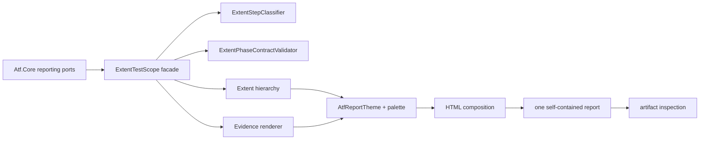
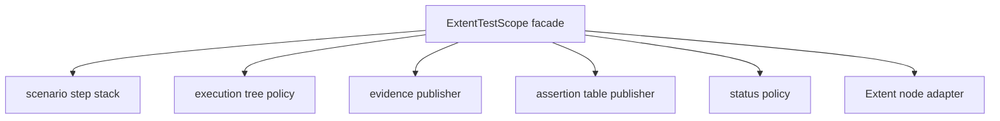
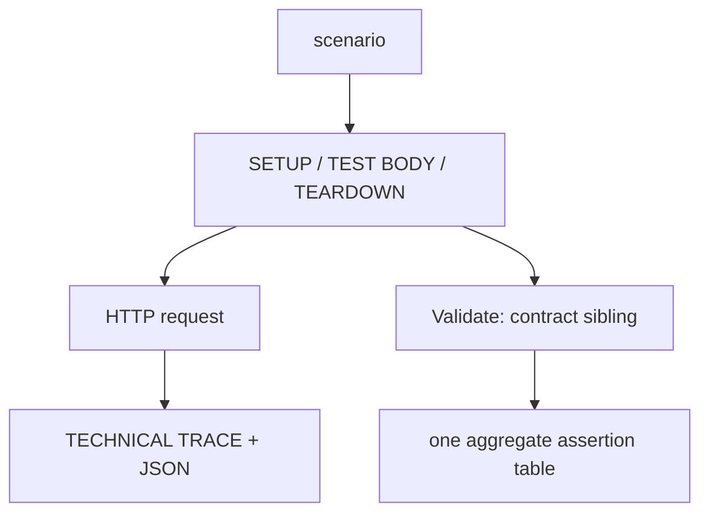

# Atf.Reporting.Extent — raportarea HTML

`Atf.Reporting.Extent` este adaptorul concret dintre porturile de raportare
renderer-neutral din `Atf.Core` și un singur artifact HTML Extent, autonom și
ușor de parcurs. Nu execută HTTP și nu decide dacă un contract de business a
trecut.

## Poziția în arhitectură



Fluxul textual echivalent este:

```text
Core port -> Extent scope -> Extent tree + evidence HTML -> theme/composition
           -> embedded assets -> one .html file -> artifact checks
```

## Ownership clar

| Componentă | Face | Nu face |
|---|---|---|
| `ExtentTestHierarchy` | clase, scenarii, faze și status agregat | nu execută request-uri |
| `ExtentTestScope` | fațadă sincronizată pentru pași, evidence și lifecycle | nu clasifică singur titlurile și nu validează singur arborele |
| `ExtentStepClassifier` | clasifică phase/request/validation | nu creează noduri și nu publică evidence |
| `ExtentPhaseContractValidator` | verifică request → validation sibling + un tabel | nu mută noduri și nu schimbă verdicturi |
| `ExtentEvidenceRenderer` | envelope HTML sigur, collapsed și accesibil | nu inventează verdicturi |
| `ExecutionEvidenceComposer` | clasifică trace-ul și reduce câmpurile tehnice | nu modifică `ApiResponse` |
| `AtfReportTheme` | CSS, densitate, culori și responsive layout | nu citește config de business |
| `ExtentReportClientBehaviour` | navigare, collapse default și overview reconciliation | nu numără teste din runner arbitrar |
| `ReportArtifactInspector` | verifică artifactul pe care îl deschide utilizatorul | nu înlocuiește verificarea browserului |

Direcția dependenței este strictă:

```text
Atf.Core -> Atf.Reporting.Extent -> ExtentReports
```

`Atf.Core` nu referă package-ul Extent și nu conține markup Extent. Orice
renderer viitor trebuie să consume aceleași porturi, nu să copieze logica
executorului sau a validatorilor.

## Audit OOP curent — unde este presiunea reală

Adaptorul funcționează, dar `ExtentTestScope` are aproximativ **396 de linii**
și încă este fațadă, state machine, policy de arbore, redactor și renderer în
același tip. Refactorizarea corectă este incrementală și păstrează API-ul
`IAtfScenarioScope`:



Nu extrage clase doar pentru a reduce numărul de linii. Fiecare colaborator
trebuie să aibă un contract determinist și să poată fi testat fără HTML complet:

| Seam | Contract minim |
|---|---|
| step stack | nesting, pop idempotent, context async separat |
| tree policy | phase → request + validation sibling, tranziții invalide respinse |
| evidence publisher | redaction, escaping, JSON/trace fără verdict funcțional |
| assertion publisher | un singur tabel agregat, limită de display, duplicate respins |
| status policy | `Info` tehnic nu devine `Pass`, precedence failure/skip stabil |

Cele mai mari riscuri vizuale sunt încă `AtfReportTheme` (**1.048 linii**) și
`ExtentReportClientBehaviour` (**839 linii**). Ele trebuie împărțite pe
intenții (`tokens/surfaces/tree/evidence/responsive`, respectiv
`discovery/overview/disclosure/navigation/accessibility`) numai după ce
testele de artifact fixează selectorii, culorile, fonturile, collapse-ul și
zero overflow orizontal. Nu mutați ownership-ul evidence-ului în JavaScript ca
să reparați un defect de layout.

## Contractul arborelui API



Regula normativă este exactă: requestul și validarea sunt frați direcți ai
aceleiași faze, iar validarea urmează imediat requestului care a produs
response-ul. Nu este un nod orfan la nivel de scenariu și nu este mutată în
ultimul request printr-un fallback
implicit.

```text
TEST BODY
├── GET /public/v2/users
│   ├── request/response details
│   └── request/response JSON
└── Validate: user collection contract
    └── ASSERTION | EXPECTED | ACTUAL | RESULT
```

Pentru fiecare response funcțional există o singură tabelă agregată. Statusul
transportului este `Info`; `Pass`/`Fail` din validare este verdictul funcțional.
Un request într-o fază de succes fără validare asociată este invalid și este
respins de contractele structurale.

## Contractul disclosure-urilor

Toate nodurile de fază, request, validation, trace, JSON și assertions sunt
închise implicit. Titlul colapsat trebuie să fie scurt, scanabil și suficient
de informativ:

| Evidence | Titlu afișat | Conținut la expand |
|---|---|---|
| transport | `Response details · N fields` | tabel tehnic compact |
| request payload | `REQUEST JSON` | code block cu scroll vertical |
| response payload | `RESPONSE JSON` | code block cu scroll vertical |
| contract | `Assertions · N` | un singur tabel agregat |

Titlurile lungi se afișează cu ellipsis, dar valoarea completă rămâne în
`title` și `aria-label`. Astfel pagina rămâne compactă fără să piardă
informația la hover sau pentru un cititor asistiv. Body-ul nu este tăiat:

- tabelele tehnice se încadrează în card și folosesc wrap controlat;
- JSON-ul este monospace, wrapped și scrollabil vertical;
- pagina nu primește overflow orizontal din evidence;
- primul și ultimul element din body nu adaugă spațiu ornamental inutil.

`TECHNICAL TRACE` este o clasificare de evidence, nu un verdict și nu o a doua
validare. Metadata generică de fază nu este randată ca `Execution summary` pe
ultimul request.

Fațada `ExtentTestScope` nu trebuie să devină un nou god-object. Orice regulă
nouă de structură se extrage într-o politică internă pură/testabilă, iar scope-ul
rămâne responsabil de sincronizare, delegare și ownership-ul `AsyncLocal`.

## Contractul artifactului

Artifactul final este un singur HTML timestamped sub `artifacts/reports/`.
Assets Extent sunt inline, iar folderul sibling `extent` nu este livrat.

```text
overview native -> ATF metadata secondary (collapsed)
                -> ATF tag audit (collapsed)
                -> Tags + System/Environment
test navigation -> scenario -> phase -> request + validation sibling evidence
```

Dashboard-ul nu afișează cardul nativ Extent `Log events`; acesta dublează
agregarea ATF. Evenimentele Info/Pass/Fail rămân păstrate în nodurile testelor
și în evidence-ul fiecărui schimb HTTP.

Toate suprafețele folosesc tokenurile centrale din `AtfReportColors` și
`AtfReportTypography`; nu se adaugă culori locale în renderer. Overview-ul și
tag audit-ul folosesc aceleași carduri-scenarii directe pentru numărare; class
roots, feature groups și testele interne nu devin API scenarios suplimentare.

Panourile `ATF scenario identities by test class`, `Test packages` și `Other
annotations / tags` folosesc același frame vizual ca `Tags` și
`System/Environment`: header deasupra, aceeași culoare și aceeași suprafață.
Fiecare are un singur tabel de date, fără rând total sintetic și fără tabel
înglobat într-un alt tabel.

## Cum se schimbă raportarea în siguranță

1. Schimbă contractul sau modelul în `Atf.Core` numai dacă este renderer-neutral.
2. Schimbă agregarea/semantică în `Atf.Core` sau `Atf.Common`, nu în CSS.
3. Schimbă markup-ul, tema sau JS-ul numai aici.
4. Adaugă test structural pentru arbore și test de artifact pentru HTML.
5. Generează un raport real și verifică manual: overview, faze, request,
   validation, JSON, tabel și lipsa folderului `extent`.

Nu rezolva un defect de layout prin a muta evidence-ul în alt nod. Layout-ul
trebuie să păstreze ownership-ul semantic verificat de `ExtentAdapterBoundaryTests`
și `ReportingStructureTests`.

## Teste și comenzi

```powershell
dotnet test .\Atf.Tests\Atf.Reporting.Extent.Tests\Atf.Reporting.Extent.Tests.csproj --no-restore
dotnet test .\Atf.Tests\Atf.Core.Tests\Atf.Core.Tests.csproj --no-restore
dotnet test .\Atf.Tests\Atf.Common.Tests\Atf.Common.Tests.csproj --no-restore
```

Testele adaptorului protejează în special:

| Contract | Dovadă |
|---|---|
| Extent nu leak-uiește în Core | `ExtentAdapterBoundaryTests` |
| request → validation ownership | `ExtentAdapterBoundaryTests`, `ReportingStructureTests` |
| evidence este collapsed și safe | `ExtentAdapterBoundaryTests` |
| titlurile lungi rămân lizibile și escaped | `ExtentAdapterBoundaryTests` |
| JSON are scroll vertical și zero overflow orizontal | `ReportingComponentTests` |
| collapse/default overview este stabil | `ReportingComponentTests` |

Un test verde verifică structura, nu randarea completă a browserului. Pentru o
schimbare vizuală, artifactul HTML generat trebuie deschis și parcurs ca
utilizatorul: click pe scenario, phase, request, validation și fiecare bloc
de evidence.
