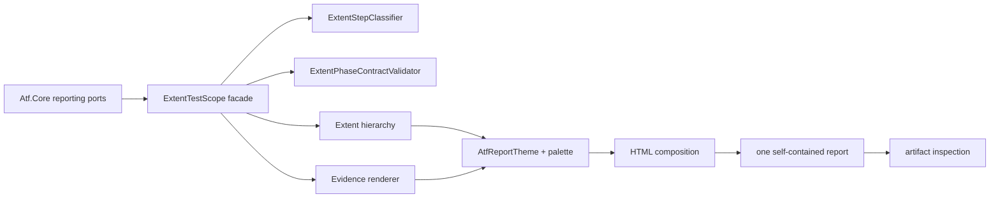
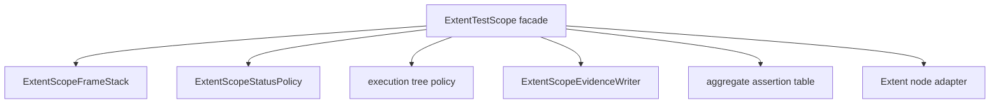
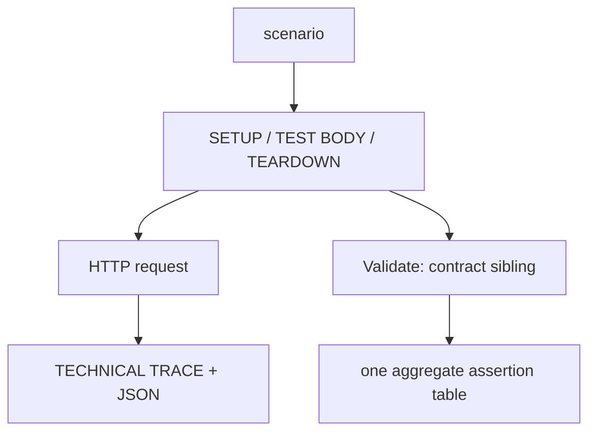

# Atf.Reporting.Extent — raportarea HTML

`Atf.Reporting.Extent` este adaptorul concret dintre porturile de raportare
renderer-neutral din `Atf.Core` și un singur artifact HTML Extent, autonom și
ușor de parcurs. Nu execută HTTP și nu decide dacă un contract de business a
trecut.

Acest proiect rămâne separat și în arhitectura simplificată. El este boundary-ul
vendorului: orice HTML, CSS, JavaScript, asset, selector sau verificare specifică
artifactului Extent aparține aici, nu în `Atf.Core` sau `Atf.Api`.

## Contract înghețat, implementare refactorizabilă

Adaptorul poate fi refactorizat intern, dar nu are mandat să redeseneze raportul.
Formatul observabil — markup semantic, ierarhie, texte, statusuri, culori,
fonturi, collapse și evidence — este definit în contractul de format. Orice
extragere de clasă trebuie să păstreze
aceeași proiecție și aceleași contracte ale artifactului.

## Contracte normative

| Element | Contract |
|---|---|
| Extent adapter și HTML standalone | responsabilitatea acestui proiect |
| semantic evidence model | rămâne în `Atf.Core` fără markup |
| static artifact inspection | verifică structura și nu înlocuiește validarea DOM |
| lifecycle/composer | se separă pe seam-uri OOP testabile, fără clase decorative |

## Poziția în arhitectură



Fluxul textual echivalent este:

```text
Port Core -> scope Extent -> arbore Extent + HTML evidence -> temă/compoziție
           -> asset-uri inline -> un fișier .html -> verificări artifact
```

## Ownership clar

| Componentă | Face | Nu face |
|---|---|---|
| `ExtentTestHierarchy` | clase, scenarii, faze și status agregat | nu execută request-uri |
| `ExtentTestScope` | fațadă sincronizată pentru pași, evidence și lifecycle | nu deține regulile de status, clasificarea titlurilor sau contractul arborelui |
| `ExtentScopeStatusPolicy` | precedence pentru warning/scenario/phase fără Extent DOM | nu mută noduri și nu publică evidence |
| `ExtentStepClassifier` | clasifică phase/request/validation | nu creează noduri și nu publică evidence |
| `ExtentPhaseContractValidator` | verifică request → validation sibling + un tabel | nu mută noduri și nu schimbă verdicturi |
| `ExtentEvidenceRenderer` | envelope HTML sigur, collapsed și accesibil | nu inventează verdicturi |
| `AssertionEvidenceFormatter` | tabel HTML agregat pentru `AtfAssertion` | nu creează assertion rows și nu decide verdictul |
| `EvidenceTableFormatter` | technical trace compact, durate și duplicate-key policy | nu modifică `ApiResponse` |
| `ExecutionEvidenceComposer` | clasifică trace-ul și reduce câmpurile tehnice | nu modifică `ApiResponse` |
| `AtfReportTheme` | fațadă de compoziție și rezolvare a tokenilor | nu deține toate regulile CSS într-un singur bundle |
| `AtfReportThemeOverviewFragments` | Overview, category și secondary audit surfaces | nu stilizează evidence-ul request/validation |
| `AtfReportThemeEvidenceFragments` | trace, tables, JSON și disclosure surfaces | nu decide statusuri sau navigare |
| `AtfReportThemeFragments` | execution hierarchy CSS | nu schimbă Overview-ul |
| `ExtentReportClientBehaviour` | fațadă de compoziție pentru client behaviour | nu deține toate controller-ele JS |
| `ExtentReportClientOverviewFragments` | counters, charts și tag audit | nu navighează în Tests/Exceptions |
| `ExtentReportClientTagPolicyController` | filtrează selectorul nativ și proiectează adnotările vizibile în detaliile scenariilor | nu schimbă ierarhia, verdictul, totalurile sau lista claselor din stânga |
| `Theme.Client.Failure.ExtentReportClientFailureEvidenceFragments` | extrage phase/request/validation/assertion evidence | nu creează view-ul Fails și nu face routing |
| `Theme.Client.Failure.ExtentReportClientFailureProjectionFragments` | creează `FailureRecord` immutable și `FailureIndex` cu ordine/cardinalitate stabile | nu construiește DOM-ul view-ului, nu mută carduri din Tests și nu recalculează verdictul |
| `ExtentReportClientFailureFragments` | construiește view-ul Fails, enrichment-ul și `Open in Tests` | nu redescoperă evidence-ul și nu recalculează Overview counters |
| `ReportArtifactInspector` | verifică artifactul Extent pe care îl deschide utilizatorul | nu înlocuiește verificarea DOM în tab-ul MCP |

## Responsabilități și separarea adaptorului

Direcția dependenței și boundary-ul vendorului trebuie păstrate. Renderer-ul rămâne zona
cu cel mai mare cost de schimbare din cauza session/composer și a lipsei unui
  contract DOM automat.

| Hotspot | De ce este riscant | Refactor OOP recomandat |
|---|---|---|
| `ScenarioStepFrame` | starea unui pas activ este model intern, separat de fațada `ExtentTestScope` | deține doar titlul, evidence-ul pending și portul `IExtentNodeAdapter`; nu expune `ExtentTest` |
| `ExtentTestScope` | sincronizare, stack, tree policy și delegare rămân în aceeași fațadă | status precedence este extrasă în `ExtentScopeStatusPolicy`; următorul seam este tranziția tree/stack |
| `ExtentReportLifecycle` | session state, path allocation și Extent bootstrap trebuie separate de publicarea finală | `ExtentArtifactPublisher` deține tranziția native → HTML publicat și cleanup-ul directorului temporar |
| Theme/client behaviour | fragmentele reduc monolitul, iar contractele sunt protejate static și interactiv | păstrează testele de token ownership, semantic selectors și DOM behavior separat |
| `ReportArtifactInspector` | verifică HTML static, nu layout-ul calculat de DOM | păstrează inspectorul pentru artifact contract și adaugă smoke DOM separat; nu-l considera test interactiv |

Nu mai adăuga metode în `ExtentTestScope` pentru defecte noi de CSS/JavaScript.
Un defect de prezentare aparține fragmentului/contractului de prezentare; un
defect de ierarhie aparține politicii de tree; un defect de verdict aparține
modelului de status. Această clasificare previne revenirea la god-object.

Direcția dependenței este strictă:

```text
Atf.Core -> Atf.Reporting.Extent -> ExtentReports
```

`Atf.Core` nu referă package-ul Extent și nu conține markup Extent. Orice
renderer viitor trebuie să consume aceleași porturi, nu să copieze logica
executorului sau a validatorilor.

## Direcții de refactorizare

Cele mai importante seam-uri verificate nu sunt în paleta vizuală, ci în tranziția
arborelui și în ownership-ul resurselor:

- `ExtentTestScope` coordonează stack-ul, evidence-ul, status policy și adapterul
  vendor; coordonarea lock + phase/request/validation transition este protejată
  de testele de port și de concurență;
- `ExtentReportLifecycle`, `ExtentReportPathAllocator`,
  `ExtentArtifactPublisher` și `ReportAssetCleanupCoordinator` au ownership
  distinct, iar testele de sesiuni suprapuse verifică path-urile, artifactele și
  cleanup-ul concurent;
- `ExtentReportDocumentComposer` este o fațadă de compoziție; sanitizarea,
  overview pruning, asset inlining și cleanup rămân colaboratori separați. Nu se
  recomandă un split arbitrar;
- `AtfReportTheme` este o fațadă peste fragmente și tokeni. Fragmentele se împart
  numai când apare un contract semantic distinct, nu pentru a reduce mecanic
  numărul de linii;
- `ReportArtifactInspector` verifică sursa HTML și rămâne contractul de
  artifact. El nu trebuie confundat cu o dovadă de DOM hidratat sau cu o
  rescriere a formatului raportului.
  Inspectorul verifică și boundary-ul `FailureRecord`/`FailureIndex` plus
  idempotency-ul `failureId`; verificarea DOM interactivă rămâne responsabilă
  pentru TAB MCP sau pentru un harness DOM dedicat.

Acestea sunt contracte de mentenanță P1/P2, nu motive pentru a modifica
comportamentul raportului fără contracte noi. Orice extragere trebuie să păstreze
request → validation sibling, collapse-by-default, tabelele agregate și aceeași
 paletă centralizată. Boundary-urile RF-02–RF-06 sunt închise în registrul de
 feedback și trebuie menținute prin aceleași dovezi.

### Criterii de acceptare pentru adaptor

| Contract | Dovada minimă |
|---|---|
| tree | test in-memory pentru phase → request + validation sibling |
| artifact | HTML real inspectat static, fără asset folder extern |
| DOM / tab MCP | DOM hidratat: click, collapse, scroll, overflow și computed styles |
| status | combinații Pass/Fail/Skip/Warning verificate în Overview, card, chart și tags |
| isolation | două sesiuni paralele nu amestecă noduri, statusuri sau path-uri |
| publisher failure | eroarea reporterului nu înlocuiește verdictul funcțional |

### Contracte de implementare

- `ValidationTableRunner` publică best-effort: erorile `StartStep`, tabel,
  verdict și `CompleteStep` nu pot înlocui excepția funcțională.
- `ExtentArtifactPublisher` separă finalizarea filesystem de session state și
  garantează cleanup-ul directorului temporar chiar când compunerea eșuează.
- `IThemeTokenProvider` separă paleta semantică de fațada CSS; testele verifică
  faptul că tokenii se rezolvă complet și că nu rămân placeholder-e.
- `IPhaseTreeWriter`, `IReportEvidencePublisher` și `IReportStatusPolicy` sunt
  porturile scenariului: tree, evidence și verdict precedence pot evolua
  independent, iar `ExtentTestScope` rămâne doar orchestration.
- `IClientProjectionComposer` separă compoziția JavaScript de fațada
  `ExtentReportClientBehaviour`; controller-ele de navigare/disclosure/failure
  rămân fragmente independente și produc același HTML self-contained.
- `UsersSteps` și `PostsSteps` nu mai există ca forwarding wrappers; `ApiModule`
  expune direct serviciile typed.

`ReportArtifactInspector` verifică doar coloana `artifact`; un selector sau un
fragment JavaScript găsit în HTML nu este dovadă că DOM-ul final se comportă
corect. Pentru aceasta este necesar un contract DOM separat.

## Presiunea OOP și seam-urile testabile

`ExtentTestScope` păstrează API-ul `IAtfScenarioScope`. Stack-ul async este deținut de
`ExtentScopeFrameStack`, iar evidence, redaction și assertion HTML de
`ExtentScopeEvidenceWriter`; scope-ul păstrează doar sincronizarea, tranzițiile
și compatibilitatea cu Extent:



Nu extrage clase doar pentru a reduce numărul de linii. Fiecare colaborator
trebuie să aibă un contract determinist și să poată fi testat fără HTML complet:

| Seam | Contract minim |
|---|---|
| step stack | nesting, pop idempotent, context async separat |
| tree policy | phase → request + validation sibling, tranziții invalide respinse |
| evidence publisher | redaction, escaping, JSON/trace fără verdict funcțional |
| assertion publisher | un singur tabel agregat, limită de display, duplicate respins |
| status policy | Info tehnic nu devine Pass, Warning este afișat ca `WARNING`/`⚠️`, iar precedence failure/skip/warning rămâne stabil |

Soft assertion-ul este o stare funcțională distinctă, nu un simplu mesaj colorat:
un rând eșuat rămâne vizibil în tabel, cu rezultatul `⚠️`, nodul de validation
primește `Warning`, iar agregarea scenariului ajunge în `WARNING` fără să
incrementeze `Tests Failed`. Aceeași populație trebuie proiectată identic în
card, chart, `Tags.WARNING` și metadata secundară. `other` este doar bucket-ul
intern Extent pentru compatibilitatea chart-urilor. Orice reporter failure este
infrastructură diagnostică și nu are voie să schimbe această semnificație;
contractul este protejat de teste componente, iar verificarea computed DOM
este un contract separat.

Statusul este evaluat pe fiecare fază, nu copiat global peste arbore: o fază cu
warning devine `Warning`, o fază cu failure rămâne `Fail`, iar o fază ulterioară
reușită rămâne `Pass`. Verdictul scenariului folosește precedence
`Fail > Skip > Warning > Pass`; astfel combinația `SETUP Warning → TEST BODY
Fail → TEARDOWN Pass` rămâne lizibilă și se încheie corect cu `Fail`.

Refactorizarea mută ownership-ul semantic în fragmente testabile:
`AtfReportTheme` este o fațadă peste fragmentele de overview, evidence și
execution hierarchy, iar `ExtentReportClientBehaviour` este o fațadă peste
controllerele de navigation, disclosure/collapse, failure triage, overview și
execution hierarchy. Output-ul final rămâne același contract HTML/JS, dar
fiecare zonă are un owner clar și poate fi verificată independent prin teste de
compoziție. Controllerul de disclosure este singurul owner pentru click/keyboard
capture și collapse-by-default; controllerul de navigation este singurul owner
pentru schimbarea view-ului și ordinea claselor/scenariilor.

Nu mutăm ownership-ul evidence-ului în JavaScript ca să reparăm un defect de
layout: C# produce structura semantică, theme-ul produce CSS, iar client
behaviour doar reconciliază DOM-ul Extent deja randat.

## Contractul arborelui API

Forma observabilă canonică este:

```text
TestCase
├── SETUP
│   └── Request(s)
├── TEST BODY
│   ├── Request
│   │   ├── Technical trace
│   │   ├── Response details
│   │   └── Response JSON
│   └── Validation(s) — următorul frate direct al requestului, sub aceeași fază
│       └── aggregate assertion table
└── TEARDOWN
    └── Request(s)
```



Regula normativă este exactă: requestul și validarea sunt frați direcți ai
aceleiași faze, iar validarea urmează imediat requestului care a produs
response-ul. Nu este un nod orfan la nivel de scenariu și nu este mutată în
ultimul request printr-un fallback
implicit.

```text
TEST BODY
├── GET /public/v2/users
│   ├── request/response details
│   └── request/response JSON
└── Validate: user collection contract
    └── ASSERTION | EXPECTED | ACTUAL | RESULT
```

Pentru fiecare response funcțional există o singură tabelă agregată. Statusul
transportului este `Info`; `Pass`/`Fail` din validare este verdictul funcțional.
Un request într-o fază de succes fără validare asociată este invalid și este
respins de contractele structurale.

## Contractul disclosure-urilor

Toate nodurile de fază, request, validation, trace, JSON și assertions sunt
închise implicit. Titlul colapsat trebuie să fie scurt, scanabil și suficient
de informativ:

| Evidence | Titlu afișat | Conținut la expand |
|---|---|---|
| transport | `Response details · N fields` | tabel tehnic compact |
| request payload | `REQUEST JSON` | code block cu scroll vertical |
| response payload | `RESPONSE JSON` | code block cu scroll vertical |
| contract | `Assertions · N` | un singur tabel agregat |

Titlurile lungi se afișează cu ellipsis, dar valoarea completă rămâne în
`title` și `aria-label`. Astfel pagina rămâne compactă fără să piardă
informația la hover sau pentru un cititor asistiv. Body-ul nu este tăiat:

- tabelele tehnice se încadrează în card și folosesc wrap controlat;
- JSON-ul este monospace, wrapped și scrollabil vertical;
- pagina nu primește overflow orizontal din evidence;
- primul și ultimul element din body nu adaugă spațiu ornamental inutil.

`TECHNICAL TRACE` este o clasificare de evidence, nu un verdict și nu o a doua
validare. Metadata generică de fază nu este randată ca `Execution summary` pe
ultimul request.

Cleanup-ul asset-urilor are aceeași separare: `ReportAssetCleaner` păstrează
fațada compatibilă, iar `ReportAssetCleanupCoordinator` serializază ștergerea
pe director normalizat, aplică retry policy injectabilă și nu confundă o
director temporar lipsă cu o eroare de raport. Astfel sesiunile paralele nu se
șterg una pe alta. Retry-ul folosește `DelayAsync` injectabil prin boundary-ul
filesystem, iar `ExtentArtifactPublisher` și composer-ul folosesc calea async;
fațadele sincron rămân doar pentru compatibilitate. Contractul HTML al
raportului nu se schimbă.

Fațada `ExtentTestScope` nu trebuie să devină un nou god-object. Orice regulă
nouă de structură se extrage într-o politică internă pură/testabilă, iar scope-ul
rămâne responsabil de sincronizare, delegare și ownership-ul `AsyncLocal`.

Boundary-ul vendorului este explicit: `ScenarioStepFrame` conține doar
starea semantică a pasului și un `IExtentNodeAdapter`; nu expune `ExtentTest`.
`ExtentNodeAdapter` este singurul loc care translatează operațiile de node către
Extent, iar validatorul de arbore consumă doar view-uri read-only ale copiilor și
logurilor. Astfel, regulile phase → request → validation pot fi testate fără ca
modelul intern de lifecycle să devină dependent de API-ul vendorului.

Rezultatul lifecycle-ului este un model explicit:

```text
ApiScenarioOutcome
├── Passed
├── Failed(reason, exception)
└── Skipped(reason, exception)
```

`ApiScenarioOutcomeResolver` aplică precedence explicită: failure-ul din setup
sau body este păstrat primul, un failure de teardown promovează un skip la
failure dacă este singura eroare tehnică, iar skip-ul nu poate ascunde un
failure. Proprietățile nullable de compatibilitate sunt doar proiecții pentru
clienții existenți, nu sursa regulii.

## Contractul ieșirii HTML

Ieșirea finală este un singur fișier HTML autonom sub directorul de rapoarte.
Assets Extent sunt inline, iar folderul sibling `extent` nu este livrat.

```text
overview native -> ATF metadata secondary (collapsed)
                -> ATF tag audit (collapsed)
                -> Tags + System/Environment
test navigation -> scenario -> phase -> request + validation sibling evidence
```

Dashboard-ul nu afișează cardul nativ Extent `Log events`; acesta dublează
agregarea ATF. Evenimentele Info/Pass/Fail rămân păstrate în nodurile testelor
și în evidence-ul fiecărui schimb HTTP.

Toate suprafețele folosesc tokenurile centrale din `AtfReportColors` și
`AtfReportTypography`; nu se adaugă culori locale în renderer. Overview-ul și
tag audit-ul folosesc aceleași carduri-scenarii directe pentru numărare; class
roots, feature groups și testele interne nu devin API scenarios suplimentare.

Panourile `ATF scenario identities by test class`, `Test packages` și `Other
annotations / tags` folosesc același frame vizual ca `Tags` și
`System/Environment`: header deasupra, aceeași culoare și aceeași suprafață.
Fiecare are un singur tabel de date, fără rând total sintetic și fără tabel
înglobat într-un alt tabel.

### Taxonomia tag-urilor

`ReportingSettings.TagOrder` este numai o regulă de ordonare. Eligibilitatea
este declarată separat în `ReportingSettings.TagTaxonomy`:

```text
SelectionTagNames  -> #tag-toggle + adnotări în detaliile/cardurile scenariilor
DiagnosticTagNames -> metadata operațională / triage, nu selector
unknown            -> diagnostic, până la declararea explicită ca selection
```

`AtfTagTaxonomy` rămâne în Core și nu cunoaște Extent. Adaptorul Extent aplică
aceeași politică în două puncte: `ExtentNativeTagSelectorSanitizer` curăță
HTML-ul static, iar `ExtentReportClientTagPolicyController` hidratează selectorul
și strip-urile `.atf-scenario-annotations` numai în detaliile scenariilor.
Lista `Tests` din stânga rămâne tag-free: item-ul clasei conține doar numele,
statusul și durata, are `tag` gol, iar orice strip `.atf-test-annotations`
moștenit este eliminat defensiv la configurarea clientului.
Categoriile rămân atașate scenariului copil; class root nu primește tag-uri și nu
poate contamina totalurile.

## Contractul navigării și al triage-ului

Ordinea semantică a tab-urilor este:

```text
Tests → Category → Fails → Overview
```

`Tests` este sursa primară a execuției, `Category` este indexul de clasificare,
`Fails` este triage-ul plat al tuturor failure-urilor, iar `Overview` este
suprafața de sinteză și ultima filă. La bootstrap și la refresh, `Overview` se
deschide implicit, fără să schimbe ordinea de mai sus.

Contractul pentru `Fails` este strict:

- un singur header semantic `Fails`;
- toate failure-urile sunt listate într-o singură colecție plată, în ordinea
  execuției, fără grupare pe clasă;
- fiecare rând păstrează faza, testul, requestul/validation-ul, assertion-ul,
  expected/actual și cauza redacted;
- `Open in Tests` ajunge la nodul sursă exact, nu la un test aproximativ;
- dacă aceeași cauză este deja deținută de validation, `TEST BODY` nu o repetă
  ca mesaj generic `Failure`.

Acest contract trebuie protejat simultan prin teste de projection, artifact
inspection și smoke DOM. Un HTML care conține textul `Fails` nu este suficient
dacă navigarea, deep-link-ul sau refresh-ul nu funcționează.

## Cum se schimbă raportarea în siguranță

1. Schimbă contractul sau modelul în `Atf.Core` numai dacă este renderer-neutral.
2. Schimbă agregarea/semantică în `Atf.Core` sau `Atf.Api/Module`, nu în CSS.
3. Schimbă markup-ul, tema sau JS-ul numai aici.
4. Adaugă test structural pentru arbore și test de artifact pentru HTML.
5. Generează un raport real și verifică manual: overview, faze, request,
   validation, JSON, tabel și lipsa folderului `extent`.

Nu rezolva un defect de layout prin a muta evidence-ul în alt nod. Layout-ul
trebuie să păstreze ownership-ul semantic verificat de `ExtentAdapterBoundaryTests`
și `ReportingStructureTests`.

## Teste și comenzi

```powershell
dotnet test .\Atf.Tests\Atf.Reporting.Extent.Tests\Atf.Reporting.Extent.Tests.csproj --no-restore
dotnet test .\Atf.Tests\Atf.Core.Tests\Atf.Core.Tests.csproj --no-restore
dotnet test .\Atf.Tests\Atf.Common.Tests\Atf.Common.Tests.csproj --no-restore
```

Testele adaptorului protejează în special:

| Contract | Dovadă |
|---|---|
| Extent nu leak-uiește în Core | `ExtentAdapterBoundaryTests` |
| request → validation ownership | `ExtentAdapterBoundaryTests`, `ReportingStructureTests` |
| evidence este collapsed și safe | `ExtentAdapterBoundaryTests` |
| titlurile lungi rămân lizibile și escaped | `ExtentAdapterBoundaryTests` |
| JSON are scroll vertical și zero overflow orizontal | `ReportingComponentTests` |
| collapse/default overview este stabil | `ReportingComponentTests` |

Un test verde verifică structura, nu randarea completă a DOM-ului. Pentru o
schimbare vizuală, artifactul HTML generat trebuie deschis în tab-ul MCP și parcurs ca
utilizatorul: click pe scenario, phase, request, validation și fiecare bloc
de evidence.

Artifactul final include `window.__atfDomContract.inspect()`, un harness
diagnostic read-only pentru verificarea repetabilă a rândurilor `Tests`/`Fails`,
stării collapsed, tabelelor de assertions, JSON overflow și computed styles.
Harness-ul observă DOM-ul hidratat și nu modifică verdicturi, navigare sau
conținut; validarea vizuală rămâne obligatoriu făcută în TAB MCP.
