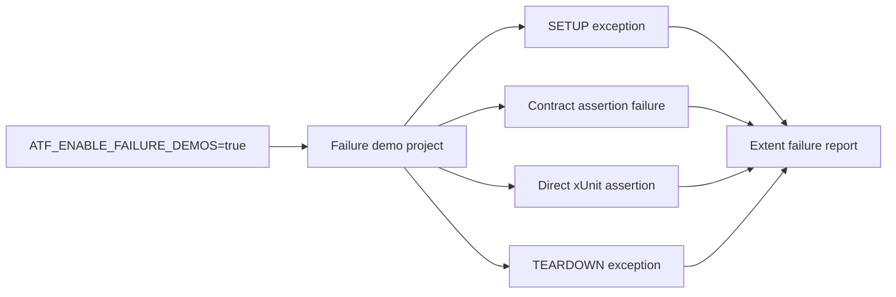

# Atf.Api.FailureDemos

This is the deliberate red-team suite for the reporting contract. It is isolated
from `Atf.Api` so a normal API run cannot become red because of an intentional
failure demonstration.

It is a test/support project, not a runtime framework module. It is already
grouped under `Atf.Tests/Atf.Api.FailureDemos`; the opt-in switch and
the red-team intent must remain unchanged. These demos must never be used as
evidence that the normal acceptance suite is healthy.

## Audit contract

Failure demos verify observability, not business correctness. Fiecare demo trebuie
să păstreze schematic în raport:

```text
test -> failing phase/request -> relevant exception/evidence -> final Fail
```

Nu este suficient să apară doar tipul excepției. Raportul trebuie să permită
legătura către testul din tab-ul Tests, să păstreze faza în care a apărut failure-ul
și să nu piardă request/validation context atunci când există. Demos nu trebuie
să fie incluse în quality gate-ul normal și nu trebuie să influențeze totalurile
unei rulări normale.

### Cazuri protejate

- setup exception fără body executat;
- contract assertion failure cu tabelul agregat prezent;
- direct body assertion failure;
- teardown exception după body;
- reporter failure care nu maschează excepția demonstrată;
- cleanup care rulează indiferent de failure-ul de reporting.

It is intentionally not a sixth root module in the target tree. Failure demos
are test data/scenarios with a special execution policy, not a runtime boundary;
their separate root project is retained only until the `Atf.Tests` consolidation
is performed.



The project is expected to finish with four failed tests. That non-zero exit code
is intentional and proves that setup, contract, body and teardown failures remain
visible in both xUnit and Extent.

```powershell
$env:ATF_ENABLE_FAILURE_DEMOS = "true"
dotnet test .\Atf.Tests\Atf.Api.FailureDemos\Atf.Api.FailureDemos.csproj --no-restore
$env:ATF_ENABLE_FAILURE_DEMOS = $null
```

The normal quality gate is `Atf.Api`; it does not reference this project as a test
fixture and therefore remains green when the diagnostic suite is not requested.
