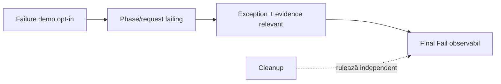
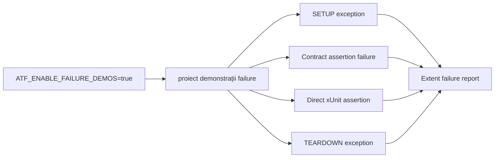

# Atf.Api.FailureDemos

Aceasta este suita red-team deliberată pentru contractul de raportare. Este
izolată de `Atf.Api`, astfel încât o rulare API normală să nu devină roșie din
cauza unei demonstrații intenționat eșuate.

Este un proiect de test/suport, nu un modul de runtime. Este deja grupat sub
`Atf.Tests/Atf.Api.FailureDemos`; comutatorul opt-in și intenția red-team trebuie
păstrate neschimbate. Aceste demonstrații nu trebuie folosite niciodată ca
dovadă că suita normală de acceptanță este sănătoasă.

## Contract de observabilitate

Demonstrațiile de failure verifică observabilitatea, nu corectitudinea de business.
Fiecare demo trebuie să păstreze schematic în raport:

```text
test -> failing phase/request -> relevant exception/evidence -> final Fail
```

Nu este suficient să apară doar tipul excepției. Raportul trebuie să permită
legătura către testul din tab-ul Tests, să păstreze faza în care a apărut failure-ul
și să nu piardă request/validation context atunci când există. Demos nu trebuie
să fie incluse în quality gate-ul normal și nu trebuie să influențeze totalurile
unei rulări normale.

## Orientare rapidă



Citește acest README în ordinea: scopul suitei → contractul de observabilitate
→ cazurile protejate → regula de rulare opt-in. Aceste teste demonstrează
diagnosticul failure-ului; nu validează business-ul API și nu reprezintă succesul
suitei live.

### Cazuri protejate

- setup exception fără body executat;
- contract assertion failure cu tabelul agregat prezent;
- direct body assertion failure;
- teardown exception după body;
- reporter failure care nu maschează excepția demonstrată;
- cleanup care rulează indiferent de failure-ul de reporting.

În mod intenționat, nu este al șaselea modul-rădăcină din arborele țintă.
Demonstrațiile de failure sunt date/scenarii de test cu o politică specială de
execuție, nu un boundary de runtime; proiectul separat este păstrat doar până la
consolidarea în `Atf.Tests`.



Proiectul trebuie să se încheie cu patru teste eșuate. Codul de ieșire nenul este
intenționat și dovedește că failure-urile din setup, contract, body și teardown
rămân vizibile atât în xUnit, cât și în Extent.

```powershell
$env:ATF_ENABLE_FAILURE_DEMOS = "true"
dotnet test .\Atf.Tests\Atf.Api.FailureDemos\Atf.Api.FailureDemos.csproj --no-restore
$env:ATF_ENABLE_FAILURE_DEMOS = $null
```

Poarta normală de calitate este `Atf.Api`; nu referi acest proiect ca fixture de test
și, prin urmare, rămâne verde când suita de diagnostic nu este solicitată.
