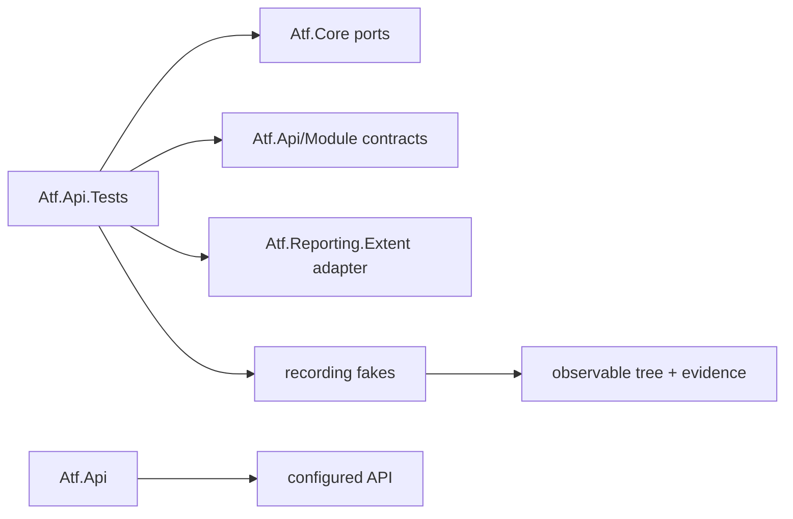
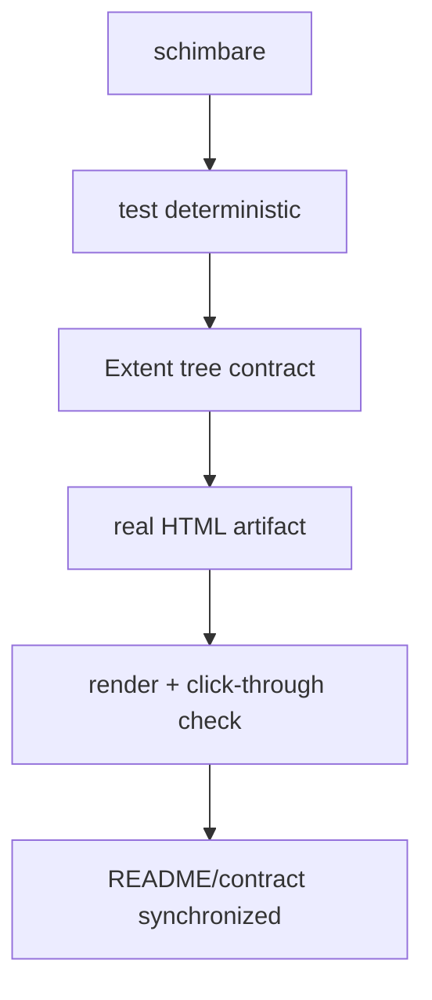
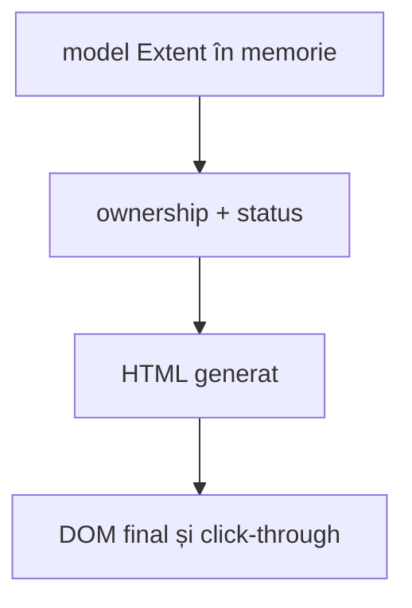

# Atf.Api.Tests — contracte API fără serviciu

`Atf.Api.Tests` verifică granița dintre scenariul API, executor și raportare
fără să pornească un serviciu, să deschidă socket-uri sau să genereze un verdict
live. Este locul pentru teste de compoziție și layout care folosesc fakes; nu
este locul pentru testele de business ale API-ului țintă.

## Boundary-ul curent

Acesta este proiectul API-facing, grupat fizic în `Atf.Tests/Atf.Api.Tests`.
Fakes, assertions și contractele
observabile trebuie să rămână identice.

Nu muta aici teste live, teste de browser sau failure demos. Ele au boundary-uri
diferite și trebuie marcate explicit în `Atf.Tests`.

## Audit alignment — 2026-10-13

Acest boundary oferă acoperire API-facing. Testele verifică
colaborarea dintre lifecycle, executor, validation și reporter fără să devină
teste de implementare Extent.

Izolarea failure-ului de reporter este protejată semantic: `StartStep`,
`AssertionTable`, `Warning`, `Pass`, `Fail` și `CompleteStep` pot eșua fără să
înlocuiască failure-ul funcțional sau să împiedice cleanup-ul. Găura rămasă este
verificarea DOM a proiecției finale, nu evaluatorul component.

## Locul în soluție



| Proiect | Când îl folosim |
|---|---|
| `Atf.Core.Tests` | reguli renderer-neutral: config, transport, retry, redaction |
| `Atf.Common.Tests` | rute, servicii, validatori, cleanup și module composition din `Atf.Api/Module` |
| `Atf.Api.Tests` | contractul API-facing dintre executor, scenariu și adapter |
| `Atf.Tests/Atf.Reporting.Extent.Tests` | Extent tree, HTML envelope, CSS/JS și artifact |
| `Atf.Api` | scenarii live care chiar testează API-ul țintă |

Versiunile și politicile runner-ului trebuie documentate explicit. Dacă proiectul
API-facing folosește altă versiune xUnit decât testele componente, diferența trebuie
să fie intenționată și acoperită pentru skip, lifecycle și parallelization; altfel
se aliniază într-un increment separat.

## Contractul testat

Un scenariu API de succes trebuie să aibă cel puțin un response validat. Pentru
fiecare response, testele verifică aceeași formă semantică:

```text
scenario
└── SETUP / TEST BODY / TEARDOWN
    ├── HTTP request
    │   ├── technical trace + request/response JSON
    │   └── evidence collapsed by default
    └── Validate: contract
        └── one aggregate ASSERTION / EXPECTED / ACTUAL / RESULT table
```

Requestul este copil direct al fazei, iar validarea este copil direct al requestului
care a produs răspunsul. Validarea nu este atașată retrospectiv ultimului request și
nu este împărțită în câte un nod pentru fiecare assertion.

Transportul și verdictul sunt separate:

```text
HTTP exchange completed -> Info / diagnostic evidence
ValidationTable          -> Pass or Fail / functional verdict
Scenario lifecycle       -> final scenario status
```

## Matricea de acoperire

| Contract | Test seam | Criteriu |
|---|---|---|
| phase vocabulary | `ExtentTestScope` + in-memory Extent | fazele canonice sunt în ordine |
| response ownership | recording scope | request și validation sunt frați direcți sub aceeași fază |
| response isolation | două requests consecutive | fiecare response are propria validare |
| aggregate assertions | `ValidationTable` fake reporter | toate verificările apar într-un singur tabel |
| evidence classification | `ApiExecutionReporter` | trace-ul este `TECHNICAL TRACE`, nu verdict |
| collapsed UI contract | `AtfReportTheme` + client behavior | faze, pași și evidence pornesc închise |
| safe presentation | generated evidence | HTML values sunt escaped, JSON-ul rămâne bounded |

## Ce nu se verifică aici

- disponibilitatea unui endpoint real;
- corectitudinea business a datelor dintr-un environment;
- token-uri reale sau permisiuni externe;
- timing-ul exact al unui serviciu;
- un screenshot luat în locul contractului structural.

Acestea aparțin scenariilor live sau verificării finale a artifactului. Un test
offline trebuie să rămână determinist și să explice un defect de framework fără
reproducere externă.

## Cum adaugi un test corect

1. Alege contractul observabil: tree, evidence, status, route sau artifact.
2. Folosește un fake pentru transport/reporter, nu `HttpClient` real.
3. Construiește un caz minim: un phase, un request, o validare agregată.
4. Verifică ordinea și ownership-ul nodurilor, nu metode private.
5. Pentru layout adaugă și o verificare CSS/HTML, nu doar modelul Extent.
6. Dacă defectul este vizual, generează apoi un raport real și parcurge manual
    scenario → phase → request + validation sibling → JSON/table.
7. Dacă defectul este de interacțiune, adaugă și contract DOM pentru click,
   collapse, scroll și computed styles; HTML static nu este suficient.

## Comandă

```powershell
dotnet test .\Atf.Tests\Atf.Api.Tests\Atf.Api.Tests.csproj --no-restore --logger "console;verbosity=normal"
```

Testele live rămân în `Atf.Api` și se rulează separat. Un test adăugat aici nu
trebuie să depindă de token, network sau de o cale de artifact dintr-o rulare
anterioară.

## Adnotări cu valoare

Nu adăuga tag-ul generic `framework`. Proiectul `Atf.Api.Tests` și namespace-ul
identifică deja natura testului; păstrăm doar metadata care schimbă filtrarea,
execuția sau navigarea raportului. Exemplele valide sunt `contract`, `negative`,
`auth`, `lifecycle` și `smoke`, atunci când testul chiar poate fi selectat sau
interpretat prin acea categorie.

## Definition of done pentru un fix de raportare



Fixul este complet numai când structura, artifactul consumat și documentația
spun același lucru: `phase → request + validation sibling → one table`.

## Extindere recomandată a suitei

Pentru orice caracteristică nouă a raportului se adaugă trei niveluri de test:



Un test de model verifică ownership-ul, un test de artifact verifică markup-ul
și asset-urile, iar verificarea browser confirmă comportamentul real după
încărcarea scriptului. Astfel nu confundăm faptul că un selector există în cod
cu faptul că utilizatorul vede corect raportul.

