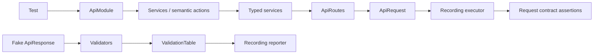
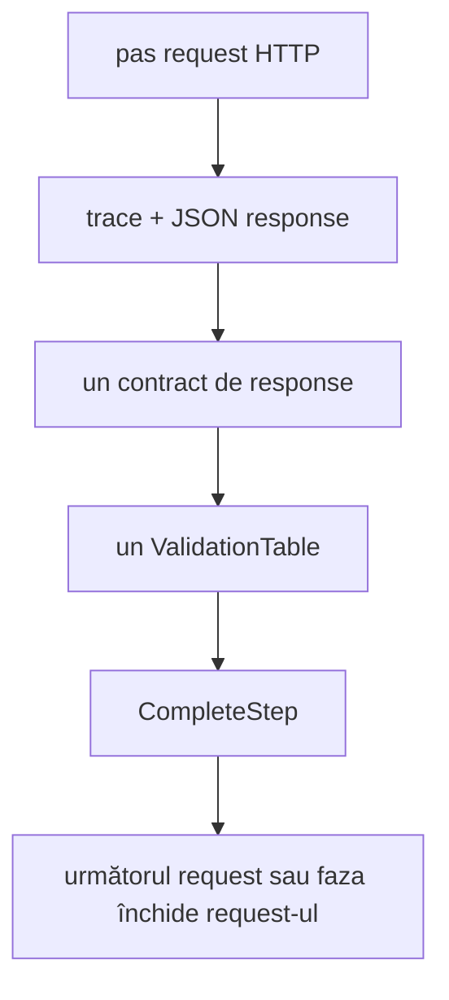

# Atf.Common.Tests — teste de componentă ale modulului API

Numele proiectului este păstrat pentru compatibilitate, dar locația fizică este
acum `Atf.Tests/Atf.Common.Tests`. Protejează fostul modul `Atf.Common`, deținut
acum de `Atf.Api/Module`; nu există un proiect de producție separat `Atf.Common`
și nu este planificată mutarea în `Atf.Tests/Api`.

Păstrează aici teste noi numai când verifică compoziția modulului API, rute,
servicii, validare, lifecycle, fixture-uri sau cleanup. Regulile neutre față de
framework aparțin în `Atf.Core.Tests`, iar regulile pentru artifactul Extent în
`Atf.Reporting.Extent.Tests`.

Boundary-urile modulului și fluxul evidence sunt descrise în
[ghidul de arhitectură și raportare](../../docs/ATF_Architecture.md).

Acesta este quality gate-ul rapid și offline pentru layer-ul modulului API. Verifică
semantica rutelor, serializarea serviciilor, acțiunile semantice justificate,
agregarea validărilor, fixture-urile/datele și cleanup-ul fără să contacteze un
API live.

## Aliniere de audit — 2026-10-13

Acoperirea modulului este bună. Riscul structural rămas este densitatea
compoziției și compatibilitatea unor API-uri
de validare; publicarea raportului este acum izolată prin publisher-ul
best-effort, iar pașii forwarding-only nu mai sunt păstrați. Testele de aici trebuie să țină
modulul renderer-neutral și să păstreze autoritatea rezultatului funcțional.

## Fluxul componentelor



## Matricea de acoperire

| Grup de teste | Comportament protejat |
|---|---|
| `RoutingServicesAndDataTests` | codificarea tokenurilor, metadata rutelor, body-urile serviciilor, compoziția modulului, unicitatea datelor și erorile fixture-ului |
| `ValidationComponentTests` | status, statusuri permise, headere, body, JSONPath, relații și JSON Schema |
| `ValidationAndLifecycleTests` | agregare într-un singur tabel, închiderea pașilor Pass/Fail, cleanup în ordine inversă și failure-uri best-effort |
| `ValidationTableContractTests` | semantica failure-ului dur față de assertion-ul soft care produce doar warning |

## Ce demonstrează aceste teste

- template-urile de rută sunt codificate sigur și rămân configurabile;
- serviciile păstrează metadata rutei, profilul de autentificare și payload-ul JSON tipizat;
- `ApiModule` expune servicii tipizate și ascunde cablarea executorului; pașii
  semantici apar numai când adaugă orchestrare sau limbaj de domeniu;
- validatorii publică toate rândurile și ridică `ApiValidationException` numai după evidence;
- `ApiAssertions.SoftContract` păstrează rândurile eșuate vizibile, emite Warning și nu aruncă excepții;
- fiecare contract de response deschide și închide exact un step agregat de raportare, inclusiv la excepții neașteptate;
- contractele consecutive de response rămân izolate sub request-ul propriu și nu combină rândurile;
- valorile assertion-ului `ACTUAL` folosesc limita maximă configurată pentru reporter,
  astfel încât tabelul de diagnostic rămâne lizibil fără schimbarea semanticii;
- formele invalide ale response-ului sunt failure-uri de contract;
- resursele sunt curățate în ordine inversă chiar când o acțiune eșuează;
- un executor fake este suficient, astfel încât niciun test nu depinde de token sau rețea.

Sunt protejate prin teste și trebuie păstrate ca regresii următoarele cazuri:

- reporter care aruncă în fiecare hook de publicare, fără mascarea failure-ului
  de contract;
- toate entry-point-urile publice de validation comparate pe aceeași response;
- reguli cu label vizual identic, dar identitate semantică diferită;
- JSON invalid, schema invalidă și colecție goală cu politică explicită;
- test care eșuează dacă un step nou este doar forwarding fără semantică.

## Rețetă de extindere

```text
1. RouteSettings / ApiRoutes metadata
2. model tipizat pentru request și response
3. serializarea serviciului
4. step semantic, dacă este util
5. validator / schemă
6. test de componentă cu executor fake
7. scenariu live în Atf.Api
```

Păstrează seam-ul de test la `IApiExecutor`. Inspectează `ApiRequest` și
`ApiRoute` produse, în loc să reconstruiești internals ale serviciului.

## De ce contează testele de lifecycle



Reporterul de înregistrare verifică evenimentele de lifecycle, nu un detaliu de implementare:
`start:Validate:*` trebuie asociat cu `complete:Pass` sau `complete:Fail`. Acest
Acest lucru protejează aceeași ierarhie randată ulterior de Extent fără să
necesite browser sau serviciu live.

## Rulare

```powershell
dotnet test .\Atf.Tests\Atf.Common.Tests\Atf.Common.Tests.csproj --no-restore --logger "console;verbosity=normal"
```

