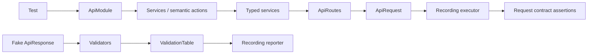
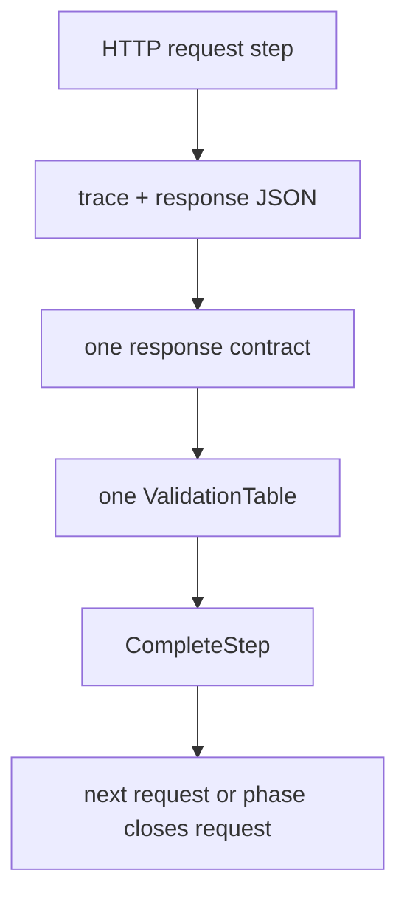

# Atf.Common.Tests — API module component tests

The project name is retained for compatibility, but its physical location is
now `Atf.Tests/Atf.Common.Tests`. It protects the former `Atf.Common` module
that is now owned by `Atf.Api/Module`; there is no separate `Atf.Common`
production project and no pending move to `Atf.Tests/Api`.

Keep new tests here only when they verify API-module composition, routes,
services, validation, lifecycle, fixtures or cleanup. Framework-neutral rules
belong in `Atf.Core.Tests`; Extent artifact rules belong in
`Atf.Reporting.Extent.Tests`.

The module boundaries and evidence flow are described in the
[architecture and reporting guide](../../docs/ATF_Architecture.md).

This is the fast, offline quality gate for the API-module layer. It verifies route semantics, service serialization, justified semantic actions, validation aggregation, fixtures/data and cleanup without contacting a live API.

## Audit alignment — 2026-10-13

Acoperirea modulului este bună. Riscul structural rămas este densitatea
compoziției și compatibilitatea unor API-uri
de validare; publicarea raportului este acum izolată prin publisher-ul
best-effort, iar pașii forwarding-only nu mai sunt păstrați. Testele de aici trebuie să țină
modulul renderer-neutral și să păstreze autoritatea rezultatului funcțional.

## Component flow



## Coverage matrix

| Test group | Protected behavior |
|---|---|
| `RoutingServicesAndDataTests` | token encoding, route metadata, service bodies, module composition, data uniqueness and fixture errors |
| `ValidationComponentTests` | status, allowed status, headers, body, JSONPath, relationships and JSON Schema |
| `ValidationAndLifecycleTests` | one-table aggregation, Pass/Fail step closure, reverse cleanup and best-effort failures |
| ValidationTableContractTests | hard failure versus warning-only soft assertion semantics |

## What these tests prove

- route templates are encoded safely and remain configurable;
- services preserve route metadata, auth profile and typed JSON payload;
- `ApiModule` exposes typed services while hiding executor wiring; semantic steps
  are introduced only when they add orchestration or domain language;
- validators publish all rows and raise `ApiValidationException` only after evidence;
- ApiAssertions.SoftContract keeps failed rows visible, emits Warning and does not throw;
- every response contract opens and closes exactly one aggregate reporter step, including unexpected exceptions;
- consecutive response contracts remain isolated under their own request and never combine rows;
- assertion `ACTUAL` values use the reporter's configured maximum length, so the
  diagnostic table stays readable without changing assertion semantics;
- malformed response shapes are contract failures;
- resources are cleaned in reverse order even when one action fails;
- a fake executor is enough, so no test depends on a token or network.

Sunt protejate prin teste și trebuie păstrate ca regresii următoarele cazuri:

- reporter care aruncă în fiecare hook de publicare, fără mascarea failure-ului
  de contract;
- toate entry-point-urile publice de validation comparate pe aceeași response;
- reguli cu label vizual identic, dar identitate semantică diferită;
- JSON invalid, schema invalidă și colecție goală cu politică explicită;
- test care eșuează dacă un step nou este doar forwarding fără semantică.

## Extension recipe

```text
1. RouteSettings / ApiRoutes metadata
2. typed request and response model
3. service serialization
4. semantic step if useful
5. validator / schema
6. fake-executor component test
7. live scenario in Atf.Api
```

Keep the test seam at `IApiExecutor`. Inspect the produced `ApiRequest` and `ApiRoute` rather than reconstructing service internals.

## Why the lifecycle tests matter



The recording reporter asserts the lifecycle events, not an implementation detail:
`start:Validate:*` must be paired with `complete:Pass` or `complete:Fail`. This
protects the same hierarchy later rendered by Extent without requiring a browser
or a live service.

## Run

```powershell
dotnet test .\Atf.Tests\Atf.Common.Tests\Atf.Common.Tests.csproj --no-restore --logger "console;verbosity=normal"
```

