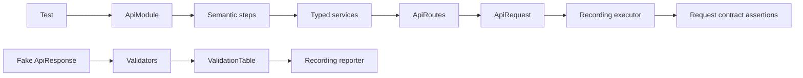

# Atf.Common.Tests — module component tests

This is the fast, offline quality gate for the API-module layer. It verifies route semantics, service serialization, semantic steps, validation aggregation, fixtures/data and cleanup without contacting a live API.

## Component flow



## Coverage matrix

| Test group | Protected behavior |
|---|---|
| `RoutingServicesAndDataTests` | token encoding, route metadata, service bodies, module composition, data uniqueness and fixture errors |
| `ValidationComponentTests` | status, allowed status, headers, body, JSONPath, relationships and JSON Schema |
| `ValidationAndLifecycleTests` | one-table aggregation, reverse cleanup and best-effort failures |

## What these tests prove

- route templates are encoded safely and remain configurable;
- services preserve route metadata, auth profile and typed JSON payload;
- `ApiModule` exposes steps while hiding executor wiring;
- validators publish all rows and raise `ApiValidationException` only after evidence;
- assertion `ACTUAL` values use the reporter's configured maximum length, so the
  diagnostic table stays readable without changing assertion semantics;
- malformed response shapes are contract failures;
- resources are cleaned in reverse order even when one action fails;
- a fake executor is enough, so no test depends on a token or network.

## Extension recipe

```text
1. RouteSettings / ApiRoutes metadata
2. typed request and response model
3. service serialization
4. semantic step if useful
5. validator / schema
6. fake-executor component test
7. live scenario in Atf.Api
```

Keep the test seam at `IApiExecutor`. Inspect the produced `ApiRequest` and `ApiRoute` rather than reconstructing service internals.

## Run

```powershell
dotnet test .\Atf.Tests\Atf.Common.Tests\Atf.Common.Tests.csproj --no-restore --logger "console;verbosity=normal"
```

