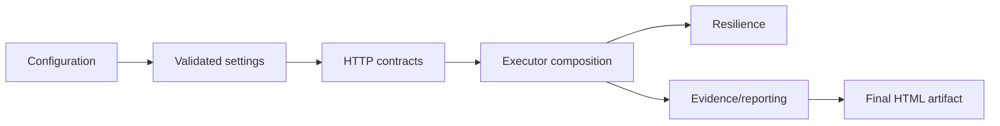
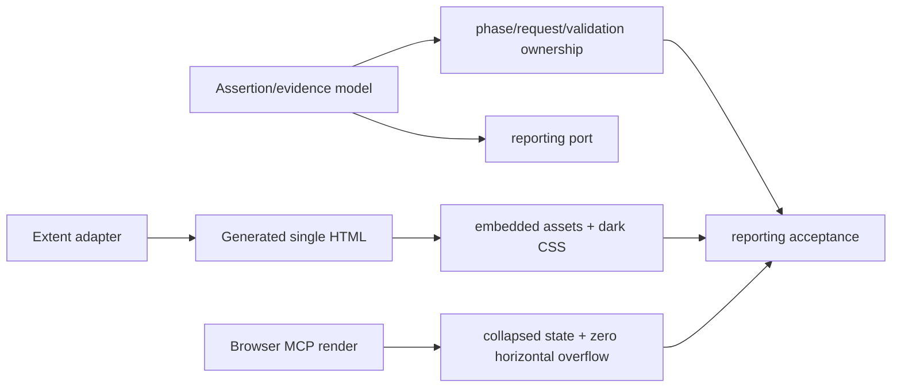

# Atf.Core.Tests — kernel and artifact contract tests

This is the test project for `Atf.Core`, physically grouped under
`Atf.Tests/Atf.Core.Tests`. It is renderer-neutral and must not import Extent
implementation details.

The complete test-to-artifact strategy is in the
[architecture and reporting guide](../../docs/ATF_Architecture.md).

This is the fast, offline quality gate for `Atf.Core`. It does not start a service, open a socket or require a token. Network and reporting boundaries are replaced with deterministic fakes or temporary files.

## Audit alignment — 2026-10-13

Testele trebuie să apere direcția de dependență și autoritatea rezultatului, nu
să repete testele adaptorului Extent.
Un reporter care aruncă este un failure de infrastructură diagnostică; nu are voie
să schimbe `ApiExecutionResult`, cauza originală sau verdictul funcțional.

Găzduiți aici doar politici renderer-neutral: timeout, cancellation, retry history,
auth state, URL/query encoding, configuration snapshot, redaction și reporting
ports. Testele pentru CSS, DOM, Extent selectors sau computed styles aparțin
adaptorului și browser contractului.

## Protected contracts



| Test group | Protected behavior |
|---|---|
| `ConfigurationAndResilienceTests` | module binding, validation, retry, polling and JSON formatting |
| `CoreArchitectureTests` | URL/query encoding, auth, transport, path and asset policy |
| `HttpExecutorComponentTests` | retry result, route metadata, JSON evidence and auth state |
| `ApiExecutorCompositionTests` | injected ports and exception preservation |
| `ReportingComponentTests` | class status precedence and evidence classification |
| `ReportingStructureTests` | phase-owned request + validation-sibling hierarchy, aggregate validation, active-step evidence and suppression of generic phase summaries |
| `ReportingLifecycleComponentTests` | fixture composition, identity forwarding and idempotent finalization |

## Testing rule

Tests verify observable contracts:

```text
fake transport -> ApiExecutionResult
recording reporter -> emitted evidence
temporary HTML -> ReportArtifactInspection
in-memory Extent -> node hierarchy
```

They should not assert private helper calls. For example, executor composition injects all ports and verifies the interaction contract without requiring a real `HttpClient`.

### Annotation policy

The generic `framework` tag is forbidden. The test project and namespace already
identify ATF tests; annotations are retained only when they change filtering,
execution policy or report navigation. `AnnotationPolicyTests` protects the
scenario source and configured tag order from regression.

## Renderer boundary

Core tests stay renderer-neutral. `AtfAssertion` is the semantic row contract;
HTML formatting, Extent selectors, dark theme tokens, collapse rules and final
artifact inspection are tested in `Atf.Tests/Atf.Reporting.Extent.Tests`.



A green unit test is not sufficient for the final browser contract: the HTML
artifact must still be opened and checked after the live API run.

`ReportArtifactInspector` este dovadă pentru artifactul static; nu îl redenumiți
și nu îl tratați ca test browser. Pentru click, disclosure, scroll și fonturi
calculate este necesar un seam DOM separat.

This is stronger than testing a CSS string in isolation.

## Run

```powershell
dotnet test .\Atf.Tests\Atf.Core.Tests\Atf.Core.Tests.csproj --no-restore --logger "console;verbosity=normal"
```

When reporting CSS or Extent structure changes, run this project before live API tests.


