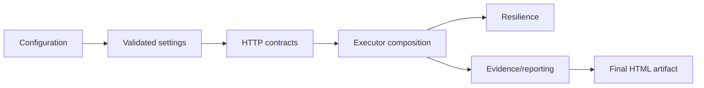
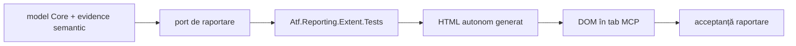

# Atf.Core.Tests — teste pentru kernelul ATF

Acesta este proiectul de teste pentru `Atf.Core`, grupat fizic sub
`Atf.Tests/Atf.Core.Tests`. Este neutru față de renderer și nu trebuie să importe
detalii de implementare Extent.

Separarea dintre testele kernelului și contractul artifactului este documentată în
[ghidul de arhitectură și raportare](../../docs/ATF_Architecture.md).

Acesta este quality gate-ul rapid și offline pentru `Atf.Core`. Nu pornește un
serviciu, nu deschide socket și nu necesită token. Boundary-urile de rețea și
raportare sunt înlocuite cu fake-uri deterministe sau fișiere temporare.

## Scope și responsabilitate

Testele trebuie să apere direcția de dependență și autoritatea rezultatului, nu
să repete testele adaptorului Extent.
Un reporter care aruncă este un failure de infrastructură diagnostică; nu are voie
să schimbe `ApiExecutionResult`, cauza originală sau verdictul funcțional.

Găzduiți aici doar politici renderer-neutral: timeout, cancellation, retry history,
auth state, URL/query encoding, configuration snapshot, redaction și reporting
ports. Testele pentru CSS, DOM, Extent selectors sau computed styles aparțin
adaptorului și contractului DOM.

## Contracte protejate



| Grup de teste | Comportament protejat |
|---|---|
| `ConfigurationAndResilienceTests` | binding, validare, retry, polling și formatare JSON |
| `ConfigurationRuleTests` | reguli de configurație și mesaje deterministe |
| `ApiSettingsSnapshotTests` | snapshot immutable și separarea valorilor runtime |
| `CoreArchitectureTests` | codificarea URL/query, auth, transport și direcția dependențelor |
| `HttpExecutorComponentTests` | retry, cancellation, metadata de rută, evidence și auth |
| `ApiExecutorCompositionTests` | porturi injectate și păstrarea excepțiilor |
| `SensitiveDataRedactorTests` | redaction pentru JSON, headere, path/query și date PII |
| `ReportAssetCleanupCoordinatorTests` | cleanup izolat și concurent al asset-urilor |
| `ReportStepScopeTests` | lifecycle renderer-neutral pentru pași și cleanup |
| `TestCaseInventoryTests` | inventarul testelor fără dependență de renderer |
| `TagTaxonomyTests` / `AnnotationPolicyTests` | taxonomia tag-urilor și interzicerea markerilor generici |
| `PackageBoundaryTests` | limitele de namespace și direcția modulelor |

## Regula de testare

Testele verifică contracte observabile:

```text
fake transport -> ApiExecutionResult
recording reporter -> emitted evidence
temporary HTML -> ReportArtifactInspection
in-memory Extent -> node hierarchy
```

Nu trebuie să verifice apeluri către helperi privați. De exemplu, compoziția
executorului injectează toate porturile și verifică contractul de interacțiune
fără să necesite un `HttpClient` real.

### Politica adnotărilor

Tag-ul generic `framework` este interzis. Proiectul de teste și namespace-ul
identifică deja testele ATF; adnotările sunt păstrate numai când schimbă filtrarea,
politica de execuție sau navigarea raportului. `AnnotationPolicyTests` protejează
sursa scenariului și ordinea configurată a tag-urilor împotriva regresiilor.

## Boundary-ul renderer-ului

Testele Core rămân neutre față de renderer. `AtfAssertion` este contractul semantic
al rândului; formatarea HTML, selectorii Extent, tokenurile temei dark, regulile de
collapse și inspecția artifactului final sunt testate în
`Atf.Tests/Atf.Reporting.Extent.Tests`.



Un test unitar nu este suficient pentru contractul final DOM: ieșirea
HTML trebuie verificată separat printr-un contract DOM.

`ReportArtifactInspector` este dovadă pentru artifactul static; nu îl redenumiți
și nu îl tratați ca test interactiv. Pentru click, disclosure, scroll și fonturi
calculate este necesar un seam DOM separat.

Aceasta este o dovadă mai puternică decât testarea izolată a unui string CSS.

## Rulare

```powershell
dotnet test .\Atf.Tests\Atf.Core.Tests\Atf.Core.Tests.csproj --no-restore --logger "console;verbosity=normal"
```

Când se schimbă CSS-ul sau structura Extent, rulează acest proiect înaintea
testelor API live.


