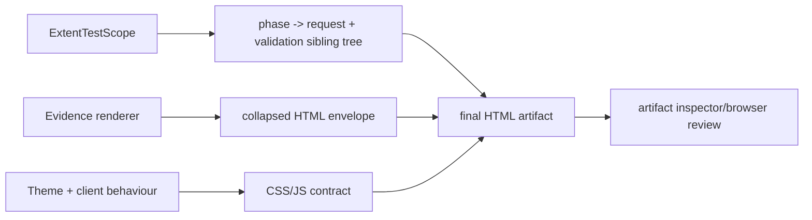
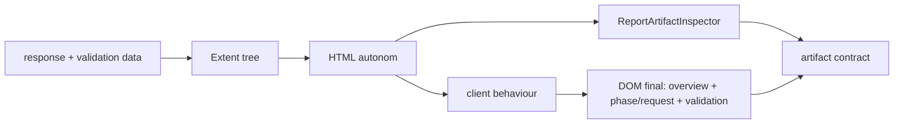

# Atf.Reporting.Extent.Tests — contracte pentru adaptorul de raportare

Acest proiect testează adaptorul Extent și artifactul HTML consumat de om.
Nu testează transportul HTTP și nu este o suită live.



## Contracte acoperite

| Zonă | Ce trebuie să rămână adevărat |
|---|---|
| ownership | Core nu referă Extent; adapterul deține implementarea concretă |
| hierarchy | validation este următorul frate direct al requestului care a produs response-ul |
| aggregation | un response produce o singură tabelă agregată de assertions |
| evidence | trace-ul este `TECHNICAL TRACE`, iar transportul rămâne `Info` |
| disclosure | fazele, pașii și evidence-ul pornesc collapsed |
| readability | titlurile lungi au ellipsis, iar textul complet rămâne accesibil prin `title`/`aria-label` |
| JSON | code block monospace, wrap, scroll vertical, fără overflow orizontal de pagină |
| artifact | HTML autonom, fără folder sibling `extent` |

## Regula de testare

```text
in-memory Extent tree -> structural contract
renderer output        -> escaped/collapsed envelope
generated HTML         -> artifact contract
browser click-through  -> final visual confidence
```

Testele nu trebuie să verifice detalii private ale helperelor. Ele verifică
noduri, statusuri, markup observabil și proprietăți CSS/JS care protejează
raportul deschis de utilizator.

## Contract dinamic pentru raport

Raportul de referință nu este doar un fișier HTML static: Extent livrează
markup-ul inițial, iar client behaviour materializează overview-ul, rolurile
semantice și starea collapsed la încărcarea paginii. Testăm ambele momente:



| Caracteristică observabilă | Protecție | Ce previne |
|---|---|---|
| `phase → request + validation sibling` | `semantic-execution-roles` + structural tests | pași atașați greșit sau fără rol |
| overview calculat din scenario cards | `reportScenarioData()` tests | totaluri bazate pe class roots/unit tests |
| response duration | `response-duration-ms` | valori fără unitate sau confundate cu timestamp |
| JSON compact și scrollabil | `scrollable-json` + CSS tests | overflow orizontal și body gigant |
| evidence collapsed și accesibil | `collapsed-evidence` + `accessible-evidence-titles` | raport deschis zgomotos sau titluri tăiate fără acces |
| tag-uri semantice | `no-generic-framework-tag` + policy test | metadata decorativă care poluează raportul |

Un test nou pentru raport trebuie să treacă prin `ExtentReportLifecycle`, să
scrie un artifact temporar și să-l inspecteze cu `ReportArtifactInspector`.
Testarea exclusivă a unui string din CSS nu este suficientă; trebuie verificată
și tranziția `tree → HTML → DOM`.

## Metadata de raportare

Adaptorul nu trebuie să emită și nu trebuie să încurajeze tag-uri generice de
tip `framework`. Un tag este justificat numai dacă are un efect observabil în
filtrare, execuție sau navigarea raportului; identitatea proiectului este deja
metadata suficientă pentru testele ATF.

## Rulare

```powershell
dotnet test .\Atf.Tests\Atf.Reporting.Extent.Tests\Atf.Reporting.Extent.Tests.csproj --no-restore
```

După orice schimbare de layout, deschide artifactul generat și verifică în
această ordine: overview, test class, scenario, phase, request, validation sibling,
technical trace, JSON și assertion table. Un test structural nu înlocuiește
verificarea randării reale.
