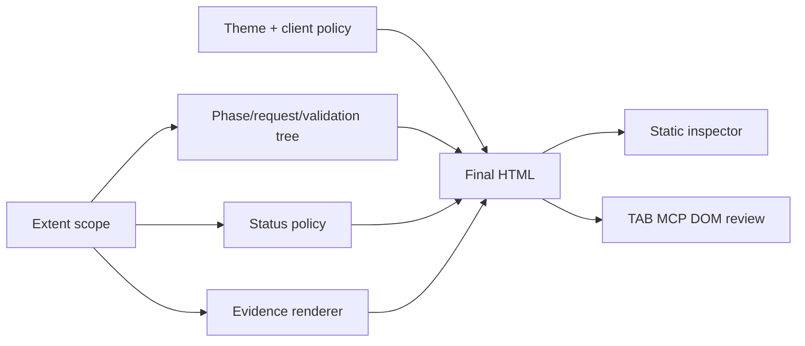
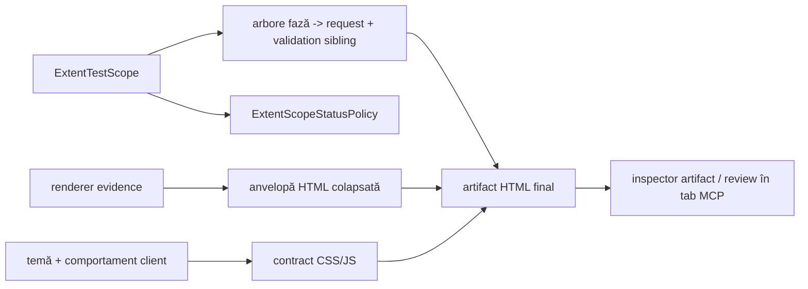
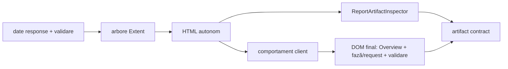

# Atf.Reporting.Extent.Tests — contracte pentru adaptorul de raportare

Acest proiect testează adaptorul Extent și artifactul HTML consumat de om.
Nu testează transportul HTTP și nu este o suită live.

Este proiectul pentru boundary-ul Extent, grupat fizic în
`Atf.Tests/Atf.Reporting.Extent.Tests`; verificarea DOM în tab-ul MCP rămâne distinctă de
inspecția statică a artifactului.

## Orientare rapidă



Citește acest README în ordinea: contracte → seam-uri → artifact dinamic →
metadata → rulare. Inspectorul static verifică markupul și cardinalitatea; TAB
MCP rămâne autoritatea pentru click, collapse, filtrare și randare observabilă.

## Contracte protejate

Testele de aici trebuie să protejeze arborele, statusul, evidence-ul și artifactul HTML,
dar nu trebuie să pretindă că un regex asupra
sursei HTML dovedește randarea DOM.



## Contracte acoperite

| Zonă | Ce trebuie să rămână adevărat |
|---|---|
| ownership | Core nu referă Extent; adapterul deține implementarea concretă |
| hierarchy | validation este următorul frate direct al requestului care a produs response-ul |
| aggregation | un response produce o singură tabelă agregată de assertions |
| warning | soft assertion-ul păstrează rândurile Fail, le afișează cu `⚠️`, promovează scenariul la Warning și apare în Overview `WARNING` |
| status policy | warning-ul este scoped pe phase, consumat la completion și păstrat la scenario completion |
| evidence | trace-ul este `TECHNICAL TRACE`, iar transportul rămâne `Info` |
| disclosure | fazele, pașii și evidence-ul pornesc collapsed |
| readability | titlurile lungi au ellipsis, iar textul complet rămâne accesibil prin `title`/`aria-label` |
| JSON | code block monospace, wrap, scroll vertical, fără overflow orizontal de pagină |
| artifact | HTML autonom, fără folder sibling `extent` |

## Organizarea testelor pe seam-uri

Testele sunt grupate după contractul dominant, nu după ordinea în care au fost
descoperite:

```text
ReportingStructureTests / ExtentScopeTreeCoordinatorTests   -> arbore și tranziții
ReportingEvidenceAndTraceTests / ReportThemeContractTests   -> evidence, trace și temă
ReportingClientNavigationTests / ReportingOverviewAuditTests -> client și overview
ReportingStatusPolicyTests                                  -> verdict și precedence
ReportingConcurrencyTests                                   -> izolarea sesiunilor
ReportingArtifactContractTests                               -> artifact HTML observabil
ReportingLifecycleComponentTests                             -> lifecycle și fixture seam
```

Un test nou se adaugă în clasa care deține seam-ul său. Nu se mărește
`ReportingLifecycleComponentTests` cu verificări de status, concurență sau
artifact doar pentru că folosește același adaptor; această regulă păstrează
failure-ul localizabil și reduce coupling-ul dintre setup-uri.

## Regula de testare

```text
arbore Extent în memorie -> contract structural
output renderer          -> anvelopă escaped/collapsed
HTML generat             -> contract artifact
click-through în tab MCP -> încredere vizuală finală
```

Testele nu trebuie să verifice detalii private ale helperelor. Ele verifică
noduri, statusuri, markup observabil și proprietăți CSS/JS care protejează
raportul deschis de utilizator.

## Contract dinamic pentru raport

Raportul de referință nu este doar un fișier HTML static: Extent livrează
markup-ul inițial, iar client behaviour materializează overview-ul, rolurile
semantice și starea collapsed la încărcarea paginii. Testăm ambele momente:



| Caracteristică observabilă | Protecție | Ce previne |
|---|---|---|
| `phase → request + validation sibling` | `semantic-execution-roles` + structural tests | pași atașați greșit sau fără rol |
| overview calculat din scenario cards | `reportScenarioData()` tests | totaluri bazate pe class roots/unit tests |
| response duration | `response-duration-ms` | valori fără unitate sau confundate cu timestamp |
| JSON compact și scrollabil | `scrollable-json` + CSS tests | overflow orizontal și body gigant |
| evidence collapsed și accesibil | `collapsed-evidence` + `accessible-evidence-titles` | raport deschis zgomotos sau titluri tăiate fără acces |
| tag-uri semantice | `no-generic-framework-tag` + policy test | metadata decorativă care poluează raportul |

Un test nou pentru raport trebuie să treacă prin `ExtentReportLifecycle`, să
scrie un artifact temporar și să-l inspecteze cu `ReportArtifactInspector`.
Testarea exclusivă a unui string din CSS nu este suficientă; trebuie verificată
și tranziția `tree → HTML → DOM`.

### Contracte și extensii recomandate

| Caz | Nivel | Acceptare |
|---|---|---|
| reporter failure nu schimbă verdictul | component — protejat | failure-ul funcțional rămâne autoritar |
| Warning/Other reconciliation | artifact + tab MCP | card, chart, tags și metadata au aceeași populație |
| request/validation ownership | tree + DOM | validation este sibling direct și tabelul este unic |
| collapsed state | DOM | phase, request, validation și evidence pornesc închise |
| response JSON | DOM | code block scrollabil fără overflow de pagină |
| overview typography/colors | DOM | titlurile, fonturile și tokenii calculați corespund contractului |
| parallel sessions | component | artifactele și nodurile nu se amestecă |

Izolarea reporterului este protejată la nivel de componentă; verificarea
complementară este DOM-ul final parcurs în tab-ul MCP pentru reconcilierea
Warning/Other, collapse și computed styles.

Pentru aceste verificări, artifactul expune `window.__atfDomContract.inspect()`.
Controllerul este read-only și oferă o suprafață stabilă pentru cardinalitate,
poziționarea statusurilor, disclosure state, assertion tables și overflow JSON;
testele Extent verifică emiterea harness-ului, iar TAB MCP verifică valorile
calculate pe artifactul real.

## Metadata de raportare

Adaptorul nu trebuie să emită și nu trebuie să încurajeze tag-uri generice de
tip `framework`. Un tag este justificat numai dacă are un efect observabil în
filtrare, execuție sau navigarea raportului; identitatea proiectului este deja
metadata suficientă pentru testele ATF.

## Rulare

```powershell
dotnet test .\Atf.Tests\Atf.Reporting.Extent.Tests\Atf.Reporting.Extent.Tests.csproj --no-restore
```

După orice schimbare de layout, deschide artifactul generat în tab-ul MCP și verifică în
această ordine: overview, test class, scenario, phase, request, validation sibling,
technical trace, JSON și assertion table. Un test structural nu înlocuiește
verificarea randării DOM reale.
