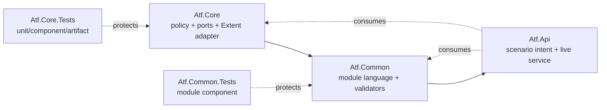
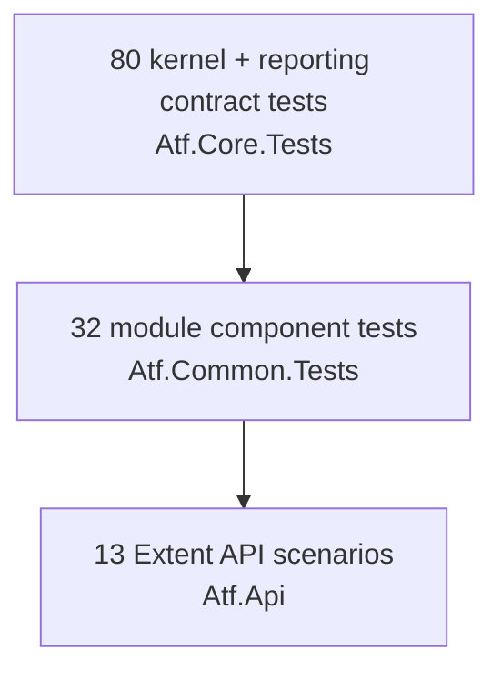
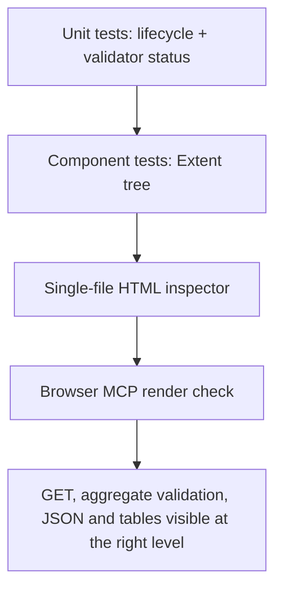

# Atf.Tests — testarea internă a ATF-ului

The test strategy and the browser-validated report contract are documented in
the [architecture and reporting guide](../docs/ATF_Architecture.md).

Aceasta este secțiunea dedicată testării ATF-ului însuși, nu testării unui API produs. Ea protejează contractele reutilizabile ale soluției înainte de rularea scenariilor live din `Atf.Api`.

## Organizare

| Proiect | Tip dominant | Ce protejează |
|---|---|---|
| `Atf.Core.Tests` | unit + component contract tests | configurație, HTTP, autentificare, executor, retry/polling, lifecycle Extent și artifactul HTML |
| `Atf.Common.Tests` | module component tests | `ApiModule`, rute, servicii, pași, fixture-uri, validări și cleanup |
| `Atf.Api` | live acceptance tests | comportamentul API-ului țintă și contractele de business |

## Cum se citește soluția



Regula de ownership este simplă: `Core` nu cunoaște domeniul, `Common` nu cunoaște
runnerul sau markup-ul Extent, iar `Api` nu construiește transportul. Dacă o
modificare poate fi verificată fără serviciu, ea aparține testelor de sub `Atf.Tests`.

## Contracte observabile și dovada lor

| Contract | Observabil în cod | Dovadă curentă | Următorul test recomandat |
|---|---|---|---|
| configurare validată înainte de runtime | `AtfConfiguration.Validate()` | `ConfigurationAndResilienceTests` | chei necunoscute + snapshot fără secrete |
| request semantic | `ApiRoute` + `ApiRequest` | `RoutingServicesAndDataTests` | toate operațiile CRUD și query encoding |
| transport separat de policy | `IApiTransport`, `IApiAuthenticator`, `IApiUrlBuilder` | `HttpExecutorComponentTests` | cancellation, timeout și headers case-insensitive |
| retry bounded | `RateLimitRetryPolicy` + `ApiExecutionResult` | `ConfigurationAndResilienceTests` | retry exhaustion fără verdict PASS |
| contract funcțional agregat | `ValidationTable` | `ValidationComponentTests` | JSON invalid, schema invalid și colecție goală |
| lifecycle de reporting | `ValidationTable.Run` + `CompleteStep` | `ValidationAndLifecycleTests` | validarea agregată rămâne copilul requestului în Extent |
| cleanup determinist | `CleanupRegistry` | `ValidationAndLifecycleTests` | failure în setup/body/teardown și duplicate ownership |
| artifact consumabil | `ReportArtifactInspector` | `ReportArtifactInspectorTests` | DOM semantic, responsive layout și overflow |

## De ce nu se numește totul `Atf.Unit.Tests`

O parte din teste sunt unitare, dar o parte verifică intenționat colaborarea dintre componente: executor + transport fake + reporter, `ApiModule` + servicii, lifecycle Extent și raportul HTML final. `Atf.Tests` este umbrela corectă; proiectele de dedesubt păstrează distincția dintre unit și componentă fără să numească generic codul „framework”.

## Regula de execuție

```text
Atf.Core.Tests -> Atf.Common.Tests -> Atf.Api
offline           offline             live / target API
```

```powershell
dotnet test .\Atf.Tests\Atf.Core.Tests\Atf.Core.Tests.csproj --no-restore
dotnet test .\Atf.Tests\Atf.Common.Tests\Atf.Common.Tests.csproj --no-restore
dotnet test .\Atf.Api\Atf.Api.csproj --no-restore
```

Orice modificare a executorului, lifecycle-ului sau raportării trebuie să fie protejată în `Atf.Tests` înainte de testele live.

## Compoziția raportării Extent

Raportarea nu trebuie tratată ca un singur helper static. Implementarea actuală separă responsabilitățile astfel:

```text
IAtfReportSession          sesiune de raport izolată per rulare
ExtentReportLifecycle      adaptor Extent al sesiunii de raport
  -> ExtentTestHierarchy   clase, scenarii, categorii și status agregat
  -> ExtentReportEnvironment metadata de execuție din overview
  -> ExtentTestScope       contextul unui scenariu și publicarea pașilor
      -> ExtentEvidenceRenderer  envelope HTML safe/collapsed
      -> ExecutionEvidenceComposer clasificare și compactare evidence
  -> AtfReportColors       constantele centrale ale paletei
  -> AtfReportTheme        stylesheet-ul compus din paletă
  -> ExtentAssetInliner     embedding CSS/JS/fonturi/logo
  -> ReportArtifactInspector contractul final al HTML-ului consumat
```

Regula de design este: lifecycle-ul decide *când* se publică informația, componentele de reporting decid *cum* se reprezintă, iar validatorii/serviciile decid *ce* înseamnă rezultatul. Astfel o schimbare de culoare sau layout nu trebuie să atingă orchestrarea testelor, iar o schimbare de contract API nu trebuie să atingă CSS-ul.

## Contractul ATF-ului, pe scurt


Un test ATF este sănătos când testează un contract observabil la nivelul potrivit:

| Contract | Owner | Test seam | Verdictul verificat |
|---|---|---|---|
| settings valide | `Atf.Core` | loader + config fake | fail fast înainte de execuție |
| request semantic | `Atf.Common` | `IApiExecutor` fake | method/path/body/auth/route metadata |
| exchange HTTP | `Atf.Core` | `IApiTransport` / `HttpMessageHandler` fake | response, attempts, duration, retry events |
| contract funcțional | `Atf.Common` | `IAtfReporter` recording fake | toate rândurile într-un singur tabel |
| lifecycle | `Atf.Api` + `Atf.Core` | fixture/context fake | setup → body → teardown; cleanup chiar la failure |
| raport consumabil | `Atf.Core` | HTML artifact real | Extent embedded, dark, collapsed, fără `extent/` |

## Piramida de teste actuală



The current `Atf.Api` xUnit assembly also contains offline framework contract
tests, so its runner total is larger than the 13 API scenarios shown by Extent.
The report and the runner are intentionally reconciled by label rather than by
blindly reusing a container count.

### Regula de verificare a raportului



Unit tests prove the close/open protocol, component tests prove the node hierarchy,
and the browser check proves that Extent's hydrated DOM preserves the intended
collapsed phase → request → evidence + aggregate validation layout. The three layers are complementary, not substitutes.

Ordinea este intenționată: un defect de configurare, routing sau reporting trebuie să eșueze în testele offline, înainte de a consuma timp și date pe serviciul live.

## Ce mai trebuie testat

### Prioritate P0 — siguranță și verdict corect

| Test propus | Seam | Criteriu de acceptare |
|---|---|---|
| `SecretsAreRedactedBeforeEvidence` | fake reporter + request/exception | token, cookie, password și secret nu apar în nicio valoare Extent |
| `RetryExhaustionNeverCreatesFunctionalPass` | fake transport + executor | ultimul `429` este `Completed/diagnostic`, iar verdictul vine numai din assertions |
| `CancellationPreservesCancellationState` | transport care aruncă `OperationCanceledException` | anularea nu este convertită în PASS și păstrează cauza originală |
| `CleanupRunsAfterSetupFailure` | scenario harness + registry | teardown rulează dacă ownership-ul a fost dobândit înainte de failure |
| `ParallelScopesNeverMixEvidence` | două task-uri + reporter recording | requesturile și tabelele rămân în scenariul lor |
| `RunnerSkipMatchesExtentSkip` | xUnit v3 scenario harness + Extent scope | un skip de precondiție este `Skipped` în ambele rezultate, nu `Passed` în runner |

### Prioritate P1 — acoperire de contract API

| Familie | Teste concrete |
|---|---|
| authentication | profile `basic`, `api-key`, custom headers; token absent; header override |
| resilience | `Retry-After` delta/epoch; max delay; timeout; retry budget; cancellation |
| resources | `PUT/PATCH/DELETE`; idempotency; 4xx fără mutation; nested create/delete |
| collections | empty collection; pagination; filters; sorting; cardinality limits |
| errors | common error schema; correlation id; rate-limit headers; invalid JSON |
| schema | missing/invalid schema; `additionalProperties`; type mismatch; nullability |

### Prioritate P2 — configurabilitate și operare

| Zonă | Dovada dorită |
|---|---|
| configuration schema | validare structurală, chei necunoscute detectate, mesaj cu path complet |
| reproducibility | snapshot fără secrete, seed/run id, aceeași configurație produce aceeași rută |
| runner inventory | `Fact`, `Theory`, `MemberData/ClassData` comparate cu totalul din report |
| report lifecycle | run repetat în același proces, flush idempotent, retenție și cleanup controlat |
| browser contract | DOM semantic, toate details collapsed, zero overflow orizontal la viewport îngust |

## Sugestii de îmbunătățire profundă

1. **Păstrează sesiunea de execuție izolată de adapterul Extent.** `IAtfReportSession` deține starea unei singure rulări, iar `ExtentReportLifecycle` este adaptorul concret. Următorul pas este un context `AsyncLocal` doar pentru corelarea explicită a transportului, nu pentru starea globală a raportului.
2. **Introdu un model de rezultat explicit.** `ApiExecutionResult` ar trebui să poată exprima transport error, cancellation, final response, correlation id și retry history fără a deduce starea din loguri.
3. **Adaugă un redactor central.** Nicio componentă nu ar trebui să decidă local ce este secret; `ISensitiveDataRedactor` trebuie aplicat înainte de `Detail`, `Json`, exception și snapshot.
4. **Validează configurația ca schemă.** JSON este implementarea curentă; blueprint-ul declarativ YAML poate fi introdus ulterior printr-un provider, dar semantic trebuie să rămână aceeași configurație pe module.
5. **Construiește un registry declarativ de operații.** `ApiRoutes` este acum scris în C#; un registry configurabil ar permite generarea operațiilor și a matricei de smoke/negative/relationship fără recompilarea motorului.
6. **Fă testarea de raportare contract-first.** `ReportArtifactInspector` trebuie extins treptat de la verificări de substring la verificări DOM/semantică pentru ordinea overview-ului, collapsed state, tabele și lipsa overflow-ului.
7. **Separă modelul de verdict de modelul de prezentare.** `ApiExecutionResult`, `ValidationTable` și statusul Extent trebuie să aibă conversii explicite; un `Info` tehnic nu trebuie să poată produce accidental `Pass` funcțional.
8. **Introdu contracte de compatibilitate pentru configurație.** Fiecare cheie configurabilă trebuie să aibă default, validator, exemplu, override environment și test de binding.
9. **Tratează raportul ca produs.** Adaugă screenshot/DOM checks la breakpoint-uri, accesibilitate minimă pentru disclosure controls și un contract de regresie pentru culori, densitate și înălțimea code-block-urilor.

## Definition of Done pentru o extensie ATF

```text
configuration contract -> route/service contract -> offline component test
-> validator/assertion contract -> lifecycle/cleanup test
-> representative live scenario -> real Extent artifact inspection
```

O extensie nu este completă dacă doar testul live trece. Trebuie să existe dovadă offline pentru comportamentul reutilizabil și dovadă în HTML pentru ceea ce va folosi omul la triage.
