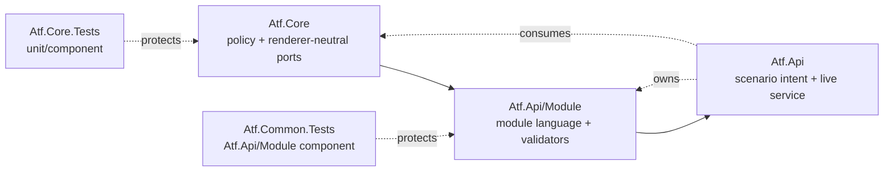
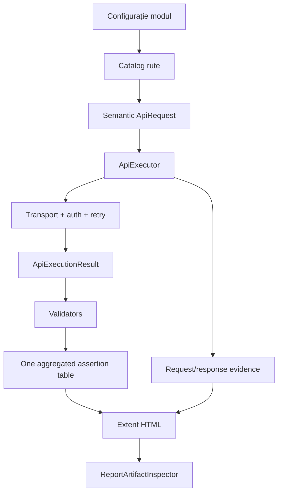
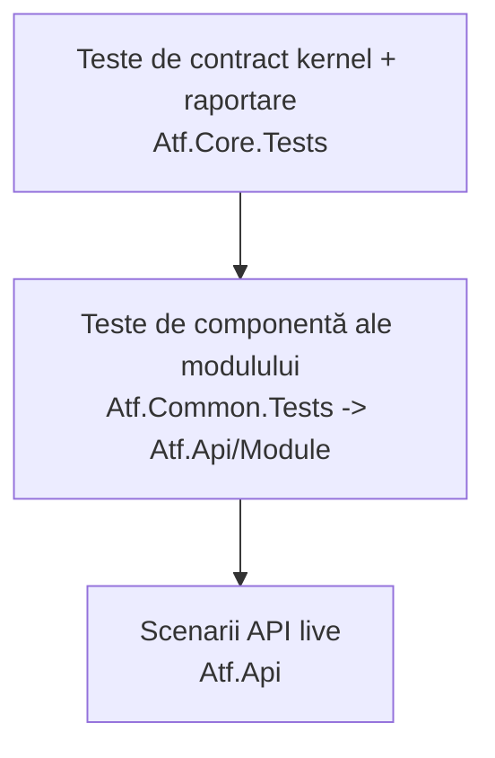
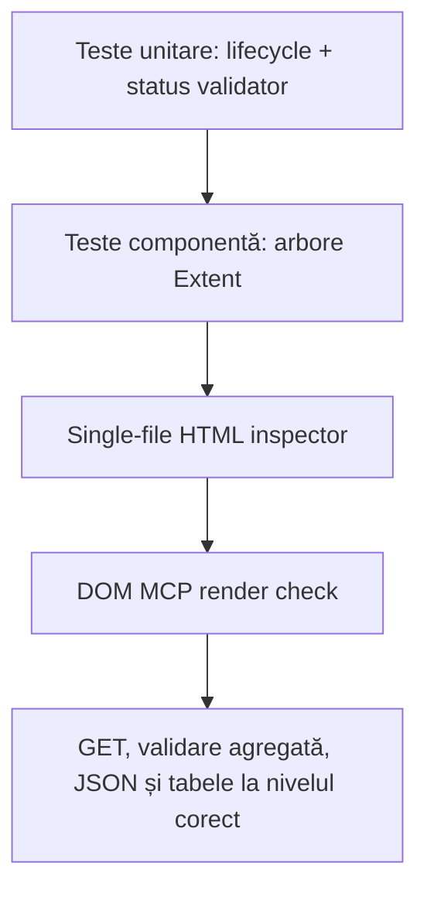

# Atf.Tests — testarea internă a ATF-ului

Strategia de testare și contractul raportului validat interactiv în tab-ul MCP sunt documentate
în [ghidul de arhitectură și raportare](../docs/ATF_Architecture.md).
Regulile normative pentru design OOP coerent, adnotări cu sens, validări agregate
și lifecycle-ul testelor sunt în
[README-ul de bune practici ATF](../docs/README_Atf_BestPractices.md).

Aceasta este secțiunea dedicată testării ATF-ului însuși, nu testării unui API
produs. Ea protejează contractele reutilizabile ale soluției înainte de rularea
scenariilor live. Toate proiectele de testare ATF sunt grupate sub acest
director; nu mai există proiecte de testare ATF la rădăcina repository-ului.

## Organizare

| Proiect | Tip dominant | Ce protejează |
|---|---|---|
| `Atf.Core.Tests` | teste unitare și de componentă pentru contracte | configurație, HTTP, autentificare, executor, retry/polling și portul de lifecycle |
| `Atf.Common.Tests` | teste de componentă pentru modulul `Atf.Api/Module` | rute, servicii, validări și cleanup |
| `Atf.Api.Tests` | teste de componentă API/raportare | teste de boundary, layout-ul fazelor și evidence fără serviciu |
| `Atf.Api.FailureDemos` | fixture-uri de failure opt-in | căi de failure controlate, fără contaminarea suitei normale |
| `Atf.Reporting.Extent.Tests` | teste pentru adaptor și artifactul raportului | ownership Extent, envelope HTML, temă și contractul collapse |

## Structura minimă țintă

La rădăcina repository-ului păstrăm modulul principal `Atf.Api`, fundația
`Atf.Core` și boundary-urile care îl susțin:

```text
Atf.Core/                 # kernel tehnic
Atf.Api/                  # modul API și scenarii live
Atf.Api.TestHost/         # composition root pentru renderer
Atf.Reporting.Extent/     # adaptor Extent
Atf.Tests/                # toate testele ATF
docs/                     # documentație și feedback
artifacts/                # rapoarte generate
```

Conținutul fostului `Atf.Common` este în `Atf.Api/Module`, iar
`Atf.Api.Tests` și `Atf.Api.FailureDemos` sunt proiecte grupate în `Atf.Tests`,
nu proiecte concurente la rădăcină. `Atf.Api.TestHost` nu se mută în `Atf.Api`, deoarece ar
introduce dependența directă de Extent în proiectul scenariilor. Orice director
nou la rădăcină trebuie să justifice un boundary, o dependență sau un lifecycle
independent și să aibă teste proprii.

## Cum se citește soluția



Structura simplificată este aplicată. Nu absorbim `Atf.Core` și nu mutăm
Extent în API.

Regula de ownership este simplă: `Core` nu cunoaște domeniul,
`Atf.Api/Module` nu cunoaște runnerul sau markup-ul Extent, iar `Api` nu
construiește transportul. Dacă o
modificare poate fi verificată fără serviciu, ea aparține testelor de sub `Atf.Tests`.

## Contracte observabile și dovada lor

| Contract | Observabil în cod | Test de protecție | Extensie recomandată |
|---|---|---|---|
| configurare validată înainte de runtime | `AtfConfiguration.Validate()` | `ConfigurationAndResilienceTests` | chei necunoscute + snapshot fără secrete |
| request semantic | `ApiRoute` + `ApiRequest` | `RoutingServicesAndDataTests` | toate operațiile CRUD și query encoding |
| transport separat de policy | `IApiTransport`, `IApiAuthenticator`, `IApiUrlBuilder` | `HttpExecutorComponentTests` | cancellation, timeout și headers case-insensitive |
| retry bounded | `RateLimitRetryPolicy` + `ApiExecutionResult` | `ConfigurationAndResilienceTests` | retry exhaustion fără verdict PASS |
| contract funcțional agregat | `ValidationTable` | `ValidationComponentTests` | JSON invalid, schema invalid și colecție goală |
| lifecycle de reporting | `ValidationTable.Run` + `CompleteStep` | `ValidationAndLifecycleTests` | validarea agregată rămâne frate direct al requestului sub aceeași fază |
| cleanup determinist | `CleanupRegistry` | `ValidationAndLifecycleTests` | failure în setup/body/teardown și duplicate ownership |
| artifact consumabil | `ReportArtifactInspector` | `ReportArtifactInspectorTests` | HTML static, tokens, self-contained artifact și overflow guards |

## Contractul stratificat de verificare

Suitea internă oferă acoperire pentru contractele componentelor. Această
acoperire nu înseamnă că raportarea este validată vizual în tab-ul MCP și nu
înlocuiește verificarea serviciului țintă.

Testele de componentă protejează izolarea failure-ului reporterului, precedența
lifecycle-ului și propagarea soft-warning. Testele DOM trebuie să protejeze
click, collapse, scroll și computed styles. Pentru soft assert, rândul
`RESULT = Fail` rămâne vizibil semantic, xUnit nu eșuează, iar scenariul este
proiectat ca `Warning`; în Overview, bucket-ul intern `other` este afișat ca
`WARNING`/`Other` conform suprafeței, fără a fi confundat cu un verdict `Fail`.

Regula de mentenanță este să adăugăm testul lângă seam-ul pe care îl protejează:
evaluarea funcțională nu trebuie să depindă de succesul publicării diagnosticului,
iar un test static de HTML nu trebuie prezentat ca dovadă de randare DOM.

### Matricea de testare

| Strat | Owner | Exemplu de contract |
|---|---|---|
| unit | `Atf.Core.Tests` / `Atf.Common.Tests` | reguli pure, config, retry, redaction, evaluare tabel |
| componentă | `Atf.Api.Tests` / teste Extent | lifecycle, ownership arbore, failure reporter, precedență status |
| artifact | `Atf.Reporting.Extent.Tests` | HTML autonom, tokenuri, roluri, bloc JSON, tabel assertions |
| DOM / tab MCP | contract interactiv separat | click, collapse, scroll, computed styles, overflow |
| live | `Atf.Api` | business contract, auth și comportament al serviciului țintă |

Un fix nu se declară complet dacă acoperă doar un strat inferior. În special,
`ReportArtifactInspectorTests` nu trebuie numite teste interactive, iar un test live
verde nu trebuie folosit ca dovadă pentru separarea responsabilităților interne.

### Datorie de toolchain

Toate proiectele de test din soluția curentă folosesc xUnit v3. Diferențele de
discovery sau lifecycle nu mai sunt acceptate ca explicație pentru un test
instabil; orice abatere trebuie introdusă printr-un test de boundary și
documentată explicit.

## De ce nu se numește totul `Atf.Unit.Tests`

O parte din teste sunt unitare, dar o parte verifică intenționat colaborarea dintre componente: executor + transport fake + reporter, `ApiModule` + servicii, lifecycle Extent și raportul HTML final. `Atf.Tests` este umbrela corectă; proiectele de dedesubt păstrează distincția dintre unit și componentă fără să numească generic codul „framework”.

### Politica de adnotări

Nu folosim tag-ul generic `framework` pentru testele ATF. Proiectul, namespace-ul
și numele testului sunt suficiente pentru identitate. Păstrăm doar categorii cu
valoare operațională, precum `smoke`, `lifecycle`, `combination`, `contract`,
`negative` sau `auth`; regula este verificată de
`AnnotationPolicyTests.GenericFrameworkTagIsNotUsedByScenariosOrTagOrder`.

## Regula de execuție

```text
CURRENT: Atf.Tests/Atf.Core.Tests + Atf.Tests/Atf.Common.Tests +
         Atf.Tests/Atf.Api.Tests + Atf.Tests/Atf.Reporting.Extent.Tests
         offline component contracts; Atf.Api rămâne live API
```

```powershell
dotnet test .\Atf.Tests\Atf.Core.Tests\Atf.Core.Tests.csproj --no-restore
dotnet test .\Atf.Tests\Atf.Common.Tests\Atf.Common.Tests.csproj --no-restore
dotnet test .\Atf.Api\Atf.Api.csproj --no-restore
```

Orice modificare a executorului, lifecycle-ului sau raportării trebuie să fie protejată în `Atf.Tests` înainte de testele live.

## Compoziția raportării Extent

Raportarea nu trebuie tratată ca un singur helper static. Implementarea actuală separă responsabilitățile astfel:

```text
Atf.Core reporting ports   contracte runner-neutral
Atf.Reporting.Extent       adaptor Extent al sesiunii de raport
  -> IAtfReportSession      sesiune de raport izolată per scenariu
  -> ExtentTestHierarchy   clase, scenarii, categorii și status agregat
  -> ExtentReportEnvironment metadata de execuție din overview
  -> ExtentTestScope       contextul unui scenariu și publicarea pașilor
      -> ExtentEvidenceRenderer  envelope HTML safe/collapsed
      -> ExecutionEvidenceComposer clasificare și compactare evidence
  -> AtfReportColors       constantele centrale ale paletei
  -> AtfReportTheme        stylesheet-ul compus din paletă
  -> ExtentAssetInliner     embedding CSS/JS/fonturi/logo
  -> ReportArtifactInspector contractul final al HTML-ului consumat
```

Regula de design este: lifecycle-ul decide *când* se publică informația, componentele din adaptor decid *cum* se reprezintă, iar validatorii/serviciile decid *ce* înseamnă rezultatul. Astfel o schimbare de culoare sau layout nu trebuie să atingă Core sau orchestrarea testelor, iar o schimbare de contract API nu trebuie să atingă CSS-ul. Contractele adaptorului sunt testate separat în `Atf.Tests/Atf.Reporting.Extent.Tests`.

## Contractul ATF-ului, pe scurt



Un test ATF este sănătos când testează un contract observabil la nivelul potrivit:

| Contract | Owner | Test seam | Verdictul verificat |
|---|---|---|---|
| settings valide | `Atf.Core` | loader + config fake | fail fast înainte de execuție |
| request semantic | `Atf.Api/Module` | `IApiExecutor` fake | method/path/body/auth/route metadata |
| exchange HTTP | `Atf.Core` | `IApiTransport` / `HttpMessageHandler` fake | response, attempts, duration, retry events |
| contract funcțional | `Atf.Api/Module` | `IAtfReporter` recording fake | toate rândurile într-un singur tabel |
| lifecycle | `Atf.Api` + `Atf.Core` | fixture/context fake | setup → body → teardown; cleanup chiar la failure |
| request/validation tree | `Atf.Api.Tests` + `Atf.Tests/Atf.Reporting.Extent.Tests` | Extent in-memory tree | fiecare request este urmat de exact un sibling de validare, în ordinea execuției |
| raport consumabil | `Atf.Core` | HTML autonom | Extent embedded, dark, collapsed, fără `extent/` |

## Piramida de teste



`Atf.Api` este boundary-ul de acceptanță live și deține implementarea modulului
din `Atf.Api/Module`. Orice test offline de compoziție API sau contract de
raportare găsit în acel assembly este tranzitoriu și trebuie mutat în
`Atf.Common.Tests`, `Atf.Core.Tests` sau `Atf.Reporting.Extent.Tests`, conform
seam-ului său. Totalul runner-ului nu este automat egal cu numărul scenariilor
API afișate de Extent; corelează-le prin etichete explicite de inventar, nu prin
reutilizarea oarbă a unui count de container sau a unei valori copiate în README.

### Regula de verificare a raportului

Contractul de ownership verificat de suite este:

```text
TestCase
├── SETUP
│   └── Request(s)
├── TEST BODY
│   ├── Request
│   │   ├── Technical trace
│   │   ├── Response details
│   │   └── Response JSON
│   └── Validation(s) — următorul frate direct al requestului, sub aceeași fază
│       └── aggregate assertion table
└── TEARDOWN
    └── Request(s)
```



Testele unitare dovedesc protocolul de deschidere/închidere, testele de componentă
dovedesc ierarhia nodurilor, iar verificarea în tab-ul MCP dovedește că DOM-ul
hidratat de Extent păstrează layout-ul dorit, cu faze collapse → request +
validation sibling, evidence de transport sub request și tabelul agregat sub
validation. Cele trei niveluri sunt complementare, nu substituibile.

Ordinea este intenționată: un defect de configurare, routing sau reporting trebuie să eșueze în testele offline, înainte de a consuma timp și date pe serviciul live.

## Harta acoperirii actuale

Documentația descrie doar teste existente. Domeniile care nu au încă o dovadă
deterministă rămân în feedback, nu sunt prezentate aici ca teste deja livrate.

| Boundary | Dovadă actuală | Responsabilitate |
|---|---|---|
| kernel | `Atf.Core.Tests` — configurație, HTTP, retry, redaction, inventory și reporting ports | politici renderer-neutral |
| modul API | `Atf.Common.Tests` — rute, servicii, validatori și cleanup | vocabularul din `Atf.Api/Module` |
| orchestration API | `Atf.Api.Tests` — lifecycle, phase layout, boundary și evidence | colaborarea scenariu/executor/reporter |
| adaptor Extent | `Atf.Reporting.Extent.Tests` — tree, status, theme, client, artifact și concurență | HTML/CSS/JS și lifecycle Extent |
| failure demos | `Atf.Api.FailureDemos` — suite opt-in | observabilitatea failure-urilor intenționate |
| acceptanță | `Atf.Api` — Users, Posts și combinații lifecycle | comportamentul API-ului țintă |

Contractul DOM final se verifică separat în tab-ul MCP; testele statice și cele
de componentă nu sunt prezentate ca randare interactivă.

### Regula pentru testele arhitecturale

Testele noi trebuie să verifice ownership-ul și efectul observabil. Nu introduceți
teste care fixează o clasă internă doar pentru că există astăzi. Dacă un split OOP
este justificat, el trebuie să aibă un seam consumat de cel puțin două cazuri sau
o politică distinctă care merită testată separat.

## Criteriul de finalizare pentru o extensie ATF

```text
contract configurație -> contract route/service -> test offline de componentă
-> contract validator/assertion -> test lifecycle/cleanup
-> scenariu live reprezentativ -> inspecția artifactului Extent real
```

O extensie nu este completă dacă doar testul live trece. Trebuie să existe dovadă offline pentru comportamentul reutilizabil și dovadă în HTML pentru ceea ce va folosi omul la triage.
