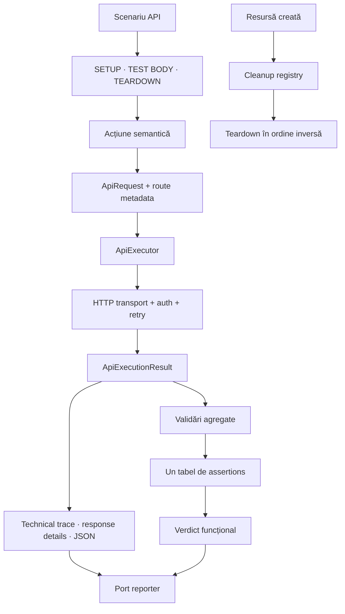
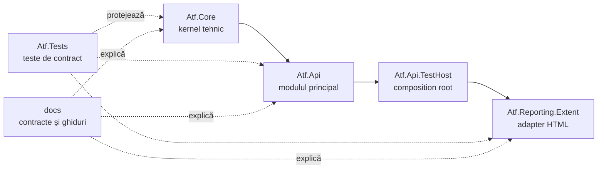
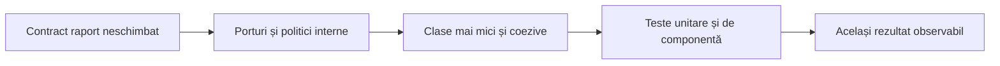
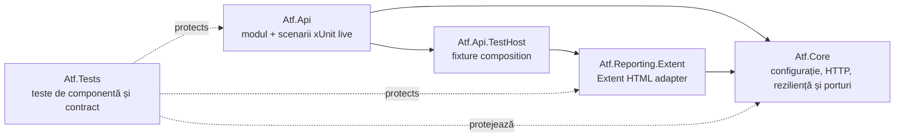
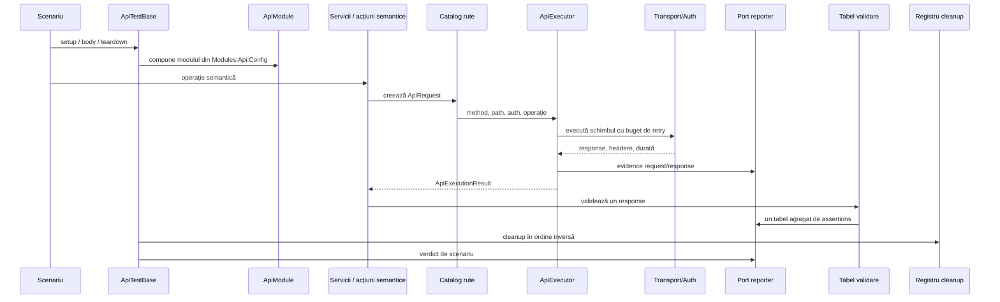
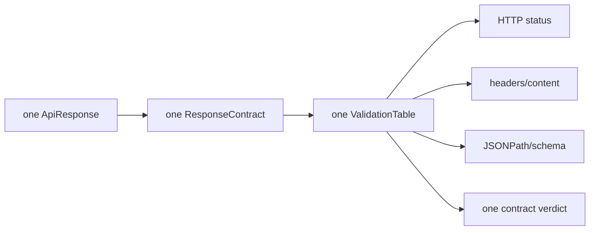
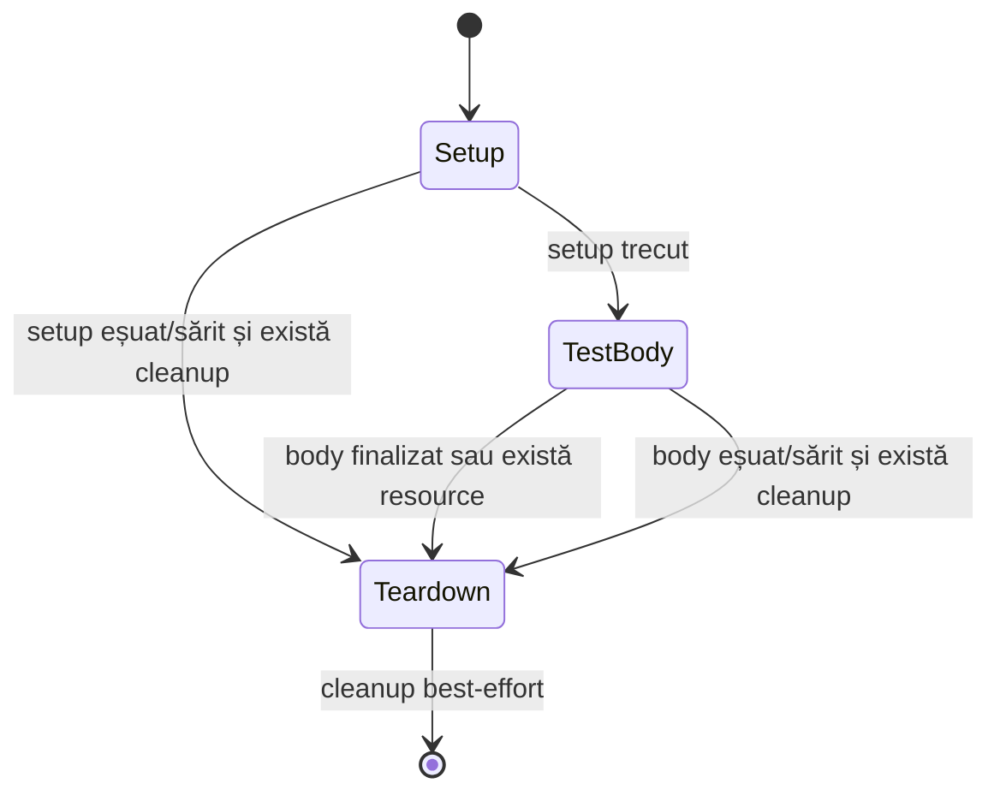

# Configurable API ATF

> Un framework .NET 9 pentru teste API lizibile, configurabile și verificabile
> până la nivelul raportului HTML final.

ATF transformă un scenariu API într-un flux controlat: construiește requestul
din configurație, execută schimbul printr-un transport înlocuibil, publică
evidence renderer-neutral, agregă validările și îl prezintă în Extent fără să
amestece responsabilitățile.

## 1. Modelul mental



Regula centrală este separarea adevărurilor:

```text
HTTP exchange completed
    ≠ contract satisfied
    ≠ scenario passed
```

Un schimb HTTP poate fi executat corect, dar poate eșua contractul funcțional.
ATF păstrează ambele informații fără să transforme evidence-ul într-un verdict.

## 2. Ce deține fiecare zonă



| Zonă | Întrebarea la care răspunde |
|---|---|
| `Atf.Core` | Cum executăm sigur un schimb API și cum expunem porturi neutre față de renderer? |
| `Atf.Api` | Ce înseamnă semantic scenariul și ce rute, servicii și validatori folosește? |
| `Atf.Api.TestHost` | Ce compoziție concretă pornește suitele live și ce reporter este ales? |
| `Atf.Reporting.Extent` | Cum devine evidence-ul un arbore HTML navigabil și stabil? |
| `Atf.Tests` | Ce contracte trebuie să rămână adevărate la fiecare refactorizare? |
| `docs` | Care sunt regulile, responsabilitățile și criteriile de acceptare? |

`Atf.Api` este modulul principal. `Atf.Core` nu cunoaște Extent, iar HTML-ul nu
ajunge în serviciile API. Conținutul fostului `Atf.Common` este concentrat în
`Atf.Api/Module`; nu reintroducem proiecte generice `Common`, `Shared` sau
`Utils` fără un boundary consumat de cel puțin două module reale.

## 3. Contractul unui test API

Un test corect are o intenție semantică, cel puțin o validare în body și cleanup
separat. Raportul trebuie să poată fi citit în aceeași ordine în care gândește
testerul:

```text
TestCase
├── SETUP
│   └── Request(s)
├── TEST BODY
│   ├── Request
│   │   ├── TECHNICAL TRACE
│   │   ├── Response details
│   │   └── Response JSON
│   └── Validation(s) — frate direct al requestului, în aceeași fază
│       └── aggregate assertion table
└── TEARDOWN
    └── Request(s)
```

Validările unui response sunt grupate într-un tabel agregat; nu împrăștiem
assertions echivalente în noduri concurente. Teardown-ul poate adăuga cleanup sau
read-back best-effort, dar nu înlocuiește validarea funcțională din body.

## 4. Cum se verifică o schimbare

Documentația nu păstrează totaluri, căi temporare sau scoruri. Acestea se
calculează live din cod, teste și artifactul Extent:

| Nivel | Ce trebuie demonstrat |
|---|---|
| semantic | lifecycle, verdict, precedență și tabel agregat |
| component | colaborarea dintre module și porturi |
| artifact | HTML autonom, cardinalitate și ierarhie |
| DOM | collapse, filtrare, navigare și stiluri prin TAB MCP |
| parallel | izolarea sesiunilor, path-urilor și cleanup-ului |
| documentation | README-ul owner rămâne sincronizat cu implementarea |

Formatul existent al raportului este contract extern: refactorizarea poate muta
ownership-ul intern, dar nu schimbă fără motiv layout-ul, paleta, fonturile,
textele, ordinea nodurilor sau interacțiunile.

Pentru pașii de lucru și contractele detaliate:

- [ghidul pentru adăugarea unui test API](docs/ATF_API_TEST_GUIDE.md);
- [bunele practici și regulile OOP](docs/README_Atf_BestPractices.md);
- [contractul de raportare](docs/ATF_Reporting_Contract.md);
- [indexul documentației](docs/README.md);
- [procedura de feedback](docs/feedback/README.md).

## Gard de siguranță pentru refactorizare

Orice schimbare care modifică rezultatul observabil este regresie, nu simplă
refactorizare. Refactorizările acceptate sunt limitate la ownership intern,
dependențe, lifecycle, concurență, testabilitate și documentația acestor seam-uri.



## Arhitectura reală a proiectului

Direcția de runtime este:



### Responsabilitatea proiectelor

| Proiect | Deține | Nu trebuie să dețină |
|---|---|---|
| `Atf.Core` | configurație, transport, auth, URL, retry, polling, evidence ports | Extent, xUnit, rute de produs, decizii de scenariu |
| `Atf.Api/Module` | module composition, routes, models, typed services, justified semantic actions, validators, cleanup | lifecycle xUnit și markup Extent |
| `Atf.Api` | scenarii live și orchestrarea xUnit | construire manuală de `HttpClient`, route strings duplicate, HTML |
| `Atf.Api.TestHost` | fixture-ul live și bridge-ul către renderer-ul actual | scenarii, validări business, transport policy |
| `Atf.Reporting.Extent` | Extent tree, HTML, CSS, JavaScript, assets și session lifecycle | HTTP, validări business, decizii de scenariu |
| `Atf.Tests/Atf.Core.Tests` | contractele kernelului | comportament API live |
| `Atf.Tests/Atf.Common.Tests` | contractele modulului API din `Atf.Api/Module` | sockets și live API |
| `Atf.Tests/Atf.Api.Tests` | boundary API, lifecycle și phase layout | apeluri la servicii externe |
| `Atf.Tests/Atf.Api.FailureDemos` | demonstrații failure opt-in | rularea implicită a suitei |
| `Atf.Tests/Atf.Reporting.Extent.Tests` | adapterul Extent și artifact contract | transport și business validation |

Regula de dependențe este simplă: Core nu poate cunoaște Extent. Extent poate
implementa porturile Core, iar `Atf.Api.TestHost` este locul explicit în care
este ales renderer-ul curent.

### Ținta de simplificare a soluției

Structura minimă este: modulul API și conținutul fostului
`Atf.Common` sunt în `Atf.Api/Module`, iar testele API și failure demos sunt
sub `Atf.Tests`. Păstrăm separat `Atf.Core`, `Atf.Api.TestHost` și
`Atf.Reporting.Extent`, deoarece acestea protejează kernelul, composition
root-ul și vendor boundary-ul.

Ținta minimă arhitecturală este:

```text
Atf/
├── Atf.Core/                 # kernel tehnic, renderer-neutral
├── Atf.Api/                  # modulul principal ATF: API + scenarii live
├── Atf.Api.TestHost/         # composition root; alege renderer-ul
├── Atf.Reporting.Extent/     # adaptorul concret Extent/HTML
├── Atf.Tests/                # toate testele ATF, pe foldere
├── docs/                     # documentația oficială, contracte și feedback
└── artifacts/                # output generat, niciodată input de runtime
```

Acesta este numărul minim de directoare de bază care păstrează boundary-urile.
`Atf.Api` este modulul principal, iar `Atf.Api/Module` concentrează vocabularul
API. `Atf.Core` rămâne fundația tehnică renderer-neutral; toate proiectele de
teste sunt sub `Atf.Tests`. `Atf.Api.TestHost` rămâne separat: dacă este absorbit
în `Atf.Api`, acel proiect trebuie să refere direct `Atf.Reporting.Extent` și
scenariile nu mai sunt independente de vendor.

Nu introducem `Atf.Shared`, `Atf.Contracts`, `Atf.Framework` sau directoare
`Common`/`Utils` fără un boundary consumat de cel puțin două module reale.
Reducem numărul de directoare, nu responsabilitățile și nu testele.

## Pipeline runtime



`ApiExecutor` separă transportul reușit de validarea funcțională:

```text
HTTP exchange completed != contract satisfied != scenario passed
```

Un răspuns 502 poate fi transportat corect și să eșueze contractul. Raportul
trebuie să păstreze ambele adevăruri.

## Contractul raportului

Arborele canonic este:

```text
TestCase
    ├── SETUP
    │   └── Request(s)
    ├── TEST BODY
    │   ├── Request
    │   │   ├── Technical trace
    │   │   ├── Response details
    │   │   └── Response JSON
    │   └── Validation(s) — următorul nod frate al request-ului
    │       └── aggregate assertion table
    └── TEARDOWN
        └── Request(s)
```

Reguli obligatorii:

- setup, test body și teardown sunt faze sub același scenario;
- un request și validarea lui sunt noduri frați direcți sub aceeași fază;
- trace-ul tehnic, response details și response JSON aparțin request-ului;
- validarea aparține response-ului imediat anterior și nu este atașată altui request;
- un response produce o singură validare agregată;
- assertions pentru același response apar într-un singur tabel;
- validation nu devine copilul request-ului și nici copilul validatorului anterior;
- fazele și evidence blocks sunt collapsed by default;
- JSON-ul este code block, wrapped și vertical-scrollable;
- evidence-ul nu produce overflow orizontal la nivelul paginii;
- verdictul funcțional este Pass/Fail/Skip, iar Info este doar evidence;
- folderul Extent extern nu este livrat împreună cu HTML-ul final.

### Modelul de validare



Forma tabelului este:

```text
ASSERTION | EXPECTED | ACTUAL | RESULT
```

Nu se creează câte un nod pentru fiecare assertion. Agregarea păstrează
diagnosticul complet și face diferența dintre request evidence și verdictul
contractului.

### Lifecycle și cleanup

Cleanup-ul este înregistrat imediat după dobândirea unei resurse, se execută în
ordine inversă și nu trebuie să înlocuiască failure-ul primar.



Contractul dorit este:

```text
primary failure > teardown failure > skip > pass
```

Contractul de cleanup este: custom teardown-ul și `Cleanup.RunAsync()` rulează
într-un `finally` interior, fără ca diagnosticul secundar să poată opri eliberarea
resurselor. Regula este protejată prin teste.

## Configurație

Configurația este deținută de modul:

```text
Modules
└── Api
    └── Config
        ├── Api
        │   ├── BaseUrl
        │   ├── TimeoutSeconds
        │   ├── AuthProfiles
        │   ├── Routes
        │   ├── RateLimit
        │   └── Polling
        └── Reporting
            ├── Engine
            ├── ReportPath
            ├── ReportName
            ├── TimestampEnabled
            └── AssertionMaxDisplayCharacters
```

Modelele sunt separate în `Atf.Core/Configuration`. Configurația este validată
înainte de execuție, iar executorul folosește un snapshot runtime pentru a evita
modificarea unei configurații partajate în timpul rulărilor paralele.

Exemple de override:

```text
ATF_ENV=local
ATF_Modules__Api__Config__Api__BaseUrl=https://api.example.test
ATF_Modules__Api__Config__Api__TimeoutSeconds=30
ATF_Modules__Api__Config__Reporting__ReportPath=<director-rapoarte>/api.html
ATF_Modules__Api__Config__Reporting__AssertionMaxDisplayCharacters=240
ATF_API_TOKEN=<secret injectat la runtime>
```

Tokenurile nu se commit-uiesc și nu apar în logs sau HTML. Redaction-ul acoperă
headers, query strings, JSON, paths locale și exception text.

## Straturi route, service și step

O route nu este doar un string. Ea descrie method, path template, resource,
operation și auth metadata.

```text
UsersService.GetAsync(id)
    -> ApiRoutes.UserItem
    -> GET /public/v2/users/{id}
    -> ApiExecutor
```

Reguli:

- scenariile nu construiesc URL-uri manual;
- services serializează modele și aleg route-ul;
- un step este permis doar dacă adaugă semantică, nu forwarding fără valoare;
- validators evaluează response-ul, nu creează route-uri;
- reporter-ul publică evidence, dar nu decide validitatea business.

## Strategia de testare

```text
teste unitare
    configuration, URL/auth, retry, polling, redaction
        |
teste de componentă
    module wiring, services, validators, lifecycle, cleanup
        |
teste de contract ale artifactului
    HTML autonom, CSS tokens, collapsed nodes, JSON blocks, assertion table
        |
 DOM smoke în tab-ul MCP
    DOM, click, collapse, scroll, computed styles, overflow
        |
teste API live
    contracte reale, auth, lifecycle și business coverage
```

Comenzi uzuale:

```powershell
dotnet build .\Atf.slnx --no-restore

dotnet test .\Atf.Tests\Atf.Core.Tests\Atf.Core.Tests.csproj --no-restore
dotnet test .\Atf.Tests\Atf.Common.Tests\Atf.Common.Tests.csproj --no-restore
dotnet test .\Atf.Tests\Atf.Reporting.Extent.Tests\Atf.Reporting.Extent.Tests.csproj --no-restore
dotnet test .\Atf.Tests\Atf.Api.Tests\Atf.Api.Tests.csproj --no-restore
dotnet test .\Atf.Tests\Atf.Api.FailureDemos\Atf.Api.FailureDemos.csproj --no-restore
```

Suite-ul live este separat și poate necesita tokenuri și acces la endpoint:

```powershell
dotnet test .\Atf.Api\Atf.Api.csproj --no-restore
```

O schimbare de reporting trebuie protejată printr-un test structural și un test
pe artifactul HTML final. Un test bazat doar pe string-uri nu înlocuiește
verificarea interactivă în tab-ul MCP.

## Porți de calitate

O schimbare este completă numai când:

- build-ul nu introduce warnings noi;
- Core, modulul API, Extent și API component tests trec;
- live tests sunt verzi sau skipped cu motiv explicit;
- nu apare niciun secret în source, logs sau HTML;
- un response păstrează o singură validation table agregată;
- request și validation rămân frați în raport;
- raportul este un singur HTML autonom;
- folderul extern `extent` nu este livrat împreună cu HTML-ul;
- JSON-ul este collapsed, code-formatted și scrollable;
- raportul generat este deschis și parcurs în tab-ul MCP;
- verificarea DOM confirmă layout-ul, click-urile și stilurile reale.

## Garduri de refactorizare aplicate

Direcțiile de mai jos sunt reguli de design deja reflectate în cod și teste, nu
un backlog copiat în README:

- `AtfConfigurationValidator` compune validatori independenți pentru secțiuni;
- `ValidationTable`, evaluatorul și publisher-ul best-effort au responsabilități
  distincte;
- lifecycle-ul API separă phase, teardown și outcome;
- Core rămâne renderer-neutral, iar Extent deține theme, client behaviour și
  artifact publishing;
- `ReportArtifactInspector` dovedește artifactul static; comportamentul DOM este
  o dovadă separată;
- namespace-urile noi respectă limita de maximum 8 tipuri top-level directe,
  iar depășirile istorice au ratchet și owner.

Orice abatere nouă se adaugă numai în documentul de feedback potrivit, cu owner,
seam, test și criteriu de acceptare. Astfel README-ul rămâne explicație de
arhitectură, nu jurnal de lucru.

## Documentație și surse normative

README-urile descriu ownership-ul local și trebuie să rămână sincronizate cu
codul și contractele de verificare.

- [Architecture și reporting guide](docs/ATF_Architecture.md)
- [Indexul documentației](docs/README.md)
- [Reporting contract](docs/ATF_Reporting_Contract.md)
- [Ghid pentru adăugarea unui test API](docs/ATF_API_TEST_GUIDE.md)
- [Lifecycle și combinații de raportare](docs/feedback/Atf_Lifecycle_Combination.md)
- [Refactorizare și responsabilități](docs/feedback/Atf_Refactoring_Feedback.md)
- [Registrul de feedback](docs/feedback/README.md)
- [Best practices](docs/README_Atf_BestPractices.md)
- [Atf.Core README](Atf.Core/README.md)
- [Atf.Api module README](Atf.Api/Module/README.md)
- [Atf.Api README](Atf.Api/README.md)
- [Atf.Api.Tests README](Atf.Tests/Atf.Api.Tests/README.md)
- [Atf.Reporting.Extent README](Atf.Reporting.Extent/README.md)
- [Atf.Tests README](Atf.Tests/README.md)

Regula „maximum opt tipuri top-level directe într-un namespace” este o limită
arhitecturală pentru codul de producție, nu un simplu semnal de review. Un
namespace nou nu poate depăși 8 tipuri. Depășirile sunt datorie
de refactorizare urmărită prin ratchet tests: count-ul poate scădea, dar nu
poate crește. Split-ul este permis numai pe o responsabilitate reală, nu prin
clase goale sau mutări artificiale. Criteriile de split sunt în
[`README_Atf_BestPractices.md`](docs/README_Atf_BestPractices.md).

## Adăugarea unei operații API noi

Pentru traseul complet, inclusiv exemple, diagrame, ownership, teste offline și
validarea interactivă a raportului Extent, urmează
[ghidul specializat pentru adăugarea unui test API](docs/ATF_API_TEST_GUIDE.md).

Secvența scurtă este: definește contractul, adaugă ruta și modelele tipizate,
implementează service-ul semantic, agregă assertions pentru response,
înregistrează cleanup-ul, protejează schimbarea prin teste offline, adaugă
scenariul live și verifică raportul în tab-ul MCP.
