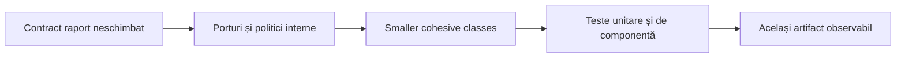
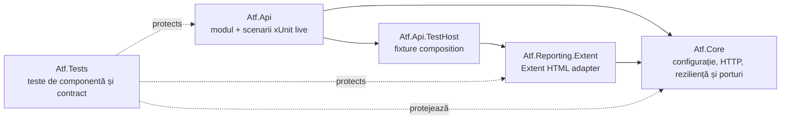
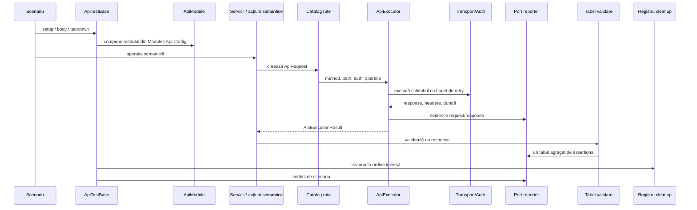
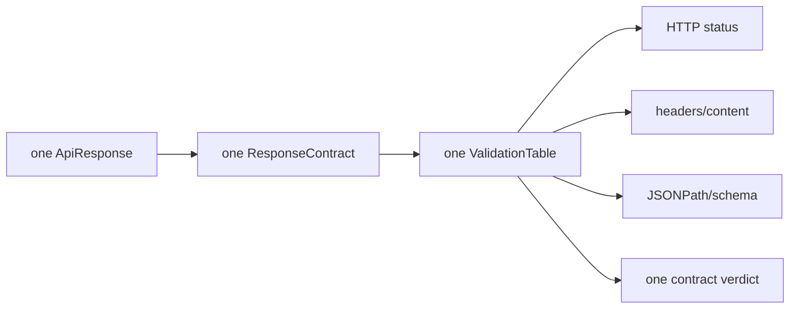
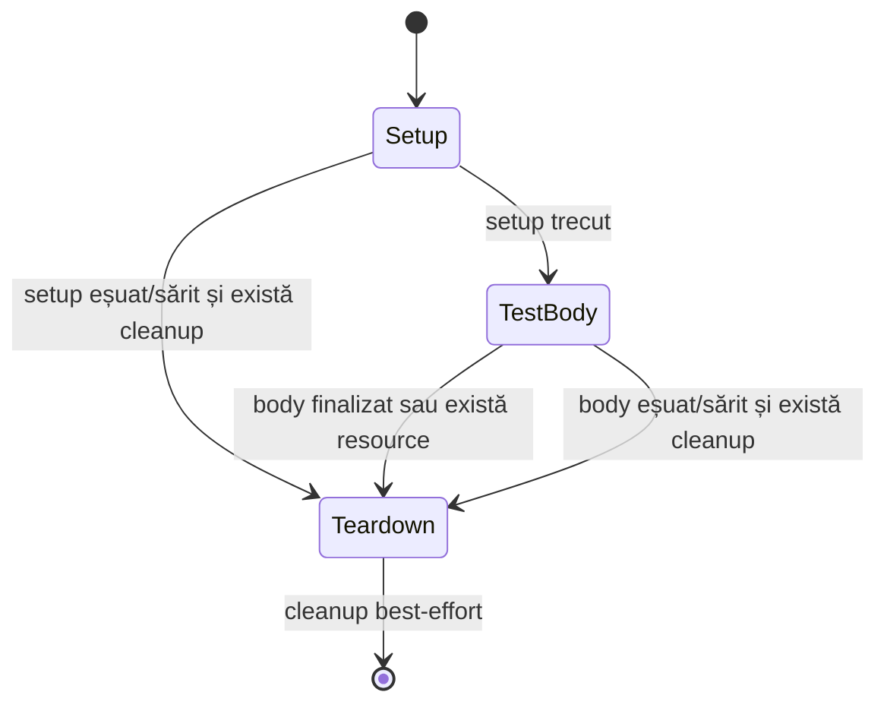

# Configurable API ATF

ATF este un framework .NET 9 pentru testarea API-urilor prin configurație,
contracte de transport, validări agregate și raportare HTML Extent.

Scopul lui este să ofere o limbă clară pentru scenarii API:

```text
scenario -> semantic step -> service -> route -> executor -> transport
                                             |
                                             +-> renderer-neutral evidence

response -> grup de validare -> un tabel de assertions -> verdict de scenariu
resource -> registru cleanup -> teardown în ordine inversă
```

ATF nu este UI automation, nu este un client de business și nu trebuie să
conțină logică specifică unui produs în kernelul reutilizabil.

## Starea actuală

Starea codului se verifică live, nu se îngheață într-o evaluare statică în README.
Numărul testelor, verdicturile și layout-ul final trebuie confirmate prin build, teste și
artefactul HTML generat. Direcția curentă este urmărită prin findings active,
ownership, dovezi și criterii de acceptare.

## Gard de siguranță pentru refactorizare

În această etapă formatul raportului este tratat ca un contract existent. Nu
redesenăm layout-ul, nu schimbăm paleta, fonturile, textele, ordinea nodurilor
sau interacțiunile raportului. Documentul
`docs/feedback/ATF_LIFECYCLE_COMBINATION_ANALYSIS_2026-10-13.md` rămâne
referința externă pentru acel format și este exclus din refactorizarea curentă.



Orice schimbare care modifică artifactul observabil este regresie, nu refactorizare.
Schimbările acceptate sunt limitate la ownership intern, dependențe, lifecycle,
concurență, testabilitate și documentația acestor seam-uri.

### Probleme deschise prioritare

1. `ExtentTestScope` păstrează sincronizare, tree transitions, status policy și evidence delegation; următorul split trebuie făcut doar prin seam-uri testabile.
2. `ExtentReportLifecycle` și theme/composer leagă încă session state, filesystem și template composition.
3. `ReportArtifactInspector` verifică în principal sursa statică, nu DOM-ul hidratat.
4. Testele de reporting verifică în principal HTML/CSS/JS static; lipsesc
   verificări reale de browser pentru click, collapse, scroll și computed styles.
5. Clasele de test foarte mari trebuie împărțite după contract, nu după numărul de metode;
   `ReportingComponentTests` are peste 800 de linii și trebuie redus ca suprafață de review.
6. Suitele de teste folosesc încă două generații xUnit: v3 în proiectele API și
   v2 în proiectele interne. Migrarea trebuie făcută controlat înainte de
   consolidarea în `Atf.Tests`.

### Interpretarea statusurilor

Feedback-ul folosește două niveluri care nu trebuie confundate:

| Nivel | Ce este deja protejat | Ce rămâne deschis |
|---|---|---|
| semantic | verdictul funcțional, precedence-ul Fail/Skip, tabelul agregat și izolarea reporterului | outcome model mai strict și eliminarea API-urilor de validare compatibile în paralel |
| artifact | HTML autonom, roluri semantice și markup-ul expected | DOM hidratat, computed styles, click, scroll și overflow real |
| soft assertion | rândul `Fail` rămâne vizibil, xUnit nu eșuează, iar scenariul devine `Warning` | reconcilierea DOM/computed-style în toate suprafețele Overview/Tags/metadata |
| security | redactor central și strategii separate | matrice de redaction executată pentru fiecare suprafață de evidence |

Prin urmare, `Warning/Other` este **mitigat semantic**, nu închis end-to-end,
iar `ReportArtifactInspector` dovedește contractul static, nu comportamentul
browserului. Acest vocabular este obligatoriu în README-urile modulelor.

Detaliile findings-urilor active, backlog-ul și metodologia auditului live sunt în
[feedback-ul live compilat](docs/feedback/ATF_LIVE_CODE_FEEDBACK_2026-10-13.md)
și în [evaluarea de refactorizare](docs/ATF_Refactoring_Assessment.md).

## Arhitectura reală a proiectului

Direcția de runtime este:



### Responsabilitatea proiectelor

| Proiect | Deține | Nu trebuie să dețină |
|---|---|---|
| `Atf.Core` | configurație, transport, auth, URL, retry, polling, evidence ports | Extent, xUnit, rute de produs, decizii de scenariu |
| `Atf.Api/Module` | module composition, routes, models, typed services, justified semantic actions, validators, cleanup | lifecycle xUnit și markup Extent |
| `Atf.Api` | scenarii live și orchestrarea xUnit | construire manuală de `HttpClient`, route strings duplicate, HTML |
| `Atf.Api.TestHost` | fixture-ul live și bridge-ul către renderer-ul actual | scenarii, validări business, transport policy |
| `Atf.Reporting.Extent` | Extent tree, HTML, CSS, JavaScript, assets și session lifecycle | HTTP, validări business, decizii de scenariu |
| `Atf.Tests/Atf.Core.Tests` | contractele kernelului | comportament API live |
| `Atf.Tests/Atf.Common.Tests` | contractele modulului API din `Atf.Api/Module` | sockets și live API |
| `Atf.Tests/Atf.Api.Tests` | boundary API, lifecycle și phase layout | apeluri la servicii externe |
| `Atf.Tests/Atf.Api.FailureDemos` | demonstrații failure opt-in | rularea implicită a suitei |
| `Atf.Tests/Atf.Reporting.Extent.Tests` | adapterul Extent și artifact contract | transport și business validation |

Regula de dependențe este simplă: Core nu poate cunoaște Extent. Extent poate
implementa porturile Core, iar `Atf.Api.TestHost` este locul explicit în care
este ales renderer-ul curent.

### Ținta de simplificare a soluției

Structura minimă este acum aplicată: modulul API și conținutul fostului
`Atf.Common` sunt în `Atf.Api/Module`, iar testele API și failure demos sunt
sub `Atf.Tests`. Păstrăm separat `Atf.Core`, `Atf.Api.TestHost` și
`Atf.Reporting.Extent`, deoarece acestea protejează kernelul, composition
root-ul și vendor boundary-ul.

Ținta minimă arhitecturală este:

```text
Atf/
├── Atf.Core/                 # kernel tehnic, renderer-neutral
├── Atf.Api/                  # modulul principal ATF: API + scenarii live
├── Atf.Api.TestHost/         # composition root; alege renderer-ul
├── Atf.Reporting.Extent/     # adaptorul concret Extent/HTML
├── Atf.Tests/                # toate testele ATF, pe foldere
├── docs/                     # documentația oficială, contracte și feedback
└── artifacts/                # output generat, niciodată input de runtime
```

Acesta este numărul minim de directoare de bază care păstrează boundary-urile.
`Atf.Api` este modulul principal, iar `Atf.Api/Module` concentrează vocabularul
API. `Atf.Core` rămâne fundația tehnică renderer-neutral; toate proiectele de
teste sunt sub `Atf.Tests`. `Atf.Api.TestHost` rămâne separat: dacă este absorbit
în `Atf.Api`, acel proiect trebuie să refere direct `Atf.Reporting.Extent` și
scenariile nu mai sunt independente de vendor.

Nu introducem `Atf.Shared`, `Atf.Contracts`, `Atf.Framework` sau directoare
`Common`/`Utils` fără un boundary consumat de cel puțin două module reale.
Reducem numărul de directoare, nu responsabilitățile și nu testele.

## Runtime pipeline



`ApiExecutor` separă transportul reușit de validarea funcțională:

```text
HTTP exchange completed != contract satisfied != scenario passed
```

Un răspuns 502 poate fi transportat corect și să eșueze contractul. Raportul
trebuie să păstreze ambele adevăruri.

## Contractul raportului

Arborele canonic este:

```text
test class
└── scenario
    ├── SETUP
    │   └── request
    │       └── validation sibling
    ├── TEST BODY
    │   ├── request
    │   │   └── technical trace + request/response JSON
    │   └── validation sibling
    └── TEARDOWN
        └── cleanup / verification
```

Reguli obligatorii:

- setup, test body și teardown sunt faze sub același scenario;
- un request și validarea lui sunt noduri frați sub aceeași fază;
- un response produce o singură validare agregată;
- assertions pentru același response apar într-un singur tabel;
- validation nu devine copilul request-ului și nici copilul validatorului anterior;
- fazele și evidence blocks sunt collapsed by default;
- JSON-ul este code block, wrapped și vertical-scrollable;
- evidence-ul nu produce overflow orizontal la nivelul paginii;
- verdictul funcțional este Pass/Fail/Skip, iar Info este doar evidence;
- folderul Extent extern nu este livrat împreună cu HTML-ul final.

### Validation model



Forma tabelului este:

```text
ASSERTION | EXPECTED | ACTUAL | RESULT
```

Nu se creează câte un nod pentru fiecare assertion. Agregarea păstrează
diagnosticul complet și face diferența dintre request evidence și verdictul
contractului.

### Lifecycle și cleanup

Cleanup-ul este înregistrat imediat după dobândirea unei resurse, se execută în
ordine inversă și nu trebuie să înlocuiască failure-ul primar.



Contractul dorit este:

```text
primary failure > teardown failure > skip > pass
```

**P0 închis:** custom teardown-ul și `Cleanup.RunAsync()` sunt protejate printr-un
`finally` interior, iar testele confirmă cleanup după failure de teardown,
`StartStep` și callback de diagnostic. Reporter failure nu mai trebuie să oprească
resource cleanup; această regulă este acum contract protejat prin teste.

## Configurație

Configurația este module-owned:

```text
Modules
└── Api
    └── Config
        ├── Api
        │   ├── BaseUrl
        │   ├── TimeoutSeconds
        │   ├── AuthProfiles
        │   ├── Routes
        │   ├── RateLimit
        │   └── Polling
        └── Reporting
            ├── Engine
            ├── ReportPath
            ├── ReportName
            ├── TimestampEnabled
            └── AssertionMaxDisplayCharacters
```

Modelele sunt separate în `Atf.Core/Configuration`. Configurația este validată
înainte de execuție, iar executorul folosește un snapshot runtime pentru a evita
modificarea unei configurații partajate în timpul rulărilor paralele.

Exemple de override:

```text
ATF_ENV=local
ATF_Modules__Api__Config__Api__BaseUrl=https://api.example.test
ATF_Modules__Api__Config__Api__TimeoutSeconds=30
ATF_Modules__Api__Config__Reporting__ReportPath=artifacts/reports/api.html
ATF_Modules__Api__Config__Reporting__AssertionMaxDisplayCharacters=240
ATF_API_TOKEN=<secret injectat la runtime>
```

Tokenurile nu se commit-uiesc și nu apar în logs sau HTML. Redaction-ul acoperă
headers, query strings, JSON, paths locale și exception text.

## Straturi route, service și step

O route nu este doar un string. Ea descrie method, path template, resource,
operation și auth metadata.

```text
UsersService.GetAsync(id)
    -> ApiRoutes.UserItem
    -> GET /public/v2/users/{id}
    -> ApiExecutor
```

Reguli:

- scenariile nu construiesc URL-uri manual;
- services serializează modele și aleg route-ul;
- un step este permis doar dacă adaugă semantică, nu forwarding fără valoare;
- validators evaluează response-ul, nu creează route-uri;
- reporter-ul publică evidence, dar nu decide validitatea business.

## Strategia de testare

```text
teste unitare
    configuration, URL/auth, retry, polling, redaction
        |
teste de componentă
    module wiring, services, validators, lifecycle, cleanup
        |
teste de contract ale artifactului
    HTML autonom, CSS tokens, collapsed nodes, JSON blocks, assertion table
        |
browser smoke
    DOM, click, collapse, scroll, computed styles, overflow
        |
teste API live
    contracte reale, auth, lifecycle și business coverage
```

Comenzi uzuale:

```powershell
dotnet build .\Atf.slnx --no-restore

dotnet test .\Atf.Tests\Atf.Core.Tests\Atf.Core.Tests.csproj --no-restore
dotnet test .\Atf.Tests\Atf.Common.Tests\Atf.Common.Tests.csproj --no-restore
dotnet test .\Atf.Tests\Atf.Reporting.Extent.Tests\Atf.Reporting.Extent.Tests.csproj --no-restore
dotnet test .\Atf.Tests\Atf.Api.Tests\Atf.Api.Tests.csproj --no-restore
dotnet test .\Atf.Tests\Atf.Api.FailureDemos\Atf.Api.FailureDemos.csproj --no-restore
```

Suite-ul live este separat și poate necesita tokenuri și acces la endpoint:

```powershell
dotnet test .\Atf.Api\Atf.Api.csproj --no-restore
```

O schimbare de reporting trebuie protejată printr-un test structural și un test
pe artifactul HTML final. Un test string-based nu înlocuiește un browser smoke
test.

## Porți de calitate

O schimbare este completă numai când:

- build-ul nu introduce warnings noi;
- Core, Common, Extent și API component tests trec;
- live tests sunt verzi sau skipped cu motiv explicit;
- nu apare niciun secret în source, logs sau HTML;
- un response păstrează o singură validation table agregată;
- request și validation rămân frați în raport;
- raportul este un singur HTML autonom;
- folderul `artifacts/reports/extent` nu este livrat;
- JSON-ul este collapsed, code-formatted și scrollable;
- raportul generat este deschis și parcurs în browser;
- verificarea browserului confirmă layout-ul, click-urile și stilurile reale.

## Refactoring roadmap

### P0 închis

- cleanup garantat după custom teardown failure;
- teste pentru failure/skip/teardown/cleanup precedence;
- păstrarea cauzei primare când diagnosticul secundar eșuează.

### P1

- cleanup independent de reporter failure;
- Core renderer-neutral fără markup HTML Extent;
- `ValidationTableRunner` cu rezultat funcțional autoritar și publisher best-effort;
- un singur protocol public pentru validarea unui response;
- politici separate pentru `ExtentTestScope`;
- separarea phase/teardown/outcome din `ApiScenarioLifecycleRunner` prin seam-uri testabile;
- duplicate-key policy pentru technical trace;
- browser smoke tests pe artifactul final;
- alinierea versiunilor xUnit și a politicilor de parallelization între proiectele de test;
- boundary tests pentru `Atf.Api.TestHost` și renderer;
- eliminarea afirmațiilor istorice din evaluările active.

### P2

- cleanup coordinator async cu ownership controlat al lock-urilor;
- înlocuirea `Thread.Sleep` din retry-ul de cleanup cu o politică injectabilă și anulabilă;
- wrapper-ele `Steps` forwarding-only au fost eliminate; reintroducerea cere semantică reală;
- matrice completă de redaction și audit pentru exception text/snapshot;
- `ApiAttemptRunner` numai dacă testele justifică seam-ul;
- declarative operation registry după stabilizarea contractelor;
- al doilea renderer doar prin aceleași reporting ports.

## Documentație și surse normative

README-urile descriu ownership-ul local și trebuie să rămână sincronizate cu
codul și artifactul generat.

- [Architecture și reporting guide](docs/ATF_Architecture.md)
- [Indexul documentației](docs/README.md)
- [Reporting contract](docs/ATF_Reporting_Contract.md)
- [Refactoring assessment](docs/ATF_Refactoring_Assessment.md)
- [Feedback live compilat](docs/feedback/ATF_LIVE_CODE_FEEDBACK_2026-10-13.md)
- [Best practices](docs/README_Atf_BestPractices.md)
- [Atf.Core README](Atf.Core/README.md)
- [Atf.Api module README](Atf.Api/Module/README.md)
- [Atf.Api README](Atf.Api/README.md)
- [Atf.Api.Tests README](Atf.Tests/Atf.Api.Tests/README.md)
- [Atf.Reporting.Extent README](Atf.Reporting.Extent/README.md)
- [Atf.Tests README](Atf.Tests/README.md)

Regula „maximum opt clase într-un pachet” este un semnal de review, nu o lege.
Criteriul principal rămâne un singur motiv dominant de schimbare, dependențe
clare și teste care protejează contractul.

## Adăugarea unei operații API noi

1. Definește metadata rutei în `Atf.Api/Module`.
2. Adaugă un model tipizat numai când payload-ul are nevoie de el.
3. Adaugă o metodă de service pentru serializare și alegerea rutei.
4. Adaugă un step semantic numai dacă îmbunătățește limbajul scenariului; nu adăuga un wrapper forwarding-only.
5. Adaugă validatori care agregă verificările pentru un singur response.
6. Înregistrează imediat resursele create în `CleanupRegistry`.
7. Adaugă teste offline de componentă înaintea unui scenariu live.
8. Adaugă scenariul live numai când contribuie la acoperirea de business.
9. Generează HTML-ul final și inspectează-l în browser.

Cea mai sigură extensie este cea care adaugă vocabular de domeniu fără să mute
politica de transport, lifecycle sau renderer în scenariu.
