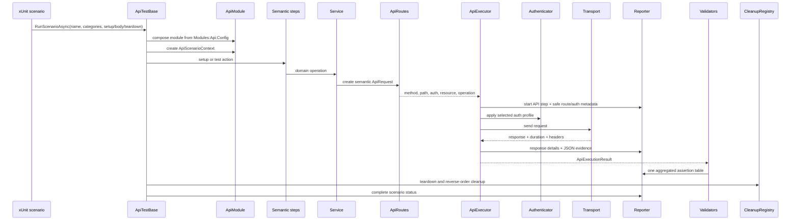
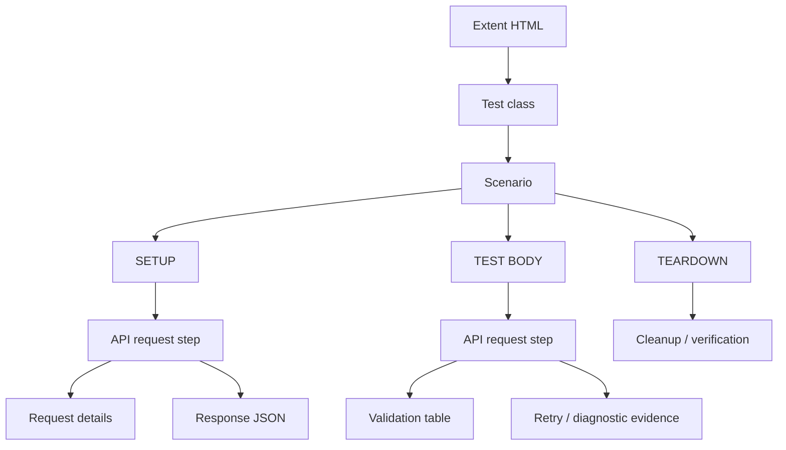
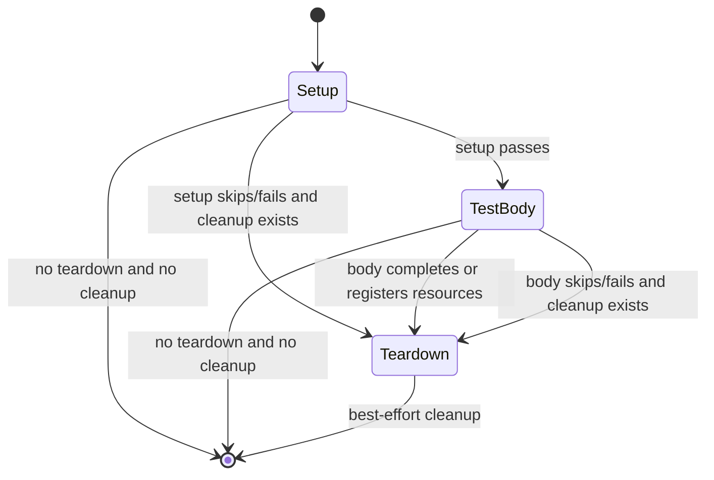
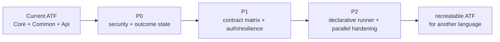
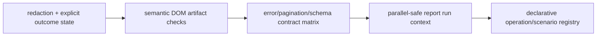

# Configurable API ATF

This repository is a reusable, configuration-driven API automation framework for .NET 9. It is intentionally product-neutral: the framework executes HTTP exchanges, applies authentication and resilience policies, validates contracts, owns test data cleanup and publishes a self-contained Extent HTML report. A product-specific module contributes routes, models, fixtures, validators and scenarios.

The implementation is the executable companion to the [ATF requirements](docs/ATF_Requirements.html). The requirements describe the intended behavior; this repository is the reference implementation of the contracts that can be verified in code.

## What this framework is responsible for

The ATF separates five concerns that are often accidentally mixed in API test suites:

1. **Configuration** — module-owned settings, environment overrides, route templates, auth profiles and reporting policy.
2. **Execution** — URL construction, authentication, transport, bounded retry and polling.
3. **Domain API language** — routes, typed services and semantic steps used by test scenarios.
4. **Contract evidence** — aggregated assertions, request/response details and lifecycle ownership.
5. **Report delivery** — Extent adapter, embedded assets and a final HTML artifact that is independently inspected.

The framework contains no UI automation, browser driver, database integration, cloud-provider SDK or NorthStandard-specific business logic.

## Architecture at a glance

The dependency rule is deliberately one-way:

```text
Atf.Api  (live xUnit scenarios)
   |
   v
Atf.Common  (module composition, routes, services, steps, validation, cleanup)
   |
   v
Atf.Core  (configuration, HTTP, resilience, reporting ports and Extent adapter)
```

No lower layer references an upper layer. In particular:

- `Atf.Core` does not know a product route, schema or scenario.
- `Atf.Common` does not own xUnit orchestration or Extent markup.
- `Atf.Api` does not build `HttpClient`, duplicate endpoint strings or manipulate report nodes.
- Tests replace boundaries with fakes instead of starting a service or requiring a token.

### Runtime sequence



If a renderer does not support Mermaid, the dependency and sequence diagrams above are still represented by the text flow and the module guides.

### Report tree



The three lifecycle phases are direct siblings below the scenario. An API request and its validation rows remain beneath the phase that caused them. Details and JSON are collapsed by default so the report is scannable before it becomes forensic.

## Projects and ownership

`Atf.Tests` este secțiunea de testare internă a ATF-ului. Nu este un alt modul de runtime și nu conține teste ale unui produs extern; este umbrela pentru verificările offline ale componentelor reutilizabile.

| Project | Owns | Must not own |
|---|---|---|
| `Atf.Core` | Configuration, HTTP contracts, transport/auth ports, executor, retry/polling, reporting ports and Extent adapter | Product routes, product schemas, domain decisions |
| `Atf.Common` | Module composition, route catalog, typed models, services, steps, fixtures, validation and cleanup | xUnit lifecycle, raw Extent markup, live environment policy |
| `Atf.Api` | Live scenarios, xUnit collection fixture and business coverage | `HttpClient` construction, route duplication, report rendering |
| `Atf.Core.Tests` *(under Atf.Tests)* | Unit/component contract tests for kernel, boundaries and final report artifact | Live service behavior |
| `Atf.Common.Tests` *(under Atf.Tests)* | Module component tests for composition and domain API language | Core internals, sockets, live service behavior |

Detailed guides:

- [Atf.Tests/README.md](Atf.Tests/README.md)
- [Atf.Core/README.md](Atf.Core/README.md)
- [Atf.Common/README.md](Atf.Common/README.md)
- [Atf.Api/README.md](Atf.Api/README.md)
- [Atf.Tests/Atf.Core.Tests/README.md](Atf.Tests/Atf.Core.Tests/README.md)
- [Atf.Tests/Atf.Common.Tests/README.md](Atf.Tests/Atf.Common.Tests/README.md)

## Design patterns used deliberately

These are not labels added after the fact; each pattern corresponds to a concrete responsibility in the source.

| Pattern | Concrete implementation | Why it exists |
|---|---|---|
| Layered architecture | Core → Common → Api | Prevents product code from leaking into the reusable kernel |
| Ports and adapters | `IApiTransport`, `IApiAuthenticator`, `IApiUrlBuilder`, `IAtfReporter`, `IAtfReportLifecycle` | Replaces sockets, secrets and Extent with deterministic test doubles |
| Composition root | `ApiModule`, `ExtentCollectionFixture` | Keeps object graph construction in one place |
| Strategy | `RateLimitRetryPolicy`, auth profiles, configured route policy | Changes policy without changing orchestration |
| Pipeline/orchestrator | `ApiExecutor` | Runs one HTTP exchange in a stable order and emits evidence at the boundary |
| Facade | `UsersSteps`, `PostsSteps` | Gives scenarios a readable domain vocabulary |
| Catalog / builder | `ApiRoutes`, `ApiRoute.CreateRequest`, `ApiUrlBuilder` | Centralizes endpoint semantics and safe token/query encoding |
| Aggregator | `ValidationTable`, `ReportStatusAggregator` | Publishes one contract outcome from many observations |
| Ownership / unit of work | `CleanupRegistry`, `ApiScenarioContext` | Makes created resources explicit and teardown deterministic |
| Adapter | `ExtentReportLifecycle`, `ExtentTestScope`, `ExtentManager` | Isolates the Extent lifecycle from scenario/domain code |
| Presentation | `ExtentEvidenceRenderer`, `AtfReportTheme` | Keeps evidence HTML and palette decisions out of lifecycle orchestration |
| Artifact adapter | `ExtentAssetInliner`, `ReportAssetCleaner` | Produces one portable HTML file without an external `extent` folder |
| Artifact contract | `ReportArtifactInspector` | Verifies the HTML users open, not only in-memory Extent nodes |

### Responsibility boundaries

```text
Scenario         expresses intent and chooses validators
Steps            exposes semantic test actions
Services         serializes typed requests and selects routes
Routes           defines method/path/auth/resource/operation metadata
Executor         performs one exchange and emits diagnostic evidence
Validators       decides contract pass/fail
Cleanup          owns resources and performs best-effort teardown
Reporter         renders evidence; never decides business validity
```

A common mistake is to let a scenario call `HttpClient` directly, assert a status inline, and write a report node for every field. That bypasses the route contract, makes authentication invisible and produces noisy reports. The intended flow is:

```text
scenario -> step -> service -> route -> executor -> transport
                                      \\-> reporter
response -> validation table -> reporter
created resource -> cleanup registry -> teardown
```

## Configuration contract

Configuration is owned by the module under `Modules:Api:Config`. This is important: reporting belongs to the module configuration boundary, not to a global root section, so a future ATF can host multiple API modules without creating unrelated global settings.

```text
appsettings.json
       +
appsettings.{ATF_ENV}.json
       +
ATF_ environment hierarchy
       |
       v
AtfConfigurationLoader
       |
       v
AtfConfiguration.Modules["Api"].Config
       |------------------|
       v                  v
ApiSettings             ReportingSettings
```

Shape:

```text
Modules
  Api
    Config
      Api:
        BaseUrl, TimeoutSeconds, WriteTestsEnabled
        TokenEnvironmentVariable, DefaultAuthProfile
        RateLimit, Polling, AuthProfiles, Routes
      Reporting:
        Engine, ReportPath, TimestampEnabled
        TimestampFormat, DocumentTitle, ReportName
        AssertionMaxDisplayCharacters
```

Environment examples:

```text
ATF_ENV=local
ATF_Modules__Api__Config__Api__BaseUrl=https://api.example.test
ATF_Modules__Api__Config__Api__TimeoutSeconds=30
ATF_Modules__Api__Config__Reporting__ReportPath=artifacts/reports/api.html
ATF_Modules__Api__Config__Reporting__AssertionMaxDisplayCharacters=240
ATF_API_TOKEN=<injected secret>
```

Secrets are read at runtime and are never committed, placed in fixtures or rendered into HTML. The report may show `auth.profile`, `auth.mode` and token availability state, but never the token value.

### Authentication semantics

Authentication is explicit in the route catalog:

- public read routes use an anonymous profile;
- write routes use the configured bearer profile;
- a missing bearer token causes a write scenario to be skipped by the scenario policy, not silently authenticated;
- `ConfiguredApiAuthenticator` owns header application and safe token-state description;
- `ApiRouteAuthentication` owns route intent as typed data, not as a free-form policy string;
- the executor reports both the declared route contract (`route.auth.*`) and the effective runtime profile (`auth.*`), so the report explains why a request was anonymous or authenticated.

## HTTP execution contract

`ApiExecutor` is the only orchestration boundary for one HTTP exchange:

1. build the absolute URL from the configured base and relative path;
2. start an API step using method and relative path;
3. publish route and safe auth metadata;
4. render request JSON when a body exists;
5. delegate network I/O to `IApiTransport`;
6. publish status, content type, response JSON and duration;
7. ask `RateLimitRetryPolicy` whether a configured status is retryable;
8. return `ApiExecutionResult` with attempts and retry events;
9. leave functional contract validation to `Atf.Common`.

A completed HTTP exchange is not automatically a functional pass. A 502 can be successfully transported and still fail the contract table. This distinction is essential for truthful reporting:

```text
transport completed  !=  contract satisfied  !=  scenario passed
```

## Routes, services and steps

A route is executable metadata, not just a string. It contains:

- stable route name;
- HTTP method;
- configurable path template;
- resource and operation;
- typed authentication metadata: mechanism (`ApiAuthType`), access requirement
  (`ApiAuthRequirement`) and configurable profile;
- a derived human-readable auth policy for the report.

Example:

```text
UsersSteps.GetAsync(7)
  -> UsersService.GetAsync(7)
  -> ApiRoutes.UserItem
  -> GET /public/v2/users/{id}
  -> auth contract: none / optional / anonymous profile
  -> ApiExecutor
```

Do not put literal endpoint strings in scenario classes. To add an operation:

1. add route metadata;
2. add a typed model if the payload needs one;
3. add a service method;
4. add a semantic step only if it improves scenario vocabulary;
5. add validators and deterministic component tests;
6. add a live scenario only after the offline contract is green.

## Validation and evidence model

All assertions for one contract are accumulated in one `ValidationTable`. Each row has:

```text
ASSERTION | EXPECTED | ACTUAL | RESULT
```

The table is emitted once, after all rows have been evaluated. This gives the reader the complete failure picture without reconstructing it from many nodes. Status, headers, content, JSONPath, relationship and schema checks use the same aggregation model.

Evidence ownership:

| Evidence | Owner | Display policy |
|---|---|---|
| Route/method/auth/path | `ApiExecutor` | one compact technical trace |
| Request JSON | `ApiExecutor` + reporter adapter | collapsed, dark, vertically scrollable, wrapped |
| Response JSON | `ApiExecutor` + reporter adapter | collapsed, dark, vertically scrollable, wrapped |
| Assertion rows | `ValidationTable` | one table, collapsed by default |
| Fixture/setup metadata | scenario/module | compact execution summary |
| Cleanup actions | `CleanupRegistry` | under TEARDOWN, never detached from scenario |

## Lifecycle and failure semantics



Rules:

- setup, test body and teardown are siblings under one scenario;
- an empty phase is not created;
- cleanup runs in reverse registration order;
- a cleanup failure is recorded as warning while other cleanup continues;
- a primary test failure is not replaced by a teardown failure;
- a skipped write test is visible as skipped and never counted as a pass;
- class status aggregation is `Fail > Skip > Pass`.

## Extent artifact contract

Extent is the only reporting engine. The final HTML is self-contained:

- Extent CSS, JavaScript and fonts are embedded;
- no `artifacts/reports/extent` folder is part of the delivered report;
- reports are timestamped under `artifacts/reports/` by default;
- the left navigation groups scenarios under their actual xUnit class;
- phase nodes are siblings below the scenario;
- request/response details, JSON and assertion evidence are collapsed by default;
- JSON is a dark wrapped code block with vertical scrolling and no page-level horizontal overflow;
- dashboard, tests, tags and environment tables share one dark surface token;
- `ReportArtifactInspector` verifies the generated file after Extent flushes.

The contract is intentionally consumer-facing. It checks the artifact a developer opens in a browser, not merely the Extent object graph in memory.

## Test strategy

```text
fast unit tests
  configuration, URL/auth, retry/polling, JSON formatting
        |
component tests
  executor composition, module wiring, routes, services, validators, cleanup
        |
artifact contract tests
  HTML self-contained, dark token, collapsed nodes, JSON scroll, assertion table
        |
live API tests
  real endpoints, auth availability, lifecycle and business contracts
```

The offline gates are:

```powershell
dotnet test .\Atf.Tests\Atf.Core.Tests\Atf.Core.Tests.csproj --no-restore --logger "console;verbosity=normal"
dotnet test .\Atf.Tests\Atf.Common.Tests\Atf.Common.Tests.csproj --no-restore --logger "console;verbosity=normal"
```

The live suite:

```powershell
dotnet test .\Atf.Api\Atf.Api.csproj --no-restore --logger "console;verbosity=normal"
```

Useful slices:

```powershell
dotnet test .\Atf.Api\Atf.Api.csproj --filter "Category=smoke"
dotnet test .\Atf.Api\Atf.Api.csproj --filter "Category=lifecycle"
dotnet test .\Atf.Api\Atf.Api.csproj --filter "Category=combination"
```

Every new public behavior needs a deterministic test. Every report-rendering change needs both a structural Extent test and a final-HTML artifact test. Live tests may be skipped for an explicit environment reason; they must not be made “green” by hiding a missing token or a broken contract.

## How to recreate this ATF in another language

Preserve contracts, not C# syntax:

1. a module-owned configuration object with environment overlays;
2. a route catalog carrying method/path/auth/resource/operation;
3. a transport/auth/url boundary that can be replaced in tests;
4. one executor pipeline for request, response and retry evidence;
5. semantic services and steps above the executor;
6. an aggregated validation-table model;
7. explicit setup/body/teardown ownership and reverse cleanup;
8. one reporting adapter that renders the same consumer-facing tree;
9. a final artifact inspector that verifies the HTML itself.

The target language may use different dependency injection, test runner or HTTP client libraries. The observable behavior and responsibilities should remain stable.

## Live audit snapshot and improvement backlog

The repository currently has a sound execution path, but the following boundaries are intentionally visible so they do not get mistaken for completed configurability:

### Baseline verificat în ultima rundă

```text
build solution                         PASS / 0 warnings / 0 errors
Atf.Core.Tests                         56 passed
Atf.Common.Tests                       27 passed
Atf.Api                                33 discovered; live skip parity verified with xUnit v3
report artifact                        self-contained HTML
report sibling extent folder           absent
assertion display limit                configurable, default 240
```

The live artifact is inspected as a user would inspect it: class → scenario →
phase → API step, request/response nodes collapsed initially, JSON in scrollable
code blocks and all assertions grouped in one table. This is a release gate, not
just a developer convenience.

| Observation | Current state | Recommended next step |
|---|---|---|
| configuration | module-owned JSON is validated at startup | add schema validation and an environment/profile snapshot without secrets |
| auth | `none` and `bearer` are implemented | add strategy contracts for basic/api-key/custom headers only when a target API requires them |
| reporting | Extent-only, embedded, dark and artifact-inspected | extract static state into a run/context abstraction and add semantic DOM checks |
| native overview totals | Extent cards count the two class-root containers (`2 passed`, `0 failed`), while xUnit executed `32 passed + 1 skipped` scenarios | make the authority label and scenario totals visually unambiguous; do not let a class-container count look like a functional test count |
| evidence security | token value is not reported by the current auth adapter | introduce one central redactor for headers, URLs, JSON and exceptions |
| declarative execution | routes and scenarios are still C# | add an operation registry/DSL after the runtime contracts stabilize |
| resilience | bounded 429 retry and polling exist | model cancellation, transport failure and correlation id explicitly |
| test inventory | facts and inline theory rows are counted | support custom data providers and compare inventory with runner totals |
| skip semantics | fixed with xUnit v3 dynamic skip | keep a runner contract test so future runner changes cannot reintroduce false-green skips |



The order matters: declarative YAML or additional endpoint generators should not be built on an ambiguous execution outcome or unsafe evidence pipeline.

### Suggested implementation sequence



This sequence reduces risk: it hardens truthfulness and evidence safety before
adding more configuration surface or generating tests from YAML.

## Quality checklist

A change is complete only when:

- solution build succeeds with no warnings introduced;
- Core and Common offline tests pass;
- live tests pass or are explicitly skipped for a documented environment reason;
- no secret appears in source, logs or HTML;
- route strings are not duplicated in scenarios;
- new public behavior has unit/component coverage;
- phase hierarchy remains class → scenario → setup/body/teardown → API step;
- all assertions for one contract remain in one table;
- report HTML is self-contained and has no delivered `extent` folder;
- generated HTML preserves the shared dark theme, compact trace and collapsed forensic evidence.

Canonical report directory:

```text
artifacts/reports/
```

