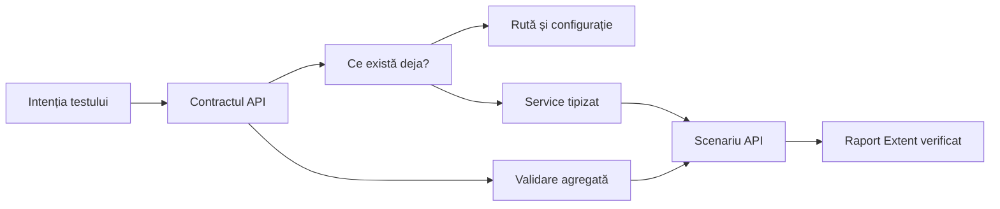
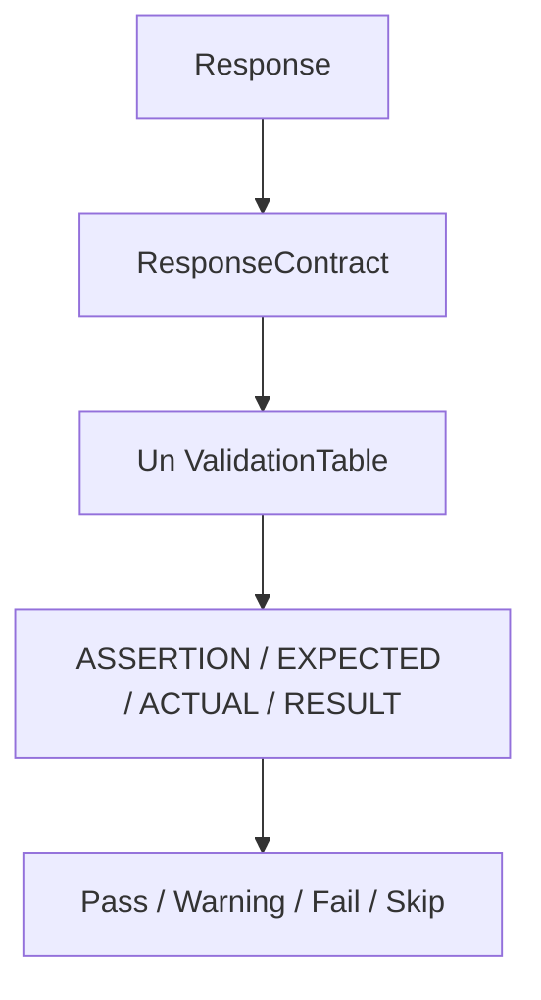

# ATF — ghid pentru adăugarea unui test API

Acest ghid este pentru oamenii care adaugă sau extind teste API în ATF. El arată
doar drumul necesar: ce decizie iei, în ce modul lucrezi, ce teste scrii și ce
verifici în raportul Extent. Detaliile generale rămân în README-urile modulelor.

## Rezumatul în zece pași

1. Definește comportamentul API pe care vrei să-l verifici.
2. Verifică ce poți reutiliza înainte să creezi cod nou.
3. Adaugă ruta și configurația numai dacă lipsesc.
4. Adaugă modelul și operația de service numai dacă sunt necesare.
5. Grupează toate verificările response-ului într-un singur tabel.
6. Înregistrează cleanup-ul imediat pentru datele create sau modificate.
7. Scrie testele offline pentru regula nouă.
8. Adaugă scenariul API cu nume și tag-uri utile.
9. Rulează testele și generează raportul Extent.
10. Deschide raportul în tab-ul MCP și verifică rezultatul vizibil.

Pentru un endpoint deja suportat, de obicei începi la pasul 5. Pentru un
endpoint nou, urmezi toți pașii relevanți. O operație de scriere nu este gata
fără cleanup verificat.

## Înainte să scrii cod

Răspunde scurt la aceste întrebări:

| Întrebare | Exemplu de răspuns |
|---|---|
| Ce resursă verific? | `users`, `posts` sau o resursă nouă |
| Ce operație verific? | listare, citire, creare, modificare, ștergere, relație |
| Ce status este corect? | `200`, `201`, `404`, `401` sau un set explicit |
| Ce este important în response? | headers, content type, schema, câmpuri, relații |
| Ce autentificare folosește? | anonim, bearer, API key sau profil configurat |
| Creează date? | da — cine le șterge și când; nu — nu inventa cleanup |
| Ce tag-uri ajută? | numai cele care schimbă filtrarea sau navigarea |

Dacă o întrebare nu se aplică, notează decizia în test sau în contract; nu o
lăsa implicită în cod.



## Unde se modifică fiecare lucru

| Modul | Responsabilitate | Nu pune aici |
|---|---|---|
| `Atf.Core` | transport, autentificare, configurație și politici comune | rute de produs, Extent, assertions de scenariu |
| `Atf.Api/Module/Routing` | verb, path, resource, operation și auth metadata | apel HTTP sau HTML |
| `Atf.Api/Module/Models` | payload-uri și răspunsuri tipizate | environment sau raportare |
| `Atf.Api/Module/Services` | operații API semantice | CSS, Extent sau assertions dispersate |
| `Atf.Api/Module/Validation` | contracte și tabelul agregat | construirea rutei sau layout |
| `Atf.Api/Module/Lifecycle` | ownership și cleanup în ordine inversă | verdict xUnit sau markup |
| `Atf.Api` | scenarii live și fazele lor | URL-uri, `HttpClient` sau HTML manual |
| `Atf.Tests` | teste offline, componentă și artifact | dependență obligatorie de endpoint-ul real |
| `Atf.Reporting.Extent` | arbore, HTML, CSS, JS și artifact | HTTP sau reguli de business |

Arhitectura completă este în
[`ATF_Architecture.md`](ATF_Architecture.md). Nu crea o clasă sau un modul nou
doar pentru că fișierul existent pare lung; creează-l doar când apare o
responsabilitate separată și un test care o protejează.

## 1–3. Rută și configurație

Dacă ruta nu există:

1. folosește verbul din `ApiRequestConstants`;
2. adaugă path-ul în vocabularul de rute, nu ca literal în test;
3. definește `ApiRoute` cu method, path template, resource, operation și auth;
4. folosește route builder-ul pentru parametri;
5. pune valorile de environment în configurația modulului `Api`.

Dacă ruta există, nu o duplica. Adaugă un test pentru metoda, path-ul,
parametrii și metadata auth. Nu deduce autentificarea din numele testului sau din
verb.

## 4. Model și service

Adaugă model doar când response-ul nu este exprimat clar de un model existent.
Service-ul trebuie să expună o operație care spune ce face:

```csharp
public Task<ApiExecutionResult> GetAsync(
    int resourceId,
    string? authProfile = null,
    CancellationToken ct = default) =>
    _executor.ExecuteAsync(
        ApiRoutes.ResourceItem.CreateRequest(resourceId, authProfile), ct);
```

Service-ul nu construiește raportul, nu decide verdictul și nu creează un al
doilea `HttpClient`. Pentru operații compuse, fiecare response rămâne identificabil
și are validarea proprie.

## 5. Validare: un response, un tabel

Toate verificările aceluiași response se grupează într-o singură validare:

```csharp
ApiAssertions.Contract(
    context.Reporter,
    result.Response,
    "Validate: resource item",
    contract => contract
        .Status(HttpStatusCode.OK)
        .ContentTypeContains("application/json")
        .JsonSchema(schemaPath)
        .Field("id", expectedId));
```

Raportul trebuie să arate un singur tabel cu:

```text
ASSERTION | EXPECTED | ACTUAL | RESULT
```

Reguli:

- request-ul și validation-ul sunt frați direcți în aceeași fază;
- validation-ul aparține response-ului imediat anterior;
- nu crea un nod pentru fiecare assertion;
- un `SoftContract` produce `Warning`, nu `Pass` și nu `Fail`;
- actual și expected sunt redactate înainte de HTML;
- limita de caractere schimbă doar afișarea, nu valoarea verificată.



Contractul complet este în
[`ATF_Reporting_Contract.md`](ATF_Reporting_Contract.md), iar regulile locale în
[`Atf.Api/Module README`](../Atf.Api/Module/README.md).

## 6. Cleanup și lifecycle

Pentru `POST`, `PUT`, `PATCH` sau orice operație care creează/modifică date:

1. execută operația în faza potrivită;
2. validează response-ul și extrage identificatorul;
3. înregistrează imediat cleanup-ul;
4. execută comportamentul testat;
5. rulează teardown-ul în ordine inversă;
6. păstrează cauza primară dacă teardown-ul eșuează.

Nu folosi `Task.Delay` arbitrar și nu transforma o eroare de cleanup într-un
test verde. Detaliile sunt în [`Atf.Api README`](../Atf.Api/README.md).

```text
SETUP → TEST BODY → TEARDOWN
             │
             └── request → validation sibling → assertion table
```

## 7. Teste înainte de scenariul live

| Ce ai schimbat | Unde testezi | Verificarea minimă |
|---|---|---|
| rută, path, auth | `Atf.Api.Tests` | method, path, parametri și auth |
| model, JSON | `Atf.Common.Tests` | serializare și contract |
| service, executor | `Atf.Core.Tests` / `Atf.Api.Tests` | transport fake și response |
| validator | `Atf.Common.Tests` | tabel agregat și status |
| cleanup, lifecycle | `Atf.Api.Tests` | ordine și cauza primară |
| arbore Extent | `Atf.Reporting.Extent.Tests` | fază, request și validation sibling |
| HTML/CSS/JS | `Atf.Reporting.Extent.Tests` | markup, tokeni și starea inițială |
| interacțiune raport | tab MCP | click, expand, scroll și stiluri |

Un test live nu înlocuiește testul offline al unei reguli reutilizabile. Pentru
HTML static se folosește `ReportArtifactInspector`; pentru comportament vizibil
este necesară verificarea în tab-ul MCP.

## 8. Scenariul API

Pune testul în clasa care deține aceeași resursă sau familie de comportamente.
Nu crea o clasă nouă pentru o singură metodă fără ownership real.

```csharp
[Fact(DisplayName = "Resources: known item matches contract")]
[Trait("Category", "smoke")]
public Task GetKnownResourceReturnsItem() => RunScenarioAsync(
    "GET /public/v2/resources/{id} — item contract",
    ["api", "resources", "smoke", "contract"],
    async context =>
    {
        var result = await context.Resources.GetAsync(1, "anonymous");
        ContractValidators.ResourceItem(context.Reporter, result.Response);
    });
```

Scenariul trebuie să aibă:

- nume care descrie operația și contractul;
- lifecycle gestionat de runner;
- cel puțin un response validat;
- tag-uri puține și utile;
- fără tag generic `framework`;
- cleanup pentru datele create;
- status negativ declarat explicit în cazurile negative.

`warning`, `failure`, `skip`, `teardown` și `soft-assert` sunt metadata de
execuție, nu tag-uri de navigare. Nu atașa tag-uri pe rădăcina clasei doar pentru
a le face vizibile: asta poate contamina totalurile Overview/Tags. Politica
detaliată este în [`Atf_Refactoring_Feedback.md`](feedback/Atf_Refactoring_Feedback.md).

## 9. Rulează testele și generează raportul

Rulează întâi proiectele offline relevante, apoi scenariul live. Dacă există
alte rulări active, folosește un output separat; nu opri procesele și nu șterge
artifactele lor. Procedura de build izolat este în
[`Atf_Feedback_Execution_Guide.md`](feedback/Atf_Feedback_Execution_Guide.md).

Raportul trebuie să fie un HTML autonom, fără dependență de un folder extern
`extent`.

## 10. Verifică raportul Extent în tab-ul MCP

### Overview

- totalurile provin din scenariile reale;
- chart-urile nu sunt numărate ca teste;
- `Tags` și `System/Environment` au aceeași familie vizuală;
- Overview se deschide la încărcare și refresh.

### Tests și arborele de execuție

```text
Tests list: class name + status + durată (fără tag-uri)
└── Scenario detail: status + durată + tag-uri utile
    └── SETUP / TEST BODY / TEARDOWN
        ├── Request
        │   ├── Technical trace (Info)
        │   └── Request/response JSON
        └── Validation (frate al request-ului)
            └── tabel agregat de assertions
```

Verifică:

- în lista din stânga: clasele, durata și statusul, fără tag-uri sau pills;
- în detaliile din dreapta: numele scenariului, durata, statusul și tag-urile sale;
- selectorul de tag-uri filtrează fără să injecteze tag-uri în lista stângă;
- fazele și nodurile colapsate implicit;
- request-ul și validation-ul ca frați direcți;
- trace-ul ca Info, fără a deveni verdict;
- JSON-ul în code block scrollabil și redactat;
- lipsa failure-urilor duplicate în `TEST BODY`.

### Assertions și Fails

- există un singur tabel agregat pentru fiecare response;
- `ASSERTION`, `EXPECTED`, `ACTUAL`, `RESULT` sunt vizibile și aliniate;
- `Warning` păstrează rândul eșuat fără a deveni `Fail`;
- `Fails` apare doar când există failure-uri;
- fiecare failure duce la testul și nodul sursă corect;
- Overview, Tags și Fails păstrează aceleași totaluri după navigare și refresh.

Nu este suficient ca textul să existe în HTML. Elementele relevante trebuie
deschise, colapsate, filtrate și verificate vizual în tab-ul MCP.

## Criteriul final

Testul este gata numai dacă:

- [ ] contractul este clar și ruta este reutilizată sau adăugată corect;
- [ ] responsabilitățile sunt în modulele potrivite;
- [ ] fiecare response relevant are validation agregat;
- [ ] cleanup-ul este explicit pentru datele create;
- [ ] testele offline relevante trec;
- [ ] scenariul live are metadata minimă și utilă;
- [ ] Overview, Tests, Assertions, Tags și Fails sunt corecte;
- [ ] request-ul și validation-ul sunt frați direcți;
- [ ] raportul HTML este autonom;
- [ ] raportul a fost verificat efectiv în tab-ul MCP.

## Referințe

- [`ATF_Architecture.md`](ATF_Architecture.md) — arhitectură și ownership;
- [`ATF_Reporting_Contract.md`](ATF_Reporting_Contract.md) — contractul raportului;
- [`README_Atf_BestPractices.md`](README_Atf_BestPractices.md) — reguli OOP și testare;
- [`Atf.Api README`](../Atf.Api/README.md) — scenarii și lifecycle;
- [`Atf.Api/Module README`](../Atf.Api/Module/README.md) — rutare, modele și validare;
- [`Atf.Api.Tests README`](../Atf.Tests/Atf.Api.Tests/README.md) — teste offline;
- [`Atf.Reporting.Extent README`](../Atf.Reporting.Extent/README.md) — raportare;
- [`Atf.Tests README`](../Atf.Tests/README.md) — harta testelor.
