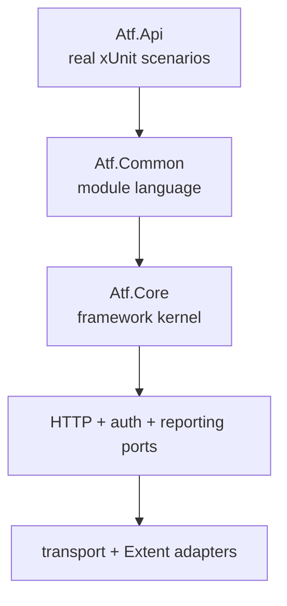
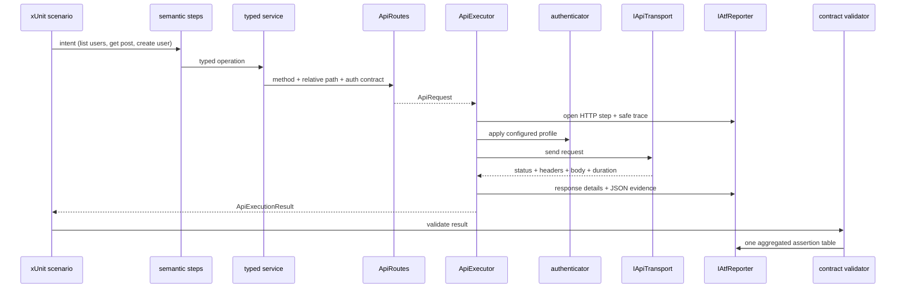
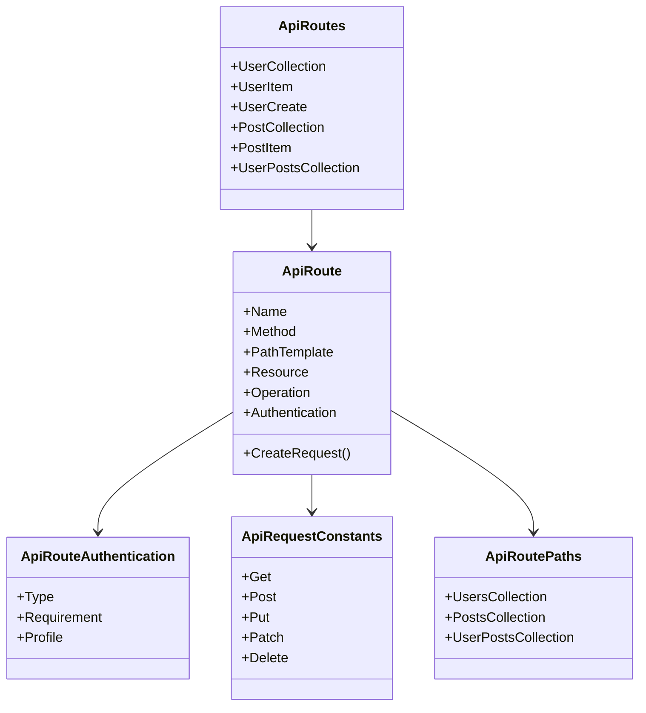
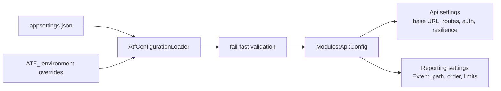
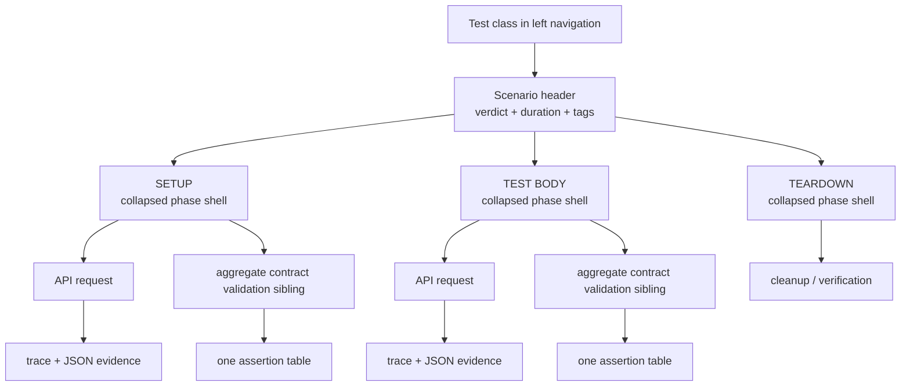
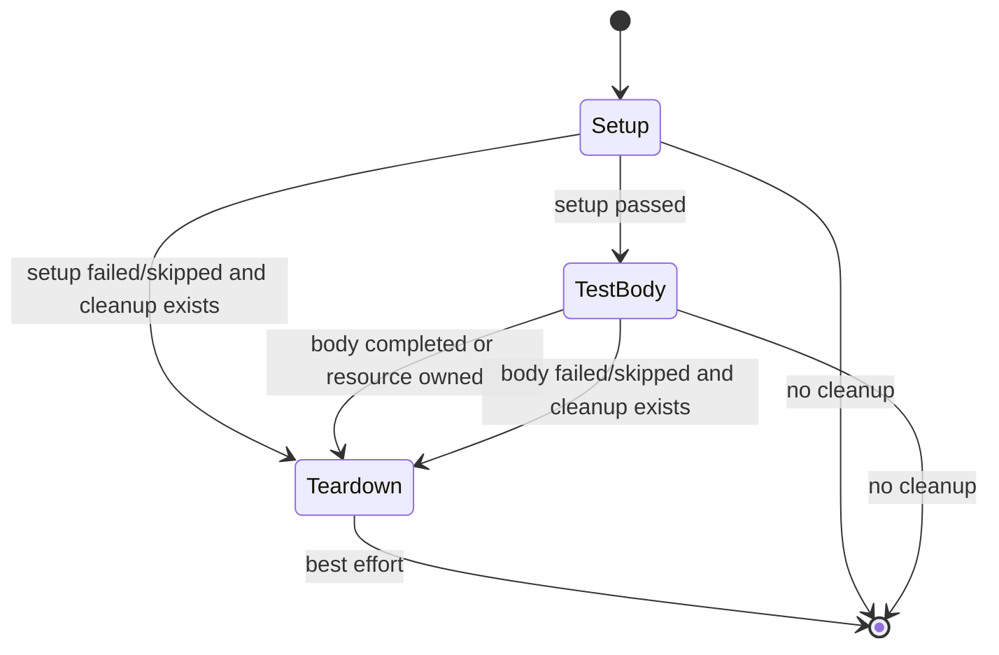
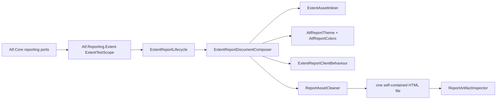
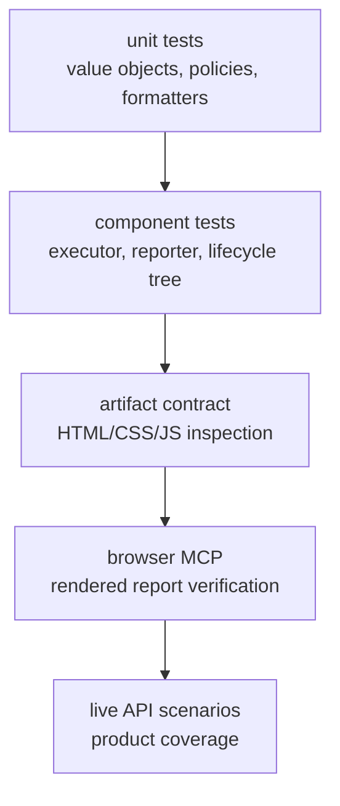

# Configurable API ATF — architecture and reporting guide

This document is the executable design guide for the repository. It records the
contracts discovered while comparing the generated ATF report with the legacy
Extent report and then validating the current HTML in a browser. It is written
for engineers who need to add another API module without copying framework code.

## 1. What belongs where

The framework has one direction of dependency. A lower layer never references a
scenario or product concern from an upper layer.



| Layer | Owns | Does not own |
|---|---|---|
| `Atf.Core` | configuration, URL building, authentication ports, transport, retry/polling and renderer-neutral reporting ports | product routes, schemas, business fixtures |
| `Atf.Common` | route catalog, typed services, semantic steps, validators, fixtures, cleanup | xUnit orchestration, raw Extent markup, secrets |
| `Atf.Api` | test classes, scenario intent, categories and live coverage | `HttpClient`, endpoint literals, report layout |
| `Atf.Tests` | deterministic unit/component/architecture tests | live service coverage |

The practical rule is: if a defect can be reproduced without a live API, it
belongs in `Atf.Tests`; if it proves product behavior, it belongs in `Atf.Api`.

## 2. Runtime request pipeline



The following are different facts and must not be conflated:

```text
HTTP exchange completed  !=  contract satisfied  !=  scenario passed
```

`ApiExecutor` owns transport facts and leaves the HTTP execution context open while
its evidence is published. The validator then opens one aggregate validation node
as the next direct sibling of the request that produced the response, under the same phase. This is
why the final report is phase -> request + validation sibling -> table, while assertions
for the same response remain rows in one table.

The normative details are maintained in [ATF_Reporting_Contract.md](ATF_Reporting_Contract.md).

## 3. Route and configuration vocabulary

Routes are semantic metadata, not strings scattered through tests.



`ApiRequestConstants` contains HTTP verbs. `ApiRoutePaths` contains the default
relative path vocabulary used by `RouteSettings`; environment configuration may
override those values. Keeping them separate prevents an endpoint literal from
being repeated in a service, a test and a report assertion.

Configuration is module-owned:



Secrets are injected at runtime. The report may expose `auth.profile`,
`auth.mode` and token availability state, but never the token value.

## 4. Scenario and report tree

The left navigation groups scenarios under the xUnit test class. The scenario
header carries the verdict, duration and tags. Composite lifecycle scenarios use
the following visual hierarchy:



The visual rules are intentional:

1. The composite scenario does not render a redundant parent `Scenario passed`
   event table. Its verdict is already visible in the scenario header.
2. `SETUP`, `TEST BODY` and `TEARDOWN` are compact, collapsed phase shells.
3. An API request owns its transport/response evidence. Exactly one aggregate
    validation sibling immediately follows the request under the same phase and owns the assertion table for that response.
4. Request details, response details, JSON and assertion evidence are collapsed
   evidence blocks; opening a node reveals forensic information on demand.
5. Empty phases are not manufactured.
6. The phase order is canonical: setup, body, teardown.

The browser behaviour is implemented by
`Atf.Reporting.Extent/Reporting/Theme/ExtentReportClientBehaviour.cs`; the structure is
created by the Extent adapter's `ExtentTestScope` and Core's `ApiScenarioPhaseLayout`.

## 5. Evidence contract

Each API exchange has one technical trace table with compact fields such as
method, relative path, URL, auth profile, attempt, response status and duration.
The values are evidence, not a business verdict.

Each contract validator emits one table:

```text
ASSERTION | EXPECTED | ACTUAL | RESULT
HTTP status | 200 OK | 200 OK | PASS
Content-Type | contains application/json | application/json; charset=utf-8 | PASS
JSON schema | Schemas/user-collection.schema.json | schema matched | PASS
```

The table is aggregated before it is rendered so a failing contract shows all
known mismatches together. `PASS` is represented as a small semantic marker in
the final column; the table must not be confused with technical `Info` events.

JSON evidence is rendered as an embedded dark code block with wrapped lines and
a vertical scroll area. The page itself must not acquire horizontal scrolling.
The final HTML contains the CSS, JavaScript, fonts and logo needed by Extent;
the sibling `extent` asset directory is removed after composition.

## 6. Lifecycle and failure ownership



- cleanup is registered when a resource is created;
- cleanup runs in reverse registration order;
- cleanup failures are recorded without hiding the primary failure;
- a skipped write scenario remains skipped when the token is absent or writes
  are disabled;
- class aggregation is failure-first: `Fail > Skip > Pass`;
- xUnit remains authoritative for the runner result.

## 7. Extent composition boundary



`AtfReportColors` is the single palette source. `AtfReportTheme` expands it into
CSS, while `ExtentReportClientBehaviour` manages navigation, collapse state and
the overview-counter reconciliation. These concerns must not leak into services
or scenario classes.

The native Extent parent counter is not authoritative before ATF reconciliation
for this hierarchy: it counts the class roots that Extent creates for navigation. The ATF script
reconciles the visible `Tests Passed`, `Tests Failed`, skipped and parent chart
values from direct API scenario cards. Unit/component tests executed by the
runner are deliberately outside this API evidence report, so they cannot inflate
the API scenario total.

The artifact acceptance contract is:

| Check | Meaning |
|---|---|
| custom theme | ATF dark theme is embedded |
| self-contained | no `extent/...` external reference remains |
| extent folder removed | no sibling asset directory is delivered |
| collapsed evidence | step evidence is closed by default |
| phase shells collapsed | lifecycle phase cards match the reference report |
| composite summary cleanup | redundant parent event is removed for phase scenarios |
| overview reconciliation | native counters use direct API scenario cards, not class roots or unit tests |
| scrollable JSON | large bodies are readable without page overflow |
| assertion table | expected/actual/result evidence is aggregated |
| technical trace | request facts are visible in one compact table |

## 8. Test strategy



Use the cheapest proof that can detect the defect:

| Concern | Test location | Proof |
|---|---|---|
| phase vocabulary/order | `Atf.Api.Tests/ApiScenarioPhaseLayoutTests.cs` | canonical labels and phase/request/validation ownership tree |
| automatic phase closure | same test class | starting a new phase closes the prior frame |
| HTTP/validation ownership semantics | API/Core reporting structure tests | validation is the request's next direct phase sibling; phase closes after aggregate evidence |
| collapse and summary behaviour | `ReportingComponentTests` | generated client contract contains the browser rules |
| final artifact | `ReportArtifactInspectorTests` | embedded theme, no asset folder, phase contract |
| JSON and evidence safety | reporting/evidence tests | escaping, wrapping, one assertion table |
| configuration/resilience | Core configuration tests | fail-fast values, retry and polling policies |
| live service contract | `Atf.Api` | actual endpoint status/schema/relationship behaviour |

Run the deterministic suites before a live run:

```powershell
dotnet test .\Atf.Tests\Atf.Core.Tests\Atf.Core.Tests.csproj --no-restore
dotnet test .\Atf.Tests\Atf.Common.Tests\Atf.Common.Tests.csproj --no-restore
dotnet test .\Atf.Api\Atf.Api.csproj --no-build --no-restore
dotnet test .\Atf.Api.Tests\Atf.Api.Tests.csproj --no-build --no-restore
dotnet test .\Atf.Tests\Atf.Reporting.Extent.Tests\Atf.Reporting.Extent.Tests.csproj --no-build --no-restore
```

After a live run, inspect the generated file rather than relying only on the
runner summary. Verify the left class grouping, one scenario tree, collapsed
phase shells, phase-sibling aggregate validation, JSON scroll behaviour, dark
surfaces, assertion table and absence of `artifacts/reports/extent`.

## 9. Adding a new API module

1. Add a module configuration section under `Modules:<Name>:Config`.
2. Define relative paths and request constants in the module/common routing
   vocabulary; do not duplicate endpoint literals in tests.
3. Add typed route metadata including authentication intent.
4. Add a service and semantic step only where they improve readability.
5. Add validators that publish one aggregated assertion table.
6. Register created resources with `CleanupRegistry`.
7. Add unit/component tests before the live scenario.
8. Add the live scenario under the real test class and stable categories.
9. Generate the HTML report and inspect it in a browser.

The module contributes domain language. Core remains unchanged unless the new
behavior is genuinely product-neutral.

