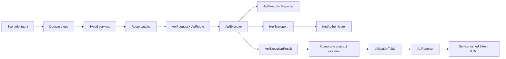
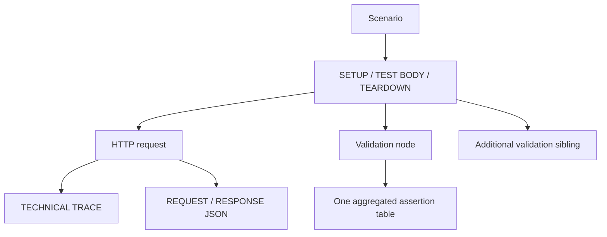

# ATF quality assessment and refactoring backlog

This is the constructive red-team review of the current .NET ATF. The scores
measure maintainability and diagnostic confidence, not the number of passing
live tests. A high score means the contract is explicit, isolated and protected
by deterministic tests; it does not mean that no further work is useful.

## Executive verdict

| Area | Score | Direct feedback |
|---|---:|---|
| Layering and dependency direction | 86 | Core/Common/Api boundaries are now visible and mostly one-way. Keep the composition root strict. |
| OOP and responsibility cohesion | 78 | Routes, services, steps, validators and adapters are good seams. The report theme and client behaviour are still large presentation modules. |
| HTTP execution and resilience | 82 | Transport, auth, URL building and retry are injectable and deterministic. Cancellation/timeout and reporter-failure contracts now have explicit coverage. |
| Validation model | 84 | `ValidationTable` is the right aggregation boundary. Scenario code still needs discipline to call one composite validator per contract. |
| Reporting correctness | 82 | Request-owned validation, collapsed evidence and final-artifact checks are strong. Browser hydration remains a separate verification layer. |
| Report visual consistency | 80 | Central tokens and self-contained HTML reduce drift. CSS/JS should eventually be split into named presentation components. |
| Testability | 81 | Offline tests cover core seams and structure. Missing matrices remain around cancellation, masking, empty collections and cleanup isolation. |
| Documentation and onboarding | 84 | README files now describe contracts and diagrams. The next improvement is executable examples and a single “first change” path. |
| Security and diagnostic hygiene | 74 | Token descriptions are safe and the report is self-contained. Add systematic secret masking and tests for headers/query/body values. |
| CI and quality gates | 62 | Local gates are clear, but repository-level CI/analyzer enforcement is not yet a hard contract. |
| **Overall** | **80** | A solid framework foundation; the remaining risk is concentrated in presentation-module size, diagnostic data policy and unautomated quality gates. |

The blunt conclusion: the framework is no longer a collection of test helpers,
but it is not yet a fully governed platform. The next gains come from making
contracts executable, not from adding more endpoint wrappers.

## The intended object model



The important OOP rule is that `ApiExecutor` orchestrates; it does not know how
Extent renders a technical trace. `ApiExecutionReporter` is the anti-corruption
adapter between execution facts and report evidence. If the report renderer
fails, the HTTP result and its exception remain authoritative.

## Reporting contract



The invariant is `phase → request + validation siblings`, not a flat list and not one
child node per assertion. The request remains the active execution context while
response evidence is published; the validation is then created under the same phase
and is associated with that response by execution order and contract title.
Each validation closes itself in `finally`, preventing validation A from
swallowing validation B as its child. Composite validators should therefore
combine status, headers, schema and JSON-path checks into one table whenever
they describe the same contract.

## What is already protected

The current deterministic suite covers:

- route token encoding, unresolved-token rejection and typed route metadata;
- URL/query construction and injected transport/authenticator boundaries;
- bounded rate-limit retries and server/fallback delay selection;
- JSON pretty printing and configurable assertion previews;
- phase sibling layout and request-associated validation nodes;
- collapsed report evidence, nested card click delegation and JSON overflow;
- central typography/color tokens and absence of horizontal page overflow;
- self-contained HTML, no external `extent` folder and no open evidence nodes;
- reporter failures not replacing a successful transport outcome;
- cleanup reverse ordering and continuation after a cleanup failure.

Run the offline gates from the isolated build location:

```powershell
dotnet build C:\work\ex\.net\.tmp\Atf\Atf.slnx --configuration Release --no-restore --nologo
dotnet test C:\work\ex\.net\.tmp\Atf\Atf.Tests\Atf.Core.Tests\Atf.Core.Tests.csproj --configuration Release --no-build --no-restore
dotnet test C:\work\ex\.net\.tmp\Atf\Atf.Tests\Atf.Common.Tests\Atf.Common.Tests.csproj --configuration Release --no-build --no-restore
dotnet test C:\work\ex\.net\.tmp\Atf\Atf.Api\Atf.Api.csproj --configuration Release --no-build --no-restore
```

## Aggressive improvement backlog

### P0 — protect correctness before adding features

1. **Make one contract equal one table by default.** Keep `ContractValidators`
   as the preferred public facade. Add a test for every composite contract that
   asserts exactly one reporter table and the expected row count.
2. **Add the missing diagnostic-data policy.** Define a masking pipeline for
   bearer tokens, cookies, authorization headers, API keys and configurable
   sensitive JSON fields. Test the policy before testing the HTML.
3. **Add cancellation/timeout matrices.** Prove that cancellation is propagated,
   no retry happens after cancellation, and an `HttpClient` timeout is reported
   as the original exception while the report is best-effort.
4. **Keep the final artifact as a gate.** Every report-rendering change needs
   structural Extent tests, static artifact inspection and one browser smoke
   run that expands phase → request + validation siblings and evidence blocks.

### P1 — improve maintainability and OOP

1. Split `ExtentReportClientBehaviour` into named builders: navigation,
   hierarchy, disclosure and layout. Keep the public `Build()` facade so the
   generated HTML contract does not change.
2. Split `AtfReportTheme` into token, overview, execution-tree, evidence and
   responsive sections. The current single large CSS source is the largest
   presentation-maintenance risk.
3. Introduce typed report property names for method/path/auth/status/duration
   instead of spreading string keys through execution code. Keep the serialized
   labels stable for backward-compatible reports.
4. Add a `ScenarioValueBag` scoped to `ApiScenarioContext` for captured ids and
   correlation values. It must be isolated per scenario and never static.
5. Add analyzer/format gates and a repository CI workflow. Warnings should be
   reviewed before enabling warnings-as-errors globally; do it in two stages.

### P2 — expand API confidence

1. Empty collection semantics: explicit policy instead of relying on vacuous
   `All(...)` behavior.
2. Error-envelope contracts: status, error code, message and correlation id in
   one table.
3. Pagination/filter/sort contracts, including stable ordering and continuation.
4. PUT/PATCH/DELETE contract matrix with idempotency and read-back checks.
5. Parallel scenario isolation and deterministic report ordering under concurrency.
6. Schema diagnostics that retain a bounded readable preview while preserving
   the complete raw response in the report DOM.

## Test matrix to add next

| Component | Test to add | Why it matters |
|---|---|---|
| `ApiExecutionReporter` | start/detail/json failure is non-fatal | protects execution from presentation defects |
| `ApiExecutor` | cancellation during retry delay | prevents hidden extra calls and misleading retries |
| `ApiExecutor` | timeout preserves original exception | protects triage under real network failure |
| `RateLimitRetryPolicy` | HTTP-date `Retry-After` and malformed date | covers production header variants |
| `ValidationTable` | duplicate/empty contract policy | keeps tables meaningful and deterministic |
| `ContractValidators` | one table per composite contract | prevents report fragmentation |
| `CleanupRegistry` | scenario isolation and double-run | prevents cross-test resource leakage |
| `ReportArtifactInspector` | no page horizontal overflow and no open evidence | catches visual regressions before browser review |
| browser smoke | expand phase, request, validation, JSON and assertions | verifies hydrated DOM, not only source strings |

## Definition of “done” for the next refactor

The next refactor is complete only when:

1. the three offline test projects pass from `.tmp`;
2. the generated report remains the canonical filename and is self-contained;
3. the artifact inspector has zero violations;
4. a browser smoke expands and collapses every layer without page errors;
5. a long JSON block scrolls vertically and does not widen the page;
6. one composite contract produces one aggregated table;
7. the README diagrams still describe the actual object graph;
8. no active run in `C:\work\ex\.net\Atf` was stopped or overwritten.

