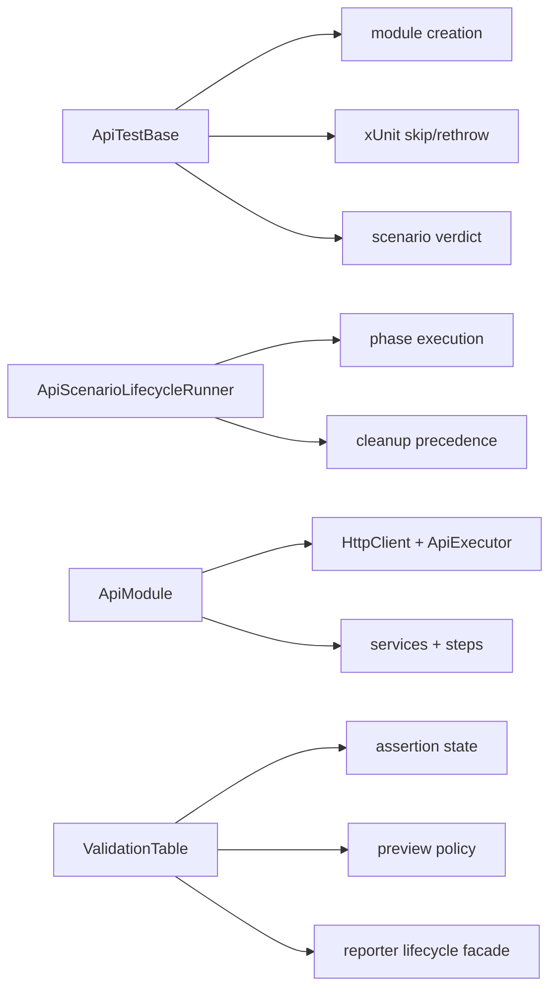
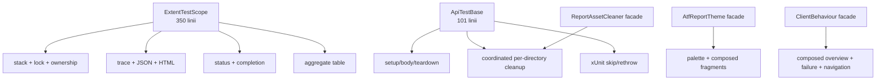
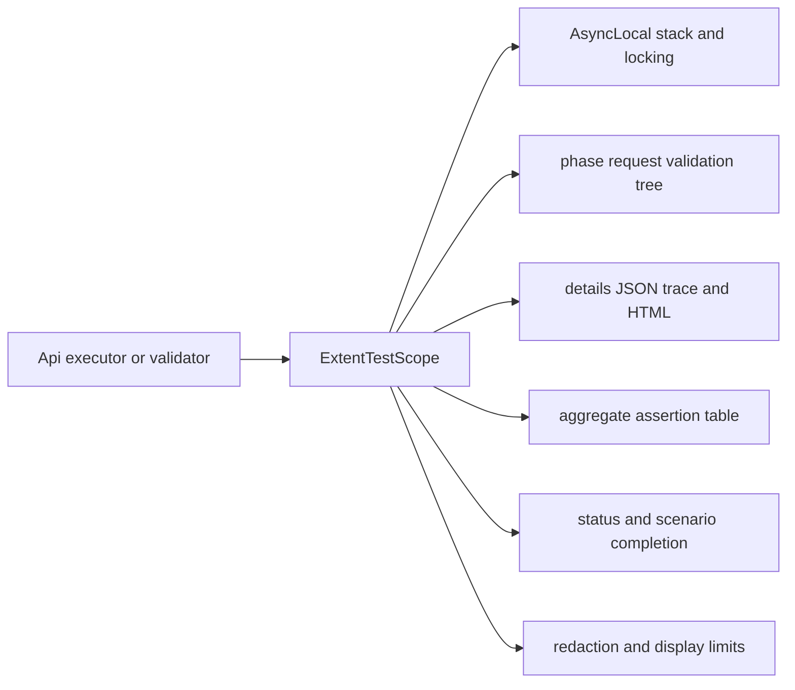
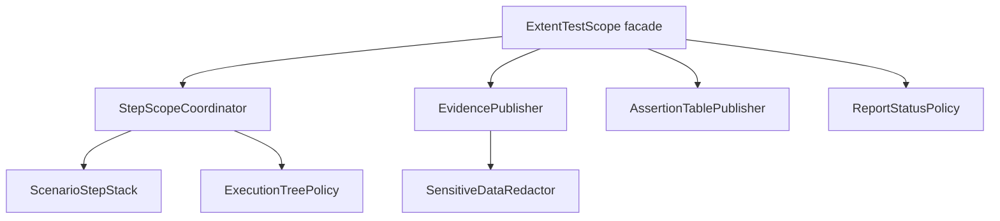
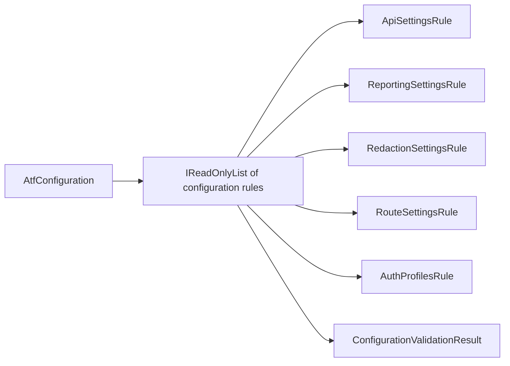
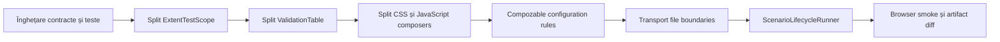
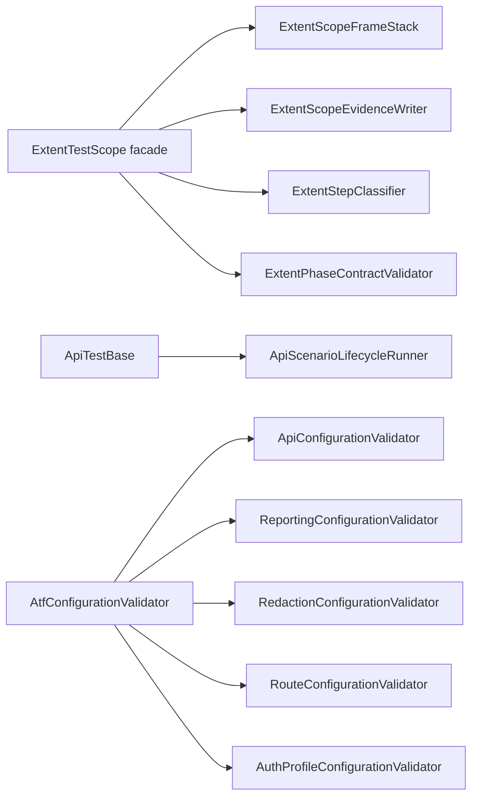
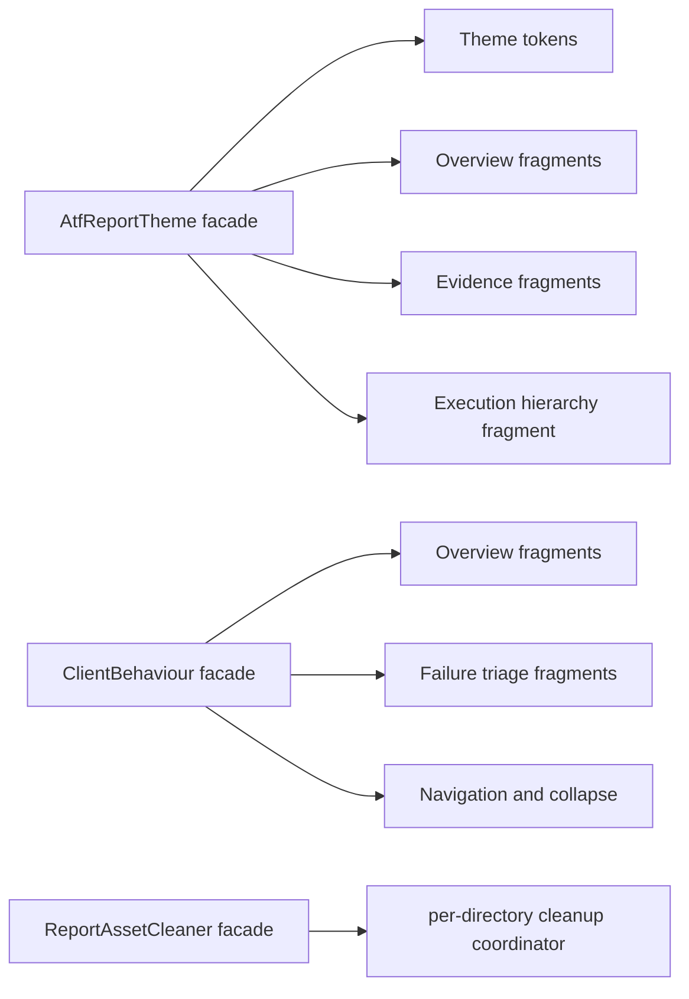
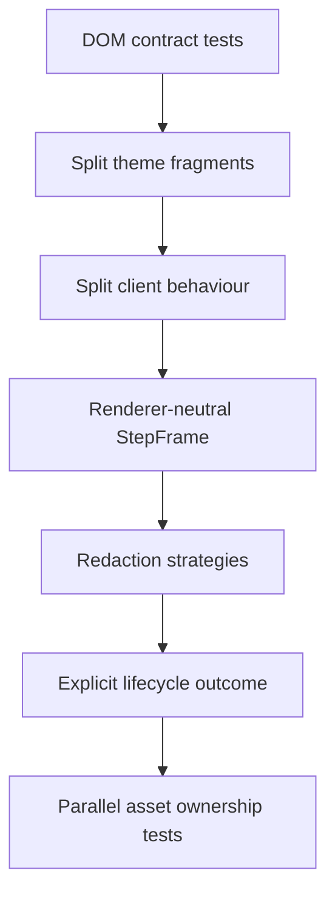
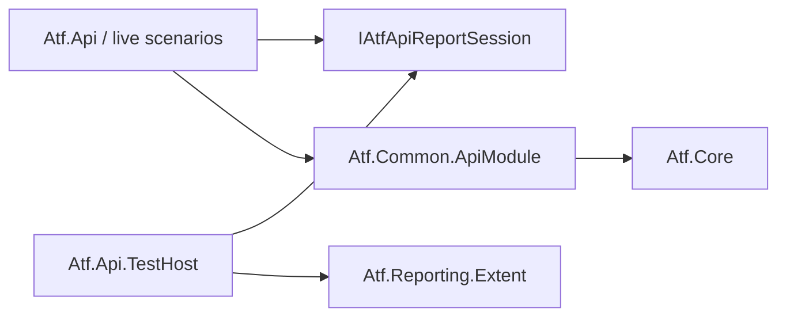

# ATF refactoring assessment and OOP roadmap

Acest document este auditul constructiv al codului ATF live. Scorurile sunt
note de mentenabilitate, nu note pentru faptul că testele trec. Un scor mare
înseamnă responsabilități clare, dependențe controlabile și contracte protejate
prin teste deterministe. Obiectivul este refactorizare fără schimbare de
comportament: același API, aceeași ierarhie de raport, aceleași verdicte și
aceeași politică de securitate.

## Verdict executiv

> **Snapshot 2026-10-13 — audit actualizat pe working tree.** Scorul curent și
> findings active sunt centralizate în
> `docs/feedback/ATF_LIVE_CODE_FEEDBACK_2026-10-13.md`. Acest document păstrează
> roadmap-ul OOP și rationale-ul extins; nu este o a doua sursă de scor.

> **Notă de sincronizare:** tabelele numerice de mai jos sunt baseline-ul
> păstrat pentru comparație istorică. Nu le interpreta ca scor curent și nu le
> folosi pentru a descrie working tree-ul fără verificarea registrului din
> `docs/feedback/`. În snapshotul inițial scorul era **82/100**; între timp HTML-ul și
> inspectorul Extent au fost mutate din `Atf.Core` în `Atf.Reporting.Extent`.

## Scope-ul acestei evaluări

Acest roadmap evaluează numai refactorizarea internă. Formatul raportului nu
este reproiectat aici; analiza dedicată din
`docs/feedback/ATF_LIFECYCLE_COMBINATION_ANALYSIS_2026-10-13.md` este exclusă și
rămâne autoritatea separată pentru format. Orice recomandare de mai jos trebuie
să păstreze aceeași ierarhie, aceleași verdicte și aceeași proiecție observabilă.

| Zonă | Notă | Feedback agresiv, dar acționabil |
|---|---:|---|
| Direcția dependențelor | 78 | proiectele urmează direcția corectă, dar Core conține încă HTML/CSS și selectors Extent-specific în evidence și artifact inspector. |
| OOP și coeziunea claselor | 75 | scope-ul și lifecycle-ul s-au subțiat, dar session/composer, cleanup/reporting și validation/evaluation încă ating responsabilități diferite. |
| `ExtentTestScope` | 72 | Are aproximativ 350 de linii și deleagă stack-ul async către `ExtentScopeFrameStack`, evidence/redaction către `ExtentScopeEvidenceWriter`, iar nodul vendor este ascuns prin `IExtentNodeAdapter`. Rămân coordonarea tranzițiilor și status precedence. |
| CSS/tema raportului | 58 | baseline-ul a identificat `AtfReportTheme` ca monolit; acum compune fragmente separate pentru Overview, evidence și execution hierarchy, dar randarea cere încă smoke browser. |
| JavaScript-ul raportului | 58 | baseline-ul a identificat client behaviour ca monolit; acum Overview și failure triage sunt fragmente distincte, iar navigation/collapse rămân în fațadă. |
| Configurație | 83 | snapshot-ul și validatorii fail-fast sunt corecte; diagnosticul validatorilor poate deveni mai compozabil. |
| Validare și assertions | 79 | `ValidationTableRunner` separă publicarea, dar modelul încă păstrează evaluare, failure state și display policy. |
| Transport și auth | 82 | strategiile typed și porturile sunt injectabile; rămân policy seams pentru attempt/budget. |
| Lifecycle API | 80 | custom teardown cleanup și izolarea reporter-failure sunt protejate; lock lifecycle și verificarea DOM rămân deschise. |
| Concurență | 73 | scope locking și asset coordinator există; lock lifecycle și cleanup/reporting isolation mai cer hardening. |
| Testabilitate | 84 | porturi, fakes și contracte offline bune; lipsește browser DOM validation. |
| Securitate diagnostică | 88 | redaction-ul este compus și acoperă text, query, JSON nested/arrays și exception diagnostics. |
| Documentație | 82 | README-urile au diagrame și contracte; unele afirmații istorice trebuie sincronizate cu registrul feedback. |
| **Scor general** | **78** | fundația este bună; următoarea îmbunătățire importantă este boundary-ul renderer-neutral și cleanup independent de reporter. |

## Audit suplimentar — separarea responsabilităților pe module

Scorul general nu trebuie confundat cu numărul de teste verzi. Mai jos este
costul de schimbare pe boundary-ul real al soluției:

| Modul | Notă | Observație critică |
|---|---:|---|
| `Atf.Core` | 74 | porturi și policies bune, dar evidence HTML și artifact selectors încalcă renderer-neutral boundary |
| `Atf.Common` | 76 | vocabular API reutilizabil; cleanup/reporting și validation/evaluation sunt încă apropiate |
| `Atf.Api` | 80 | scenarii subțiri, outcome explicit și runner testabil; hardening-ul de concurență și verificarea DOM rămân deschise |
| `Atf.Reporting.Extent` | 75 | adapter și vendor boundary îmbunătățite; lifecycle/composer și browser behavior rămân apropiate |
| `Atf.Tests` | 84 | separare bună pe contracte; verificarea HTML este în principal statică, nu browser-semantică |

### P0 închis — custom teardown și reporter isolation

`ApiScenarioLifecycleRunner` are acum un `finally` interior în faza TEARDOWN și
teste pentru teardown failure, callback failure și păstrarea cauzei primare.
Regresia veche este închisă. `CleanupRegistry` și `ValidationReportPublisher`
protejează acum separat resource actions și verdictul funcțional chiar dacă
reporter-ul nu poate deschide, publica sau închide un pas. Rămân P1 de urmărit:
lock lifecycle, filesystem sub lock și verificarea DOM/computed-style în TAB MCP.

### P1 — responsabilități care se ating



Ținta OOP nu este mai multe proiecte, ci contracte interne care permit testarea
fiecărei politici separat: `ApiTestBase` rămâne host adapter, `ApiModule`
rămâne composition root, iar modelul de validation nu mai știe cum se publică
în Extent.

### Măsurători care schimbă prioritizarea

`ApiExecutor` are aproximativ 129 de linii și delegă deja evidence-ul în
`ApiExecutionReporter`; nu este primul candidat pentru o rescriere. În schimb,
următoarele trei axe sunt reale și independente:



Feedbackul direct: dacă se extrage întâi `ApiExecutor`, se consumă timp pe o
zonă deja relativ coerentă și se păstrează problema principală. Ordinea corectă
este `ExtentTestScope` → `ApiTestBase` → CSS/JS, cu teste contractuale înaintea
fiecărui split.

## Ce este bun și trebuie păstrat

- `Atf.Core` expune porturi pentru transport, auth și reporting; aceasta este
  direcția corectă pentru OOP și teste offline.
- `ApiExecutor` este un orchestrator relativ clar: execută schimbul HTTP și
  delegă evidence-ul către `ApiExecutionReporter`.
- `ValidationTable` păstrează regula importantă „un response, un tabel
  agregat”. Această regulă trebuie mutată într-un model mai mic, nu eliminată.
- `ReportArtifactInspector` verifică HTML-ul livrat, nu doar obiectele Extent
  din memorie. Aceasta este protecția corectă împotriva diferențelor de
  randare.
- configurația este module-owned, iar `AtfConfigurationValidator` nu mai este
  îngropat în loader. Următorul pas este compoziția regulilor, nu o rescriere a
  configurației.

## Problemele care merită refactorizate primele

### 1. `ExtentTestScope` este un god object

În aceeași clasă coexistă:



Ținta este păstrarea unei fațade mici și injectarea unor colaboratori:



Responsabilitatea fiecăruia trebuie să fie testabilă fără Extent complet:

| Colaborator | Face | Nu face |
|---|---|---|
| `ScenarioStepStack` | push/pop/current și ownership de context async | nu decide status și nu generează HTML |
| `ExecutionTreePolicy` | verifică phase/request/validation și tranzițiile permise | nu scrie CSS/JS |
| `EvidencePublisher` | publică trace, JSON și mesaje safe | nu decide Pass/Fail business |
| `AssertionTablePublisher` | publică exact un tabel agregat | nu coordonează lifecycle-ul fazei |
| `ReportStatusPolicy` | mapează statusurile și precedence-ul | nu manipulează DOM |
| `ExtentTestScope` | păstrează API-ul public și delegă | nu conține reguli de prezentare |

Refactorizarea trebuie făcută incremental: întâi clase interne, apoi teste de
contract, apoi schimbarea constructorului intern. API-ul `IAtfScenarioScope` nu
trebuie rupt.

### 2. Tema CSS și comportamentul JavaScript sunt template monoliths

`AtfReportTheme.BuildCss()` și `ExtentReportClientBehaviour.Build()` sunt fațade
corecte, dar sursa internă trebuie împărțită pe intenții. Un builder cu sute de
linii nu este „OOP” doar pentru că returnează un `string`.

Ținta:

```text
ThemeComposer
├── ThemeTokens
├── BaseSurfaceStyles
├── OverviewStyles
├── ExecutionTreeStyles
├── EvidenceStyles
├── JsonStyles
└── ResponsiveStyles

ClientBehaviourComposer
├── DomRoleDiscovery
├── OverviewCountersBehaviour
├── DisclosureBehaviour
├── ExecutionTreeBehaviour
├── AccessibilityBehaviour
└── ClientScriptComposer
```

Fiecare fragment trebuie să aibă un test care verifică selectorii/rolurile
publice. Compozitorul final doar concatenează fragmentele într-o ordine stabilă.
Nu se schimbă tokenii, culorile, collapse-ul sau numele raportului.

### 3. Configurația are nevoie de reguli compozabile

`AtfConfigurationValidator` este mai bun decât validarea împrăștiată, dar
metodele `ValidateApi`, `ValidateReporting`, `ValidateRedaction`, `ValidateRoutes`
și `ValidateAuthProfiles` rămân o singură unitate de schimbare.

Ținta este:



Fiecare regulă trebuie să producă un diagnostic cu `Code`, `Path` și `Message`.
Excepția finală poate rămâne aceeași pentru compatibilitate, dar testele vor
putea verifica exact regula care a eșuat.

### 4. `ValidationTable` trebuie separată de execuție și reporting

Modelul ar trebui să fie aproape immutable după `Finish`:

```text
ValidationTable              agregă rânduri și rezultat
AssertionPreviewPolicy       aplică limita configurabilă de caractere
ValidationRunner              execută checks și capturează failure-ul
ValidationReportPublisher     transformă rezultatul în IAtfReporter
```

Reguli obligatorii:

- duplicatele și numele goale se validează în model;
- truncarea este o policy pură, nu logică de reporting;
- excepția de business este separată de excepția rendererului;
- `Finish` este idempotent sau refuză explicit a doua finalizare;
- un response produce o singură agregare, indiferent de numărul de checks.

### 5. Transportul trebuie să reflecte obiectele reale

`ApiTransport.cs` amestecă trei concepte:

```text
IApiTransport / HttpClientTransport
IApiAuthenticator / ConfiguredApiAuthenticator
IApiUrlBuilder / ApiUrlBuilder
```

Separarea fizică în fișiere și namespace-uri clare este un refactor mic, cu
risc redus. După aceea auth strategies pot fi testate fără a construi
`HttpClient`, iar URL builder-ul poate avea teste complet independente.

### 6. `ApiTestBase` trebuie redus la compoziție și delegare

Clasa de bază nu ar trebui să știe toate politicile de skip, teardown și
finalizare. Ținta este un `ApiScenarioRunner` injectabil cu:

```text
ScenarioLifecycleRunner
├── PhaseRunner
├── ScenarioFailurePolicy
├── CleanupCoordinator
└── ScenarioReportFinalizer
```

`ApiTestBase` rămâne un adapter xUnit subțire care furnizează fixture-ul și
apelează runnerul. Astfel testele pot verifica lifecycle-ul fără să moștenească
o clasă de test și fără să pornească raportarea reală.

## Reguli de refactorizare fără regresie

1. Un refactor nu schimbă numele raportului, statusurile, tokenii CSS,
   contractul `request + validation sibling` sau limitele de display.
2. Orice clasă nouă are un singur motiv dominant de schimbare și maximum opt
   tipuri top-level directe în pachetul proprietar.
3. Orice colaborator nou este testat printr-un contract determinist înainte să
   fie conectat în composition root.
4. Fațadele publice rămân stabile; split-ul începe prin clase interne și
   interfețe private/internal unde este suficient.
5. Nu se mută reguli în HTML/JavaScript doar pentru că sunt mai ușor de scris
   acolo. Structura și invariants rămân validate în C#.
6. Nu se adaugă adnotări generice de tip `framework`. O adnotare este permisă
   numai dacă schimbă o politică observabilă și are test dedicat.
7. Orice schimbare de reporting cere două dovezi: test structural al arborelui
   Extent și inspecție a HTML-ului final.

## Matrice minimă de teste după refactor

| Componentă | Teste obligatorii |
|---|---|
| `ScenarioStepStack` | nesting valid, pop în ordine, context async separat, dispose repetat |
| `ExecutionTreePolicy` | phase sibling, request + validation sibling, request fără validation respins la final |
| `EvidencePublisher` | redaction în trace/JSON/excepție, renderer failure nu schimbă rezultatul HTTP |
| `AssertionTablePublisher` | un singur tabel, limită de caractere, zero assertions, failure rows |
| configuration rules | fiecare regulă izolată, multiple diagnostics, path/code stabil |
| `ThemeComposer` | token dark unic, fonturi, JSON surface, selectors fără duplicate contradictorii |
| `ClientBehaviourComposer` | collapse implicit, roluri DOM, counters, zero page horizontal overflow |
| `ReportAssetCleaner` | folder lipsă, retry, file lock, rulări paralele fără ștergerea folderului altui raport |
| `ScenarioLifecycleRunner` | setup/body/teardown, skip, failure în body, failure în teardown, cleanup reverse-order |

## Ordinea recomandată



Prima etapă nu trebuie să înceapă prin rescrierea tuturor claselor. Începe cu
teste care fixează comportamentul deja dorit, apoi extrage colaboratori fără să
schimbe output-ul. Dacă un diff de HTML apare fără o cerință explicită, refactorul
se oprește și se investighează.

## Decizia și rezultatul rundei curente

Runda curentă a implementat incrementul de consolidare fără schimbare de
contract public sau de output:



- `ExtentTestScope` deleagă stack-ul async și publicarea de evidence către
  colaboratori dedicați; clasificarea și contractul request → validation rămân
  protejate, eliminând logica duplicată din scope;
- `ApiScenarioLifecycleRunner` coordonează fazele, cleanup-ul, skip-ul și
  precedence-ul failure/teardown, astfel încât `ApiTestBase` rămâne un adapter
  xUnit subțire;
- validatorul de configurație este acum un coordonator, iar regulile API,
  reporting, redaction, routes și auth sunt tipuri interne cu responsabilitate
  unică;
- `ConfigurationRuleTests` verifică fiecare boundary, iar
  `ExtentStepClassifierTests` fixează clasificarea folosită de arbore;
- `ValidationTable` a fost redusă la modelul de assertions, iar
  `ValidationTableRunner` deține lifecycle-ul reporterului și publicarea unui
  singur tabel agregat;
- mesajele, ordinea validării, statusurile și fațadele publice rămân neschimbate.

Verificarea live se face în repository-ul `C:\work\ex\.net\Atf`, iar build-urile
alternative pot folosi `C:\work\ex\.net\.tmp\` pentru a nu opri rulările active.
Incrementul curent a separat fragmentele Overview/evidence/execution hierarchy,
a reparat ordinea de expandare a token-urilor CSS și a harden-uit redaction-ul;
următorul seam rămas este izolarea politicii de tree/status față de coordonatorul
`ExtentTestScope`; portul intern `IExtentNodeAdapter` este deja introdus.

## Audit profund — feedback constructiv agresiv

Scorurile de mai jos măsoară riscul de schimbare și costul de înțelegere, nu
numărul de teste verzi. Un framework poate avea teste bune și totuși să fie greu
de extins dacă fiecare modificare obligă dezvoltatorul să atingă un monolit.

| Zonă | Scor | Verdict | Ce trebuie făcut |
|---|---:|---|---|
| direcția dependențelor | 78 | bună, dar cu leak | păstrează Core fără HTML/Extent vocabulary; nu reexpune `IExtentNodeAdapter` în contracte publice noi |
| OOP / SRP | 75 | în consolidare | scope-ul și lifecycle-ul s-au subțiat; separă cleanup/reporting și evidence model/HTML |
| `ExtentTestScope` | 72 | acceptabil, dar încă dens | următorul pas este separarea tree/status coordination, nu încă o metodă adăugată în scope |
| configurare | 81 | bună | validatorii sunt separați; următorul pas este diagnostic compozabil `Code + Path + Message` |
| validare agregată | 84 | bună | modelul și runnerul sunt separate; păstrează invariantul un response → un tabel |
| securitate / redaction | 82 | bună | politicile sunt deja separate intern; adaugă teste de compoziție, idempotence și configurări conflictuale |
| concurență / lifecycle | 73 | în consolidare | custom teardown este protejat; cleanup reporter seam și lock lifecycle rămân de urmărit |
| raportare HTML/JS/CSS | 66 | hotspot redus, nu închis | CSS/JS sunt fragmentate; inspectorul static nu înlocuiește browser smoke |
| testare | 84 | bună | reporter failure cleanup este protejat prin teste; rămâne compatibilitatea DOM reală în TAB MCP |
| documentație | 82 | bună, cu risc de drift | registrul `docs/feedback` este sursa curentă; roadmap-ul trebuie sincronizat |

Scorul istoric păstrat de acest roadmap: **78/100**. Implementarea este
mai matură decât baseline-ul de 68/100, dar nu este considerată stabilă fără
artifact generat după codul live și parcurgere browser pentru Overview, Tests,
faze, request, validation, assertions și Category.

### 1. Problema reală a reporting-ului nu mai este CSS-ul individual

`AtfReportTheme` și `ExtentReportClientBehaviour` sunt fațade de compoziție, nu
locul în care trebuie întreținută toată prezentarea. Fragmentele lor au acum
ownership semantic pentru Overview, evidence, failure triage și execution
hierarchy. Înainte, collapse, navigation, counters, tag audit, sizing și
reconciliation erau livrate dintr-un singur builder. Riscurile rămase sunt:

1. o modificare de overview poate rupe JSON evidence;
2. testele verifică fragmente de string, nu responsabilități;
3. nu există un owner clar pentru o regulă vizuală.

Refactorul corect nu este „împărțim fișierul la fiecare 100 de linii”, ci:



Fațadele produc același contract CSS/JS final. Testele verifică faptul că
fragmentele sunt rezolvate, placeholder-ele nu ajung în artifact, selectorii
critici există, iar disclosure-ul are starea implicită corectă.

Cleanup-ul folosește un filesystem injectabil în coordinator. Asta separă
policy-ul de retry de I/O-ul fizic și permite testarea lock-urilor, folderului
lipsă și a trei apeluri concurente fără a crea sau șterge artefacte reale.

### 2. `ExtentTestScope` este mai bun; următorul seam este coordonarea internă

`ExtentScopeFrameStack`, `ExtentScopeEvidenceWriter` și `IExtentNodeAdapter`
sunt direcția corectă. `StepFrame` nu mai expune `ExtentTest`; vendor-ul este
ținut de `ExtentNodeAdapter`, iar frame-ul păstrează doar adapterul intern,
titlul și metadata de assertions.

Ținta următoare:

```text
ScenarioStepFrame
  Title
  Details
  AssertionTableCount
  Status
        |
        v
ExtentNodeAdapter -> ExtentTest
```

Scope-ul trebuie să coordoneze stack-ul și locking-ul; adapterul trebuie să
dețină `ExtentTest`; writer-ul trebuie să publice evidence. Următorul pas este
ca `ExtentPhaseContractValidator` să primească un model intern de tree, nu
tipul nested al scope-ului. Nu adăuga noi proprietăți publice pe `StepFrame`.

### 3. Redaction-ul este acum bine separat; trebuie întărit prin contracte

`SensitiveDataRedactor` este acum o fațadă de securitate peste politici interne
separate pentru JSON structurat, pattern-uri de secret, query string, path local
și PII. Riscul actual nu mai este SRP, ci lipsa unei matrice complete de
compoziție și idempotence.

Contracte recomandate:

```text
SensitiveDataRedactor facade
├── StructuredJsonRedactor
├── SecretPatternRedactor
├── QueryStringRedactor
├── LocalPathRedactor
└── PiiRedactor
```

Regex-ul pentru cheile configurate trebuie compilat o singură dată la
construcție, nu reconstruit la fiecare apel. Testele obligatorii sunt: JSON
imbricat, array-uri, valori non-string, query repetat, headers concatenate,
PII disabled/enabled, path Windows și redaction idempotent.

### 4. Lifecycle-ul trebuie să aibă un rezultat semantic, nu doar excepții

`ApiScenarioLifecycleRunner` este un pas bun, dar `Exception? Failure` și
`Exception? Skip` permit stări greu de explicat. Un rezultat explicit de tip
`Passed | Failed | Skipped` cu `Reason` și `Exception` opționale ar face regula
de precedence vizibilă: failure în body bate failure în teardown; skip-ul nu
poate ascunde un failure existent; cleanup-ul rulează întotdeauna.

Acest lucru nu trebuie implementat prin mai multe `catch`-uri în testele xUnit.
Trebuie fixat prin teste parametrizate pentru toate combinațiile body/teardown/
cleanup.

### 5. Asset cleanup-ul încă trebuie tratat ca problemă de ownership

Retry-ul sincron cu `Thread.Sleep` este pragmatic, dar nu dovedește că folderul
șters aparține exact rulării curente. Contractul sigur este:

```text
run A -> private staging A -> inline -> publish A -> cleanup A
run B -> private staging B -> inline -> publish B -> cleanup B
```

Un test concurent trebuie să creeze două rapoarte simultan, să blocheze un font
dintr-un staging directory și să demonstreze că A nu șterge B. Cleanup-ul nu
trebuie să blocheze thread-ul de test mai mult decât politica documentată.

### 6. Ce este bine și trebuie păstrat

- contractul `phase → request + validation sibling` este clar și testat;
- validatorii agregă assertions într-un singur tabel;
- configurația are acum boundary-uri separate fără schimbarea mesajelor publice;
- Core rămâne renderer-neutral;
- testele de package boundary împiedică fragmentarea sau aglomerarea arbitrară;
- verificarea raportului prin DOM/CDP este mult mai valoroasă decât snapshot-uri
  de HTML brut.

### Ordinea recomandată pentru următoarele schimbări



Nu recomand încă rescrierea `ApiTestBase`, schimbarea formatului raportului sau
introducerea unui nou renderer. Acestea ar extinde suprafața de risc înainte ca
seam-urile interne să fie suficient de stabile.

## Audit de separare a responsabilităților între module

| Boundary | Scor | Observație constructivă |
|---|---:|---|
| `Atf.Core` → ports/policies | 86 | cea mai sănătoasă graniță; păstrează Extent și xUnit în afara ei |
| `Atf.Common` → API language | 82 | compoziția are acum `ApiModuleFactory.FromSettings` și `FromPorts`; overload-urile constructorului rămân compatibile |
| `Atf.Api` → acceptance host | 66 | este host xUnit, nu modul reutilizabil; numele ascunde această responsabilitate |
| `Atf.Api` → `Atf.Reporting.Extent` | 82 | nu mai există referință directă; `Atf.Api.TestHost` este bridge-ul explicit de compoziție |
| `Atf.Api.Tests` → offline contract tests | 78 | separarea este bună, dar unele teste pot folosi doar porturi și fake-uri, fără referință Extent |
| `Atf.Reporting.Extent` → concrete adapter | 74 | responsabilitatea este corectă, dar global using-urile și theme bundle-urile ascund dependențele reale |
| `Atf.Tests` → framework verification | 85 | granița conceptuală este clară și are teste de package boundary |

### Problema principală: host-ul live este cuplat la renderer

Înainte de refactor, `Atf.Api` consuma `Atf.Reporting.Extent` pentru fixture și
scope. Acum scenariile consumă portul `IAtfApiReportSession`, iar Extent este
compozat explicit în `Atf.Api.TestHost`, deși documentația afirmă corect că
domeniul nu trebuie să manipuleze HTML-ul.
Diferența importantă este aceasta:

```text
nu manipulează DOM-ul       = bine
nu depinde deloc de Extent   = încă nu este adevărat
```

Ținta mai curată este:



`ApiTestBase` cunoaște acum `IAtfApiReportSession` și produce
`IAtfScenarioScope`, nu `ExtentCollectionFixture`. Fixture-ul Extent este
compozat în host/adapter separat. Aceasta este o refactorizare de boundary, nu
o simplă redenumire de using.

### `Atf.Api` trebuie tratat ca acceptance host, nu ca library module

Proiectul are `IsTestProject=true`, pachete xUnit și teste live în interior. Asta
este legitim, dar trebuie spus explicit: `Atf.Api` nu este un modul reutilizabil
și nu trebuie folosit ca dependență de alt API. Pentru viitor, denumirea
`Atf.Api.Acceptance` sau `Atf.Api.Scenarios` ar fi mai corectă. Rename-ul trebuie
făcut separat, cu compatibilitate pentru namespace-uri, filtre și raportare.

### `Atf.Common` este aproape corect, dar compoziția trebuie izolată

`ApiModule` este composition root legitim, însă are două moduri de creare:

```text
ApiModule(settings, reporter, HttpClient?)  -> production composition
ApiModule(executor, routes)                 -> test composition
```

Aceste două responsabilități pot deveni două fabrici explicite:

```text
ApiModuleFactory.FromSettings(...)
ApiModuleFactory.FromPorts(...)
```

Obiectul `ApiModule` ar rămâne graph final immutable, nu ar decide simultan
ownership-ul `HttpClient`, autentificarea și testabilitatea. Nu este urgent, dar
este cel mai clar pas OOP pentru Common după stabilizarea lifecycle-ului.

### Global using-urile reduc transparența arhitecturală

`Atf.Api`, `Atf.Common` și `Atf.Reporting.Extent` importă global multe namespace-uri
Core, Reporting și Transport. Build-ul este comod, însă review-ul nu mai arată
ce dependențe are fiecare fișier. Recomandarea este:

1. păstrează global using doar pentru contracte omniprezente;
2. mută `Extent`, `Transport` și `Configuration` în using-uri locale;
3. adaugă un test de boundary care interzice referințe directe la Extent din
   `Atf.Common` și interzice xUnit în `Atf.Core`/`Atf.Common`.

### Separarea fizică a fișierelor trebuie să urmeze ownership-ul

Două fișiere încă agregă concepte diferite, chiar dacă namespace-ul este corect:

- `Atf.Core/Configuration/` conține acum fișiere separate pentru API, rate limit,
  polling, auth, routes și reporting;
- `Atf.Core/Http/Transport/` conține acum fișiere separate pentru porturi, authenticator,
  URL builder și transport HTTP.

Acestea nu cer proiecte noi. Este suficient un split fizic pe tipuri, păstrând
namespace-urile publice. Câștigul este navigare și review mai bune, fără risc de
compatibilitate.

### Reguli de boundary care merită introduse

```text
Atf.Core        -> nu poate referi Xunit sau AventStack
Atf.Common      -> nu poate referi Xunit sau AventStack
Atf.Reporting   -> poate referi AventStack, nu poate referi Atf.Common
Atf.Api.Tests   -> poate folosi porturi și fake-uri; Extent doar în teste de adapter
Atf.Api.TestHost -> singura compoziție live care selectează Extent
Atf.Api         -> consumă porturi, nu expune Extent în scenarii
```

Aceste reguli trebuie testate prin reflection/assembly references, nu lăsate doar
în README. Astfel o viitoare refactorizare nu poate introduce accidental o
dependență ascendentă.

## Update de implementare — 2026-10-13

Feedback-ul structural a fost transformat în cod și teste, nu doar în
recomandări:

| Hotspot | Implementare curentă | Dovadă |
|---|---|---|
| client behaviour monolitic | `ExtentReportClientBehaviour` compune controllere separate pentru navigation și disclosure, plus fragmentele overview/failure/hierarchy | `ExtentAdapterBoundaryTests`, `ReportingComponentTests` |
| vendor leak în lifecycle | `StepFrame` expune `IExtentNodeAdapter`; `ExtentNodeAdapter` este boundary-ul Extent | `StepFrameDoesNotExposeExtentTest` |
| redaction SRP | fațadă + cinci strategii interne specializate | `FacadeUsesFocusedRedactionStrategies` + matricea de redaction |
| precedence lifecycle | `ApiScenarioOutcome.Passed/Failed/Skipped` și resolver explicit | `ApiScenarioLifecycleRunnerTests` |
| asset ownership | coordinator cu lock pe director normalizat, retry și teste concurente | `ReportAssetCleanupCoordinatorTests` |

Diagramele și README-urile trebuie să descrie aceste seam-uri actuale. O
diagramă care arată încă două excepții nullable ca model normativ sau un client
JS monolitic este documentație stale și trebuie actualizată în același change-set
cu refactorul.

### Gating pentru următorul scor

Nu declarăm auditul peste 80 doar pentru că numărul de clase a crescut. Gating-ul
este comportamental:

1. toate unit/component tests verzi;
2. raport HTML real, self-contained, cu zero `extent/` și zero placeholders;
3. Overview cu combinație pass/fail/skip corect agregată din scenarii directe;
4. click-ui verificat pentru Tests → phase → request/validation/evidence,
   Exceptions → Open in Tests și Categories;
5. build/report parallel proof care arată ownership separat al artifactelor.

