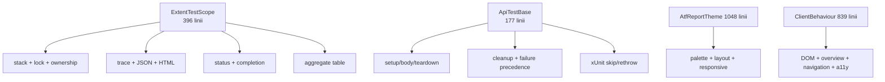
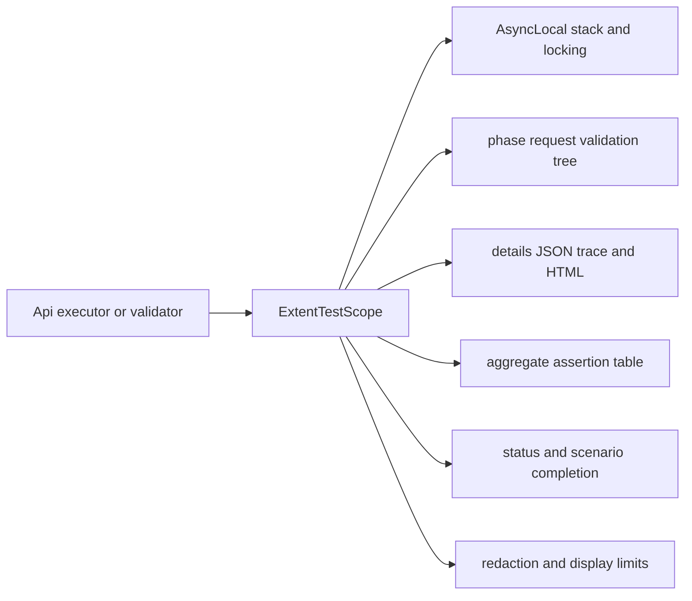
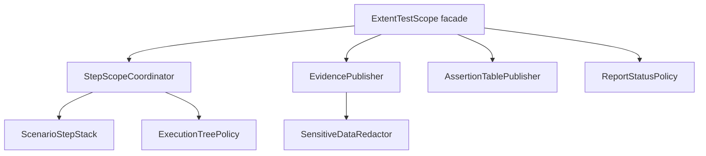
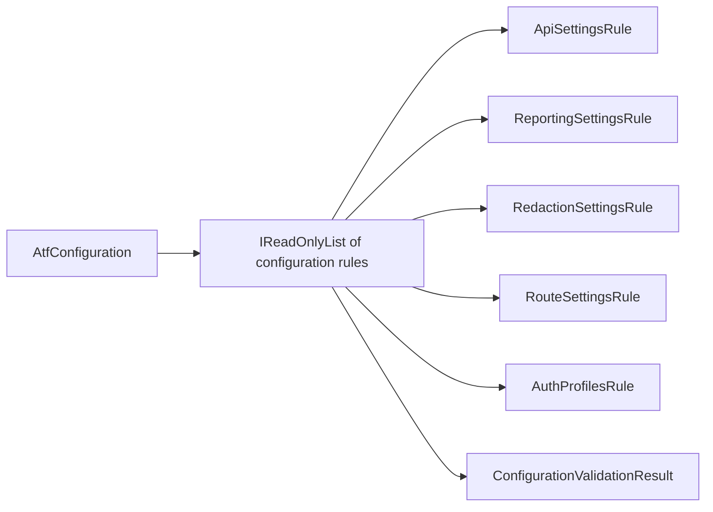
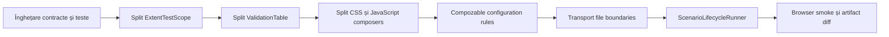
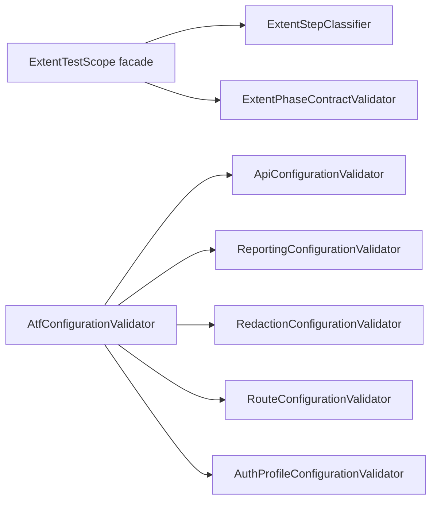

# ATF refactoring assessment and OOP roadmap

Acest document este auditul constructiv al codului ATF live. Scorurile sunt
note de mentenabilitate, nu note pentru faptul că testele trec. Un scor mare
înseamnă responsabilități clare, dependențe controlabile și contracte protejate
prin teste deterministe. Obiectivul este refactorizare fără schimbare de
comportament: același API, aceeași ierarhie de raport, aceleași verdicte și
aceeași politică de securitate.

## Verdict executiv

> **Snapshot 2026-10-13 — audit read-only al codului live.** Dimensiunile
> menționate mai jos sunt măsurători ale fișierelor actuale, nu estimări dintr-un
> raport vechi. În această rundă se modifică doar documentația; niciun cod,
> proiect, test sau comportament de raportare nu este schimbat.

| Zonă | Notă | Feedback agresiv, dar acționabil |
|---|---:|---|
| Direcția dependențelor | 88 | Core nu referă Extent, iar Common și Api urmează direcția corectă. Nu acceptați niciun shortcut de la Core spre renderer. |
| OOP și coeziunea claselor | 58 | Porturile sunt bune, dar lifecycle-ul API și adaptorul Extent încă concentrează prea multe politici într-o singură fațadă. |
| `ExtentTestScope` | 46 | Are **396 de linii** și gestionează stack async, locking, tree policy, status, redaction, HTML, JSON și assertion tables. Numele „scope” ascunde un mini-framework. |
| CSS/tema raportului | 34 | `AtfReportTheme` are **1.048 de linii**. Este cel mai mare risc de regresie vizuală și nu poate fi întreținut elegant prin editări locale. |
| JavaScript-ul raportului | 36 | `ExtentReportClientBehaviour` are **839 de linii** și amestecă DOM discovery, overview, navigare, collapse, accesibilitate și reconciliere de counters. |
| Configurație | 71 | Snapshot-ul și validarea fail-fast sunt corecte, dar modelul rămâne mutabil, cu `Type` și chei libere string-based și reguli greu de compus. |
| Validare și assertions | 61 | Agregarea într-un singur tabel este solidă; `ValidationTable` încă execută checks, acumulează erori, aplică lifecycle și publică evidence. |
| Transport și auth | 73 | Strategiile typed există și porturile sunt injectabile; `ApiTransport.cs` încă grupează fizic trei concepte distincte și lasă auth config-ul string-based. |
| Lifecycle API | 55 | `ApiTestBase` are **177 de linii** și coordonează fixture, module, faze, skip, teardown, cleanup, exception policy și verdict final. Este prea mult pentru un adapter xUnit. |
| Concurență | 62 | `AsyncLocal` plus lock reduc riscul, dar ownership-ul scope-ului Extent, ordinea deterministă și rulările paralele nu au încă un contract suficient de explicit. |
| Testabilitate | 80 | Există porturi, fakes, teste de arbore și inspecție de artifact; lipsesc matricele complete pentru cancellation, parallel isolation, redaction și runner parity. |
| Securitate diagnostică | 71 | Redaction-ul este central și traversează JSON/text/exception, dar `RedactionSettings.Enabled` permite dezactivarea globală fără o protecție de mediu. |
| Documentație | 87 | README-urile au diagrame și contracte reale; riscul rămas este drift-ul dintre documentația istorică, API-ul public și regulile actuale de testare. |
| **Scor general** | **68** | Fundamentul este bun și funcțional, dar nu este încă elegant OOP: reporting-ul, lifecycle-ul și configurarea sunt încă centre de schimbare prea mari. |

### Măsurători care schimbă prioritizarea

`ApiExecutor` are aproximativ 129 de linii și delegă deja evidence-ul în
`ApiExecutionReporter`; nu este primul candidat pentru o rescriere. În schimb,
următoarele trei axe sunt reale și independente:



Feedbackul direct: dacă se extrage întâi `ApiExecutor`, se consumă timp pe o
zonă deja relativ coerentă și se păstrează problema principală. Ordinea corectă
este `ExtentTestScope` → `ApiTestBase` → CSS/JS, cu teste contractuale înaintea
fiecărui split.

## Ce este bun și trebuie păstrat

- `Atf.Core` expune porturi pentru transport, auth și reporting; aceasta este
  direcția corectă pentru OOP și teste offline.
- `ApiExecutor` este un orchestrator relativ clar: execută schimbul HTTP și
  delegă evidence-ul către `ApiExecutionReporter`.
- `ValidationTable` păstrează regula importantă „un response, un tabel
  agregat”. Această regulă trebuie mutată într-un model mai mic, nu eliminată.
- `ReportArtifactInspector` verifică HTML-ul livrat, nu doar obiectele Extent
  din memorie. Aceasta este protecția corectă împotriva diferențelor de
  randare.
- configurația este module-owned, iar `AtfConfigurationValidator` nu mai este
  îngropat în loader. Următorul pas este compoziția regulilor, nu o rescriere a
  configurației.

## Problemele care merită refactorizate primele

### 1. `ExtentTestScope` este un god object

În aceeași clasă coexistă:



Ținta este păstrarea unei fațade mici și injectarea unor colaboratori:



Responsabilitatea fiecăruia trebuie să fie testabilă fără Extent complet:

| Colaborator | Face | Nu face |
|---|---|---|
| `ScenarioStepStack` | push/pop/current și ownership de context async | nu decide status și nu generează HTML |
| `ExecutionTreePolicy` | verifică phase/request/validation și tranzițiile permise | nu scrie CSS/JS |
| `EvidencePublisher` | publică trace, JSON și mesaje safe | nu decide Pass/Fail business |
| `AssertionTablePublisher` | publică exact un tabel agregat | nu coordonează lifecycle-ul fazei |
| `ReportStatusPolicy` | mapează statusurile și precedence-ul | nu manipulează DOM |
| `ExtentTestScope` | păstrează API-ul public și delegă | nu conține reguli de prezentare |

Refactorizarea trebuie făcută incremental: întâi clase interne, apoi teste de
contract, apoi schimbarea constructorului intern. API-ul `IAtfScenarioScope` nu
trebuie rupt.

### 2. Tema CSS și comportamentul JavaScript sunt template monoliths

`AtfReportTheme.BuildCss()` și `ExtentReportClientBehaviour.Build()` sunt fațade
corecte, dar sursa internă trebuie împărțită pe intenții. Un builder cu sute de
linii nu este „OOP” doar pentru că returnează un `string`.

Ținta:

```text
ThemeComposer
├── ThemeTokens
├── BaseSurfaceStyles
├── OverviewStyles
├── ExecutionTreeStyles
├── EvidenceStyles
├── JsonStyles
└── ResponsiveStyles

ClientBehaviourComposer
├── DomRoleDiscovery
├── OverviewCountersBehaviour
├── DisclosureBehaviour
├── ExecutionTreeBehaviour
├── AccessibilityBehaviour
└── ClientScriptComposer
```

Fiecare fragment trebuie să aibă un test care verifică selectorii/rolurile
publice. Compozitorul final doar concatenează fragmentele într-o ordine stabilă.
Nu se schimbă tokenii, culorile, collapse-ul sau numele raportului.

### 3. Configurația are nevoie de reguli compozabile

`AtfConfigurationValidator` este mai bun decât validarea împrăștiată, dar
metodele `ValidateApi`, `ValidateReporting`, `ValidateRedaction`, `ValidateRoutes`
și `ValidateAuthProfiles` rămân o singură unitate de schimbare.

Ținta este:



Fiecare regulă trebuie să producă un diagnostic cu `Code`, `Path` și `Message`.
Excepția finală poate rămâne aceeași pentru compatibilitate, dar testele vor
putea verifica exact regula care a eșuat.

### 4. `ValidationTable` trebuie separată de execuție și reporting

Modelul ar trebui să fie aproape immutable după `Finish`:

```text
ValidationTable              agregă rânduri și rezultat
AssertionPreviewPolicy       aplică limita configurabilă de caractere
ValidationRunner              execută checks și capturează failure-ul
ValidationReportPublisher     transformă rezultatul în IAtfReporter
```

Reguli obligatorii:

- duplicatele și numele goale se validează în model;
- truncarea este o policy pură, nu logică de reporting;
- excepția de business este separată de excepția rendererului;
- `Finish` este idempotent sau refuză explicit a doua finalizare;
- un response produce o singură agregare, indiferent de numărul de checks.

### 5. Transportul trebuie să reflecte obiectele reale

`ApiTransport.cs` amestecă trei concepte:

```text
IApiTransport / HttpClientTransport
IApiAuthenticator / ConfiguredApiAuthenticator
IApiUrlBuilder / ApiUrlBuilder
```

Separarea fizică în fișiere și namespace-uri clare este un refactor mic, cu
risc redus. După aceea auth strategies pot fi testate fără a construi
`HttpClient`, iar URL builder-ul poate avea teste complet independente.

### 6. `ApiTestBase` trebuie redus la compoziție și delegare

Clasa de bază nu ar trebui să știe toate politicile de skip, teardown și
finalizare. Ținta este un `ApiScenarioRunner` injectabil cu:

```text
ScenarioLifecycleRunner
├── PhaseRunner
├── ScenarioFailurePolicy
├── CleanupCoordinator
└── ScenarioReportFinalizer
```

`ApiTestBase` rămâne un adapter xUnit subțire care furnizează fixture-ul și
apelează runnerul. Astfel testele pot verifica lifecycle-ul fără să moștenească
o clasă de test și fără să pornească raportarea reală.

## Reguli de refactorizare fără regresie

1. Un refactor nu schimbă numele raportului, statusurile, tokenii CSS,
   contractul `request + validation sibling` sau limitele de display.
2. Orice clasă nouă are un singur motiv dominant de schimbare și maximum opt
   tipuri top-level directe în pachetul proprietar.
3. Orice colaborator nou este testat printr-un contract determinist înainte să
   fie conectat în composition root.
4. Fațadele publice rămân stabile; split-ul începe prin clase interne și
   interfețe private/internal unde este suficient.
5. Nu se mută reguli în HTML/JavaScript doar pentru că sunt mai ușor de scris
   acolo. Structura și invariants rămân validate în C#.
6. Nu se adaugă adnotări generice de tip `framework`. O adnotare este permisă
   numai dacă schimbă o politică observabilă și are test dedicat.
7. Orice schimbare de reporting cere două dovezi: test structural al arborelui
   Extent și inspecție a HTML-ului final.

## Matrice minimă de teste după refactor

| Componentă | Teste obligatorii |
|---|---|
| `ScenarioStepStack` | nesting valid, pop în ordine, context async separat, dispose repetat |
| `ExecutionTreePolicy` | phase sibling, request + validation sibling, request fără validation respins la final |
| `EvidencePublisher` | redaction în trace/JSON/excepție, renderer failure nu schimbă rezultatul HTTP |
| `AssertionTablePublisher` | un singur tabel, limită de caractere, zero assertions, failure rows |
| configuration rules | fiecare regulă izolată, multiple diagnostics, path/code stabil |
| `ThemeComposer` | token dark unic, fonturi, JSON surface, selectors fără duplicate contradictorii |
| `ClientBehaviourComposer` | collapse implicit, roluri DOM, counters, zero page horizontal overflow |
| `ReportAssetCleaner` | folder lipsă, retry, file lock, rulări paralele fără ștergerea folderului altui raport |
| `ScenarioLifecycleRunner` | setup/body/teardown, skip, failure în body, failure în teardown, cleanup reverse-order |

## Ordinea recomandată



Prima etapă nu trebuie să înceapă prin rescrierea tuturor claselor. Începe cu
teste care fixează comportamentul deja dorit, apoi extrage colaboratori fără să
schimbe output-ul. Dacă un diff de HTML apare fără o cerință explicită, refactorul
se oprește și se investighează.

## Decizia și rezultatul rundei curente

Runda curentă a implementat primul increment cu risc redus, fără schimbare de
contract public sau de output:



- `ExtentTestScope` deleagă clasificarea și contractul request → validation către
  colaboratori existenți, eliminând logica duplicată din scope;
- validatorul de configurație este acum un coordonator, iar regulile API,
  reporting, redaction, routes și auth sunt tipuri interne cu responsabilitate
  unică;
- `ConfigurationRuleTests` verifică fiecare boundary, iar
  `ExtentStepClassifierTests` fixează clasificarea folosită de arbore;
- mesajele, ordinea validării, statusurile și fațadele publice rămân neschimbate.

Verificarea se face incremental în `C:\work\ex\.net\.tmp\`, pe o copie izolată
a repository-ului, pentru a nu opri rulările active. Următorul increment cu risc
acceptabil este separarea `ExtentReportClientBehaviour` și `AtfReportTheme` în
compozitori mici, numai după teste de snapshot/DOM și fără redenumirea
artifactului.

