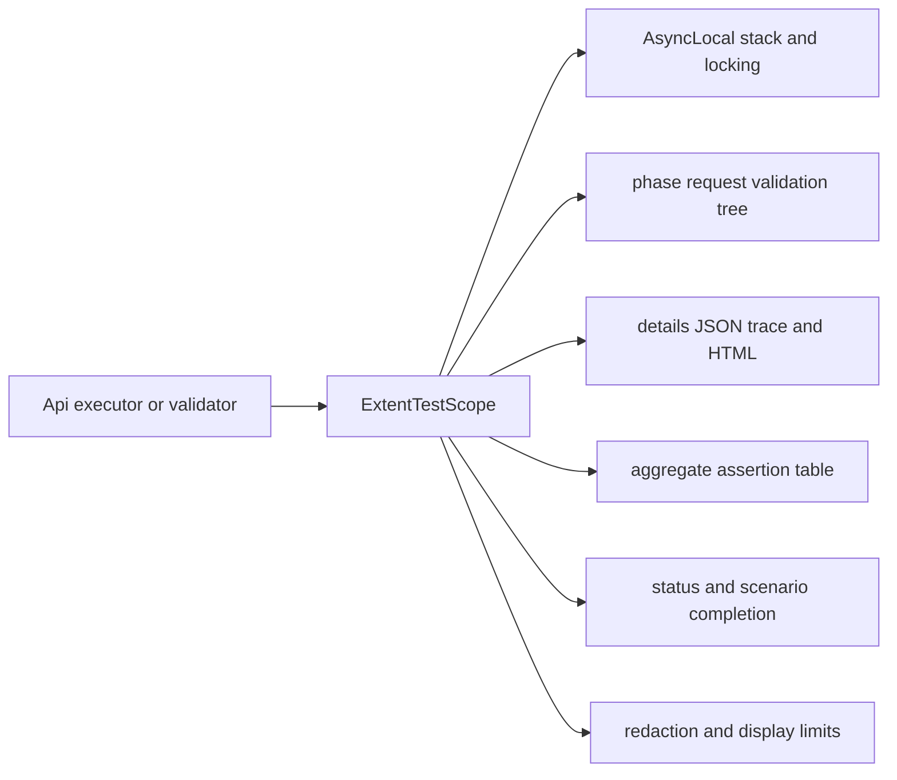
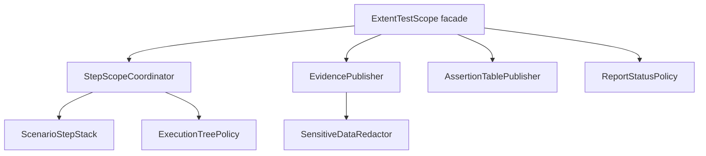
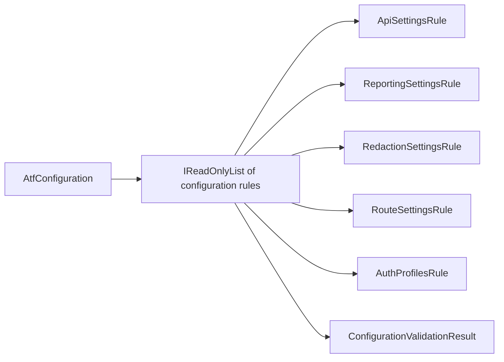
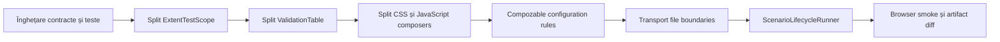

# ATF refactoring assessment and OOP roadmap

Acest document este auditul constructiv al codului ATF live. Scorurile sunt
note de mentenabilitate, nu note pentru faptul că testele trec. Un scor mare
înseamnă responsabilități clare, dependențe controlabile și contracte protejate
prin teste deterministe. Obiectivul este refactorizare fără schimbare de
comportament: același API, aceeași ierarhie de raport, aceleași verdicte și
aceeași politică de securitate.

## Verdict executiv

| Zonă | Notă | Feedback agresiv, dar acționabil |
|---|---:|---|
| Direcția dependențelor | 86 | Core/Common/Api sunt bine separate; orice nouă referință din Core spre Extent ar fi regresie arhitecturală. |
| OOP și coeziunea claselor | 48 | Există interfețe bune, dar câteva clase coordonează simultan stare, reguli, randare și lifecycle. Sunt „god objects” în devenire. |
| `ExtentTestScope` | 42 | Gestionează stack-ul, sincronizarea, lifecycle-ul, statusul, redaction-ul, HTML-ul, JSON-ul și tabelele de assertions. Nu mai este un scope; este un mini-framework. |
| CSS/tema raportului | 35 | `AtfReportTheme` are aproximativ 892 de linii într-un singur builder. Un token schimbat cere navigarea unui șablon monolitic și crește riscul de regresie vizuală. |
| JavaScript-ul raportului | 38 | `ExtentReportClientBehaviour` are aproximativ 619 linii și amestecă discovery DOM, overview, navigare, collapse, accesibilitate și reconciliere de counters. |
| Configurație | 68 | Validatorul a fost separat, dar încă verifică mai multe subdomenii într-o singură unitate statică. Regulile sunt greu de compus și de raportat granular. |
| Validare și assertions | 54 | `ValidationTable` este o idee corectă, dar amestecă modelul tabelar, truncarea, excepțiile, execuția și publicarea în report. |
| Transport și auth | 62 | Porturile sunt bune, însă `ApiTransport.cs` conține URL building, auth și transport concret în același fișier/conceptual boundary. |
| Lifecycle API | 58 | `ApiTestBase` coordonează fixture, module, setup/body/teardown, skip, excepții și finalizarea raportului. E prea mult pentru o clasă de bază. |
| Concurență | 59 | `AsyncLocal` și lock-ul protejează o parte din stare, dar contractul de ownership și cleanup concurent trebuie făcut explicit și testat. |
| Testabilitate | 73 | Există porturi și teste bune; lipsesc teste contractuale pentru fiecare nou colaborator după split și teste de concurență/cancellation. |
| Documentație | 76 | Există diagrame și reguli utile, dar ierarhia request/validation a fost descrisă inconsistent în mai multe README-uri. |
| **Scor general** | **58** | Fundament bun, dar reporting-ul și lifecycle-ul sunt prea centralizate pentru o evoluție elegantă. Refactorizarea trebuie să înceapă acolo. |

## Ce este bun și trebuie păstrat

- `Atf.Core` expune porturi pentru transport, auth și reporting; aceasta este
  direcția corectă pentru OOP și teste offline.
- `ApiExecutor` este un orchestrator relativ clar: execută schimbul HTTP și
  delegă evidence-ul către `ApiExecutionReporter`.
- `ValidationTable` păstrează regula importantă „un response, un tabel
  agregat”. Această regulă trebuie mutată într-un model mai mic, nu eliminată.
- `ReportArtifactInspector` verifică HTML-ul livrat, nu doar obiectele Extent
  din memorie. Aceasta este protecția corectă împotriva diferențelor de
  randare.
- configurația este module-owned, iar `AtfConfigurationValidator` nu mai este
  îngropat în loader. Următorul pas este compoziția regulilor, nu o rescriere a
  configurației.

## Problemele care merită refactorizate primele

### 1. `ExtentTestScope` este un god object

În aceeași clasă coexistă:



Ținta este păstrarea unei fațade mici și injectarea unor colaboratori:



Responsabilitatea fiecăruia trebuie să fie testabilă fără Extent complet:

| Colaborator | Face | Nu face |
|---|---|---|
| `ScenarioStepStack` | push/pop/current și ownership de context async | nu decide status și nu generează HTML |
| `ExecutionTreePolicy` | verifică phase/request/validation și tranzițiile permise | nu scrie CSS/JS |
| `EvidencePublisher` | publică trace, JSON și mesaje safe | nu decide Pass/Fail business |
| `AssertionTablePublisher` | publică exact un tabel agregat | nu coordonează lifecycle-ul fazei |
| `ReportStatusPolicy` | mapează statusurile și precedence-ul | nu manipulează DOM |
| `ExtentTestScope` | păstrează API-ul public și delegă | nu conține reguli de prezentare |

Refactorizarea trebuie făcută incremental: întâi clase interne, apoi teste de
contract, apoi schimbarea constructorului intern. API-ul `IAtfScenarioScope` nu
trebuie rupt.

### 2. Tema CSS și comportamentul JavaScript sunt template monoliths

`AtfReportTheme.BuildCss()` și `ExtentReportClientBehaviour.Build()` sunt fațade
corecte, dar sursa internă trebuie împărțită pe intenții. Un builder cu sute de
linii nu este „OOP” doar pentru că returnează un `string`.

Ținta:

```text
ThemeComposer
├── ThemeTokens
├── BaseSurfaceStyles
├── OverviewStyles
├── ExecutionTreeStyles
├── EvidenceStyles
├── JsonStyles
└── ResponsiveStyles

ClientBehaviourComposer
├── DomRoleDiscovery
├── OverviewCountersBehaviour
├── DisclosureBehaviour
├── ExecutionTreeBehaviour
├── AccessibilityBehaviour
└── ClientScriptComposer
```

Fiecare fragment trebuie să aibă un test care verifică selectorii/rolurile
publice. Compozitorul final doar concatenează fragmentele într-o ordine stabilă.
Nu se schimbă tokenii, culorile, collapse-ul sau numele raportului.

### 3. Configurația are nevoie de reguli compozabile

`AtfConfigurationValidator` este mai bun decât validarea împrăștiată, dar
metodele `ValidateApi`, `ValidateReporting`, `ValidateRedaction`, `ValidateRoutes`
și `ValidateAuthProfiles` rămân o singură unitate de schimbare.

Ținta este:



Fiecare regulă trebuie să producă un diagnostic cu `Code`, `Path` și `Message`.
Excepția finală poate rămâne aceeași pentru compatibilitate, dar testele vor
putea verifica exact regula care a eșuat.

### 4. `ValidationTable` trebuie separată de execuție și reporting

Modelul ar trebui să fie aproape immutable după `Finish`:

```text
ValidationTable              agregă rânduri și rezultat
AssertionPreviewPolicy       aplică limita configurabilă de caractere
ValidationRunner              execută checks și capturează failure-ul
ValidationReportPublisher     transformă rezultatul în IAtfReporter
```

Reguli obligatorii:

- duplicatele și numele goale se validează în model;
- truncarea este o policy pură, nu logică de reporting;
- excepția de business este separată de excepția rendererului;
- `Finish` este idempotent sau refuză explicit a doua finalizare;
- un response produce o singură agregare, indiferent de numărul de checks.

### 5. Transportul trebuie să reflecte obiectele reale

`ApiTransport.cs` amestecă trei concepte:

```text
IApiTransport / HttpClientTransport
IApiAuthenticator / ConfiguredApiAuthenticator
IApiUrlBuilder / ApiUrlBuilder
```

Separarea fizică în fișiere și namespace-uri clare este un refactor mic, cu
risc redus. După aceea auth strategies pot fi testate fără a construi
`HttpClient`, iar URL builder-ul poate avea teste complet independente.

### 6. `ApiTestBase` trebuie redus la compoziție și delegare

Clasa de bază nu ar trebui să știe toate politicile de skip, teardown și
finalizare. Ținta este un `ApiScenarioRunner` injectabil cu:

```text
ScenarioLifecycleRunner
├── PhaseRunner
├── ScenarioFailurePolicy
├── CleanupCoordinator
└── ScenarioReportFinalizer
```

`ApiTestBase` rămâne un adapter xUnit subțire care furnizează fixture-ul și
apelează runnerul. Astfel testele pot verifica lifecycle-ul fără să moștenească
o clasă de test și fără să pornească raportarea reală.

## Reguli de refactorizare fără regresie

1. Un refactor nu schimbă numele raportului, statusurile, tokenii CSS,
   contractul `request + validation sibling` sau limitele de display.
2. Orice clasă nouă are un singur motiv dominant de schimbare și maximum opt
   tipuri top-level directe în pachetul proprietar.
3. Orice colaborator nou este testat printr-un contract determinist înainte să
   fie conectat în composition root.
4. Fațadele publice rămân stabile; split-ul începe prin clase interne și
   interfețe private/internal unde este suficient.
5. Nu se mută reguli în HTML/JavaScript doar pentru că sunt mai ușor de scris
   acolo. Structura și invariants rămân validate în C#.
6. Nu se adaugă adnotări generice de tip `framework`. O adnotare este permisă
   numai dacă schimbă o politică observabilă și are test dedicat.
7. Orice schimbare de reporting cere două dovezi: test structural al arborelui
   Extent și inspecție a HTML-ului final.

## Matrice minimă de teste după refactor

| Componentă | Teste obligatorii |
|---|---|
| `ScenarioStepStack` | nesting valid, pop în ordine, context async separat, dispose repetat |
| `ExecutionTreePolicy` | phase sibling, request + validation sibling, request fără validation respins la final |
| `EvidencePublisher` | redaction în trace/JSON/excepție, renderer failure nu schimbă rezultatul HTTP |
| `AssertionTablePublisher` | un singur tabel, limită de caractere, zero assertions, failure rows |
| configuration rules | fiecare regulă izolată, multiple diagnostics, path/code stabil |
| `ThemeComposer` | token dark unic, fonturi, JSON surface, selectors fără duplicate contradictorii |
| `ClientBehaviourComposer` | collapse implicit, roluri DOM, counters, zero page horizontal overflow |
| `ReportAssetCleaner` | folder lipsă, retry, file lock, rulări paralele fără ștergerea folderului altui raport |
| `ScenarioLifecycleRunner` | setup/body/teardown, skip, failure în body, failure în teardown, cleanup reverse-order |

## Ordinea recomandată



Prima etapă nu trebuie să înceapă prin rescrierea tuturor claselor. Începe cu
teste care fixează comportamentul deja dorit, apoi extrage colaboratori fără să
schimbe output-ul. Dacă un diff de HTML apare fără o cerință explicită, refactorul
se oprește și se investighează.

## Decizia pentru această rundă

Această rundă documentează și prioritizează refactorizarea; nu introduce schimbări
de runtime speculative într-un working tree modificat concurent. Implementarea
codului trebuie făcută pe pași mici, fiecare sincronizat în live ATF și verificat
în `C:\work\ex\.net\.tmp\`, pentru a nu opri rulările active și pentru a nu
confunda un build cu o validare de comportament.

