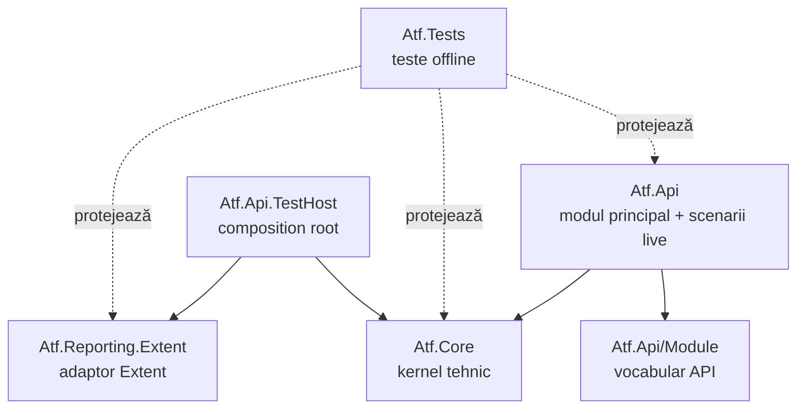

# ATF — documentație

`Atf.Api` este modulul principal al ATF-ului: conține vocabularul modulului în
`Atf.Api/Module` și scenariile API live. `Atf.Core` este kernelul tehnic
renderer-neutral, iar restul proiectelor sunt boundary-uri specializate.

## Harta documentației

| Document | Scop |
|---|---|
| [`ATF_Architecture.md`](ATF_Architecture.md) | ownership, dependențe și reguli de extindere |
| [`ATF_Reporting_Contract.md`](ATF_Reporting_Contract.md) | contractele observabile ale artifactului |
| [`README_Atf_BestPractices.md`](README_Atf_BestPractices.md) | reguli OOP, SRP, teste, lifecycle și adnotări |
| [`ATF_Quality_Assessment.md`](ATF_Quality_Assessment.md) | analiză de calitate și criterii de hardening |
| [`ATF_Refactoring_Assessment.md`](ATF_Refactoring_Assessment.md) | analiză arhitecturală extinsă și direcții de refactorizare |
| [`feedback/README.md`](feedback/README.md) | backlog activ, contracte și dovadă de test |

`ATF_LIFECYCLE_COMBINATION_ANALYSIS_2026-10-13.md` rămâne documentul separat
pentru formatul raportului și nu este gestionat de registrul de feedback intern.

## Reguli de mentenanță

1. Documentația descrie contracte și ownership, nu păstrează note numerice.
2. Orice schimbare de cod care modifică responsabilitatea unui modul actualizează
   README-ul modulului și contractul relevant.
3. Un finding de feedback trebuie să aibă owner, seam, test și Definition of Done.
4. Nu se introduce un director principal nou dacă responsabilitatea aparține lui
   `Atf.Api`, `Atf.Core`, `Atf.Api.TestHost`, `Atf.Reporting.Extent` sau `Atf.Tests`.
5. Formatul raportului se schimbă numai prin documentul și procesul lui dedicat.
