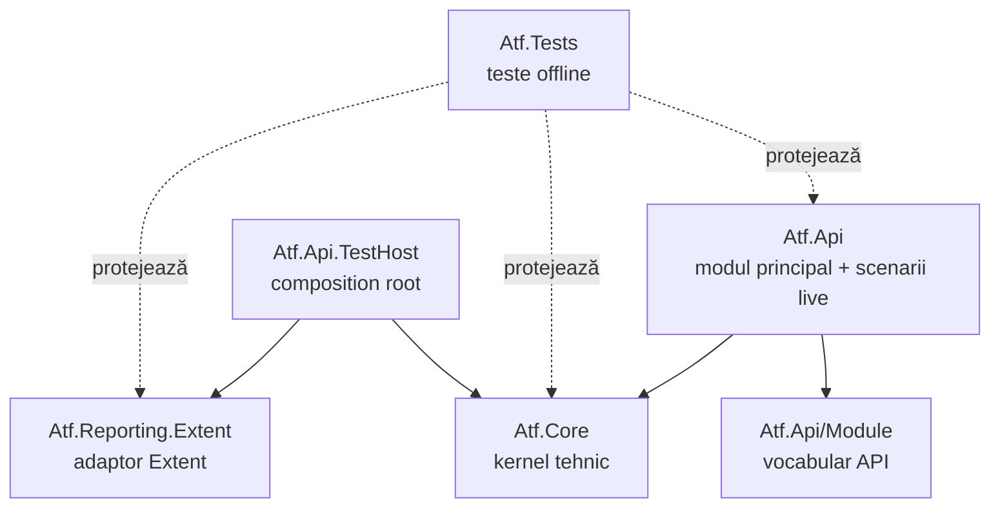

# ATF — documentație

`Atf.Api` este modulul principal al ATF-ului: conține vocabularul modulului în
`Atf.Api/Module` și scenariile API live. `Atf.Core` este kernelul tehnic
renderer-neutral, iar restul proiectelor sunt boundary-uri specializate.

## Harta documentației

| Document | Scop |
|---|---|
| [`ATF_Architecture.md`](ATF_Architecture.md) | ownership, dependențe și reguli de extindere |
| [`ATF_Reporting_Contract.md`](ATF_Reporting_Contract.md) | contractele observabile ale artifactului |
| [`README_Atf_BestPractices.md`](README_Atf_BestPractices.md) | reguli OOP, SRP, teste, lifecycle și adnotări |
| [`ATF_API_TEST_GUIDE.md`](ATF_API_TEST_GUIDE.md) | pașii compleți pentru adăugarea, testarea și validarea unui test API |
| [`Atf_Lifecycle_Combination.md`](feedback/Atf_Lifecycle_Combination.md) | registru separat pentru lifecycle, statusuri, assertions și raportare |
| [`Atf_Refactoring_Feedback.md`](feedback/Atf_Refactoring_Feedback.md) | RF-02–RF-06 închise: OOP, boundary-uri, ownership, navigare și cleanup |
| [`Atf_Feedback_Execution_Guide.md`](feedback/Atf_Feedback_Execution_Guide.md) | procedura obligatorie și gateway-urile de rezolvare |
| [`feedback/README.md`](feedback/README.md) | backlog, contracte și dovezi de test |

`docs/feedback/` păstrează registrele de feedback, procedura și dovada închiderii.
Documentul lifecycle este păstrat separat și nu face parte din această rundă.
Contractul permanent al raportului rămâne în `ATF_Reporting_Contract.md`;
documentele din feedback nu îl dublează și nu păstrează rezultate temporare.

## Reguli de mentenanță

1. Documentația descrie contracte și ownership, nu păstrează note numerice.
2. Orice schimbare de cod care modifică responsabilitatea unui modul actualizează
   README-ul modulului și contractul relevant.
3. Un finding de feedback trebuie să aibă owner, seam, test și criteriu de finalizare.
4. Nu se introduce un director principal nou dacă responsabilitatea aparține lui
   `Atf.Api`, `Atf.Core`, `Atf.Api.TestHost`, `Atf.Reporting.Extent` sau `Atf.Tests`.
5. Formatul raportului se schimbă numai prin documentul și procesul lui dedicat.
