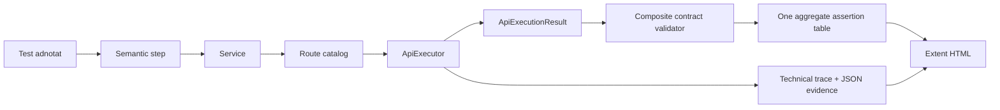
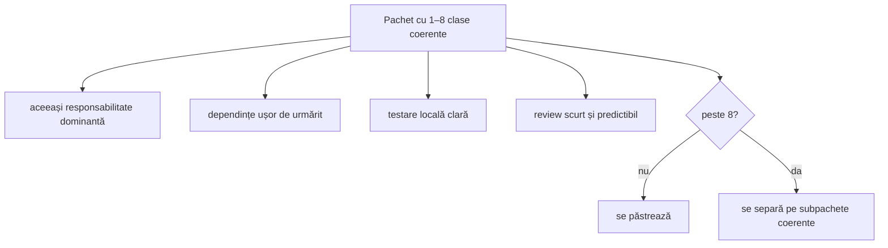
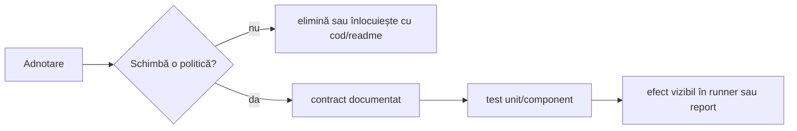
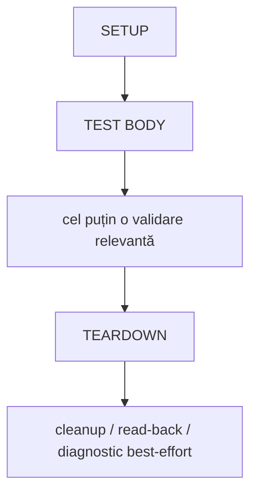
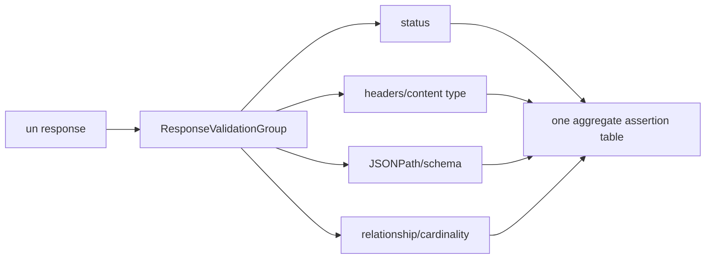
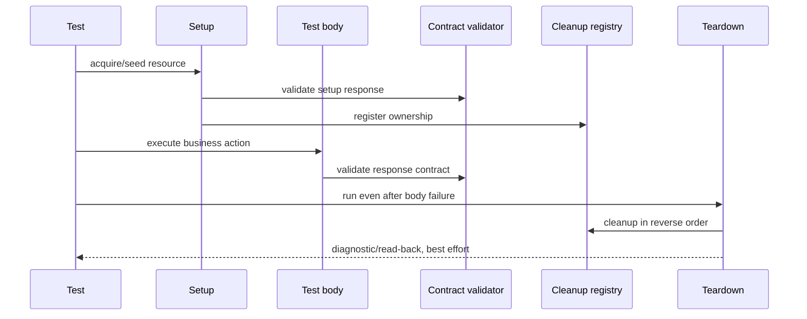
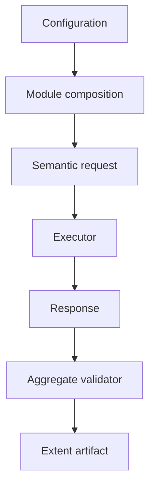

# ATF — bune practici de design, testare și raportare

Acest document este normativ pentru evoluția ATF-ului. Nu este o colecție de
preferințe de stil: regulile de mai jos definesc ce înseamnă un test lizibil,
un modul coerent, o validare credibilă și un raport util la triage.

Scopul este să păstrăm funcționalitatea existentă, dar să facem codul mai
OOP, mai ușor de extins și mai ușor de verificat fără rulări live inutile.

## 1. Modelul mental al unui test ATF

Un scenariu trebuie să exprime intenția de business. Detaliile tehnice rămân
în modulele de compoziție, servicii, executor, validatori și reporter.



Regula de citire este:

```text
test intent -> domain action -> one HTTP exchange -> one response contract -> one table
```

Un test care descrie direct `HttpClient`, string-uri de endpoint, markup Extent
și cinci assert-uri dispersate nu mai este un test de domeniu; a devenit o a
doua implementare a framework-ului în interiorul scenariului.

## 2. Reguli obligatorii

### 2.1 O clasă, o responsabilitate clară

O clasă trebuie să aibă un motiv principal pentru a se schimba. Dacă aceeași
schimbare cere modificarea transportului, a raportării și a validării în aceeași
clasă, responsabilitățile sunt amestecate.

| Responsabilitate | Componentă potrivită | Nu trebuie să facă |
|---|---|---|
| compunerea obiectelor | `ApiModule` | să execute HTTP sau să decidă verdictul |
| execuția unui exchange | `ApiExecutor` | să cunoască reguli de business |
| I/O HTTP | `IApiTransport` / adapter | să creeze noduri Extent |
| aplicarea autentificării | `IApiAuthenticator` | să afișeze token-ul |
| descrierea rutelor | `ApiRoutes` / `ApiRoute` | să construiască raportul |
| acțiune semantică | `UsersSteps`, `PostsSteps` | să duplice URL-uri |
| contractul răspunsului | `ContractValidators` | să trimită request-ul |
| agregarea observațiilor | `ResponseValidationGroup` / `ValidationTable` | să decidă layout-ul HTML |
| evidence tehnic | `ApiExecutionReporter` | să declare că business-ul a trecut |
| cleanup | `CleanupRegistry` | să înlocuiască validarea din body |
| stylesheet / HTML | reporting theme/renderer | să schimbe verdictul testului |

Semnal de refactorizare: o metodă cu `await`, `Assert`, `HttpClient` și
`Extent` în aceeași zonă este aproape întotdeauna prea încărcată.

### 2.2 Maximum 8 clase top-level într-un pachet

Un namespace/pachet nu trebuie să aibă mai mult de opt tipuri top-level directe.
Limita controlează responsabilitatea și navigarea; nu este un motiv pentru a
fragmenta artificial fiecare clasă în propriul proiect.



Nu se rezolvă depășirea limitei prin nume artificiale, clase goale sau mutarea
aleatorie a fișierelor. Se identifică axele reale de schimbare, de exemplu:

```text
Atf.Core.Http
  -> contracte și request-uri
Atf.Core.Http.Execution
  -> orchestration, retry și execution evidence
Atf.Core.Http.Transport
  -> transport și auth adapters
Atf.Core.Reporting
  -> lifecycle, evidence, theme și artifact inspection
```

Tipurile private/nested folosite doar ca test doubles nu se numără ca membri
publici ai pachetului; ele rămân detalii ale testului care le folosește.

Într-un boundary cu mai multe axe de schimbare se preferă un coordonator mic și
reguli cu responsabilitate unică. De exemplu, `AtfConfigurationValidator` nu
validează direct toate secțiunile: deleagă către `ApiConfigurationValidator`,
`ReportingConfigurationValidator`, `RedactionConfigurationValidator`,
`RouteConfigurationValidator` și `AuthProfileConfigurationValidator`. Regula
este verificată prin teste unitare pe fiecare boundary, nu doar printr-un test
end-to-end al loaderului. Același principiu se aplică în reporting:
`ExtentTestScope` coordonează, `ExtentStepClassifier` clasifică, iar
`ExtentPhaseContractValidator` impune arborele request → validation sibling.

### 2.3 Adnotările trebuie să aibă efect observabil

O adnotare generică precum `Framework`, `ApiTest` sau `TestCase` nu justifică
existența sa doar pentru că sună organizat. Se păstrează numai dacă schimbă în
mod documentat cel puțin una dintre aceste politici:

- filtrarea sau categorisirea testului;
- compunerea modulelor sau fixture-ului;
- setup/teardown ori ownership-ul cleanup-ului;
- autentificarea, retry-ul, timeout-ul sau politica de execuție;
- numele/metadata-ul afișat în raport;
- inventarul de teste sau reconcilierea runner/report;
- selectarea unui contract/schema/validator;
- skip-ul condiționat, cu motiv vizibil.



Regulă de review:

```text
Pentru fiecare adnotare trebuie să putem răspunde în 10 secunde:
1. cine o citește?
2. ce comportament schimbă?
3. unde este testat efectul?
```

Dacă răspunsul este „doar marchează că acesta este un framework test”,
adnotarea nu adaugă informație. Categoria, numele proiectului și README-ul
sunt suficiente. În mod explicit, tag-ul `framework` și variantele sale
(`Framework`, `[Framework]`, `[Trait("Category", "Framework")]`) sunt interzise
în scenarii, configurație și raportare. Identitatea proiectului de test și
namespace-ul spun deja că testăm ATF-ul; tag-ul trebuie să aducă o informație
operațională suplimentară.

Exemple:

| Situație | Decizie | Motiv |
|---|---|---|
| `framework` / `Framework` | interzis | duplică proiectul și nu schimbă comportamentul |
| `smoke` | permis | permite filtrarea unei suite rapide și stabile |
| `lifecycle` | permis | descrie forma execuției și navigarea raportului |
| `negative` / `auth` / `contract` | permis | descrie intenția verificată |

Regula este protejată de `AnnotationPolicyTests`: dacă tag-ul generic reapare
în scenariile API sau în ordinea de tag-uri, testele de arhitectură eșuează.
Adnotările utile trebuie să fie rare, semantice și stabile.

### 2.4 Un test API adnotat trebuie să se încheie cu cel puțin o validare

Un test de API nu este complet dacă doar execută request-ul și termină cu
`Pass`. Body-ul trebuie să conțină cel puțin o validare funcțională sau de
contract care se referă la rezultatul acțiunii testate.



Sunt acceptate în `TEARDOWN`:

- ștergerea resurselor create;
- read-back de confirmare a cleanup-ului;
- colectarea unui diagnostic suplimentar;
- eliberarea resurselor chiar după un failure.

Nu este acceptat ca teardown-ul să fie singura dovadă că acțiunea principală a
funcționat. Read-back-ul de cleanup nu înlocuiește validarea din body.

Excepții explicite și documentate:

- testele intenționat negative care validează o excepție sau un failure;
- testele de infrastructură care verifică o politică înainte să existe un
  response contract;
- testele de lifecycle care verifică strict că teardown-ul se execută după
  failure.

Chiar și aceste excepții trebuie să aibă un verdict observabil și o explicație
în numele testului sau în documentație. Un simplu `Assert.True(true)` nu este
validare și nu este permis.

### 2.5 O singură masă agregată pentru același response

Pentru un response, statusul, content type-ul, schema, JSONPath-urile și
relațiile trebuie grupate într-un singur contract validator și într-o singură
masă de assertions.



Exemplu recomandat:

```csharp
ContractValidators.UserItem(reporter, response);
```

sau, când contractul este local scenariului:

```csharp
ApiAssertions.Contract(reporter, response, "Validate: user item contract", contract => contract
    .Status(HttpStatusCode.OK)
    .ContentTypeContains("application/json")
    .JsonSchema("Schemas/user.schema.json")
    .JsonPathExists("$.id"));
```

Nu este recomandat:

```csharp
ApiAssertions.Status(reporter, response, HttpStatusCode.OK);
ApiAssertions.ContentType(reporter, response, "application/json");
JsonAssertions.Exists(reporter, response, "$.id");
```

Cele trei verificări sunt corecte semantic, dar produc evidence fragmentată și
îl obligă pe cititor să reconstruiască un singur contract din mai multe noduri.
Separă mesele doar când există responses diferite sau o limită reală de
contract: de exemplu request-ul de creare și request-ul ulterior de read-back.

### 2.6 Request-ul deține validarea response-ului

Raportul trebuie să fie lizibil ca structură:

```text
TEST BODY
└── GET /users
    ├── TECHNICAL TRACE
    ├── RESPONSE JSON
    └── Validate: user collection contract
        └── ASSERTION TABLE
```

Executorul publică trace-ul și payload-urile pe request și păstrează requestul
activ până când validatorul își publică evidence-ul. Validatorul deschide un
un sibling direct după request și își închide propriul nod după tabelul
agregat. Această regulă este contractul normativ al
ATF-ului și previne validări afișate sub fază greșită sau atașate unui request
greșit.

```text
phase
└── HTTP request
    ├── TECHNICAL TRACE
    ├── REQUEST / RESPONSE JSON
    └── Validate: contract
        └── ASSERTION TABLE
```

### 2.7 Scenariile nu controlează infrastructura

Scenariile nu trebuie să:

- construiască `HttpClient` sau `HttpRequestMessage` direct;
- manipuleze markup Extent/CSS/HTML;
- repete URL-uri și politici de autentificare;
- decidă local cum se agregă statusul testului;
- ascundă token-uri în string-uri de diagnostic;
- folosească state static mutabil între scenarii.

Compoziția se face într-un module root, iar dependențele sunt injectate sau
înlocuite cu fakes în teste.

### 2.8 State-ul este explicit și per scenariu

Datele create în setup se înregistrează în `ApiScenarioContext` sau
`CleanupRegistry`, nu în câmpuri statice și nu în variabile globale ascunse.
Contextul trebuie să facă vizibile:

```text
resource ownership -> cleanup action -> reverse-order teardown
```

În viitor, un `ScenarioValueBag` tipizat poate centraliza valorile dinamice;
până atunci, orice valoare trebuie să aibă un owner clar și un test pentru
failure în setup/body/teardown.

### 2.9 Numele și metadata trebuie să ajute triage-ul

Numele testului, route metadata, tag-urile și operation type trebuie să răspundă
rapid la întrebările „ce request a eșuat?”, „ce contract verificam?” și „ce
politică de auth s-a folosit?”. Nu adăugăm timestamp-uri în identitatea logică a
testului și nu folosim tag-uri generice care nu permit filtrare sau navigare.

## 3. Lifecycle recomandat pentru un scenariu



Checklist pentru fiecare test API:

- setup-ul pregătește doar ce este necesar;
- fiecare response important are un validator agregat;
- test body-ul se încheie cu minimum o validare relevantă;
- cleanup-ul este înregistrat imediat după dobândirea ownership-ului;
- teardown-ul eliberează resurse și nu maschează verdictul primar;
- numele și tag-urile descriu intenția, nu implementarea internă;
- nodurile raportului sunt collapsed by default, dar pot fi expandate fără
  pierderea contextului.

## 4. Contracte pentru documentație și diagrame

### Sursa de adevăr

Pentru a evita reguli contradictorii, documentația are următoarele roluri:

| Document | Rol |
|---|---|
| root `README.md` | onboarding, navigare și contracte principale |
| `docs/ATF_Architecture.md` | modelul de obiecte și dependențe |
| `docs/README_Atf_BestPractices.md` | reguli normative de design, testare și review |
| `docs/ATF_Quality_Assessment.md` | scoruri, riscuri și backlog; nu redefinește ierarhia |
| module/test README-uri | ghiduri locale, fără reguli care contrazic documentul normativ |

Ierarhia curentă care trebuie folosită în toate README-urile este:

```text
    scenario → SETUP / TEST BODY / TEARDOWN → request + validation sibling
request → technical trace + JSON evidence
validation sibling → one aggregate assertion table
```

Toate README-urile trebuie să descrie validarea ca „validation sibling”; formularea „validation child” este
depășită și trebuie corectată la modelul phase-sibling: validarea este următorul
frate direct al requestului, iar faza rămâne proprietara ordinii lifecycle.

Fiecare modul public trebuie să aibă un README care răspunde clar la:

1. ce responsabilitate deține modulul;
2. ce nu deține;
3. care sunt dependențele și direcția lor;
4. care sunt contractele publice;
5. cum se înlocuiește infrastructura în unit tests;
6. cum arată un flux normal și unul de failure;
7. ce se vede în raport;
8. ce invariants nu trebuie rupte.

Diagrama minimă recomandată:



O diagramă este utilă numai dacă reflectă obiectele reale. La fiecare refactor,
README-ul și diagramele trebuie actualizate împreună cu contractele și testele.

### Contract de mentenanță pentru diagrame

Pentru fiecare diagramă nouă sau modificată:

1. se identifică owner-ul: arhitectură, modul, testare sau raportare;
2. se verifică termenii față de contractul normativ de mai sus;
3. se păstrează o reprezentare text când Mermaid nu este randat;
4. se evită simboluri Mermaid ambigue în label-uri, în special `|`, `<`, `>` și
   paranteze nequotate;
5. se verifică faptul că diagrama nu introduce clase sau fluxuri inexistente;
6. se actualizează aceeași schimbare în README-ul local și în checklist-ul de
   acceptare, fără a copia statistici volatile.

O diagramă veche care contrazice codul nu este „context istoric” dacă este
prezentată fără avertisment; trebuie corectată sau marcată explicit ca istorică.

## 5. Reguli de testare a framework-ului

| Nivel | Ce verifică | Ce nu verifică |
|---|---|---|
| unit | funcții pure, config, route building, retry, aggregation | integrarea reală a mai multor componente |
| component | executor + fake transport/reporter, module composition, cleanup | disponibilitatea API-ului real |
| artifact | HTML real, collapsed state, tabel, JSON scroll, theme, overflow | business behavior al serviciului |
| live API | endpoint, auth, schema și business contract real | toate ramurile interne ale framework-ului |
| browser/manual | click path, ordine vizuală, lizibilitate | dovada repetabilă a logicii interne |

Orice bug de raportare trebuie să primească:

1. test unit pentru regula locală;
2. test component pentru arborele Extent;
3. test artifact/browser pentru HTML-ul pe care îl deschide utilizatorul.

Un test live care trece nu compensează lipsa acestor dovezi offline.

## 6. Checklist de review — feedback agresiv, dar constructiv

| Întrebare | Acceptat | Respins |
|---|---|---|
| clasa are un singur motiv de schimbare? | da, responsabilitate evidentă | executor + assertions + HTML în aceeași clasă |
| pachetul are max. 8 tipuri directe? | da, sau split justificat | namespace mare cu clase fără owner |
| adnotarea schimbă o politică? | efect testat și documentat | marker generic fără efect |
| test body are validare? | contract/business validation vizibilă | doar request + cleanup |
| response-ul are o masă agregată? | un validator, un tabel | status/header/json în noduri separate |
| teardown-ul este suplimentar? | cleanup/read-back best effort | singura dovadă a testului |
| raportul păstrează ownership-ul? | phase → request + validation sibling; evidence sub request și tabel sub validation | validări combinate între răspunsuri |
| secretele sunt protejate? | redaction central, testată | token în trace/JSON/exception |
| README-ul explică fluxul? | diagramă + contract + failure path | descriere de fișiere fără model |

## 7. Definition of Done pentru o schimbare ATF

```text
responsibility clarified
  -> package boundary checked (<= 8 top-level types)
  -> meaningful annotations only
  -> response validations aggregated
  -> test body ends with validation
  -> teardown owns cleanup only
  -> unit/component tests added
  -> README + diagram updated
  -> generated Extent HTML inspected
  -> browser click-through confirms collapsed hierarchy and evidence ownership
```

O feature nu este „gata” când build-ul trece. Este gata când codul, contractul,
testele și raportul spun aceeași poveste.

## 8. Direcții de îmbunătățire prioritare

### Găuri cunoscute care trebuie urmărite de agentul care modifică codul

Acest README descrie regula dorită; testele de arhitectură trebuie să o aplice
efectiv. În special:

- pragul de package boundary trebuie să fie același peste tot: maximum 8 tipuri
  top-level directe;
- testele trebuie să verifice și `Atf.Api`, nu numai Core și Common;
- redaction-ul trebuie acoperit pentru JSON, query, headers și exceptions;
- un test API fără validare în `TEST BODY` trebuie respins structural;
- numărul de teste și verdicturile trebuie citite din artifactul generat, nu
  copiate manual în README.

1. **P0 — redaction centralizat:** headers, URLs, JSON și exceptions trebuie să
   treacă prin aceeași politică testabilă.
2. **P0 — outcome explicit:** transport success, contract success, skip,
   cancellation și failure trebuie modelate separat.
3. **P1 — analyzer pentru structură:** detectează adnotări fără efect,
   request-uri fără validator și duplicate endpoint strings.
4. **P1 — contract matrix:** fiecare route să aibă operație, auth, response
   schema, negative case și validator agregat.
5. **P1 — DOM artifact tests:** verifică semantic titlurile, collapsed state,
   tabela unică, înălțimea JSON și overflow-ul la viewport-uri relevante.
6. **P2 — declarative operation registry:** numai după stabilizarea executorului,
   outcome-ului și evidence security.

Aceste direcții păstrează funcționalitatea, dar reduc ambiguitatea: fiecare
responsabilitate are un owner, fiecare regulă are o dovadă, iar raportul reflectă
exact ceea ce a fost testat.

