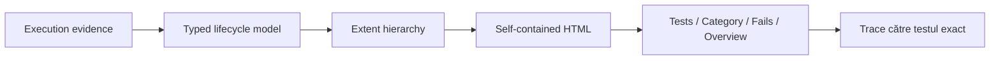

# ATF — analiza lifecycle și contractul raportului

Acest document este referința unică pentru partea de lifecycle și raportare.
Păstrează formatul vizual agreat și conține numai contractele obligatorii și
backlog-ul care nu este încă demonstrat complet. Nu păstrează scoruri, verdict
executiv sau istoric de implementare.

Scorul, când este solicitat, se calculează live din cod, teste și artefactul HTML
randat. Nu se persistă în acest document.

## Scopul contractului

Raportul trebuie să facă vizibile, în aceeași structură:

1. execuția testului;
2. evidence HTTP și tehnic;
3. validările și assertions cu rezultatele lor.



## Ordinea obligatorie a tab-urilor

```text
Tests → Category → Fails → Overview
```

- `Overview` este ultimul tab și view-ul implicit fără hash și la refresh fără
  deep-link;
- `Tests` este zona principală de execuție;
- `Category` este indexul de navigare, iar numele testelor sunt hyperlink-uri
  către testul exact din `Tests`;
- `Fails` este flat, fără grupare pe clasă sau pe tipul excepției;
- `Fails` are un singur header, listă compactă în stânga și detalii în dreapta;
- tab-ul și view-ul `Fails` există numai când există failure-uri;
- bootstrap-ul, refresh-ul și mutațiile târzii sunt idempotente: nu apar tab-uri,
  view-uri, headere sau records duplicate;
- hash-ul selectează view-ul și testul, dar nu schimbă ordinea tab-urilor.

## Ierarhia semantică

Validarea este perechea semantică a request-ului pe care îl verifică. În
randarea Extent, perechea este proiectată ca doi frați direcți în fază, în
ordinea `request → validation`; validation nu devine copil arbitrar al altui
request și nu este un pas independent de fază.

```text
TestCase
├── SETUP
│   └── Request(s)
├── TEST BODY
│   ├── Request
│   │   ├── Technical trace
│   │   ├── Response details
│   │   └── Response JSON
│   └── Validation(s) — direct sibling of its owning request
│       └── aggregate assertion table
└── TEARDOWN
    └── Request(s)
```

Reguli de randare:

- fazele `SETUP`, `TEST BODY`, `TEARDOWN` sunt frați, în această ordine, și sunt
  collapse-by-default;
- request-ul rămâne deschis până la publicarea validărilor;
- request-ul și validation-ul sunt frați direcți ai fazei și păstrează ordinea
  de execuție; ownership-ul validation-ului este indicat prin perechea
  request/response, nu prin nesting HTML artificial;
- HTTP evidence este `Info`; request-ul nu primește `Pass` înaintea validărilor;
- failure-ul apare o singură dată la owner-ul semantic. Dacă validation/assertion
  conține cauza, `TEST BODY` nu repetă încă un card generic `Failure`;
- liniile verticale decorative nu creează un container fals în test body;
- JSON-ul este code block monospace, scrollabil, cu înălțime naturală pentru
  payload-uri mici și limită configurabilă pentru payload-uri mari;
- `Technical trace` este separat de `RESPONSE JSON` și afișează doar metadata
  tehnică relevantă.

## Contractul statusurilor

Precedența este unică în lifecycle și raportare:

```text
Fail > Skip > Warning > Pass
```

Teardown-ul se raportează separat și nu poate șterge cauza unui failure anterior.
Combinațiile care trebuie să rămână protejate sunt:

| Combinație | Verdict | Evidence obligatoriu |
|---|---|---|
| setup fail → teardown pass | Fail | failure în setup și teardown executat |
| setup fail → teardown warning/fail | Fail | cauză primară și callback secundar distinct |
| setup warning → body fail → teardown pass | Fail | warning și failure păstrate |
| body fail → teardown warning/fail | Fail | body și teardown separate |
| body skip → teardown warning/fail | Skip sau Fail | skip-ul nu devine Pass |
| setup skip → teardown skip | Skip | ambele faze vizibile |
| body pass → teardown fail | Fail | body trecut, cleanup failure vizibil |
| warnings în faze diferite | Warning | toate warning-urile și count-ul lor |

## Tabelul agregat de assertions

Fiecare validation/request are un singur tabel:

```text
ASSERTION | EXPECTED | ACTUAL | RESULT
```

| Rânduri | Verdict tabel | Regula |
|---|---|---|
| Pass + Pass | Pass | toate rândurile sunt vizibile |
| Pass + Warning | Warning | warning-ul nu devine Fail |
| Pass + Fail | Fail | failure-ul domină, pass-ul rămâne evidence |
| Warning + Fail | Fail | ambele rânduri rămân vizibile |
| Skip + Skip | Skip/Other | nu apare Pass fals |

`ACTUAL` păstrează valoarea efectivă sau un marker clar pentru lipsă. Limitarea
configurabilă a textului este numai de afișare și nu modifică response-ul folosit
de validator.

## Contractul Fails / Bugs

Fiecare failure este un record independent și stabil:

```text
failureId
scenario
phase
request
validation
assertion
expected
actual
cause
link către Tests
```

- două assertions failing în același request produc două records;
- failure-urile din setup, body și teardown nu se pierd și nu se amestecă;
- aceeași cauză nu este clonată artificial la scenariu, fază și assertion;
- fiecare record are link determinist către test/fază/request/validation;
- lista este orientată pe failure occurrence, nu pe clasa de test sau exception type;
- detaliile nu inventează evidence care nu există în modelul execuției.

## Contracte deja protejate — nu mai sunt backlog

Nu se reintroduc ca task-uri istorice:

- lifecycle setup/body/teardown și precedența statusurilor;
- tabelul agregat și statusurile Pass/Warning/Fail/Skip;
- request → validation pairing directă sub fază;
- cardinalitatea de bază pentru assertions multiple și `failureId`;
- JSON code blocks și limita configurabilă de afișare;
- separarea Technical Trace de JSON evidence;
- raport autonom, fără folder auxiliar `extent` și fără referințe externe;
- verificările statice pentru tab order, header unic și collapse-by-default.

Aceste contracte se redeschid doar printr-o regresie demonstrată de test sau de
artefactul randat.

## Backlog rămas

### P0 — smoke DOM/MCP automat

Un test automat trebuie să verifice pe artefactul final:

1. ordinea `Tests → Category → Fails → Overview`;
2. `Overview` implicit la bootstrap și refresh;
3. absența lui `Fails` fără failure-uri;
4. un singur header `Fails` și toate failure records;
5. `Open in Tests` pentru failure din setup, body și teardown;
6. expand/collapse pentru fază, request și validation;
7. toate nodurile collapse-by-default;
8. JSON scrollabil și assertion table fără overflow sau coloane mutate.

### P1 — failure projection typed — boundary separată, model typed încă necesar

Separarea de responsabilități este acum materializată în client:

- `ExtentReportClientFailureEvidenceFragments` extrage evidence-ul semantic;
- `ExtentReportClientFailureProjectionFragments` creează identitatea stabilă și
  proiectează `FailureRecord`-urile;
- `ExtentReportClientFailureFragments` construiește view-ul Fails, enrichment-ul
  și rutarea `Open in Tests`.

`ReportingComponentTests` protejează această graniță. Rămâne migrarea către un
model typed explicit pentru `FailureRecord`/`FailureIndex`, fără a muta DOM
querying-ul sau routing-ul în factory/projector.

```mermaid
flowchart TD
    Evidence[Execution evidence] --> Factory[FailureRecordFactory]
    Factory --> Records[FailureRecord[]]
    Records --> Index[FailureIndexProjector]
    Records --> Link[Tests deep-link]
    Index --> View[Fails view]
```

Factory-ul nu face DOM querying, projectorul nu recalculează verdictul și
deduplicarea folosește `failureId`/`evidenceId`, nu textul afișat. Ordinea
records trebuie să fie stabilă pentru aceeași execuție.

### P1 — eliminarea dublării failure evidence

Owner-ul trebuie să fie unic:

- request-ul deține evidence HTTP;
- validation-ul deține tabelul și cauza assertion-ului;
- Fails doar proiectează record-ul;
- `TEST BODY` nu adaugă `Failure` generic când cauza este deja afișată sub
  validation/assertion.

Se cer teste de artifact și DOM pentru `body failure + validation failure`,
`body pass + teardown failure` și două assertions failing în același request.
Artifactul curent a fost verificat în TAB MCP pentru `body pass + teardown
failure`, validation failure și două failure records distincte; verificarea DOM
automatizată rămâne parte din P0.

### P2 — separare OOP

| Responsabilitate | Componentă | Limită |
|---|---|---|
| lifecycle | `ScenarioLifecycleOrchestrator` | nu produce HTML/DOM |
| verdict | `OutcomeResolver` | nu face routing |
| evidence | `ExecutionEvidenceWriter` | nu grupează Fails |
| assertions | `ValidationTablePublisher` | nu duplică precedence |
| failure records | `FailureRecordFactory` | nu caută în DOM |
| triage | `FailureIndexProjector` | nu mută carduri din Tests |
| navigare | `ReportNavigationReconciler` | nu descoperă failure-uri |
| artifact | `ReportArtifactValidator` | nu aplică styling |
| client view | `ReportViewController` | nu deduce verdictul din culori/text |

Orice interfață nouă trebuie justificată de un consumator real și de un test de
contract; nu se introduc clase doar pentru a muta codul.

## Dovezi după ultima refactorizare

Raportul verificat în TAB MCP:

`C:\work\ex\.net\Atf\artifacts\reports\api-atf-report_2026-10-13_13-38-27.html`

- xUnit API: `19` Pass, `8` Skip, `0` Fail;
- Extent: `13` Pass, `2` Fail, `4` Skip, `4` Warning;
- Fails: exact `2` records, fără dublare artificială;
- `Open in Tests` a dus la testul, faza, request-ul și validation-ul exacte;
- `body pass → teardown fail` și `warning → fail precedence` au rămas vizibile;
- console log verificat în TAB MCP: fără erori JavaScript.

Aceasta este o verificare manuală interactivă în TAB MCP. Smoke-ul DOM repetabil
este încă backlog P0 și nu este declarat implementat doar pe baza acestei
dovezi.

## Criteriul final de închidere

Documentul poate fi considerat închis numai când un artefact nou, verificat
automat în DOM, demonstrează simultan:

- tab-uri în ordinea contractată, cu Overview ultimul și implicit;
- Fails flat, cu un singur header și toate failure occurrences;
- hyperlink exact către test/fază/request/validation;
- request → validation pairing directă sub fază, fără nesting sau siblings
  neasociați;
- failure evidence fără dublare în Test Body;
- assertion table agregat pentru Pass/Warning/Fail/Skip;
- setup/body/teardown cu status și nesting corecte;
- JSON scrollabil, cu înălțime naturală pentru payload mic;
- Technical Trace distinct și compact;
- refresh/rebootstrap fără duplicate, orphan nodes sau schimbare de layout.

Până la această dovadă, raportarea rămâne un contract activ și nu se declară
închisă. Verificarea TAB MCP de mai sus confirmă comportamentul observat al
artefactului, dar nu înlocuiește harness-ul DOM automat din P0.
