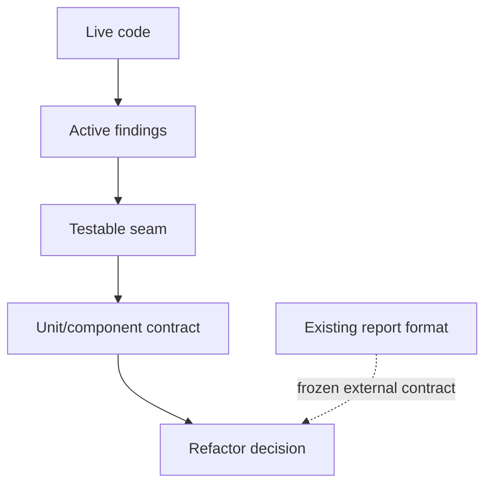

# ATF — feedback live, activ și măsurabil

Data re-auditului: **2026-10-13**  
Repository: `C:\work\ex\.net\Atf`  
Scope: refactorizare internă, OOP/SRP, separarea responsabilităților, concurență,
teste și mentenanță.  
Exclus: formatul observabil al raportului, definit separat în
`ATF_LIFECYCLE_COMBINATION_ANALYSIS_2026-10-13.md`.

Acest document nu stochează note. Notele se calculează live la fiecare audit și
apar doar în răspunsul auditului. Aici rămân numai riscurile active, dovada,
acțiunea, testele și criteriul de închidere. O recomandare deja implementată
este consemnată la „mitigated” și nu este reintrodusă ca backlog.

## 1. Context live fără scor persistent

Suitele sunt verzi. Problemele închise nu mai sunt backlog; acest document
urmărește numai cele trei seam-uri care încă scad calitatea și pot produce câștig
rapid, măsurabil:

1. extinderea dovezii deterministe pentru ownership-ul path/asset/cleanup în rulări paralele;
2. împărțirea testelor de reporting pe contracte, ca failure-ul să fie localizabil;
3. consolidarea regulilor de configurație și a boundary-urilor dintre module.



## 2. Dovadă live verificată

Ultima execuție verificată pe o copie izolată a sursei live, cu build fresh, este
staging-ul `C:\work\ex\.net\.tmp\Atf-feedback-20261013-r14`:

```text
Atf.Core.Tests:             91/91
Atf.Tests/Atf.Common.Tests: 67/67
Atf.Reporting.Extent.Tests: 119/119
Atf.Tests/Atf.Api.Tests:    52/52
Total:                      329/329
```

Build-ul a trecut cu 0 warning/0 error; suitele offline au trecut integral.
Rularea API a trecut cu 19 teste și 8 skip-uri, iar failure-demo opt-in a
produs controlat 4 failures în contract, assertion, setup și teardown. Ambele
HTML-uri au fost deschise în TAB MCP; Overview, Tests, Fails, Categories,
expand/collapse, response details și Open in Tests au fost verificate.

## 3. Guardrails protejate — nu sunt backlog

| Contract protejat | Dovadă live |
|---|---|
| Core nu cunoaște Extent/HTML/CSS; TestHost este composition root | package-boundary și architecture tests |
| `phase → request → validation` păstrează validation ca sibling direct | `ReportingStructureTests`, `ExtentScopeTreeCoordinatorTests` |
| evaluarea, politica și publisher-ul sunt separate | `ValidationEvaluatorTests`, `ValidationOutcomePolicyTests` |
| warning-ul rămâne warning și cleanup-ul continuă după failure | lifecycle/status/cleanup component tests |
| modulele principale sunt `Atf.Core`, `Atf.Api`, `Atf.Api.TestHost`, `Atf.Reporting.Extent`, `Atf.Tests` | soluția și build-ul izolat |
| toate proiectele de test folosesc xUnit v3 | project files + build fără warning/error |

Aceste contracte nu se redeschid pentru a repeta istoricul. Se redeschid doar
dacă apare o regresie verificabilă.

## 4. Backlog activ, ordonat după câștig

### CON-01 — ownership-ul path/asset/cleanup în paralel — closed

**Owner:** `Atf.Reporting.Extent` + porturile artifact din `Atf.Core`
**Fișiere:** `ExtentReportPathAllocator`, `ExtentArtifactPublisher`,
`ReportAssetCleanupCoordinator`, `ExtentReportLifecycle`
**Dovadă:** `ReportAssetCleanupCoordinatorTests` verifică retry pentru lock,
`UnauthorizedAccessException`, failure epuizat fără gate leak, două sesiuni cu
directoare distincte și cleanup idempotent; testele de allocator/lifecycle
acoperă rezervarea și release-ul path-urilor.

Este un P1 deoarece `ExtentReportPathAllocator` rezervă path-uri într-un set
static protejat, iar
`ReportAssetCleanupCoordinator` folosește gate pe director. `ExtentReportLifecycle`
protejează state-ul sesiunii și `ExtentArtifactPublisher` curăță staging-ul în
`finally`. Un test verde de rezervare nu dovedește că un failure între
reservation, flush, move și cleanup eliberează ownership-ul.

Teste obligatorii:

- 20 de sesiuni paralele cu același nume logic produc path-uri distincte;
- fiecare sesiune își curăță doar directory-ul rezervat;
- release după success, exception și cancellation reduce reservation count;
- cleanup nu șterge un asset încă folosit de altă sesiune;
- filesystem failure nu lasă gate permanent și nu maschează verdictul;
- cleanup repetat este idempotent.

**Definition of done:** test repetat de concurență, fără sleep arbitrar și cu
barieră controlată, demonstrează lipsa coliziunilor, deadlock-urilor și
scurgerilor de directoare.

Închiderea este limitată la ownership-ul filesystem demonstrat de codul curent;
nu schimbă formatul HTML și nu depinde de serviciul API.

### TEST-01 — testele mari încetinesc feedback-ul — mitigated, P1 pentru viteză

**Owner:** `Atf.Tests/Atf.Reporting.Extent.Tests`
**Fișiere:** `ReportingComponentTests.cs`,
`ReportingLifecycleComponentTests.cs`
**Dovadă existentă:** coverage integrală; problema este localizarea failure-ului,
nu lipsa testelor.
**Progres:** contractele theme/sanitizer au fost mutate în
`ReportThemeContractTests`; contractele tree/status/path au deja fixture-uri
dedicate. `ReportingComponentTests` este acum 760 de linii, iar
`ReportingLifecycleComponentTests` 478. Restul client-behaviour/lifecycle
poate fi separat incremental fără schimbare de output.

Nu este o problemă de
coverage, ci de diagnostic: un failure de theme, tree, asset sau navigation
apare în aceeași unitate de testare.

Împărțirea recomandată este pe contracte:

```text
ExtentScopeTreeContractTests
ExtentEvidenceContractTests
ExtentThemeTokenTests
ExtentClientBehaviourContractTests
ExtentArtifactLifecycleTests
ExtentConcurrencyTests
```

Nu se copiază setup-ul. Fixture-urile comune trebuie să rămână mici și locale
modulului. Criteriul este ca un failure să indice un singur seam dominant.

**Câștig rapid:** mutarea testelor fără schimbare de comportament crește viteza
de diagnostic imediat și nu atinge HTML-ul sau lifecycle-ul de producție.

### CFG-01 — reguli de configurație și snapshot — closed

**Owner:** `Atf.Core/Configuration`
**Fișiere:** `AtfConfigurationValidator`,
`ApiConfigurationValidator`, `AuthProfileConfigurationValidator`,
`ReportingConfigurationValidator`, `RouteConfigurationValidator`
**Dovadă:** `AtfConfigurationException` expune `Code`, `Path` și `Detail`, iar
validatorii emit coduri stabile pentru URL, timeout, rate-limit, auth, rute,
reporting și redaction. `ConfigurationRuleTests` acoperă rute duplicate, auth
necunoscut și snapshot izolat; loader-ul rămâne orchestratorul.

Loader-ul și snapshot-ul sunt mai bine separate, dar regulile trebuie să rămână
compozabile și diagnosticele stabile (`Code + Path + Message`). Testele lipsă cu
valoare sunt duplicate/conflicting keys, URL invalid, timeout invalid, unknown
auth profile și snapshot mutat după creare.

**Definition of done:** fiecare regulă se testează fără loader și runtime-ul
consumă doar snapshot-ul validat.

Contractul public al settings nu s-a schimbat; diagnosticul este compatibil cu
`InvalidOperationException`, dar poate fi consumat programatic.

## 5. Ordine de lucru pentru accelerare

```text
1. TEST-01: split incremental al client-behaviour/lifecycle pe contracte
2. LIFE-01: reevaluare doar dacă apare un al doilea host
```

Ordinea este intenționat diferită de o rescriere arhitecturală: mai întâi
scurtăm feedback-ul, apoi extragem un singur seam cu dovadă, apoi consolidăm.

## 6. Matricea minimă de protecție

| Nivel | Dovadă necesară | Nu este suficient |
|---|---|---|
| unit | policy pură, fără Extent | test care verifică doar string-uri |
| component | colaborare cu fake reporter/node | constructor care pornește filesystem real |
| architecture | dependency direction și narrow ports | convenție scrisă doar în README |
| concurrency | barieră controlată și cleanup verificat | `Task.Delay` și rezultat verde accidental |
| regression | 329/329 + contractele noi | total de teste fără seam atribuit |

## 7. Regula de actualizare

Un finding devine `closed` numai cu cod, test și criteriu verificabil. Un finding
`mitigated` nu se redeschide doar pentru a repeta istoricul; se redeschide doar
dacă apare o regresie concretă.

La fiecare re-audit se verifică live codul, testele și documentația. Se
recalculează notele în răspunsul auditului, fără a le persista în feedback.
Nu se inventează delte, totaluri, build-uri sau validări vizuale.
