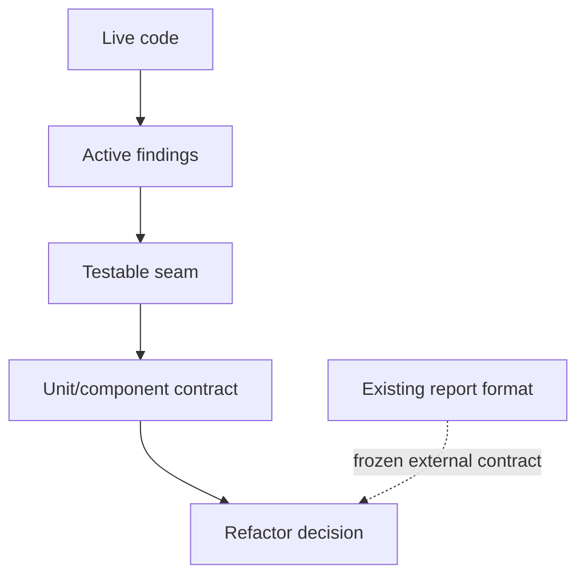
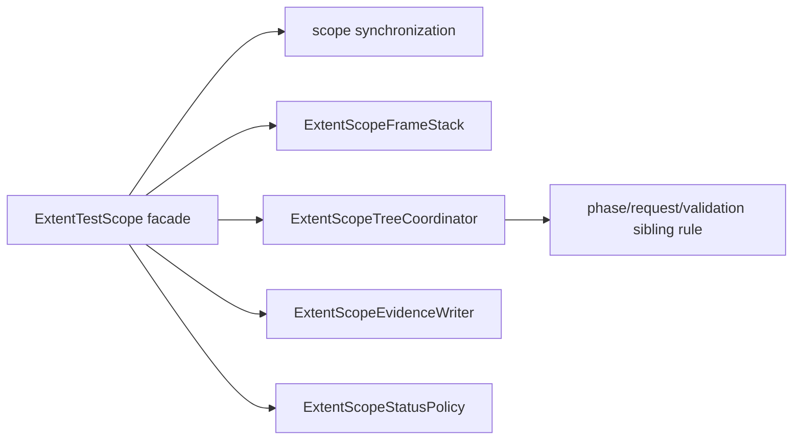

# ATF — feedback live, activ și măsurabil

Data re-auditului: **2026-10-13**  
Repository: `C:\work\ex\.net\Atf`  
Scope: refactorizare internă, OOP/SRP, separarea responsabilităților, concurență,
teste și mentenanță.  
Exclus: formatul observabil al raportului, definit separat în
`ATF_LIFECYCLE_COMBINATION_ANALYSIS_2026-10-13.md`.

Acest document nu stochează note. Notele se calculează live la fiecare audit și
apar doar în răspunsul auditului. Aici rămân numai riscurile active, dovada,
acțiunea, testele și criteriul de închidere. O recomandare deja implementată
este consemnată la „mitigated” și nu este reintrodusă ca backlog.

## 1. Context live fără scor persistent

Suitele sunt verzi, iar direcția arhitecturală este mai bună decât sugerează
feedback-ul vechi. Viteza de progres a scăzut deoarece backlog-ul amesteca
probleme închise cu probleme reale.

Incrementul curent a închis primul seam de reporting, a introdus evaluarea
neutră a validărilor, a consolidat modulele și a confirmat build/test într-un
staging separat. Cele mai mari câștiguri rămase sunt concrete:

1. extinderea dovezii deterministe pentru ownership-ul path/asset/cleanup în rulări paralele;
2. împărțirea testelor de reporting pe contracte, ca failure-ul să fie localizabil;
3. consolidarea regulilor de configurație și a boundary-urilor dintre module.



## 2. Dovadă live verificată

Ultima execuție verificată pe binarele curente, fără build și fără restore:

```text
Atf.Core.Tests:             83/83
Atf.Tests/Atf.Common.Tests: 67/67
Atf.Reporting.Extent.Tests: 118/118
Atf.Tests/Atf.Api.Tests:    52/52
Total:                      320/320
```

Acest rezultat provine din staging-ul
`C:\work\ex\.net\.tmp\Atf-feedback-20261013-r13` și confirmă regresia offline.
Build-ul a trecut cu 0 warning/0 error. Rularea API a trecut cu 18 teste și 8
skip-uri, iar failure-demo opt-in a produs controlat 4 failures în setup,
assertion, contract validation și teardown. Ambele HTML-uri au fost verificate
static și în TAB MCP, inclusiv Overview, Tests, Fails, Categories, expand/collapse
și Open in Tests.

## 3. Guardrails protejate — nu sunt backlog

| Contract protejat | Dovadă live |
|---|---|
| Core nu cunoaște Extent/HTML/CSS; TestHost este composition root | package-boundary și architecture tests |
| `phase → request → validation` păstrează validation ca sibling direct | `ReportingStructureTests`, `ExtentScopeTreeCoordinatorTests` |
| evaluarea, politica și publisher-ul sunt separate | `ValidationEvaluatorTests`, `ValidationOutcomePolicyTests` |
| warning-ul rămâne warning și cleanup-ul continuă după failure | lifecycle/status/cleanup component tests |
| modulele principale sunt `Atf.Core`, `Atf.Api`, `Atf.Api.TestHost`, `Atf.Reporting.Extent`, `Atf.Tests` | soluția și build-ul izolat |
| toate proiectele de test folosesc xUnit v3 | project files + build fără warning/error |

Aceste contracte nu se redeschid pentru a repeta istoricul. Se redeschid doar
dacă apare o regresie verificabilă.

## 4. Backlog activ, ordonat după câștig

### OOP-01 — tranzițiile arborelui au fost extrase din `ExtentTestScope` — mitigated

`ExtentTestScope` este acum o fațadă subțire. Nu mai este monolitul
inițial: stack-ul este în `ExtentScopeFrameStack`, evidence în
`ExtentScopeEvidenceWriter`, status precedence în `ExtentScopeStatusPolicy`,
tranzițiile în `ExtentScopeTreeCoordinator`, iar nodul vendor este ascuns prin
`IExtentNodeAdapter`.

Facade-ul păstrează lock-ul ca boundary de serializare, dar nu mai deține
regulile de tranziție. Coordinatorul se ocupă exclusiv de
`phase → request → validation`, închiderea implicită, drain și contractul de
phase; nu cunoaște HTML sau verdicturi de business.



Refactorul este implementat prin `ExtentScopeTreeCoordinator`; fațada publică
rămâne neschimbată.

Teste obligatorii înainte de mutare:

- phase nou închide step-urile vechi fără a muta nodul în alt scenariu;
- request nou închide request-ul anterior fără validation orfană;
- validation este acceptată doar ca sibling direct al request-ului din aceeași fază;
- tranziție invalidă nu schimbă stack-ul existent;
- `Dispose` repetat și `CompleteScenario` repetat sunt idempotente;
- două scope-uri cu gate-uri independente nu amestecă noduri sau statusuri.

**Dovadă:** `ExtentScopeTreeCoordinatorTests` acoperă phase boundary, validation
invalidă și drain-ul unui request neînchis; `ReportingStructureTests` păstrează
contractul de sibling request/validation. Concurența filesystem rămâne separat
în CON-01.

### CON-01 — ownership-ul path/asset/cleanup în paralel — P1

`ExtentReportPathAllocator` rezervă path-uri într-un set static protejat, iar
`ReportAssetCleanupCoordinator` folosește gate pe director. `ExtentReportLifecycle`
protejează state-ul sesiunii și `ExtentArtifactPublisher` curăță staging-ul în
`finally`. Designul este rezonabil, dar exact aici apar blocaje greu de
reprodus: path reservation, flush, move și cleanup sunt faze diferite.

Teste obligatorii:

- 20 de sesiuni paralele cu același nume logic produc path-uri distincte;
- fiecare sesiune își curăță doar directory-ul rezervat;
- release după success, exception și cancellation reduce reservation count;
- cleanup nu șterge un asset încă folosit de altă sesiune;
- filesystem failure nu lasă gate permanent și nu maschează verdictul;
- cleanup repetat este idempotent.

**Definition of done:** test repetat de concurență, fără sleep arbitrar și cu
barieră controlată, demonstrează lipsa coliziunilor, deadlock-urilor și
scurgerilor de directoare.

### TEST-01 — testele mari încetinesc feedback-ul — P1 pentru viteză

`ReportingComponentTests` are aproximativ 809 linii, iar
`ReportingLifecycleComponentTests` aproximativ 478. Nu este o problemă de
coverage, ci de diagnostic: un failure de theme, tree, asset sau navigation
apare în aceeași unitate de testare.

Împărțirea recomandată este pe contracte:

```text
ExtentScopeTreeContractTests
ExtentEvidenceContractTests
ExtentThemeTokenTests
ExtentClientBehaviourContractTests
ExtentArtifactLifecycleTests
ExtentConcurrencyTests
```

Nu se copiază setup-ul. Fixture-urile comune trebuie să rămână mici și locale
modulului. Criteriul este ca un failure să indice un singur seam dominant.

### VAL-01 — evaluatorul și decizia de validation sunt separate — closed

Evaluatorul, politica pură și publisher-ul sunt separate. `Finish` este acum
doar orchestration boundary: transformă evaluarea în decizie prin
`ValidationOutcomePolicy`, publică rows/status prin `ValidationReportPublisher`
și aplică exception policy.

Seam-ul cu valoare este un `ValidationOutcomePolicy` pur:

```text
ValidationEvaluation + mode -> ValidationDecision
ValidationDecision -> ValidationReportPublisher
ValidationDecision -> exception policy
```

Nu se introduc noi DSL-uri. Testele trebuie să acopere hard failure, warning,
unexpected exception, zero assertions și publisher care aruncă.

**Dovadă:** `ValidationEvaluatorTests` și `ValidationOutcomePolicyTests` verifică
hard failure, warning, unexpected exception și zero assertions fără Extent sau
filesystem. Publisher-ul rămâne singurul loc care aplică efectele în reporter.

### OOP-02 — fațada agregată `IAtfReporter` este ținută la margine — mitigated

Porturile înguste există în namespace-ul semantic `Atf.Core.Reporting.Ports`, iar consumatorii principali folosesc deja
`IAtfValidationReporter`/`IAtfCleanupReporter`. Contractul agregat rămâne însă
în `IAtfScenarioScope` și în `IAtfReporter`, pentru compatibilitate.

Nu trebuie eliminat prin breaking change. Trebuie doar:

- să rămână folosit la boundary-ul scenario scope;
- validatori, servicii și cleanup să primească portul minim;
- test de architecture să detecteze apariția unui consumer nou pe agregat;
- documentația să nu mai descrie `IAtfReporter` ca port recomandat universal.

`CoreArchitectureTests.ReportingPortsDoNotRequireScenarioCompletion`,
`ReportingPortBoundaryTests` și
`PackageBoundaryTests.FrameworkPackagesKeepAtMostEightTopLevelTypesPerNamespace`
protejează aceste limite.

### CFG-01 — reguli de configurație și snapshot — P2

Loader-ul și snapshot-ul sunt mai bine separate, dar regulile trebuie să rămână
compozabile și diagnosticele stabile (`Code + Path + Message`). Testele lipsă cu
valoare sunt duplicate/conflicting keys, URL invalid, timeout invalid, unknown
auth profile și snapshot mutat după creare.

**Definition of done:** fiecare regulă se testează fără loader și runtime-ul
consumă doar snapshot-ul validat.

### LIFE-01 — `ApiTestBase` este adapter, nu trebuie spart artificial — P2

`ApiScenarioLifecycleRunner` este deja coordinator subțire, cu phase runner,
teardown runner și outcome resolver. Extragerile vechi propuse sunt mitigate.

Presiunea reală rămasă în `ApiTestBase` este compoziția module/contextului și
traducerea outcome-ului neutru în xUnit plus finalizarea scenario scope. Aceasta
este responsabilitatea corectă a host adapter-ului. Un nou `ScenarioFinalizer`
merită introdus doar dacă apare al doilea host sau dacă testele arată o regulă
independentă; altfel ar fi doar indirection.

### TOOL-01 — xUnit v2/v3 — closed

Toate proiectele de test din soluția live folosesc xUnit v3. Build-ul staged
este fără warning/error după propagarea tokenului de cancellation xUnit în
testele async. Nu mai există o matrice mixtă în codul curent.

### ARCH-01 — consolidarea modulelor — closed

Ținta minimă rămâne:

```text
Atf.Core + Atf.Api + Atf.Api.TestHost + Atf.Reporting.Extent + Atf.Tests
```

Codul fostului `Atf.Common` este acum în `Atf.Api/Module`, testele sunt în
`Atf.Tests`, iar `Atf.Api.TestHost` rămâne composition root-ul. Soluția live
este actualizată la aceste căi și este protejată de build-ul full-solution și
de suitele 320/320. Nu se mai păstrează un proiect `Atf.Common` separat.

## 5. Ordine de lucru pentru accelerare

```text
1. CON-01: filesystem fault matrix pentru path, asset și cleanup
2. TEST-01: split pe contracte fără schimbare de output
3. CFG-01: composable rule matrix și diagnostice stabile
4. LIFE-01: reevaluare doar dacă apare un al doilea host
```

Ordinea este intenționat diferită de o rescriere arhitecturală: mai întâi
scurtăm feedback-ul, apoi extragem un singur seam cu dovadă, apoi consolidăm.

## 6. Matricea minimă de protecție

| Nivel | Dovadă necesară | Nu este suficient |
|---|---|---|
| unit | policy pură, fără Extent | test care verifică doar string-uri |
| component | colaborare cu fake reporter/node | constructor care pornește filesystem real |
| architecture | dependency direction și narrow ports | convenție scrisă doar în README |
| concurrency | barieră controlată și cleanup verificat | `Task.Delay` și rezultat verde accidental |
| regression | 320/320 + contractele noi | total de teste fără seam atribuit |

## 7. Regula de actualizare

Un finding devine `closed` numai cu cod, test și criteriu verificabil. Un finding
`mitigated` nu se redeschide doar pentru a repeta istoricul; se redeschide doar
dacă apare o regresie concretă.

La fiecare re-audit se verifică live codul, testele și documentația. Se
recalculează notele în răspunsul auditului, fără a le persista în feedback.
Nu se inventează delte, totaluri, build-uri sau validări vizuale.
