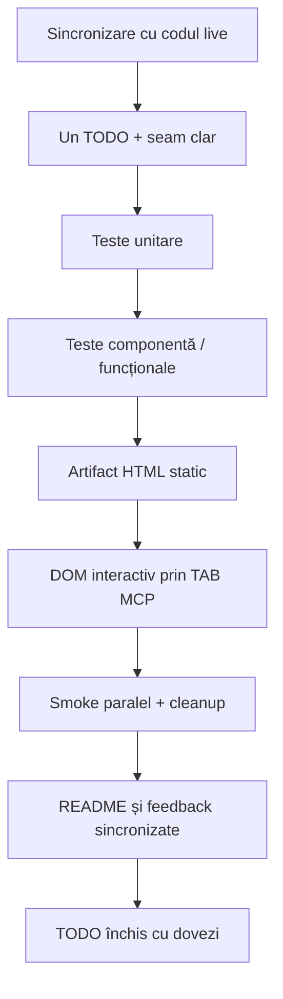

# ATF — ghid obligatoriu pentru rezolvarea feedback-ului

Acest document este procedura obligatorie pentru orice rezolvare a unui TODO din
feedback. Nu este opțional și nu poate fi înlocuit cu un build verde sau cu o
inspecție statică a codului.

Folosește-l ca checklist de lucru pentru o persoană: citește întâi rezumatul,
deschide README-ul owner-ului, aplică doar verificările relevante pentru TODO-ul
tău și închide-l numai după ce criteriile observabile sunt îndeplinite. Nu este
nevoie să completezi pași fără legătură cu schimbarea.

Scope-ul acestei runde este explicit:

- [`Atf_Refactoring_Feedback.md`](Atf_Refactoring_Feedback.md) — contractele
  închise pentru OOP, module, ownership, tag-uri și concurență;
- [`Atf_Lifecycle_Combination.md`](Atf_Lifecycle_Combination.md) — backlog
  activ pentru LC-01 și LC-06 în această rundă; criteriile de aici se aplică
  harness-ului DOM și regresiilor vizuale ale raportului.

Prin urmare, procedura de mai jos se aplică doar regresiilor noi sau feedback-ului
nou care afectează contractele de refactorizare. Documentul lifecycle rămâne
disponibil pentru o rundă separată, explicit autorizată.

## Principiul de lucru



Un TODO rămâne deschis dacă lipsește oricare etapă relevantă pentru seam-ul său.
Nu se schimbă formatul aprobat al raportului pentru a face un test mai ușor.

## Procedura obligatorie

### 1. Sincronizează-te cu codul live

Înainte de orice editare:

1. verifică `git status`, branch-ul și commit-ul curent;
2. verifică diferența față de `origin/main`;
3. inspectează implementarea și testele seam-ului, nu doar README-ul;
4. păstrează modificările existente și nu folosi `reset --hard`, `checkout --`
   sau `git clean`;
5. notează dacă alt proces rulează și nu îl opri.

Dacă working tree-ul se schimbă în timpul lucrului, oprește editarea acelui fișier,
recitește conținutul live și reaplică doar patch-ul minim necesar.

### 2. Alege un singur TODO și definește dovada

Pentru fiecare TODO completează înainte de cod:

```text
TODO:
Owner:
Seam (punct de legătură):
Responsabilitate mutată:
Format existent protejat:
Dovadă test unitar:
Dovadă componentă/funcțională:
Dovadă artifact:
Dovadă DOM:
Dovadă concurență/cleanup:
```

Un refactor fără responsabilitate mutată sau fără test nou/întărit nu este
considerat progres.

### 3. Lucrează cu build izolat

Build-ul și testele nu trebuie să interfereze cu rulările existente. Folosește un
staging root separat, generat pentru fiecare sesiune, de exemplu:

```powershell
$stage = '.tmp/Atf-validation-<id>'

dotnet restore .\Atf.slnx `
  -p:BaseIntermediateOutputPath="$stage\obj\"

dotnet build .\Atf.slnx --configuration Debug --no-restore `
  -p:BaseOutputPath="$stage\bin\" `
  -p:BaseIntermediateOutputPath="$stage\obj\"

dotnet test .\Atf.slnx --configuration Debug --no-build --no-restore `
  -p:BaseOutputPath="$stage\bin\" `
  -p:BaseIntermediateOutputPath="$stage\obj\"
```

Dacă proiectul sau un proces existent nu permite redirecționarea sigură,
folosește un checkout/worktree de staging sincronizat cu commit-ul live. Nu
închide procese, nu șterge `bin/obj` ale altui proces și nu reutiliza staging-ul
unei rulări anterioare.

Pentru o verificare obișnuită este suficient rezultatul comenzilor din terminal:
build-ul trebuie să se termine fără erori, iar testele relevante trebuie să fie
verzi. Fișierele de diagnostic detaliat se cer numai când există un eșec greu de
explicat; nu sunt criteriu obligatoriu de închidere.

### 4. Verifică în ordine

| Punct de verificare | Ce verifică | Dovadă minimă |
|---|---|---|
| G0 — punct de plecare | starea înainte de schimbare | status, commit și teste relevante |
| G1 — unit | politici pure, ordine, deduplicare, precedence | teste unitare deterministe |
| G2 — componentă | colaborarea dintre module și seam | teste fără randare DOM |
| G3 — artifact | HTML, cardinalitate, ierarhie și text | inspector static |
| G4 — DOM | click, collapse, filtrare, deep-link, stiluri | TAB MCP, nu browser Windows |
| G5 — paralel | sesiuni, path-uri și cleanup | test cu două sesiuni, dacă este relevant |
| G6 — documentație | contractul și procedura rămân sincronizate | README și linkuri valide |

G4 este obligatoriu pentru orice schimbare de navigare, disclosure, selector,
layout, font, culoare, scroll sau overflow. Un test de string nu înlocuiește G4.

### 5. Teste obligatorii pentru fiecare TODO

| TODO | Unit | Component/funcțional | Artifact | DOM | Paralel |
|---|---:|---:|---:|---:|---:|
| RF-02 fațade | porturi și delegare | izolare între puncte de legătură | client/theme inclus | numai dacă UI se schimbă | — |
| RF-03 namespace-uri | regulă de boundary | direcția dependențelor | — | — | — |
| RF-04 sesiuni | alocare/cleanup | două sesiuni | ownership path/asset | — | obligatoriu |
| LC-01 harness DOM | selectori și helperi | fluxuri complete | artifact real | obligatoriu | — |
| LC-06 vizual | contracte token | compoziție theme | HTML/CSS | stiluri calculate | — |
| RF-05 navigare/tag-uri | proiecție fără tag-uri în lista clasei | detalii scenariu | lista stângă fără pills/`tag`; detalii cu tag-uri | obligatoriu | — |

### 6. Validează raportul prin TAB MCP

Pentru orice TODO care atinge raportarea:

1. generează artifactul în staging;
2. deschide artifactul în TAB MCP, nu în browserul Windows;
3. verifică Overview, Tests, Category și Fails;
4. selectează un test cu status normal și unul cu status negativ/warning;
5. apasă fiecare control relevant și verifică DOM-ul după acțiune;
6. verifică faptul că nodurile pornesc collapsed și că nu se clonează conținutul
   în alt view;
7. notează calea artifactului și commit-ul în rezultatul local, nu în README.

Pentru metadata de navigare verifică explicit separarea suprafețelor: lista
`Tests` din stânga trebuie să conțină doar clasa, statusul și durata; nu trebuie
să aibă tag pills, strip-uri sau atribut `tag` populat. Tag-urile validate pot
apărea în header-ul/cardul scenariului din dreapta și în Overview. Selectarea sau
refresh-ul nu are voie să mute tag-uri în lista claselor.

Artifactul final include harness-ul read-only `window.__atfDomContract.inspect()`.
În TAB MCP, harness-ul sau probele DOM echivalente trebuie folosite pentru a
raporta selectori, cardinalitate, relații de poziționare și computed styles;
prezența unui string în HTML nu este suficientă.

Nu se închide un TODO pe baza unei capturi sau a faptului că HTML-ul conține
textul așteptat.

### 7. Actualizează documentația după cod

După ce testele și artifactul sunt validate:

- mută contractul stabil în README-ul modulului potrivit;
- păstrează în feedback doar ce mai este de făcut;
- elimină TODO-ul închis sau marchează explicit dovada lui în istoricul Git;
- nu păstra scoruri, timestamp-uri, căi temporare sau nume de rapoarte în
  README-uri;
- verifică linkurile Markdown și inspectează diff-ul înainte de commit.

## Definition of Done

Un TODO este rezolvat numai dacă toate răspunsurile sunt „da”:

- responsabilitatea este mai clară decât înainte;
- testul protejează comportamentul, nu implementarea accidentală;
- testele unitare și componentă trec în staging;
- artifactul conține structura și cardinalitatea corectă;
- DOM-ul interactiv a fost verificat prin TAB MCP dacă este relevant;
- testul paralel/cleanup a trecut dacă există stare sau filesystem;
- formatul raportului aprobat nu s-a schimbat accidental;
- README-urile și feedback-ul nu se contrazic;
- nu au fost oprite rulări existente și nu au fost șterse artifacte străine.

Build-ul și testele offline acoperă cel mult G0–G2. Închiderea reală cere toate punctele
relevante și dovada finală a artifactului.
