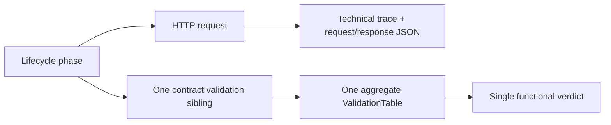
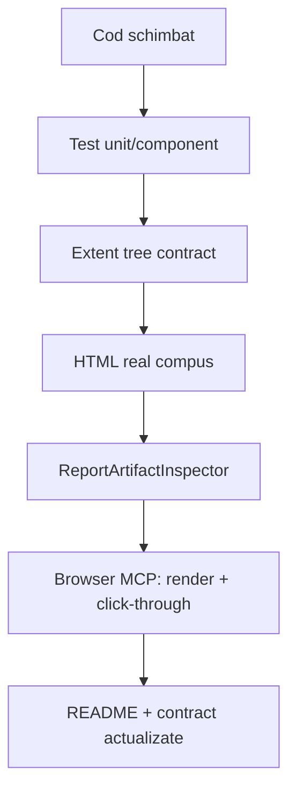

# Rezoluția evaluării constructive

Acest document este contractul de lucru rezultat din feedback-ul arhitectural. El
leagă fiecare problemă de o regulă verificabilă, un seam de test și un artefact
observabil. Scopul este să nu mai existe diferență între cod, testele offline,
README-uri și raportul Extent consumat în browser.

## Invariante rezolvate



Pentru fiecare `ApiResponse`:

- requestul este proprietarul evidence-ului de transport, duratei și payload-urilor;
- validarea este următorul frate direct al requestului, în aceeași fază;
- toate verificările status, headers, JSONPath, schema și relații sunt rânduri în
  același tabel `ASSERTION | EXPECTED | ACTUAL | RESULT`;
- `Info` descrie transportul și nu poate deveni verdict funcțional;
- un răspuns HTTP diferit primește un request și un tabel diferit;
- un request de succes fără exact o validare agregată este invalid lifecycle și
  produce eroare de contract înainte de finalizarea fazei.

Fazele `SETUP`, `TEST BODY` și `TEARDOWN` rămân copii direcți ai scenariului.
Această regulă este independentă de faptul că raportul Extent le afișează
colapsate sau expandate.

## Ce a fost implementat

### OOP și separarea responsabilităților

- `Atf.Core` expune porturi de reporting (`IAtfReportSession`, `IAtfReportNode`,
  evidence și lifecycle) și nu referenția Extent.
- adaptorul Extent rămâne în `Atf.Reporting.Extent`;
- `ExtentTestScope` gestionează protocolul phase → request + validation sibling și refuză
  validări fără request activ;
- `ValidationTable` este publicat o singură dată pentru validarea activă;
- `ReportArtifactInspector` verifică artifactul final, nu doar obiectele Extent din
  memorie;
- JavaScript-ul raportului materializează rolurile DOM `phase`, `request` și
  `validation`, cu `data-atf-parent-node` coerent.

### Lifecycle și concurență

- faza următoare închide determinist faza precedentă;
- requestul este închis înainte de crearea validării, astfel încât ambele să rămână
  copii direcți ai aceleiași faze;
- `Dispose` și `finally` păstrează teardown-ul chiar la eșec;
- testele adaptorului Extent sunt serializate pentru a evita coliziunea asupra
  resurselor native ale reporterului; testele de lifecycle verifică în continuare
  izolarea mai multor sesiuni.

### Raport și UX

- phase/request/validation/evidence sunt colapsate implicit;
- JSON-ul rămâne code-block scrollabil vertical, fără overflow orizontal la nivel
  de pagină;
- payload-urile, trace-ul tehnic, durata și tabelul de aserțiuni apar la nivelul
  nodului care le deține;
- raportul este un singur HTML autonom; nu se livrează folder `extent` separat;
- inspectorul verifică existența tabelului agregat, rolurile semantice, collapse,
  dark theme, scroll JSON și protecția împotriva overflow-ului orizontal.

### Pass, Skip și Fail — aceeași ierarhie, verdict diferit

Raportul de referință este normativ și pentru scenariile care nu trec. Starea nu
schimbă arborele:

```text
scenario [Pass | Skip | Fail]
  -> phase [Pass | Skip | Fail]
       -> HTTP request [Info/Fail]
       -> Validate: contract [Pass/Fail, dacă există răspuns validabil]
            -> Assertions · N [un singur tabel]
```

- un `Fail` de transport sau setup rămâne pe nodul care a eșuat și păstrează
  durata, `ATTEMPT`/retry history și technical trace fără a inventa un verdict
  `Pass`;
- un `Fail` de contract păstrează requestul `Info`, iar verdictul negativ este
  în tabelul agregat al validării asociate;
- un `Skip` rămâne vizibil ca `Skip`, nu creează request sau validare fictivă și
  nu este numărat ca test trecut;
- toate nodurile și evidence blocks pornesc colapsate, inclusiv în scenarii
  eșuate, iar HTML-ul rămâne self-contained și fără folder `extent`.

## Dovezi automate

Suitele offline verificate în copia izolată `.tmp`:

| Suită | Rezultat |
|---|---:|
| `Atf.Core.Tests` | 74/74 |
| `Atf.Common.Tests` | 44/44 |
| `Atf.Reporting.Extent.Tests` | 51/51 |
| `Atf.Api.Tests` | 23/23 |

Testele importante pentru feedback sunt:

- ownership request → validation;
- mai multe request-uri cu tabele independente și ordine stabilă;
- respingerea requestului de succes fără validare;
- respingerea validării fără tabel sau cu tabele duplicate;
- rolurile DOM și păstrarea ierarhiei în HTML-ul compus;
- inspectorul pentru artifact self-contained, dark, collapsed și fără `extent/`;
- testele de clase API și lifecycle pentru `SETUP`, `TEST BODY`, `TEARDOWN`.

## Regula pentru schimbări viitoare

Orice schimbare de reporting trebuie să treacă în această ordine:



Nu este suficient ca un test să fie `Pass` în memorie. Raportul final trebuie
generat din aceeași sursă verificată, deschis în browser și parcurs prin navigarea
din stânga, expand/collapse pe phase, request, validation, JSON și tabel.

## Hardening rămas, fără a schimba invariantă

Următoarele sunt îmbunătățiri separate, nu justifică revenirea la modelul sibling:

1. înlocuirea warning-urilor de analiză statică (`CA1305`, `CA1869`, `CA1822`);
2. reguli OOP compozabile (`StatusRule`, `HeaderRule`, `JsonPathRule`, `SchemaRule`)
   fără dependență de Extent;
3. redaction matrix centralizat pentru headers, query, body și response;
4. snapshot immutable al configurației pentru execuții paralele;
5. export semantic JSON/Markdown al aceluiași model de evidence;
6. test de sincronizare README → public types → DOM semantic.

Acestea pot crește scorul de maturitate, dar nu trebuie implementate prin mutarea
validării înapoi ca frate al fazei sau prin fragmentarea unui response în mai multe
tabele.
