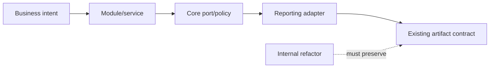
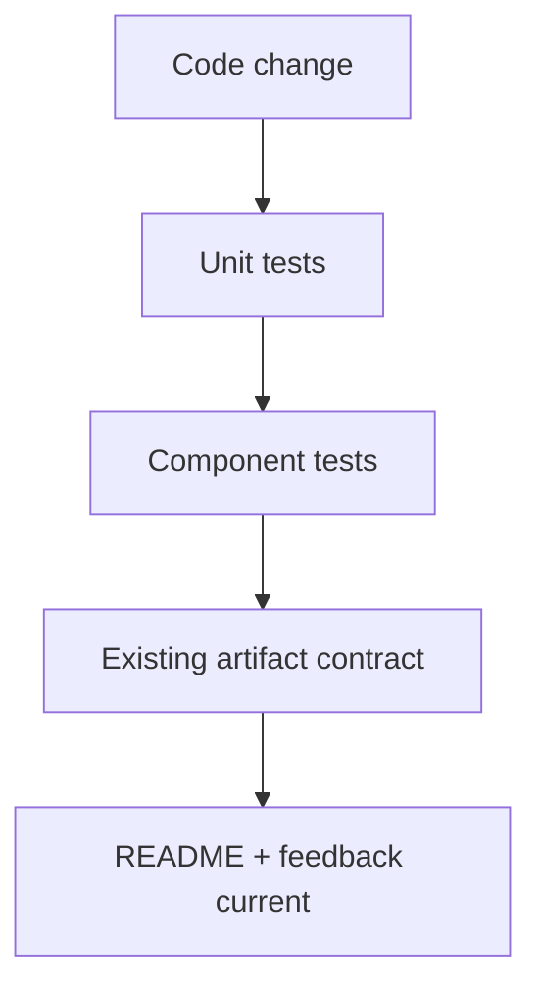

# Rezoluția evaluării constructive — contracte active

Acest document nu este jurnal al fixurilor. Păstrează numai criteriile pe care
următoarele refactorizări trebuie să le respecte și testele care trebuie să le
întărească. Formatul raportului rămâne în documentul lifecycle exclus din acest
audit.

## Principiul central



Un refactor este acceptat dacă schimbă ownership-ul intern fără să schimbe API-ul
public, verdictul, ierarhia observabilă sau formatul artifactului.

## Contracte normative active

| Contract | Owner | Test necesar |
|---|---|---|
| Core nu cunoaște Extent/HTML/CSS/selectors | `Atf.Core` | architecture boundary test |
| composition root-ul este `Atf.Api.TestHost` | TestHost | host boundary test |
| `Atf.Api` exprimă scenarii, nu infrastructură | `Atf.Api` | API composition test |
| un response are un singur model de validation și publisher | `Atf.Api/Module` | aggregate-table contract test |
| reporter failure nu schimbă rezultatul funcțional | `Atf.Api/Module` + `Atf.Reporting.Extent` | throwing-reporter matrix |
| warning-ul nu este promovat la failure și nu este pierdut la completion | Extent | `ExtentScopeStatusPolicyTests` |
| cleanup continuă după failure | `CleanupRegistry` | reverse-order lifecycle test |
| config runtime este immutable snapshot | `Atf.Core` | snapshot isolation test |
| două sesiuni nu împart ownership | Core/Extent | parallel-session component test |
| refactorul nu schimbă artifactul observabil | adapter | artifact contract regression |

## Contracte protejate și lucru activ

### Guardrail — seam-uri de reporting

`ExtentTestScope` rămâne fațadă pentru API-ul existent. Extragerile interne
implementate sunt:

```text
ExtentTestScope
  -> ExtentScopeTreeCoordinator
  -> ExtentScopeFrameStack
  -> ExtentScopeStatusPolicy
  -> ExtentScopeEvidenceWriter
```

Fiecare seam este testabil separat și nu importă reguli de business sau markup
suplimentar. `ExtentScopeTreeCoordinatorTests` acoperă phase boundary, invalid
transition și drain fără să compileze un document HTML.

Acest refactor este protejat și nu este backlog. Orice schimbare ulterioară
trebuie să păstreze aceeași fațadă publică și aceleași teste.

### Guardrail — evaluator versus publisher

```text
ApiResponse
  -> ResponseContract
  -> ValidationEvaluation
  -> ValidationOutcomePolicy
  -> ValidationTable
  -> ValidationReportPublisher
```

Evaluatorul nu scrie Extent. Politica nu cunoaște reporterul. Publisher-ul nu
decide validitatea și aplică doar efectele deciziei. Tabelul agregat este creat
o singură dată și rămâne autoritatea assertions. Acest seam este protejat prin
`ValidationEvaluatorTests` și `ValidationOutcomePolicyTests`; nu se redeschide
fără o regresie concretă.

### CON-01 — cleanup și lock lifecycle — closed, P1

- resource action rulează chiar dacă `StartStep`, tabelul sau `CompleteStep` eșuează;
- lock-ul nu acoperă filesystem I/O care poate bloca;
- reservation/path/asset ownership este eliberat la success, exception și cancellation;
- testele paralele verifică lipsa scurgerilor între sesiuni;
- bariera verificată pornește 20 de rezervări simultan, fără `Task.Delay` arbitrar.

Matricea filesystem este protejată de `ReportAssetCleanupCoordinatorTests`:
retry pentru lock și permisiune, failure epuizat fără gate leak, sesiuni cu
directoare distincte și cleanup repetat idempotent.

### CFG-01 — configuration rules — closed, P2

Regulile de config sunt independente și produc `AtfConfigurationException` cu
`Code + Path + Detail`. Snapshot-ul este singura valoare consumată de runtime,
iar testele acoperă URL/timeout, auth necunoscut, duplicate routes și
izolarea mutațiilor ulterioare.

### TEST-01 — separarea testelor mari — mitigated, P1 pentru viteza feedback-ului

`ReportThemeContractTests` separă deja theme/sanitizer de componenta generală.
Separarea client-behaviour și lifecycle trebuie continuată incremental, fără
schimbare de output:

```text
ExtentScopeTreeContractTests
ExtentEvidenceContractTests
ExtentThemeTokenTests
ExtentClientBehaviourContractTests
ExtentArtifactLifecycleTests
ExtentConcurrencyTests
```

Nu se copiază setup-ul și nu se adaugă o nouă abstracție doar pentru a reduce
numărul de linii dintr-o clasă.

## Matrice minimă de teste

| Componentă | Teste obligatorii |
|---|---|
| scope coordinator | nesting, async isolation, invalid transition, dispose idempotent |
| status policy | `Fail > Skip > Warning > Pass`, warning scoped pe phase, reporter failure secondary |
| validation evaluator | rows parțiale, invalid JSON, schema, relationship, warning și policy neutră |
| publisher | fiecare hook poate arunca fără mascarea rezultatului |
| cleanup | setup/body/teardown failure și acțiuni multiple în reverse order |
| configuration | invalid values, duplicates, immutable snapshot, parallel snapshots |
| artifact boundary | self-contained, no external `extent/`, stable semantic contract |
| architecture | Core fără Extent și TestHost ca singur bridge concret |

## Definition of done



Nu se folosește „toate testele verzi” ca unic criteriu. Un schimb este gata
numai când:

1. are un owner intern clar;
2. are cel puțin un test al seam-ului introdus;
3. păstrează formatul și verdicturile existente;
4. nu introduce aliasuri sau module generice noi fără boundary real;
5. actualizează documentația fără a copia istoricul rezolvat.
