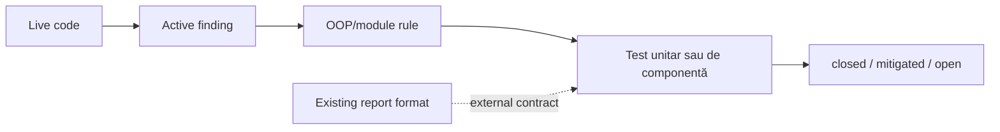

# ATF feedback — registru fără zgomot

Acest folder păstrează numai constatările active despre codul ATF, separarea
responsabilităților, teste și mentenanță. Nu este jurnal de implementare și nu
repetă probleme deja închise.

## Domeniu

Feedback-ul de aici acoperă:

- OOP, SRP și coeziunea claselor;
- direcția dependențelor și structura minimă de module;
- lifecycle, cleanup și concurență;
- contracte unit/component și matrice de regresie;
- datorii de toolchain și documentație.

Formatul raportului este în afara scope-ului. Documentul
`ATF_LIFECYCLE_COMBINATION_ANALYSIS_2026-10-13.md` rămâne referința separată
pentru format și nu este modificat de acest registru.



## Documente active

| Document | Rol |
|---|---|
| `ATF_LIVE_CODE_FEEDBACK_2026-10-13.md` | audit live, findings active și backlog |
| `CONSTRUCTIVE_EVALUATION_RESOLUTION.md` | contracte de acceptare pentru următoarele schimbări |
| `README.md` | index, scope și regulile acestui registru |

Documentele generale rămân în `docs/`:

- [`ATF_Architecture.md`](../ATF_Architecture.md) — ownership și dependențe;
- [`ATF_Refactoring_Assessment.md`](../ATF_Refactoring_Assessment.md) — roadmap OOP;
- [`ATF_Reporting_Contract.md`](../ATF_Reporting_Contract.md) — invariants de artifact;
- [`README_Atf_BestPractices.md`](../README_Atf_BestPractices.md) — reguli normative.

## Dovadă de regresie verificată

Ultima rulare offline verificată cu binarele curente a fost:

```text
Atf.Core.Tests:             91/91
Atf.Tests/Atf.Common.Tests: 67/67
Atf.Reporting.Extent.Tests: 119/119
Atf.Tests/Atf.Api.Tests:    52/52
Total:                      329/329
```

Aceste totaluri sunt dovadă pentru suitele offline. Staging-ul verificat este
`C:\work\ex\.net\.tmp\Atf-feedback-20261013-r14`; build-ul a trecut cu 0
warning și 0 error, API-ul cu 19 pass și 8 skip, iar failure-demo cu 4 fail
intenționate. Raportul a fost verificat în TAB MCP pe Overview, Tests, Fails,
Categories, expand/collapse, response details și Open in Tests. Notele nu se
păstrează în feedback; ele se recalculează live la fiecare audit.

## Taxonomia statusului

| Status | Înseamnă |
|---|---|
| `closed` | codul și testul protejează contractul; nu mai este backlog |
| `mitigated` | seam-ul este protejat, dar lipsește o dovadă sau o consolidare |
| `open` | există un risc activ și un test/owner trebuie adăugat |

O problemă închisă poate apărea o singură dată ca invariant de regresie; nu se
repetă în fiecare document cu explicații istorice.

## Structura minimă aplicată

```text
Atf.Core + Atf.Api + Atf.Api.TestHost + Atf.Reporting.Extent + Atf.Tests
```

`Atf.Api/Module` conține fostul modul `Atf.Common`, iar proiectele
`Atf.Api.Tests`, `Atf.Api.FailureDemos`, `Atf.Common.Tests`,
`Atf.Core.Tests` și `Atf.Reporting.Extent.Tests` sunt grupate sub
`Atf.Tests`. `Atf.Api.TestHost` rămâne separat ca composition root Extent.

## Regula pentru feedback nou

Fiecare intrare nouă trebuie să conțină:

1. `Status`: `open`, `mitigated` sau `closed`;
2. `Priority`: `P1` sau `P2`;
3. owner și fișierul responsabil;
4. testul care dovedește problema sau remedierea;
5. criteriul de acceptare;
6. impactul asupra formatului existent — de regulă „fără schimbare”.

Nu se adaugă un finding dacă nu schimbă o decizie, un test sau o responsabilitate.
Notele nu se persistă în aceste documente și se calculează numai în auditul live.
