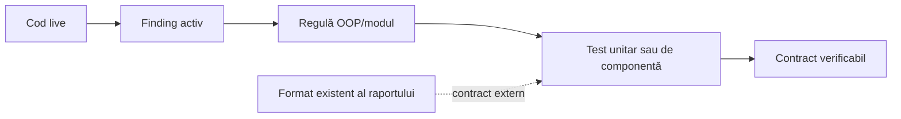

# ATF — registru de feedback, procedură și dovadă

Acest folder păstrează feedback-ul urmărit, starea contractelor și procedura de
închidere pentru codul ATF, separarea responsabilităților, teste și mentenanță.
Nu este jurnal de execuție, registru de scoruri sau sursa contractelor stabile;
informația normativă aparține README-urilor proiectelor și documentelor
permanente din `docs/`.

## Domeniu

Feedback-ul de aici acoperă:

- OOP, SRP și coeziunea claselor;
- direcția dependențelor și structura minimă de module;
- lifecycle, cleanup și concurență;
- contracte unit/component și matrice de regresie;
- datorii de toolchain și documentație;
- calitatea raportării, navigarea și contractele DOM;
- proiecția adnotărilor și politica tag-urilor de selecție;
- matrice de lifecycle și combinații de statusuri.

Contractul raportului este definit permanent în `docs/ATF_Reporting_Contract.md`
și rezumat în `Atf.Reporting.Extent/README.md`. În acest moment nu există TODO
activ în registrul de refactorizare; RF-02–RF-06 și contractele lifecycle LC-01
și LC-06 sunt închise. Feedback-ul nu redeschide un item fără o regresie
observabilă.



## Documente și roluri

| Document | Rol |
|---|---|
| `Atf_Lifecycle_Combination.md` | lifecycle, statusuri, assertions, Fails și proiecția raportului |
| `Atf_Refactoring_Feedback.md` | backlog-ul de TODO-uri noi pentru OOP, boundary-uri, ownership de stare și metadata de navigare |
| `Atf_Feedback_Execution_Guide.md` | procedura obligatorie, punctele de verificare și matricea TODO → teste → dovadă |
| `README.md` | index, scope și regulile acestui registru |

Documentele generale rămân în `docs/`:

- [`ATF_Architecture.md`](../ATF_Architecture.md) — ownership și dependențe;
- [`ATF_Reporting_Contract.md`](../ATF_Reporting_Contract.md) — invariants de artifact;
- [`README_Atf_BestPractices.md`](../README_Atf_BestPractices.md) — reguli normative.

## Regula dovezii

Dovezile se verifică la fiecare analiză live, din codul și testele disponibile
atunci. README-urile nu păstrează totaluri, căi tehnice temporare, nume de rapoarte,
capturi, scoruri sau rezultate intermediare. Un contract este considerat
protejat numai când owner-ul, testul și criteriul sunt identificabile.

Documentele de feedback descriu starea finding-urilor, acțiunile, testele și
criteriile de acceptare. Contractele stabile și diagramele normative apar în README-urile
proiectului și în documentele permanente din `docs/`; feedback-ul poate trimite
către ele, dar nu le înlocuiește.

## Contracte urmărite

Registrul urmărește permanent harness-ul DOM read-only, metadata secundară
colapsată, ierarhia `phase → request + validation`, evidence colapsat, selectorul
de tag-uri limitat la tag-uri de selecție și lista claselor fără pills sau
adnotări. Dovada trebuie să vină din cod, teste, artifact și DOM; nu se copiază
în acest index rezultate, căi de artifact sau stări intermediare.

## Procedura obligatorie

Orice TODO activ sau regresie nouă se rezolvă numai urmând [`Atf_Feedback_Execution_Guide.md`](Atf_Feedback_Execution_Guide.md).
Ghidul impune sincronizarea cu codul live, build/test în staging izolat, puncte de
verificare unit/componentă/artifact/DOM/paralel și Definition of Done. Pentru validarea
interactivă se folosește TAB MCP; browserul Windows nu face parte din procedură.

## Structura minimă aplicată

```text
Atf.Core + Atf.Api + Atf.Api.TestHost + Atf.Reporting.Extent + Atf.Tests
```

`Atf.Api/Module` conține fostul modul `Atf.Common`, iar proiectele
`Atf.Api.Tests`, `Atf.Api.FailureDemos`, `Atf.Common.Tests`,
`Atf.Core.Tests` și `Atf.Reporting.Extent.Tests` sunt grupate sub
`Atf.Tests`. `Atf.Api.TestHost` rămâne separat ca composition root Extent.

## Regula pentru adnotări și selectorul de tag-uri

`TagOrder` este numai o regulă de ordonare; nu este allowlist și nu trebuie
folosit ca substitut pentru politica de vizibilitate. Feedback-ul de
refactorizare separă explicit tag-urile de domeniu, markerii de lifecycle și
markerii de diagnostic/status. Selectorul principal trebuie să fie concis și
orientat pe navigare, în timp ce markerii tehnici rămân disponibili în evidence.

Adnotările afișate în detaliile unui test trebuie derivate din metadata scenariului,
nu prin reatașarea categoriilor la rădăcina clasei. Rădăcina clasei este container
de navigare: lista `Tests` din stânga arată doar clasa, statusul și durata și nu
afișează tag-uri, pills, strip-uri sau un atribut `tag` populat. Scenariul este
owner-ul semantic al tag-urilor și al statusului; tag-urile pot apărea în zona de
detalii din dreapta și în Overview, o singură dată și conform taxonomiei.
Detaliile și criteriile verificabile ale politicii sunt în README-urile de reporting
și în testele aferente. Documentul de lifecycle rămâne owner pentru
phase/status/assertion, nu pentru politica de adnotări.

## Regula pentru feedback nou

Fiecare intrare nouă trebuie să conțină:

1. contractul sau riscul descris clar;
2. `Priority`: `P1` sau `P2`;
3. owner și fișierul responsabil;
4. testul care dovedește problema sau remedierea;
5. criteriul de acceptare;
6. impactul asupra formatului existent — de regulă „fără schimbare”.

Nu se adaugă un finding dacă nu schimbă o decizie, un test sau o responsabilitate.
Prioritatea `P1/P2` ordonează munca; nu este scor și nu înlocuiește validarea
live.
